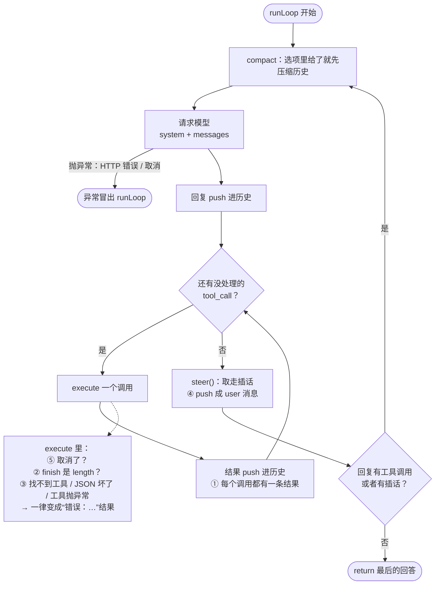

第 1 章你读过 mox 的 `runLoop`，它不到二十行就是一个能用的 Agent。但那二十行里有好几处看起来“多余”的东西：为什么每个调用都必须有结果？`finish === 'length'` 是干什么的？工具抛了异常为什么不让它冒出去？这一章把这些“多余”的行一行一行拿掉，看它们各自在防什么。

做法是五个情形，每个情形的模型回复都由脚本决定，交给三个实现：

- **v0**：一个稻草人。它就是 `runLoop` 把所有保护删光之后剩下的东西，只存在于 `labs/ch03/compare.ts` 里，用来演示，不是另一个 Agent。
- **mox**：`mox/src/loop.ts` 的真实代码，一行没改。
- **Pi**：Pi 真实的 `runAgentLoop`，模型换成 Pi 的 faux provider。

## 起点：把保护拿掉的 v0

v0 用第 1 章的消息格式，只保留“有工具调用就执行，没有就停”这一条主路径：

@code labs/ch03/compare.ts#naive

先确认成功路径没问题：

@lab node labs/ch03/compare.ts success | md

三个实现完全一致。问题都出在成功路径之外。

## 让它坏四次

@figure assets/course/ch03-four-failures.png 同一个循环的四种坏法：半截参数被执行、异常炸断循环、停不下来、插话被挡在门外

### 坏法一：输出被截断，半截参数照样执行

模型的单次输出有长度上限。如果在生成 `write` 的参数时撞到上限，参数的 JSON 就停在了半路。第 2 章说过，这时服务商会返回停止原因 `length`。

残缺的 JSON 最后变成什么，取决于谁来解析它。mox 里参数一直是**字符串**，要到执行前才 `JSON.parse`，被截断的字符串通常解析不了，会抛异常；但有几种情形它会是合法的：截断恰好落在两个调用之间（前一个调用的参数是完整的，却可能只是计划的前半部分），或者换了一个宽松解析残缺 JSON 的适配器（Pi 的流式预览就是这样补括号的）。实验模拟的是“参数合法，只是内容只写了一半”：模型给出的 JSON 格式正确，`content` 只有前一半。v0 不看停止原因：

@lab node labs/ch03/compare.ts truncated | md

v0 把半个文件写到了磁盘上，然后告诉用户“已写入”。模型以为写好了，用户也以为写好了。mox 和 Pi 多发了一次请求，最终写入的是完整内容——下面会看到它们是怎么做到的。

### 坏法二：工具抛异常，整个运行崩掉

@lab node labs/ch03/compare.ts missing | md

“文件不存在”是再普通不过的情况，模型完全有能力处理：换个文件，或者问用户。但 v0 让异常直接冲出了循环，模型根本没机会看到这个错误，已经积累的对话也一起丢了。

### 坏法三：模型不肯停

v0 只在模型“不再调用工具”时才停，**停不停完全由模型决定**。如果模型陷入“再确认一次”的循环：

@lab node labs/ch03/compare.ts runaway | md

先看前两列。实验加了一个安全阀，第 8 次请求后强行拦下；真实的 v0 会一直跑，直到把额度耗光。**mox 那一列和 v0 一样**：`runLoop` 里没有最大轮数，没有费用上限，也没有超时。这一点后面有专门的一节，先记住：它不是漏掉了，Pi 那一列也一样。

### 坏法四：用户中途插话，没人接

运行到一半，用户补了一句“只用一句话回答”。v0 的 `messages` 是函数内部的局部变量，外面根本递不进去：

@lab node labs/ch03/compare.ts steer | md

插话一直躺在队列里，模型给出了用户已经明确不想要的长篇介绍。

## 修好它：mox 的 runLoop 里每个保护在哪一行

下面是 mox 的完整循环。它和 v0 的区别集中在高亮的几行：

@code mox/src/loop.ts#runLoop hl=28,36-37,38-40

先看整条流程。每个保护都标了它防的是上面哪种坏法：

### ① 每个调用都有一条结果

第 37 行的 `for` 循环对回复里的**每一个**工具调用都 `push` 一条 `role: 'tool'` 的消息，不管 `execute` 里发生了什么。注释写得很直白：失败、拒绝、取消也一样，否则下一次请求不合法。这是服务商的硬性要求：assistant 消息里有 `tool_calls`，后面就必须跟着对应 `tool_call_id` 的结果，少一条整个请求被拒绝。后面所有保护，目的之一都是**让每个调用不管怎样都走到这一行 `push`**。

### ② 输出被截断：一个都不执行

`execute` 的第 49 行：`finish === 'length'` 就抛异常，工具函数根本不会被调用，磁盘上什么都不会发生。回到第 37 行，这个异常变成一条“错误：输出被截断，参数可能不完整，请重新调用”的结果。截断后循环**继续**（回复有工具调用），模型会看到这条结果并重新发起完整的调用。

注意 `finish` 是**整条回复**的属性，所以回复里的**所有**调用都被拒绝，而不是只跳过最后一个。截断发生在整条回复的末尾，看起来只有最后一个调用受影响，但你没有办法可靠地判断前面的调用是不是模型本来想要的完整计划的一部分：模型可能本打算“先删除旧文件，再写入新文件”，截断让第二步消失了，只执行第一步反而更糟。

下面的回放把这个过程拆成一步一步：

@trace node labs/ch03/trace.ts truncated

mox 的这道关其实有两层。第 52 行的 `JSON.parse` 是天然的第一道：残缺的参数字符串通常解析不了。第 49 行是第二道：它不依赖参数“长得对不对”，哪怕参数碰巧是合法的，只要整条回复是被截断的，就不执行。Pi 同样有两道关，只是第一道在提供商层：一个工具调用结束时，Pi 用 `parseToolCallArguments` **严格**解析完整的参数文本（只修复字符串里的非法转义，不补全缺失的括号），解析不了就把参数置为空对象，并把原因记在 `argumentsError` 里，工具校验时报错交还给模型：

@pi packages/ai/src/utils/json-parse.ts#parseToolCallArguments

### ③ 工具失败：变成一条结果

`execute` 的整个函数体包在一个 `try/catch` 里：

@code mox/src/loop.ts#execute hl=48-49,51,52,53-54,58-60

任何异常——文件不存在、模型“幻觉”出一个不存在的工具名（第 51 行）、参数 JSON 坏了（第 52 行）、`beforeTool` 拒绝了（第 53 至 54 行，理由就是给模型看的话）、`run` 本身抛出——都落进第 58 行的 `catch`，被写成 `错误：${message}`。mox 的 `bash` 工具在命令退出码不是 0 时同样抛异常，所以一条失败的命令（比如测试没过）对模型来说也是一条“错误”结果，文字里带着输出和退出码。`emit` 的 `tool_end` 事件带着 `error` 标记，界面据此把它画成红色的 ✗，但**写进历史的只是一段文字**：mox 的 `tool` 消息没有 `isError` 字段（OpenAI 格式没地方放），模型靠“错误：”这个前缀认出失败。

这是 Agent 设计里最基本的原则之一：**能变成消息的失败，就交回给模型。** 模型看到错误后通常能自己纠正：换个路径、修正参数、或者向用户说明情况。只有模型无法处理的失败（比如请求本身失败，第 29 行的 `options.model` 抛出的异常）才终止运行——这类异常 `runLoop` 不捕获，由调用方处理（第 2 章“失败的两种写法”）。

### ④ 插话：每轮工具执行完，问一次

第 38 至 39 行：所有工具结果放回历史之后，调用 `options.steer()` 取走用户这段时间插的话，每一条都 `push` 成 `user` 消息。第 40 行的退出条件因此是“没有工具调用，**并且**没有插话”：只要有插话，哪怕模型已经给出了最终回答，也要再请求一次，让模型看到它。插话紧跟在工具结果后面，下一次请求就能看到，所以 v0 那个“长篇介绍”不会出现。

### ⑤ 取消：signal 传给每一个地方

`options.signal` 被传给模型的 `fetch`、每个工具的 `run(args, signal)`，`execute` 开头还检查一次 `signal.aborted`（第 48 行）。后面有专门一节讲取消。

### 它们合在一起

用 `runLoop` 跑同样的五个情形，前四个坏法都不见了：

@lab node labs/ch03/compare.ts | md

## 停不下来怎么办：mox 和 Pi 都没有最大轮数

回到“坏法三”的表格，最后两列是同一个脚本在“宿主叫停”之后的样子。**mox 的 `runLoop` 没有轮数上限，Pi 的 `runLoop` 也没有**，两者都会一直转到模型自己不再调用工具。

这不是疏忽。最多跑几轮、花多少钱、多久超时，都是产品策略，不同的界面、不同的用户、不同的任务需要不同的答案。循环只提供机制，策略由宿主实现。关键是看循环给宿主留了哪些手：

| 宿主想做的事 | mox 里怎么做 | Pi 里怎么做 |
| --- | --- | --- |
| 数够轮数就叫停 | 在 `onEvent` 里数 `tool_end`（或 `message`），到数就 `controller.abort()`。`runLoop` 会在下一次请求时抛出 `AbortError`，宿主的 `catch` 里判断 `signal.aborted` 就知道是自己叫停的 | `finishTurn` 在每轮结束时被问一次，返回 `{ action: 'end' }` 就干净地结束，不抛异常 |
| 让它至少再试一次 | 没有对应的循环参数；用 `agent_end` 扩展事件：返回一句话，宿主把它当作新的用户消息再调一次 `runLoop`（下一节） | `finishTurn` 返回 `{ action: 'continue' }` |
| 压缩上下文 | `compact` 选项：循环每次请求前调用，可以就地改写 `messages` | `prepareNextTurn` 钩子：在两轮之间运行，可以替换上下文、切换模型 |
| 拒绝某个工具调用 | `beforeTool` 返回理由，变成错误结果；**循环照常继续**，所以它挡不住“不肯停” | 扩展事件 `tool_call`，同样变成错误结果 |

最后一行值得停一下。`beforeTool` 拒绝了调用，模型会看到“错误：…”，然后**换个办法再试**。如果你的预算策略是“用够了就拒绝所有工具”，模型很可能不断尝试，每一轮都白花一次请求。要真正停下来，必须取消，或者让循环退出——这两件事循环自己都不会替你做。

实验里两种叫停方式的差别也值得看一眼：mox 的叫停是一次**异常**（`runLoop` 没有返回值，最后的 `messages` 依然完整、合法，因为每个调用都有结果），Pi 的叫停是一次**正常返回**。前者的代码更少，后者让宿主不必区分“被叫停”和“出错了”。

::: note Pi 的三个钩子，在 mox 里去哪了
读 Pi 的 `runLoop` 会遇到三个 mox 没有的钩子：`finishTurn`（每轮结束时问宿主）、`getFollowUpMessages`（追加任务队列）、`prepareNextTurn`（两轮之间改上下文）。mox 的循环只有 `steer` 和 `compact` 两个“向宿主要东西”的选项，它们的职责落到了别处：`finishTurn` 的叫停 → 宿主用取消信号；`getFollowUpMessages` → 命令行里的 `agent_end` 事件（下一节）；`prepareNextTurn` 的压缩 → `compact` 选项。本章后面读 Pi 源码时，会回头对照这张去向表。
:::

## 插话和追加任务：mox 把后者放到了循环外面

用户在 Agent 运行时输入的内容有两种意图：

- **插话（steering）**：“只用一句话回答”“别改那个文件”——纠正正在进行的工作，越早让模型看到越好。
- **追加任务（follow-up）**：“做完之后再帮我写个测试”——不应该打断当前工作，等它告一段落再处理。

插话 mox 在循环里处理（上一节的 ④）。命令行里谁来提供这些话？看 `cli.ts` 读一行输入的地方：

@code mox/src/cli.ts#L148-L152 hl=151

运行中（`controller` 存在）输入的话，一律推进 `steering` 数组，由 `steer: () => steering.splice(0)` 在下一轮取走。mox 的命令行**没有“追加任务”队列**：你在运行中输入的每一句都是插话。

追加任务的位置在循环**外面**。`runLoop` 返回，意味着模型认为活干完了。这时命令行问一句：有没有下一句话？

@code mox/src/cli.ts#L124-L132 hl=130-131

`extensions.emit('agent_end', final)` 把最终回答交给所有扩展的 `agent_end` 处理器，第一个给出非空结论的赢；`extensions.text` 只认字符串，这个字符串被当作新的 user 消息，`while (text)` 回到上面再调一次 `runLoop`。扩展因此能做的比“一个队列”更多：它看得到最终回答，可以决定要不要继续。`cli.ts` 的注释举的例子就是“目标还没达成，让它接着干”。

两种设计各有道理，差别在**谁拥有这件事**：

| | mox | Pi |
| --- | --- | --- |
| 插话 | `steer` 选项，循环每轮取一次 | `getSteeringMessages`，循环每轮取一次 |
| 追加任务 | 循环**外面**：扩展的 `agent_end` 返回一句话，宿主再调一次 `runLoop` | 循环**里面**：`getFollowUpMessages`，在内层循环退出时取 |
| 一次“运行” | 追加任务每次是新的 `runLoop` 调用 | 追加任务属于同一次运行，同一个事件流 |
| 看得到最终回答吗 | 看得到（`agent_end(answer)`） | 看不到，只是取队列 |

下面的回放用两个队列的行为讲清楚这个顺序：

::: steps 插话与追加任务分别在哪一次请求出现
--- 运行开始：宿主把用户的任务 U 放进上下文，调用 `runLoop`。**第 1 次请求**里模型只看到 U，它要求读 README。
%%{init: {"sequence":{"width":110,"actorMargin":10,"messageFontSize":14,"noteFontSize":13,"actorFontSize":13,"mirrorActors":false,"boxMargin":6,"messageMargin":28,"noteMargin":6}}}%%
sequenceDiagram
  participant Q as 用户（插话 / 追加）
  participant L as runLoop
  participant M as 模型
  participant T as read
  participant H as 宿主（cli.ts + 扩展）
  rect rgb(255, 230, 213)
    H->>L: runLoop(messages = [U])
    L->>M: 请求 1：看到 U
    M-->>L: 调用 read
  end
--- 工具执行期间，用户同时输入了两句话：S（“只用一句话回答”，纠正方向）进了 `steer` 用的队列，F（“再列出 src 目录”，新任务）被扩展记在手里，等 `agent_end` 时才会交出来。两个队列都还没有被读取。
%%{init: {"sequence":{"width":110,"actorMargin":10,"messageFontSize":14,"noteFontSize":13,"actorFontSize":13,"mirrorActors":false,"boxMargin":6,"messageMargin":28,"noteMargin":6}}}%%
sequenceDiagram
  participant Q as 用户（插话 / 追加）
  participant L as runLoop
  participant M as 模型
  participant T as read
  participant H as 宿主（cli.ts + 扩展）
  H->>L: runLoop(messages = [U])
  L->>M: 请求 1：看到 U
  M-->>L: 调用 read
  rect rgb(255, 230, 213)
    L->>T: 执行 read
    Q->>Q: S 进插话队列，F 进扩展的待办
  end
--- 每个调用的结果放回历史后，循环调用 `options.steer()`，取走 S，作为 user 消息追加在工具结果后面。F 没有动。回复有工具调用，所以回到循环顶部。
%%{init: {"sequence":{"width":110,"actorMargin":10,"messageFontSize":14,"noteFontSize":13,"actorFontSize":13,"mirrorActors":false,"boxMargin":6,"messageMargin":28,"noteMargin":6}}}%%
sequenceDiagram
  participant Q as 用户（插话 / 追加）
  participant L as runLoop
  participant M as 模型
  participant T as read
  participant H as 宿主（cli.ts + 扩展）
  H->>L: runLoop(messages = [U])
  L->>M: 请求 1：看到 U
  M-->>L: 调用 read
  L->>T: 执行 read
  Q->>Q: S 进插话队列，F 进扩展的待办
  rect rgb(255, 230, 213)
    T-->>L: 工具结果
    L->>Q: steer() 取走 S，push 成 user 消息
  end
--- **第 2 次请求**里模型看到 U 和 S，于是只用一句话回答，没有再调用工具。这一轮既没有工具调用，`steer()` 也返回空，第 40 行 `return`：**这次 `runLoop` 结束了**，F 还在扩展手里。
%%{init: {"sequence":{"width":110,"actorMargin":10,"messageFontSize":14,"noteFontSize":13,"actorFontSize":13,"mirrorActors":false,"boxMargin":6,"messageMargin":28,"noteMargin":6}}}%%
sequenceDiagram
  participant Q as 用户（插话 / 追加）
  participant L as runLoop
  participant M as 模型
  participant T as read
  participant H as 宿主（cli.ts + 扩展）
  H->>L: runLoop(messages = [U])
  L->>M: 请求 1：看到 U
  M-->>L: 调用 read
  L->>T: 执行 read
  Q->>Q: S 进插话队列，F 进扩展的待办
  T-->>L: 工具结果
  L->>Q: steer() 取走 S，push 成 user 消息
  rect rgb(255, 230, 213)
    L->>M: 请求 2：看到 U、S
    M-->>L: 一句话回答，没有工具调用
    L-->>H: return 最后的回答
  end
--- 宿主拿着回答去问扩展：`extensions.emit('agent_end', final)`。扩展交出 F，宿主把它当作新的 user 消息，**再调用一次 `runLoop`**。
%%{init: {"sequence":{"width":110,"actorMargin":10,"messageFontSize":14,"noteFontSize":13,"actorFontSize":13,"mirrorActors":false,"boxMargin":6,"messageMargin":28,"noteMargin":6}}}%%
sequenceDiagram
  participant Q as 用户（插话 / 追加）
  participant L as runLoop
  participant M as 模型
  participant T as read
  participant H as 宿主（cli.ts + 扩展）
  H->>L: runLoop(messages = [U])
  L->>M: 请求 1：看到 U
  M-->>L: 调用 read
  L->>T: 执行 read
  Q->>Q: S 进插话队列，F 进扩展的待办
  T-->>L: 工具结果
  L->>Q: steer() 取走 S，push 成 user 消息
  L->>M: 请求 2：看到 U、S
  M-->>L: 一句话回答，没有工具调用
  L-->>H: return 最后的回答
  rect rgb(255, 230, 213)
    H->>H: emit('agent_end') → 扩展返回 F
    H->>L: runLoop(messages = [U … S … 回答, F])
  end
--- **第 3 次请求**里模型看到 U、S、F，回答完毕。宿主再问一次 `agent_end`，扩展没有更多了，整次运行结束。S 在第 2 次请求出现，F 在第 3 次出现，和实验输出一致。
%%{init: {"sequence":{"width":110,"actorMargin":10,"messageFontSize":14,"noteFontSize":13,"actorFontSize":13,"mirrorActors":false,"boxMargin":6,"messageMargin":28,"noteMargin":6}}}%%
sequenceDiagram
  participant Q as 用户（插话 / 追加）
  participant L as runLoop
  participant M as 模型
  participant T as read
  participant H as 宿主（cli.ts + 扩展）
  H->>L: runLoop(messages = [U])
  L->>M: 请求 1：看到 U
  M-->>L: 调用 read
  L->>T: 执行 read
  Q->>Q: S 进插话队列，F 进扩展的待办
  T-->>L: 工具结果
  L->>Q: steer() 取走 S，push 成 user 消息
  L->>M: 请求 2：看到 U、S
  M-->>L: 一句话回答，没有工具调用
  L-->>H: return 最后的回答
  H->>H: emit('agent_end') → 扩展返回 F
  H->>L: runLoop(messages = [U … S … 回答, F])
  rect rgb(255, 230, 213)
    L->>M: 请求 3：看到 U、S、F
    M-->>L: 回答 F，没有工具调用
    L-->>H: return
    H->>H: emit('agent_end') → 没有下一句，结束
  end
:::

实验让用户在工具执行期间同时插话（S）和追加任务（F），模型每次回复都报告它看到了哪些用户消息。mox 这一边，F 走的是真的 `loadExtensions` 装进去的 `agent_end` 处理器，外层的 `while` 照抄 `cli.ts`：

@lab node labs/ch03/queues.ts

S 在第 2 次请求里就出现了，紧跟在工具结果后面；F 要等模型对“原任务 + 插话”给出回答之后，才在第 3 次请求里出现。两种做法的消息顺序完全一致，区别只在 F 是循环里的一个队列，还是循环外的一次续跑。

::: compare Claude Code 里的同一个设计
Claude Code 的官方文档描述了完全相同的行为：在 Claude 工作时输入一句纠正并回车，消息会先排队；如果 Claude 正在执行工具，它会**在这些工具执行完之后、同一轮之内**读到这条消息，并据此调整下一步。按 Esc 则是立刻停止（取消），排队的消息随后发出。（[How Claude Code works · Interrupt and steer](https://code.claude.com/docs/en/how-claude-code-works)）
:::

## 对照 Pi 的 runLoop

现在打开 Pi 的 `runLoop`。完整函数约 160 行，先整体浏览一遍：

@pi packages/agent/src/agent-loop.ts#runLoop

骨架和 mox 一一对应，只是 Pi 有**两层循环**：内层处理“工具结果和插话”，外层在内层退出、本该结束的时候看一眼有没有追加任务。mox 的循环只有一层，外层被搬到了命令行里。逐段看几个关键位置。

**外层与内层循环**，以及启动时先查一次插话队列（用户可能在 Agent 准备期间就已经输入了）：

@pi packages/agent/src/agent-loop.ts#L184-L192

**失败的回复**：Pi 的适配器不抛异常（第 2 章），失败编码在 `stopReason` 里。循环看到 `error` 或 `aborted` 就结束，**不执行这条回复里的任何工具调用**，一条失败的回复里的工具请求是不可信的；它仍然调用 `finishTurn` 通知宿主（让宿主有机会记录和清理），但不采纳它的返回值。mox 没有这一段，因为失败在它那里是异常，根本到不了这里：

@pi packages/agent/src/agent-loop.ts#L254-L265

**截断时的错误结果**由一个专门的函数生成。它对每个调用都发出“开始执行”和“执行结束”事件，所以界面上能看到这个工具“执行失败了”，而不是悄悄消失。对应 mox 的 `execute` 第 49 行：

@pi packages/agent/src/agent-loop.ts#failToolCallsFromTruncatedMessage

截断时 Pi 的注释说得很直接：为什么是所有调用都不执行，而不是只跳过最后一个：

@pi packages/agent/src/agent-loop.ts#L272-L281

**每轮结束时的决策顺序**：先问宿主，再取插话；工具结果或插话已经足以引出下一轮时，清除“额外继续”标记。mox 对应的就是第 38 至 40 行，少了“问宿主”那一步：

::: tabs
@@ Pi
@pi packages/agent/src/agent-loop.ts#L295-L308
先问宿主（`finishTurn`），再取插话；已经会有下一轮时清除“额外继续”。
@@ mox
@code mox/src/loop.ts#L38-L40
取插话，有工具调用或插话就回到顶部。没有“问宿主”这一步。
:::

**外层的收尾**：先取追加任务，再处理宿主要求的“额外继续”，都没有才结束：

::: tabs
@@ Pi
@pi packages/agent/src/agent-loop.ts#L310-L327
先取追加任务，再处理“额外继续”，都没有才退出循环。
@@ mox
@code mox/src/cli.ts#L129-L132
循环外面：`runLoop` 返回后问 `agent_end`，有下一句就再来一轮。
:::

| 编号 | mox | Pi |
| --- | --- | --- |
| ① 每个调用都有结果 | 第 37 行的 `for` 循环，`execute` 永远有返回值 | `executeToolCalls`，每个调用都有结果消息 |
| ② 截断不执行 | `execute` 里 `finish === 'length'` 抛异常，变成错误结果 | `failToolCallsFromTruncatedMessage`，并发出执行事件 |
| ③ 异常变结果 | `execute` 的 `try/catch` | `executeToolCalls` 内部的 catch（第 4 章细读） |
| 失败的回复 | 模型函数抛异常，冒出 `runLoop` | 看 `stopReason`，`error` / `aborted` 直接结束，不执行其中的工具调用 |
| 宿主叫停 | 没有；宿主取消（抛 `AbortError`） | `finishTurn` 返回 `{ action: 'end' }` |
| ④ 插话 | `steer` | `getSteeringMessages` |
| 追加任务 | 循环外：`agent_end` 扩展事件 | `getFollowUpMessages` |

### Pi 比 mox 多做的事

mox 的循环约 40 行（含 `execute`），Pi 的约 160 行。多出来的部分每一项都对应一个真实需求：

**两个准备钩子。** `prepareNextTurn` 在两轮之间运行，可以替换上下文、切换模型——上下文压缩（第 8 章）就在这里发生。因为它可能很耗时，结束后会再查一次插话队列，让准备期间输入的消息赶上这一轮。`prepareRequest` 在请求发出前做最后的调整，它不再查队列。mox 的 `compact` 选项做同一件事：`runLoop` 每次请求前 `await options.compact?.(messages)`（第 28 行），由它就地改写 `messages`。区别是 mox 的 `compact` 之后不再查 `steer`：压缩期间输入的话，要等这一轮的回复和工具都执行完（第 38 行）才进入历史；Pi 在准备钩子结束后会再查一次，让这些话赶上这一轮的请求：

@pi packages/agent/src/agent-loop.ts#L193-L216

**细粒度的事件。** mox 只有 `text`、`message`、`tool_start`、`tool_end` 四种事件。Pi 区分开始、增量更新和结束，工具执行也有开始、进度和结束。终端界面就是靠这些事件实时刷新的，会话文件则在 `message_end` 时写入（第 0 章看过）：

@pi packages/agent/src/types.ts#L528-L551

**队列的投递模式。** mox 的插话队列每次取出全部消息。Pi 的 `Agent` 类默认**每次只取一条**（`one-at-a-time`），也可以配置成一次取全部（`all`）：

@pi packages/agent/src/agent.ts#L149-L176

两种模式的区别在于模型对每条插话是否有单独回应的机会。用户连续说了“改成英文”和“标题也改一下”：逐条投递时，模型先处理第一条，第二条在下一轮出现；一次投递时，模型在同一次回复里同时处理两条。前者更可控，后者省一次请求。

**从已有会话继续。** 恢复一个会话时，如果最后一条消息是模型的回答，直接重发同样的历史没有意义——模型没有新的输入。Pi 的 `continue()` 会先看队列里有没有插话或追加任务，有就以它们作为新输入开始运行，没有就拒绝：

@pi packages/agent/src/agent.ts#L395-L420

## 取消：按下 Ctrl+C 之后发生了什么

停止权还有最后一种形式：用户主动取消。它和叫停不同——叫停只在宿主有机会的时候发生，而取消可能发生在任何时刻：模型正在生成，或者一个命令正在运行。

两边的做法是一样的：**每次运行一个 `AbortController`**。运行开始时创建，取消就是调用它的 `abort()`。mox 的命令行在第 122 行创建它，传给 `runLoop`（第 129 行），Ctrl+C 的处理只有一行：`rl.on('SIGINT', () => (controller ? controller.abort() : exit()))`，运行中就取消，空闲时才退出：

@code mox/src/cli.ts#L120-L129 hl=122,129

Pi 的 `Agent` 也是同样的结构：

@pi packages/agent/src/agent.ts#L517-L537

同一个 `signal` 被传给模型的流式请求、每一个工具、以及钩子。模型的请求收到信号后中断 HTTP 连接。这里两边分道扬镳了：Pi 的回复停止原因变成 `aborted`，循环按“失败的回复”规则正常返回；mox 的 `fetch` 抛出 `AbortError`，`runLoop` 直接抛出。

::: steps 按下 Ctrl+C 之后：信号传到哪里，谁会停下
--- 宿主为这次运行创建一个 `AbortController`，**同一个 signal** 传给 `runLoop`，`runLoop` 再传给模型请求和每一个工具的 `run(args, signal)`。模型回复了一个 `long_task` 调用，工具开始执行，需要 2 秒。
%%{init: {"sequence":{"width":110,"actorMargin":10,"messageFontSize":14,"noteFontSize":13,"actorFontSize":13,"mirrorActors":false,"boxMargin":6,"messageMargin":28,"noteMargin":6}}}%%
sequenceDiagram
  participant U as 用户
  participant L as runLoop
  participant T as 工具（2 秒）
  participant M as 模型
  rect rgb(255, 230, 213)
    L->>T: run(args, signal)
    Note over T: 预计 2000ms 后完成
  end
--- 100 毫秒时用户按下 Ctrl+C：宿主调用 `abort()`。信号只是一个**通知**，此刻工具仍在运行，循环没有办法强行打断它。
%%{init: {"sequence":{"width":110,"actorMargin":10,"messageFontSize":14,"noteFontSize":13,"actorFontSize":13,"mirrorActors":false,"boxMargin":6,"messageMargin":28,"noteMargin":6}}}%%
sequenceDiagram
  participant U as 用户
  participant L as runLoop
  participant T as 工具（2 秒）
  participant M as 模型
  L->>T: run(args, signal)
  Note over T: 预计 2000ms 后完成
  rect rgb(255, 230, 213)
    U->>L: Ctrl+C → abort()
    L-->>T: signal 触发
  end
--- **监听信号的工具**收到通知后清掉计时器、抛出“已取消”，约 100ms 就返回；`execute` 把它变成一条“错误：已取消”的结果。**不理会信号的工具**对通知视而不见，跑满 2 秒，结果显示成功。如果这条回复里还有后面的调用，`execute` 开头的 `signal.aborted` 检查会让它们直接得到“用户取消了”，不会开始运行。
%%{init: {"sequence":{"width":110,"actorMargin":10,"messageFontSize":14,"noteFontSize":13,"actorFontSize":13,"mirrorActors":false,"boxMargin":6,"messageMargin":28,"noteMargin":6}}}%%
sequenceDiagram
  participant U as 用户
  participant L as runLoop
  participant T as 工具（2 秒）
  participant M as 模型
  L->>T: run(args, signal)
  Note over T: 预计 2000ms 后完成
  U->>L: Ctrl+C → abort()
  L-->>T: signal 触发
  rect rgb(255, 230, 213)
    T-->>L: 监听：100ms 返回错误 不监听：2000ms 返回成功
  end
--- 工具一返回，循环带着结果再请求一次模型。此时信号已经是 aborted，模型的 `fetch` 立刻抛出 `AbortError`。`runLoop` 不捕获它，**异常一路冒出**，宿主的 `catch` 看到 `signal.aborted`，打印“已取消”。取消是协作式的：循环能做的只是把信号传到每一个地方。
%%{init: {"sequence":{"width":110,"actorMargin":10,"messageFontSize":14,"noteFontSize":13,"actorFontSize":13,"mirrorActors":false,"boxMargin":6,"messageMargin":28,"noteMargin":6}}}%%
sequenceDiagram
  participant U as 用户
  participant L as runLoop
  participant T as 工具（2 秒）
  participant M as 模型
  L->>T: run(args, signal)
  Note over T: 预计 2000ms 后完成
  U->>L: Ctrl+C → abort()
  L-->>T: signal 触发
  T-->>L: 监听：100ms 返回错误 不监听：2000ms 返回成功
  rect rgb(255, 230, 213)
    L->>M: 请求（signal 已 aborted）
    M--xL: 抛出 AbortError
    Note over L: runLoop 抛出，运行结束
  end
:::

但信号只是一个**通知**。JavaScript 没有办法强行中断一段正在运行的代码，工具必须自己监听信号并提前退出。这个实验让模型调用一个需要 2 秒的工具，用户在 100 毫秒时取消，对比一个监听信号的工具和一个不理会信号的工具：

@lab node labs/ch03/abort.ts | md

监听信号的工具在 100 毫秒时就退出了，运行随即结束（mox 是抛出 `AbortError`，Pi 是 `aborted` 消息）。不理会信号的工具一直跑满 2 秒，期间用户按了 Ctrl+C 却什么都没发生——而且它的结果显示“成功”，因为工具确实做完了。mox 和 Pi 在这一点上表现一致：**取消是协作式的，循环能做的只是把信号传到每一个地方。**

表格下面那一行是 mox 的一个细节：一条回复里请求了两个调用，取消发生在第一个调用运行期间，第二个根本没有开始（`execute` 第 48 行的检查），但它**依然有一条结果**（“用户取消了”）。这就是 ① 的意义：哪怕运行马上就要因为取消而终止，历史也是合法的，`session.ts` 把它存下来、下次 `mox -c` 恢复，请求不会因为缺结果被拒绝。

这对写工具的人提出了要求：任何可能耗时的工具都应该接收 `signal`，把它传给 `fetch`、子进程或者自己的等待逻辑。mox 自己的 `bash` 工具就是个例子，它为取消专门写了几行：

@code mox/src/tools.ts#L84-L92 hl=87,89,91-92

`detached: true` 让 bash 成为**新进程组的组长**；取消（或超时）时 `kill` 向 `-child.pid`，也就是整个进程组发 `SIGKILL`，bash 以及它启动的所有子进程一起结束。为什么要这么麻烦？因为“终止 bash”不等于“终止 bash 启动的一切”。实验用 `sleep 40; echo done` 做命令：bash 是父进程，`sleep` 是它的子进程，100 毫秒时取消，300 毫秒后检查 `sleep` 还在不在：

@lab node labs/ch03/abort-bash.ts | md

朴素写法只给 `spawn` 一个 `signal` 选项：Node 对直接启动的 bash 发 `SIGTERM`，`sleep` 却继续跑，工具早就返回了“已取消”，系统里还留着一个孤儿进程。真实的场景是 `npm test`：取消之后它的子进程会继续在后台占着 CPU、改着文件。mox 用进程组解决了这个问题，Pi 的 `bash` 杀掉整个进程树，做法不同，效果一样：

@pi packages/coding-agent/src/core/tools/bash.ts#L124-L143

第 5 章读 Pi 的 `read` 工具时，会看到它在每个可能阻塞的位置都检查了信号。

## 你来改

每道题先写下预测，再动手验证。改 `mox/` 里的文件之前先看一眼 `git -C mox status`，做完用 `git -C mox checkout .` 还原。

::: predict 删掉截断检查
把 `mox/src/loop.ts` 里 ② 的判断去掉（删掉第 49 行 `if (finish === 'length') throw …`）。运行 `node labs/ch03/compare.ts truncated`，mox 一列的请求次数和磁盘上的文件会变成什么？
???
请求次数从 3 变成 2，磁盘上只剩半截内容，和 v0 一模一样。工具执行本身是成功的，模型拿到“写入成功”，也就不会再发一次完整调用。这说明截断检查必须放在**执行之前**——执行之后再补救已经晚了，副作用已经发生。（实验里的参数是合法 JSON，所以第 52 行的 `JSON.parse` 没能拦住；真实的残缺参数通常拦得住，但你不能赌这一点。）
:::

::: predict 给 mox 装一个“最多 3 次工具调用”
不改 `runLoop`，让“不肯停”的情形在累计 3 次工具调用之后就停下，用 `beforeTool` 来实现：数到第 4 次就返回一个理由字符串拒绝它。请求次数会是 3 吗？
???
不会。`beforeTool` 拒绝的是**这一次调用**，不是整个运行：返回理由后，`execute` 把它变成一条错误结果，循环照常继续，模型看到“错误：已达到上限”之后很可能再试一次，被拒，再试……直到安全阀拦下。要真正停下来，要在 `onEvent` 里数 `tool_end` 然后 `controller.abort()`（`compare.ts` 里“mox + 宿主取消”那一列就是这样做的），或者在 `compact` 钩子里抛异常。叫停和拒绝是两件事，这也是 Pi 要单独给一个 `finishTurn` 的原因。
:::

::: predict 把插话改成追加任务
在 `labs/ch03/compare.ts` 的 `mox()` 里，不用 `steer`，改成让一个 `agent_end` 处理器返回 `world.steering.shift()`，再像 `queues.ts` 那样在外面套一层 `while`。运行 `node labs/ch03/compare.ts steer`。mox 要请求几次？用户会先看到什么？
???
请求 3 次，最终回答仍然是一句话。但在那之前，第 2 次请求已经生成了一段长篇介绍，因为那时插话还没有进入历史，要等 `runLoop` 返回之后才被取出。用户先看到不想要的长答案，再看到短答案。这就是“纠正方向”必须走 `steer`、不能走 `agent_end` 的原因。
:::

::: predict 去掉 bash 的 detached: true
把 `mox/src/tools.ts` 里 `spawn('bash', ['-c', command], { cwd, detached: true })` 的 `detached: true` 去掉，其余不动。模型调用 `bash` 运行 `sleep 2; echo done`，用户在 100 毫秒时取消，工具什么时候返回？返回什么？
???
大约 2 秒之后才返回，而且返回的文字是“done … [已取消]”：取消**完全没有生效**，命令一直跑到自己结束。原因是 `kill` 向 `-child.pid` 发信号，这只有在 child 是进程组组长时才有意义；没有 `detached`，bash 和 mox 在同一个进程组里，`process.kill(-pid)` 找不到这个组，抛出的异常被 `try {} catch {}` 吞掉了，什么都没杀。`stopped` 却已经被设成了“已取消”，所以最后的文字还会写上这几个字。这是“信号只是通知”的又一个例子：通知发出去了，不等于有人收到。
:::

## 面试题

先自己回答，再展开对照要点。

::: interview Agent Loop 的停止条件有哪些？谁有权决定停止？
至少四类：

1. **模型认为完成**：回复里没有工具请求（mox 还要求没有待处理的插话）。
2. **响应失败**：错误或用户取消。Pi 把它们编码成消息的 `stopReason`，循环直接结束；mox 里它们是异常，冒出循环。两种都不执行其中的工具调用。
3. **宿主决定**：根据策略（轮数、成本、时间、重复检测、测试是否通过）叫停，或者强制再继续一轮。Pi 提供 `finishTurn`；mox 靠取消信号叫停，靠 `agent_end` 事件续跑。
4. **队列为空**：没有待处理的插话和追加任务。

关键观点：停止权不能只在模型手里。循环提供机制（决策点、取消信号），具体策略由宿主实现，所以生产级循环本身通常没有写死的轮数上限。mox 和 Pi 都是这样。
:::

::: interview 模型输出被截断时应该怎么处理？为什么所有工具调用都不执行？
看停止原因：截断时（`length` / `max_tokens`）文字可以保留，但**其中的所有工具调用都不执行**，而是为每个调用生成一条错误结果，说明参数可能不完整，让模型重新发起。循环继续，模型下一轮会发出完整调用。

全部不执行的原因：被截断的参数在语法上可能完全合法，执行后果不可预测；而且截断可能破坏了一组调用的完整性，只执行其中一部分可能比都不执行更糟。检查必须在执行之前，副作用一旦发生就无法补救。加分点：别指望 `JSON.parse` 失败来兜底，它只能拦住“恰好残缺”的参数。
:::

::: interview 工具执行失败时，Agent 应该怎么处理？
把失败转换成一条带错误标记的工具结果，交回给模型，而不是让异常终止运行。模型通常能自己纠正：换路径、修参数、或者告诉用户。mox 的做法是 `execute` 外面一个 `try/catch`，把一切异常写成“错误：…”；Pi 的结果消息带结构化的 `isError`。

需要区分两类失败：工具层面的失败（文件不存在、命令返回非零）交给模型；系统层面的失败（模型请求本身失败、被取消）才终止运行。还要处理模型调用不存在的工具、参数不符合格式等情况，同样作为错误结果返回。无论怎样，**每个工具调用都必须有一条对应的结果**，否则下一次请求会被服务商拒绝。
:::

::: interview 用户在 Agent 运行过程中发送消息，应该怎么处理？
区分两种意图：

- **插话（steering）**：纠正正在进行的工作。在每轮工具执行完之后取出，下一次请求就能看到。不打断正在执行的工具。
- **追加任务（follow-up）**：等当前工作告一段落（循环本该结束时）才取出。可以做成循环里的第二个队列（Pi），也可以放在循环外，由 Agent 结束时的事件续跑（mox 的 `agent_end`）。

还要考虑投递粒度（逐条还是一次全部）、准备阶段（比如压缩）期间到达的消息能否赶上当前轮、以及“立即停止”是另一个操作（取消），不应和插话混在一起。Claude Code 的“回车排队”和“Esc 停止”就是这两种操作。
:::

::: interview 如何防止 Agent 无限循环或成本失控？
在宿主层实现策略，通过循环提供的决策点生效：

- 每轮结束时检查累计轮数、token 用量、费用、耗时，超过上限就结束（Pi 的 `finishTurn`；mox 在事件回调里数，够了就取消）；
- 检测重复：连续多次相同的工具调用和相同的参数，判定为卡住；
- 给工具执行设置超时，给整个运行提供取消信号；
- 把上限暴露给用户配置，而不是写死在循环里。

注意“拒绝工具调用”不是叫停：权限钩子拒绝的只是那一次调用，模型会换个办法再试。加分点：说明为什么不把上限写进循环本身（策略随产品而变，循环只提供机制），以及截断、失败等情况下的重试本身也要计入预算。
:::

::: interview 用户取消一次运行时，Agent 应该怎么处理？
每次运行创建一个取消控制器（`AbortController`），把同一个信号传给模型请求、所有工具和钩子：

- 模型请求收到信号后中断连接：Pi 把它编码成 `aborted` 的回复，mox 抛出 `AbortError`；两者都不会再执行其中的工具调用；
- 正在执行的工具负责响应信号：中断网络请求、杀掉子进程（要杀整个进程树，而不是只杀 shell：mox 让命令独占一个进程组再整组杀掉，Pi 杀整个进程树）；
- 取消是协作式的，不响应信号的工具会一直跑完，所以写工具时要把信号传到每个可能阻塞的地方；
- 取消发生时，一条回复里还没开始的调用也要有结果，历史才是合法的；
- 已经发生的副作用无法撤销，需要配合检查点或版本控制（第 16 章）。

加分点：区分“取消”与“插话”（插话不打断正在执行的工具）；说清楚取消后排队的消息怎么处理——Pi 把它们退回输入框，Claude Code 的文档说会在停止后接着发送它们。两种规则都合理，关键是要有明确的规则。
:::
