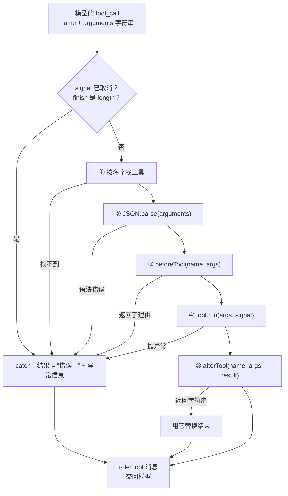

第 3 章的循环里有一句 `await execute(call, ...)`，当时只当它是“调用工具，出错就变成错误结果”。这一章把这句话展开。我们先看 mox 里一个工具到底由什么组成，再用几个会出错的调用去撞它的边界，最后读 Pi 在同样的位置多做了什么。

mox 的做法非常朴素：参数只做 `JSON.parse`，工具一个接一个执行，结果只有一个字符串。这些取舍都不是疏忽。650 行的 Agent 要保持能读完，就只能在这里省。但“省”的代价会在真实模型面前显出来：模型把 `offset` 写成字符串 `"3"`，mox 不会报错，只会悄悄多读几行，还丢掉“后面还有”的提示。**这一章的每一节都按同一个顺序走：mox 怎么做、构造一个让它失败的场景、Pi 怎么做**。校验和并行这两个缺口，最后做成两个“你来改”。

## mox 的工具：一个 JSON Schema 加一个函数

一个工具对两个读者说话。对**模型**，它是一份说明书：名字、用途、参数格式，模型只能看到这三样。对**程序**，它是一个函数。mox 的 `Tool` 类型把这两半直接拼在一起：

@code mox/src/loop.ts#L4-L20 hl=4,16,17

第 4 行就是全部定义：`ToolSpec`（`name`、`description`、`parameters`，由 `runLoop` 原样发给模型）加一个 `run`。`run` 收到解析好的参数和取消信号，返回一个字符串，同步异步都行。没有别的字段了。没有“这个工具能不能并行”的声明，没有给界面显示的标签，也没有“这次调用是不是失败了”的标记。

再看一个真实的工具是怎么写的。`read` 的定义在 `codingTools` 里：

@code mox/src/tools.ts#L29-L44 hl=32,33,36,41

`parameters` 是一份普通的 JSON Schema（`object()` 只是把 `{ type: 'object', properties, required }` 拼好），`run` 里直接解构参数。注意第 33 行的 `offset = 1`：默认值是 `run` 自己处理的，没有任何一层替它检查 `offset` 是不是数字；第 36 行用 `offset - 1 + limit` 算切片的终点，第 41 行用 `offset + count` 算下一段从哪里开始，这两处如果碰上字符串，结果会怎样，下面的实验会看到。

Pi 的工具类型把同一个设计做得更厚：

@pi packages/agent/src/types.ts#L478-L511

除了发给模型的三个字段，`label` 给界面显示，`prepareArguments` 修正参数，`executionMode` 控制并发，`execute` 真正干活。工具的返回值也分成两部分：

@pi packages/agent/src/types.ts#L423-L446

`content` 发给模型，`details` 留给界面和日志，另外还有 `isError` 和 `terminate`。注释里有一条约定值得记住：报告失败要么抛异常，要么返回 `isError: true`，**不要只在 `content` 里用文字描述失败**，因为界面、钩子、统计都靠这个标记判断成败。

| | mox | Pi |
| --- | --- | --- |
| 给模型的部分 | `name` `description` `parameters` | 同样三项 |
| 给程序的部分 | `run`（一个函数） | `execute`、`prepareArguments`、`executionMode`、`label` |
| 返回值 | 一个字符串 | `content` + `details` + `isError` + `terminate` |
| 怎样表示失败 | 抛异常，由 `execute` 加上“错误：”前缀 | 抛异常，或返回 `isError: true` |

mox 的结果里没有 `isError`，失败只体现在文字前缀“错误：”上。`tool_end` 事件里有一个 `error` 布尔值，界面据此画红色的 ✗，但写进历史的那条 `role: 'tool'` 消息只有文字。

## 一次工具调用要过的五步

模型发来一个工具调用，到结果交回模型之前，`execute` 做了这些事：



代码就是这张图的直译：

@code mox/src/loop.ts#execute hl=48,49,50,51,52,53,54,55,56,58,59

读这段代码，抓住三件事：

**所有失败走同一个出口。** 第 47 到 60 行是一个大 `try`。取消了、输出被截断了（第 3 章）、工具不存在、`JSON.parse` 失败、被钩子拒绝、工具函数抛异常，全部走到第 59 行：`result = 错误：${message}`。模型看到的永远是一条以“错误：”开头的文字，所以**异常信息本身就是写给模型的反馈**。这也是为什么 `edit` 找不到 `old` 时抛的是“old 在文件里找不到，先 read 再改”，而不是一个技术性的堆栈（第 5 章）。

**`beforeTool` 在 `JSON.parse` 之后、`run` 之前。** 它拿到的是解析好的参数对象，返回字符串就等于拒绝：第 54 行把理由包成异常，走同一个出口。`afterTool` 只在 `run` 成功之后才调用，第 56 行的 `||` 意味着返回空字符串不会替换结果。失败的调用不会经过 `afterTool`。

**每个调用都必须有一条结果。** `execute` 无论怎样都返回一个字符串，`runLoop` 把它写成 `role: 'tool'` 消息。少一条，下一次请求就会被服务商拒绝（第 3 章“每个调用都有结果”）。

下面用一个写错参数的调用，看它怎样过关：

::: steps 一个写错参数的调用怎样过 mox 的五步
--- 模型发来 `read`，参数是 `{"file":"a.txt","limit":"20"}`：参数名写成了 `file`，`limit` 写成了字符串。
flowchart LR
  C["tool_call"]:::on --> G1["① 找工具"]:::dim --> G2["② JSON.parse"]:::dim --> G3["③ beforeTool"]:::dim --> G4["④ run"]:::dim --> G5["⑤ afterTool"]:::dim --> T["tool 消息"]:::dim
  G1 -.-> E["错误：…"]:::dim
  G2 -.-> E
  G3 -.-> E
  G4 -.-> E
  E --> T
--- **① 找到工具。** `read` 在工具表里，继续。
flowchart LR
  C["tool_call"]:::done --> G1["① 找工具"]:::on --> G2["② JSON.parse"]:::dim --> G3["③ beforeTool"]:::dim --> G4["④ run"]:::dim --> G5["⑤ afterTool"]:::dim --> T["tool 消息"]:::dim
  G1 -.-> E["错误：…"]:::dim
  G2 -.-> E
  G3 -.-> E
  G4 -.-> E
  E --> T
--- **② 解析。** 这段字符串是合法的 JSON，`JSON.parse` 成功。**它只检查语法，不看有没有 `path`。**
flowchart LR
  C["tool_call"]:::done --> G1["① 找工具"]:::done --> G2["② JSON.parse"]:::on --> G3["③ beforeTool"]:::dim --> G4["④ run"]:::dim --> G5["⑤ afterTool"]:::dim --> T["tool 消息"]:::dim
  G1 -.-> E["错误：…"]:::dim
  G2 -.-> E
  G3 -.-> E
  G4 -.-> E
  E --> T
--- **③ 钩子。** `beforeTool` 只关心工具名和命令内容，没有理由拒绝，放行。
flowchart LR
  C["tool_call"]:::done --> G1["① 找工具"]:::done --> G2["② JSON.parse"]:::done --> G3["③ beforeTool"]:::on --> G4["④ run"]:::dim --> G5["⑤ afterTool"]:::dim --> T["tool 消息"]:::dim
  G1 -.-> E["错误：…"]:::dim
  G2 -.-> E
  G3 -.-> E
  G4 -.-> E
  E --> T
--- **④ 执行。** `run` 解构出的 `path` 是 `undefined`，`at()` 的默认值把它变成 `'.'`，于是 `readFileSync` 去读工作目录本身，抛出 `EISDIR`。校验这件事，是由工具函数撞上一个异常来完成的。
flowchart LR
  C["tool_call"]:::done --> G1["① 找工具"]:::done --> G2["② JSON.parse"]:::done --> G3["③ beforeTool"]:::done --> G4["④ run"]:::on --> G5["⑤ afterTool"]:::dim --> T["tool 消息"]:::dim
  G1 -.-> E["错误：…"]:::dim
  G2 -.-> E
  G3 -.-> E
  G4 -.-> E
  E --> T
--- 异常被 `catch` 接住，结果是“错误：EISDIR: illegal operation on a directory, read”。**⑤ afterTool 不会被调用**，这条错误文字直接作为 tool 消息交回模型。
flowchart LR
  C["tool_call"]:::done --> G1["① 找工具"]:::done --> G2["② JSON.parse"]:::done --> G3["③ beforeTool"]:::done --> G4["④ run"]:::done --> G5["⑤ afterTool"]:::dim --> T["tool 消息"]:::on
  G1 -.-> E["错误：…"]:::on
  G2 -.-> E
  G3 -.-> E
  G4 -.-> E
  E --> T
:::

## 只做 JSON.parse：参数写错了会怎样

### 先撞一下

`JSON.parse` 只保证“这是合法的 JSON”。参数名对不对、类型对不对，都要靠工具函数自己。下面这个实验用 mox 真实的 `read` 工具，构造两种模型常犯的错：

- **情形 A**：参数名写错，`file` 而不是 `path`；
- **情形 B**：数字写成了字符串，`offset: "3", limit: "2"`。

三列分别是 mox 原样、mox 加上本章末尾的参考校验、Pi（Pi 自带校验）：

@lab node labs/ch04/validate.ts

情形 A 里，mox 交给模型的是 Node 内部的一句 `EISDIR: illegal operation on a directory, read`。`path` 缺失时 `at()` 悄悄用了默认的 `'.'`，于是 `read` 去读工作目录，报了一个和“参数名写错”毫无关系的错误。模型多半猜得出来（脚本里它第二次就改对了），但这是在赌。Pi 的信息是 `path: missing`，加上模型当时实际发送的完整参数。

**情形 B 才是真正的危险，因为没有任何报错。** mox 的 `read` 成功返回了，内容却不对：

- 本该读 2 行，读出了 6 行（从第 3 行到文件末尾）。第 36 行的 `offset - 1 + limit` 里 `limit` 是字符串 `"2"`，`2 + "2"` 得到的是字符串 `"22"`，切片于是一直读到第 22 行（文件只有 8 行，就读到末尾）；
- 末尾没有“还有后文”的提示。第 41 行的 `offset + count` 同样是字符串拼接，`"3" + 6` 得到 `"36"`，大于总行数，`next <= lines.length` 判断为“已经读完”。

对一个 8 行的小文件这无关紧要。但如果模型是想用 `offset: "2001", limit: "100"` 翻页读一个大文件，它会拿到一大段本来不想要的内容，并且不知道这段内容是否读完。这类 bug 在 JavaScript 里特别隐蔽：字符串和数字混用不报错，只是悄悄给出另一个答案。

### Pi 怎么做：宽进严出

Pi 在 `execute` 之前多了几道关：

@figure assets/course/ch04-pipeline.png 一次工具调用经过的六道工序：找到工具、修正参数、校验、执行前钩子、执行、执行后钩子；并行执行，按原来的顺序交回

<figure class="diagram">
<svg viewBox="0 0 720 250" role="img" aria-label="工具调用的六道关">
<defs><marker id="a4" viewBox="0 0 10 10" refX="9" refY="5" markerWidth="7" markerHeight="7" orient="auto"><path d="M0 0L10 5L0 10z" fill="var(--ink-2)"/></marker><marker id="a4r" viewBox="0 0 10 10" refX="9" refY="5" markerWidth="7" markerHeight="7" orient="auto"><path d="M0 0L10 5L0 10z" fill="var(--red)"/></marker></defs>
<rect x="88" y="14" width="392" height="22" rx="6" fill="var(--bg-soft)"/><text x="284" y="29" text-anchor="middle" font-size="11.5" fill="var(--muted)">准备阶段：按调用顺序逐个进行</text>
<rect x="488" y="14" width="152" height="22" rx="6" fill="var(--accent-soft)"/><text x="564" y="29" text-anchor="middle" font-size="11.5" fill="var(--accent-ink)">执行阶段：可以并行</text>
<g font-size="12.5" text-anchor="middle" fill="var(--ink)">
<rect x="4" y="60" width="74" height="52" rx="8" fill="var(--ink)"/><text x="41" y="83" fill="var(--bg)">模型的</text><text x="41" y="100" fill="var(--bg)">toolCall</text>
<rect x="88" y="60" width="90" height="52" rx="8" fill="var(--bg)" stroke="var(--line-2)"/><text x="133" y="83">① 找到工具</text><text x="133" y="101" font-size="11" fill="var(--faint)">按名字查找</text>
<rect x="188" y="60" width="90" height="52" rx="8" fill="var(--bg)" stroke="var(--line-2)"/><text x="233" y="83">② 修正参数</text><text x="233" y="101" font-size="11" fill="var(--faint)">prepareArguments</text>
<rect x="288" y="60" width="90" height="52" rx="8" fill="var(--bg)" stroke="var(--line-2)"/><text x="333" y="83">③ 宽进严出</text><text x="333" y="101" font-size="11" fill="var(--faint)">修正 + 校验</text>
<rect x="388" y="60" width="90" height="52" rx="8" fill="var(--bg)" stroke="var(--line-2)"/><text x="433" y="83">④ 执行前钩子</text><text x="433" y="101" font-size="11" fill="var(--faint)">可以拦截</text>
<rect x="488" y="60" width="70" height="52" rx="8" fill="var(--bg)" stroke="var(--accent)"/><text x="523" y="83">⑤ 执行</text><text x="523" y="101" font-size="11" fill="var(--faint)">signal</text>
<rect x="568" y="60" width="72" height="52" rx="8" fill="var(--bg)" stroke="var(--accent)"/><text x="604" y="83">⑥ 执行后</text><text x="604" y="101" font-size="11" fill="var(--faint)">可改写</text>
<rect x="650" y="60" width="66" height="52" rx="8" fill="var(--ink)"/><text x="683" y="83" fill="var(--bg)">tool</text><text x="683" y="100" fill="var(--bg)">Result</text>
<rect x="88" y="176" width="552" height="40" rx="8" fill="var(--bg-soft)"/>
<text x="364" y="193" font-size="12.5" fill="var(--ink)">直接得到一条 isError 的结果，工具函数不会被调用</text>
<text x="364" y="209" font-size="11" fill="var(--faint)">工具不存在 · 参数修不好 · 被钩子拦下 · 已取消</text>
</g>
<g stroke="var(--ink-2)" stroke-width="1.2" fill="none" marker-end="url(#a4)">
<path d="M78 86H86"/><path d="M178 86H186"/><path d="M278 86H286"/><path d="M378 86H386"/><path d="M478 86H486"/><path d="M558 86H566"/><path d="M640 86H648"/><path d="M640 196H683V114"/>
</g>
<g stroke="var(--red)" stroke-width="1.1" fill="none" stroke-dasharray="3 3" marker-end="url(#a4r)">
<path d="M133 112V174"/><path d="M233 112V174"/><path d="M333 112V174"/><path d="M433 112V174"/>
</g>
<text x="604" y="140" font-size="11" fill="var(--faint)" text-anchor="middle">异常也变成</text><text x="604" y="154" font-size="11" fill="var(--faint)" text-anchor="middle">isError 结果</text>
</svg>
<figcaption>任何一道关失败，都会直接产生一条错误结果交回模型，而不是让异常冲出循环。</figcaption>
</figure>

::: steps 一个写错参数的调用怎样过六道关
--- 模型发来一个调用：`read_file`，参数 `{ file: "README.md", limit: "20" }`，名字和类型都写错了。
flowchart TB
  subgraph P["准备阶段：按调用顺序逐个进行"]
    direction LR
    C["toolCall"]:::on --> G1["① 找工具"]:::dim --> G2["② 修正"]:::dim --> G3["③ 校验"]:::dim --> G4["④ 前钩子"]:::dim
    G3 -.->|失败| E["isError 结果<br/>交回模型"]:::dim
  end
  subgraph X["执行阶段：可以并行"]
    direction LR
    G5["⑤ 执行"]:::dim --> G6["⑥ 后钩子"]:::dim --> R["toolResult"]:::dim
  end
  P --> X
--- **① 找到工具。** 按名字在工具表里查找，`read_file` 存在，继续。名字不存在的话，到这里就会直接得到一条错误结果。
flowchart TB
  subgraph P["准备阶段：按调用顺序逐个进行"]
    direction LR
    C["toolCall"]:::done --> G1["① 找工具"]:::on --> G2["② 修正"]:::dim --> G3["③ 校验"]:::dim --> G4["④ 前钩子"]:::dim
    G3 -.->|失败| E["isError 结果<br/>交回模型"]:::dim
  end
  subgraph X["执行阶段：可以并行"]
    direction LR
    G5["⑤ 执行"]:::dim --> G6["⑥ 后钩子"]:::dim --> R["toolResult"]:::dim
  end
  P --> X
--- **② 修正。** 先复制一份参数（不能改到历史里那条调用），再交给 `prepareArguments`，然后做类型修正：`limit: "20"` 变成数字 20。意图毫无歧义，不算错误。
flowchart TB
  subgraph P["准备阶段：按调用顺序逐个进行"]
    direction LR
    C["toolCall"]:::done --> G1["① 找工具"]:::done --> G2["② 修正"]:::on --> G3["③ 校验"]:::dim --> G4["④ 前钩子"]:::dim
    G3 -.->|失败| E["isError 结果<br/>交回模型"]:::dim
  end
  subgraph X["执行阶段：可以并行"]
    direction LR
    G5["⑤ 执行"]:::dim --> G6["⑥ 后钩子"]:::dim --> R["toolResult"]:::dim
  end
  P --> X
--- **③ 严格校验失败。** `path` 缺失、`file` 不认识。得到的是一条 `isError` 结果，列出每个问题并附上收到的原始参数；后面三道关都不会走，工具函数没有被调用。
flowchart TB
  subgraph P["准备阶段：按调用顺序逐个进行"]
    direction LR
    C["toolCall"]:::done --> G1["① 找工具"]:::done --> G2["② 修正"]:::done --> G3["③ 校验"]:::on --> G4["④ 前钩子"]:::dim
    G3 -.->|失败| E["isError 结果<br/>交回模型"]:::on
  end
  subgraph X["执行阶段：可以并行"]
    direction LR
    G5["⑤ 执行"]:::dim --> G6["⑥ 后钩子"]:::dim --> R["toolResult"]:::dim
  end
  P --> X
--- 模型把错误信息当作下一轮的输入，第二次改成 `{ path, limit: 20 }`。这次 ①～④ 全部通过：`beforeToolCall` 没有拦下它，**⑤ 执行**真正开始。
flowchart TB
  subgraph P["准备阶段：按调用顺序逐个进行"]
    direction LR
    C["toolCall"]:::done --> G1["① 找工具"]:::done --> G2["② 修正"]:::done --> G3["③ 校验"]:::done --> G4["④ 前钩子"]:::done
    G3 -.->|失败| E["isError 结果<br/>交回模型"]:::done
  end
  subgraph X["执行阶段：可以并行"]
    direction LR
    G5["⑤ 执行"]:::on --> G6["⑥ 后钩子"]:::dim --> R["toolResult"]:::dim
  end
  P --> X
--- **⑥ 执行后。** `afterToolCall` 可以改写结果（比如隐去密钥），最后得到一条正常的 `toolResult`，按调用顺序交回模型。一次请求变成两次，但没有任何异常冲出循环。
flowchart TB
  subgraph P["准备阶段：按调用顺序逐个进行"]
    direction LR
    C["toolCall"]:::done --> G1["① 找工具"]:::done --> G2["② 修正"]:::done --> G3["③ 校验"]:::done --> G4["④ 前钩子"]:::done
    G3 -.->|失败| E["isError 结果<br/>交回模型"]:::done
  end
  subgraph X["执行阶段：可以并行"]
    direction LR
    G5["⑤ 执行"]:::done --> G6["⑥ 后钩子"]:::on --> R["toolResult"]:::on
  end
  P --> X
:::


前四道关在 Pi 里由同一个函数完成：

@pi packages/agent/src/agent-loop.ts#prepareToolCall

它的返回类型只有两种：`prepared`（可以执行了）和 `immediate`（已经有结果了，不用执行）。工具不存在、参数不合法、被钩子拦下、已经取消，都属于后者。这种“要么准备好，要么已经有答案”的二分法，让后面的执行逻辑完全不需要关心失败的原因。对照 mox：mox 的 `execute` 靠 `catch` 做同样的事，只是少了“修正”和“校验”两关。

**错误信息是写给模型看的。** 校验失败的信息不是给开发者看的日志，而是下一轮模型的输入。它要回答三个问题：哪个参数错了？错在哪？我实际发了什么？Pi 的格式是逐条列出路径和问题，最后附上收到的原始参数：

@pi packages/ai/src/utils/validation.ts#L54-L69 hl=58

高亮的第 58 行注释也值得注意：校验之前先**复制**一份参数。工具和钩子可能会修改参数，直接改了历史里那条工具调用，下一次请求的前缀就变了，提示缓存会失效（第 6 章），会话记录也和模型当时实际说的话对不上。

**宽进：先修正明显无害的错误。** 情形 B 里 Pi 没有报错，而是把 `"3"` 当成了 3。这是它刻意的设计，校验器开启了类型修正（`coerce: true`）：

@pi packages/ai/src/utils/validation.ts#L8-L18

注释里列出了模型最常犯的几类格式错误：把数字写成字符串、把单个值当成数组、给可选参数传 `null`。它们的意图毫无歧义，直接修正可以省掉一次来回；而 `"abc"` 不可能是整数，修不了的就严格报错。

::: insight 宽进严出是一种权衡
修正得越多，模型越少因为格式问题浪费一次请求；但修正规则本身也可能猜错意图。好的修正只做“意图毫无歧义”的转换，并且修正发生在校验之前，修不好的仍然交给严格校验。不要为了“让调用成功”去猜测缺失的必填参数。
:::

**兼容垫片：给特定模型的习惯打补丁。** 格式修正之外，还有一类更具体的问题：某些模型对某个工具有固定的“坏习惯”。Pi 的 `edit` 接受一个 `edits` 数组，实际运行中发现，有的模型会把整个数组序列化成 JSON 字符串发过来，有的只发一个对象而不是数组，还有的用老版本的参数格式：

@pi packages/coding-agent/src/core/tools/edit.ts#prepareEditArguments

注释里直接写出了是哪些模型。`prepareArguments` 就是为此留的：**在通用校验之前，针对单个工具做定向修正。** 这是真实使用中积累下来的经验，你自己的 Agent 上线后也会慢慢长出这样的代码。

### 你来改：给 mox 补上校验

mox 不校验，但它的 `Tool` 只是一个对象，`run` 只是一个函数，所以不改 mox 也能补上：给每个工具的 `run` 包一层。参考实现在 `labs/ch04/validated.ts`，核心是 `validate`：

@code labs/ch04/validated.ts#validate hl=21,27,28,29,33,34

逐段看：第 21 行先 `structuredClone`，和 Pi 一样不碰历史里的原始调用；第 27 和 28 行是“宽进”，可选参数传 `null` 当作没传，数字字符串先转成数字再判断类型；第 29 行和第 33 行是“严出”，类型不对、必填缺失都记成一条问题；第 34 行把所有问题连同收到的原始参数一起抛出，mox 的 `execute` 会把它变成“错误：……”交回模型。包装本身只有两行：

@code labs/ch04/validated.ts#L38-L40

实验里的第二列就是它。情形 A 里模型看到的变成了 `path: 缺少必填参数`，情形 B 里读出的行数和“后面还有”的提示都回到了正确的样子。这份实现很粗：只认 `type`、`required`、`minimum`、`additionalProperties`，不处理嵌套对象、数组、枚举。要支持完整的 JSON Schema，就该引入一个校验库，Pi 用的是自己的 `pi-schema`。

::: note 要改 mox 本身，该改哪里
最自然的位置是 `execute` 里第 52 行 `JSON.parse` 之后、第 53 行 `beforeTool` 之前：此时拿到的是参数对象，校验失败直接 `throw`，走已有的错误出口。包装 `run` 的做法放在 `beforeTool` 之后，意味着钩子看到的是未校验的原始参数。这是两种做法的真实差异：Pi 里钩子拿到的是已经校验过的参数。
:::

## 钩子：beforeTool 和 afterTool

流水线上有两个留给宿主的插口。mox 把它们放在 `LoopOptions` 里（上面类型定义的第 16、17 行）：`beforeTool` 返回字符串就拒绝，字符串是给模型看的理由；`afterTool` 返回字符串就替换工具结果。

### cli 怎样接线

`runLoop` 本身不知道什么是“权限”或“扩展”，它只认这两个函数。接线在 `cli.ts` 里：

@code mox/src/cli.ts#L64-L75 hl=67,68,69,75

`beforeTool` 先问扩展：`extensions.verdict(name, args)`（第 67 行）会把这次调用交给**每一个**注册了 `tool_call` 的扩展，然后汇总成一个结论：

- **有任何一个扩展返回字符串**：拒绝，字符串就是给模型看的理由（第 68 行直接把它返回给 `runLoop`）。多个扩展都拒绝时，取先出声的那个理由；
- **没有人拒绝，但有扩展返回 `true`**：放行，并且**跳过后面向用户确认的那一步**（第 69 行）。这是给“我信任这类调用”的扩展用的，比如一个按规则自动放行 `npm test` 的权限扩展。

这是**拒绝优先**：放行必须所有扩展都不反对，拒绝只要一个扩展提出就够了。为什么不是“谁先说了算”？下面的实验会给出答案。

扩展都没有意见（既没有拒绝也没有放行），才轮到只读工具免确认、`--yolo` 和向用户询问。`afterTool` 走另一条规则，第 75 行交给 `extensions.transform`：这是**接力**，每个扩展拿到的是上一个扩展改过的结果，返回字符串就替换，返回别的就保持原样，最后的结果交回 `runLoop`。

这个实验用一个扩展做两件典型的事：拦下会删除根目录的命令，把输出里的密钥隐去。接线方式和上面 `cli.ts` 完全一样：

@lab node labs/ch04/hooks.ts

先看 mox 那一半：

- 第 1 条命令被拦下。“真正执行过的命令”里没有它，它从未到达工具函数。模型看到的是“错误：拒绝执行……”，理由被 `execute` 包上了“错误：”前缀。
- 第 2 条命令的输出里，密钥在模型看到之前就被替换成 `sk-***`。模型的历史里永远不会出现原文，也就不会在后续回答里泄露它。
- 第 3 条命令 `find / -delete` 没有被拦住。这个正则只认 `rm -rf /`。

实验末尾的小表格演示两个扩展同时存在的情形。另一个扩展 `allow` 觉得以 `rm -rf build` 开头的命令都是清理构建产物，返回 `true` 放行；`guard` 仍然拦 `rm -rf /`。第 1 条命令 `rm -rf build && rm -rf /` 正好以 `rm -rf build` 开头。不管 `allow` 排在 `guard` 前面还是后面加载，这条命令都被拦下了。

这是 mox 特意改过的地方。早先的 `emit` 是“按加载顺序，第一个给出结论的说了算”：`allow` 排在前面时，它一句“放行”就让 `guard` 根本没有机会开口，真正删根目录的那半截也会执行。用文件名（`00-guard.ts`、`50-allow.ts`）控制顺序固然能避开，但**安全不该依赖加载顺序**，一个新装的扩展不应该悄悄把别人的拒绝挤掉。所以现在的 `verdict` 让每个扩展都被问到，拒绝优先。`tool_result` 也不是“谁先说了算”，而是接力（`transform`）：先加载的扩展改完结果，交给下一个继续改。原因同样是安全：负责遮盖密钥的扩展如果排在后面，而前面某个扩展先返回了字符串，遮盖就永远不会运行。实验最后一个表格就是这个情形：`audit` 在每条结果后面加一行“已审阅”，不管它排在 `guard` 前面还是后面，密钥都被遮盖，“已审阅”也都在。这和 Pi 的 `afterToolCall` 链式处理一致。只有 `agent_end`（给出 Agent 停下之后的下一句话）仍然是“第一个非空结果说了算”，因为下一句话只能有一句。

Pi 那一半（上面三条的对照）的差别只在第 1 条：拒绝的理由原样交给模型，同时带着 `isError` 标记，没有“错误：”前缀。类型说明写得很清楚：

@pi packages/agent/src/types.ts#L319-L341

::: warn 用正则拦命令不是安全措施
第 3 条命令就是证据：换一个写法，同样的破坏性操作就溜过去了。`rm -rf "/"`、`cd / && rm -rf .`、`find / -delete` 都能绕开。第 1 条命令里无害的 `rm -rf build` 也跟着整条被拦下了。字符串匹配适合拦截“明显的误操作”，不适合抵御“有意的攻击”。mox 的 README 里也记录了同样的现象：`rm` 被拦下后，模型会改用 `unlink`。真正的边界在操作系统层面（第 15 章）。
:::

### 嵌套的调用也要过同一对钩子

mox 有一个工具会调用别的工具：`task`，它启动一个子 Agent，在空白上下文里跑另一个 `runLoop`（第 17 章）。看它传了什么：

@code mox/src/cli.ts#L88-L94 hl=93

第 93 行把同一对 `beforeTool`、`afterTool` 传给了子 Agent 的 `runLoop`。**这是 mox 保证权限检查不被绕过的全部手段**：每个调用 `runLoop` 的地方，都必须记得把钩子带上。漏掉一处，子 Agent 就能不经确认执行 `bash`。MCP 工具则不存在这个问题，`cli.ts` 把它们和内置工具放进同一个 `tools` 数组，走同一个 `execute`。

Pi 的做法是把这件事变成接口：它有一种工具会调用别的工具，`codemode` 让模型写一段 JavaScript，脚本里调用其他工具（第 15 章）。Pi 为此单独导出了一个函数，让嵌套调用走完全相同的步骤：

@pi packages/agent/src/agent-loop.ts#L812-L829

注释里说得很直白：工具调用工具时用它，**这样钩子（比如权限检查）同样适用于这些调用**。安全检查必须放在所有路径都会经过的地方，而不是“大多数路径”会经过的地方。

这两个钩子是后面好几章的地基：第 13 章的 Hooks 把它们暴露成外部命令，第 14 章的权限系统在 `beforeTool` 里按规则决定允许、询问还是拒绝，第 9 章的扩展系统把它们包装成 `tool_call` 和 `tool_result` 事件。

## 串行还是并行

第 2 章提到，模型可以在一条回复里请求多个工具，比如同时读三个文件。这些调用该一个接一个，还是同时执行？

mox 的答案在 `runLoop` 的一行里：

@code mox/src/loop.ts#L36-L37 hl=37

`for` 循环里 `await execute(...)`：上一个调用做完，下一个才开始。实验让模型一次请求三个工具，分别耗时 300、100、200 毫秒，并把 mox 和 Pi 并排放：

@lab node labs/ch04/parallel.ts | md

第一行是 mox：三个工具总耗时约 600 毫秒，完成顺序就是调用顺序。Pi 默认并行，总耗时约等于最慢的那个（300 毫秒）。注意最后两列的区别：并行时工具**完成**的顺序是 b → c → a（谁快谁先），但交给模型的结果**仍然按调用顺序**排列。界面可以按完成顺序实时显示进度，历史记录必须保持稳定的顺序。

Pi 的并行有一个容易忽略的细节：**准备阶段仍然是按顺序进行的**，只有执行阶段才并行：

::: tabs
@@ Pi
@pi packages/agent/src/agent-loop.ts#executeToolCallsParallel collapse=true
@@ 参考实现
@code labs/ch04/parallel-loop.ts#runLoopParallel
先依次 `await prepare`，再 `Promise.all` 同时 `settle`，最后按调用顺序写进 messages。
:::

::: steps 三个并行工具怎样完成、怎样交回
--- 模型一次请求了三个工具。**准备阶段按调用顺序逐个进行**：每个调用依次过校验和 `beforeToolCall`，因为权限钩子可能要弹窗，三个询问同时弹出会让用户分不清。
%%{init: {"sequence":{"width":110,"actorMargin":10,"messageFontSize":14,"noteFontSize":13,"actorFontSize":13,"mirrorActors":false,"boxMargin":6,"messageMargin":28,"noteMargin":6}}}%%
sequenceDiagram
  participant R as 循环
  participant A as 工具 a（300ms）
  participant B as 工具 b（100ms）
  participant C as 工具 c（200ms）
  rect rgb(255, 230, 213)
    R->>R: prepare(a)，prepare(b)，prepare(c)
  end
--- 准备完成后，三个工具**同时开始执行**，每个执行都是一个还没有结束的 Promise，放进 `pending`。
%%{init: {"sequence":{"width":110,"actorMargin":10,"messageFontSize":14,"noteFontSize":13,"actorFontSize":13,"mirrorActors":false,"boxMargin":6,"messageMargin":28,"noteMargin":6}}}%%
sequenceDiagram
  participant R as 循环
  participant A as 工具 a（300ms）
  participant B as 工具 b（100ms）
  participant C as 工具 c（200ms）
  R->>R: prepare(a)，prepare(b)，prepare(c)
  rect rgb(255, 230, 213)
    R->>A: execute
    R->>B: execute
    R->>C: execute
  end
--- 100ms：b 先完成，发出 `tool_end` 事件，界面可以立刻显示它的进度。
%%{init: {"sequence":{"width":110,"actorMargin":10,"messageFontSize":14,"noteFontSize":13,"actorFontSize":13,"mirrorActors":false,"boxMargin":6,"messageMargin":28,"noteMargin":6}}}%%
sequenceDiagram
  participant R as 循环
  participant A as 工具 a（300ms）
  participant B as 工具 b（100ms）
  participant C as 工具 c（200ms）
  R->>R: prepare(a)，prepare(b)，prepare(c)
  R->>A: execute
  R->>B: execute
  R->>C: execute
  rect rgb(255, 230, 213)
    B-->>R: 完成（tool_end）
  end
--- 200ms：c 完成。
%%{init: {"sequence":{"width":110,"actorMargin":10,"messageFontSize":14,"noteFontSize":13,"actorFontSize":13,"mirrorActors":false,"boxMargin":6,"messageMargin":28,"noteMargin":6}}}%%
sequenceDiagram
  participant R as 循环
  participant A as 工具 a（300ms）
  participant B as 工具 b（100ms）
  participant C as 工具 c（200ms）
  R->>R: prepare(a)，prepare(b)，prepare(c)
  R->>A: execute
  R->>B: execute
  R->>C: execute
  B-->>R: 完成（tool_end）
  rect rgb(255, 230, 213)
    C-->>R: 完成（tool_end）
  end
--- 300ms：a 最后完成。`Promise.all(pending)` 到这时才返回，总耗时约等于最慢的那一个。
%%{init: {"sequence":{"width":110,"actorMargin":10,"messageFontSize":14,"noteFontSize":13,"actorFontSize":13,"mirrorActors":false,"boxMargin":6,"messageMargin":28,"noteMargin":6}}}%%
sequenceDiagram
  participant R as 循环
  participant A as 工具 a（300ms）
  participant B as 工具 b（100ms）
  participant C as 工具 c（200ms）
  R->>R: prepare(a)，prepare(b)，prepare(c)
  R->>A: execute
  R->>B: execute
  R->>C: execute
  B-->>R: 完成（tool_end）
  C-->>R: 完成（tool_end）
  rect rgb(255, 230, 213)
    A-->>R: 完成（tool_end）
  end
--- 完成顺序是 b → c → a，但结果按**调用顺序** a → b → c 放进历史：界面可以按完成顺序显示，历史必须保持稳定。
%%{init: {"sequence":{"width":110,"actorMargin":10,"messageFontSize":14,"noteFontSize":13,"actorFontSize":13,"mirrorActors":false,"boxMargin":6,"messageMargin":28,"noteMargin":6}}}%%
sequenceDiagram
  participant R as 循环
  participant A as 工具 a（300ms）
  participant B as 工具 b（100ms）
  participant C as 工具 c（200ms）
  R->>R: prepare(a)，prepare(b)，prepare(c)
  R->>A: execute
  R->>B: execute
  R->>C: execute
  B-->>R: 完成（tool_end）
  C-->>R: 完成（tool_end）
  A-->>R: 完成（tool_end）
  rect rgb(255, 230, 213)
    Note over R: 结果顺序 a、b、c，放回历史
  end
:::


为什么不连准备阶段一起并行？因为准备阶段包含 `beforeTool`，而权限钩子可能需要弹窗询问用户。三个询问同时弹出来，用户分不清哪个是哪个；按顺序问，才能一次只回答一个。mox 的串行恰好免费满足了这一点：调用一个接一个走，`cli.ts` 里的 `ask` 同一时刻只会有一个在等输入。

::: note 串行并非一无是处
mox 的串行有真实的好处：任意两个工具不会同时运行，所以不用考虑两个 `bash` 同时写同一个文件、两次 `edit` 交错这些问题；输出事件也始终是 `tool_start`、`tool_end` 成对地一对一对出现。代价是三次读文件要等三倍的时间。模型很爱在一条回复里读好几个文件，这个代价在大项目里很明显。
:::

### 什么时候必须串行

有的工具不能和别的工具同时执行。最常见的情况是两个工具写同一个文件：同时执行时，后写的会覆盖先写的。Pi 用两种方式处理：

- **工具级别**：工具声明 `executionMode: 'sequential'`，只要一批里有它，整批都串行执行（实验最后一行）。
- **资源级别**：`edit` 和 `write` 对同一个文件的修改排队执行，对不同文件的修改仍然并行。

后者的实现是一个按文件路径分组的队列：

@pi packages/coding-agent/src/core/tools/file-mutation-queue.ts#withFileMutationQueue collapse=true

它先用 `realpath` 把路径解析到真实文件，这样通过符号链接或相对路径指向同一个文件的两次写入，也会被排进同一个队列。

### 你来改：让 mox 并行

参考实现 `labs/ch04/parallel-loop.ts` 是 `runLoop` 的一份拷贝，只改了工具执行那几行：把 `execute` 拆成 `prepare`（找工具、解析、`beforeTool`）和 `settle`（`run`、`afterTool`），先对所有调用依次 `prepare`，再 `Promise.all`。实验的第二行就是它：总耗时回到 300 毫秒，完成顺序变成 b → c → a，交给模型的顺序不变。真要改 mox，改动就是 `runLoop` 里那一行 `for`。但要注意，一旦并行，`task`、`bash` 这类会改变外部状态的工具就要考虑冲突，这时候 Pi 的“串行标记”和“按文件排队”就派上用场了。

## 批次终止：mox 没有，Pi 有

第 3 章的循环在“有工具结果”时总会再请求一次模型。但有些工具执行完，任务就已经完成了。比如一个 `submit` 工具把最终答案交给外部系统，这时再问一次模型纯属浪费。Pi 的工具可以在结果里设置 `terminate: true`，建议循环就此结束。规则是：**一批工具全部同意才结束**：

@lab node labs/ch04/terminate.ts | md

mox 一列永远是 2：它的工具只能返回字符串，`runLoop` 在带工具调用的一轮之后一定再请求一次（第 40 行的退出条件是“这一轮没有工具调用”）。Pi 一列的第一、三行是 1，第二行混进了一个普通工具，它的结果模型还没看过，必须再请求一次。判断只有一行：

@pi packages/agent/src/agent-loop.ts#shouldTerminateToolBatch

`length > 0` 不是多余的：JavaScript 里空数组的 `every()` 返回 `true`，没有它，一个空批次会被误判为“全部同意终止”。

多问的这一次请求对 mox 意味着什么？一次额外的请求，加上模型对着“已提交：42”再说一句“好的，已经处理完”。多花一点钱，不会出错。所以 mox 不做这个功能是合理的取舍。

## 工具执行中的进度

最后一个差别是耗时的工具（运行测试、下载文件）怎样让界面看到中间输出。mox 的 `Event` 里只有 `tool_start` 和 `tool_end`，没有“进行中”。Pi 的 `execute` 接收一个 `onUpdate` 回调，每次调用都会发出一个 `tool_execution_update` 事件。实验让两边都跑同一个每 0.3 秒打印一行的命令：

@lab node labs/ch04/progress.ts | md

mox 的 `bash` 把输出攒进 `output`，等命令退出才一次交出，所以终端上在 1.2 秒里什么也没有。Pi 每来一行就推一次，界面可以实时刷新。Pi 的实现里还有一个细节：

@pi packages/agent/src/agent-loop.ts#executePreparedToolCall

注意 `acceptingUpdates` 这个标记：工具返回之后再调用 `onUpdate` 会被忽略。否则一个写得不严谨的工具在返回之后仍然往界面推送内容，就会出现“结果已经显示完毕，进度却还在跳”的错乱。

## 你来改

::: predict 把 withValidation 里的 coerce 去掉
把 `labs/ch04/validated.ts` 第 28 行的 `const fixed = coerce(value, prop);` 改成 `const fixed = value;`，再让模型发 `{ path: "notes.txt", offset: "3", limit: "2" }`。会发生什么？
???
`offset` 和 `limit` 都会被判定为类型不对，工具函数不会被调用，模型看到：

```text
read 的参数不合法：
  - offset: 应该是 number，收到 "3"
  - limit: 应该是 number，收到 "2"
```

后面还跟着收到的原始参数。模型会重试一次，请求多一次。对比有 `coerce` 的版本：同样的输入一次成功，省掉一个来回。这就是“宽进”换来的东西；代价是修正规则必须只做意图毫无歧义的转换。
:::

::: predict 把准备阶段也放进 Promise.all
在 `runLoopParallel` 里，把 `for (const call of calls) prepared.push(await prepare(...))` 改成 `Promise.all(calls.map(call => prepare(...)))`。如果 `beforeTool` 是一个要用户确认的函数（假设每次确认耗时 50ms），两个调用 a、b 的“询问”和“执行”顺序会怎样？
???
原来的顺序是：问 a → 答 a → 问 b → 答 b → 执行 a → 执行 b。改了之后，`beforeTool(a)` 开始等待的同时 `beforeTool(b)` 也开始了：问 a → 问 b → 答 a → 答 b。两个确认同时出现在终端上，用户看到两个“允许吗？”却分不清哪个是哪个；在 mox 的 `cli.ts` 里，第二个 `ask` 还会覆盖第一个保存的回调，第一个询问永远等不到回答。准备阶段必须按顺序，这不是性能问题，而是交互问题。
:::

::: predict 两个扩展，一个放行一个拒绝
`allow` 对 `rm -rf build && rm -rf /` 返回 `true`，`guard` 返回拒绝理由。用 `mox --yolo` 运行呢？这条命令会执行吗？如果只有 `allow` 返回 `true`、没有任何扩展拒绝，又会怎样？
???
不会执行。`verdict` 先于 `--yolo` 判断：只要有一个扩展返回字符串，`beforeTool` 就在 `typeof verdict === 'string'` 那一行返回拒绝，`--yolo` 只影响后面“向用户确认”的环节，管不到扩展的拒绝。只有 `allow` 返回 `true` 时，`verdict` 是 `true`，`cli.ts` 的第 69 行直接放行，跳过向用户确认；不加 `--yolo` 也不会再问。所以返回 `true` 的扩展等于替用户做了决定，写放行规则要比写拒绝规则谨慎得多。
:::

::: predict afterTool 想把结果清空，返回了空字符串
在 `labs/ch04/hooks.ts` 里，如果 `tool_result` 的处理器想“完全隐藏”输出，返回 `''`，模型会看到什么？
???
模型看到的还是原文。`transform` 里 `typeof next === 'string'` 对空字符串成立，扩展确实把结果改成了 `''`；但 `execute` 里 `(await options.afterTool?.(...)) || result` 用 `||`，空字符串是假值，被当成“没有替换”，回到原来的结果。想隐藏内容，就返回一个占位文字，比如 `'（输出已隐藏）'`。这是 mox“返回字符串表示有话要说”的约定带来的一个小坑，Pi 的 `afterToolCall` 用的是显式的字段补丁，没有这个问题。（这个结论是实际运行得到的。）
:::

## 面试题

先自己回答，再展开对照要点。

::: interview 设计一个 Agent 工具时要考虑哪些方面？
- **给模型的接口**：名字和描述要说清楚用途、限制和适用场景（比如输出会被截断、大文件要分段读）；参数格式用 JSON Schema，必填项尽量少。
- **给程序的约定**：失败用异常或错误标记表示，而不是只写在文字里；声明能否与其他工具并行；支持取消信号；耗时操作报告进度。
- **结果的设计**：发给模型的内容精炼（它会留在历史里反复计费），给界面的详细数据分开放。
- **安全**：所有调用都经过统一的流水线（包括嵌套调用），让权限检查无法被绕过。
- 对照：mox 只有 `name/description/parameters` 加一个返回字符串的 `run`，换来 650 行能读完；Pi 多出的每个字段都对应一个真实问题。
:::

::: interview 模型传来的工具参数不合法时，应该怎么处理？只做 JSON.parse 会有什么问题？
宽进严出：

1. 先修正意图毫无歧义的格式错误（数字写成字符串、单个值当数组、可选参数传 null），省一次来回；
2. 再严格校验，修不好的返回错误结果给模型，**不执行工具**；
3. 错误信息写给模型看：逐条列出参数路径、问题、以及收到的原始参数，模型通常下一轮就能改对；
4. 针对特定工具和特定模型的固定坏习惯，用兼容垫片定向修正。

校验前要复制参数，避免工具修改了历史里的原始调用。只做 `JSON.parse` 的最大问题不是报错难看，而是**不报错**：`offset: "3"` 在 JavaScript 里做加法会变成字符串拼接，工具悄悄多读了几行，还丢掉“后面还有”的提示，模型却以为一切正常。
:::

::: interview 一条回复里有多个工具调用时，并行执行要注意什么？
- 结果要**按调用顺序**交回模型，即使完成顺序不同；界面可以按完成顺序显示进度。
- 需要用户确认的步骤（权限询问）应该按顺序进行，只并行真正的执行阶段。
- 有冲突的操作要串行：工具级别声明“必须串行”，或资源级别排队（比如对同一文件的写入按真实路径排队）。
- 取消信号要传给每一个并行执行的工具。
- 串行也是一种合法的取舍（mox 的做法）：代价是慢，好处是不用处理冲突，也不会同时弹出多个确认。
:::

::: interview 如何在不修改工具本身的情况下，拦截或改写工具调用？
在执行流水线上提供两个钩子：执行前钩子可以拦截调用（返回一条错误结果给模型，工具不执行）；执行后钩子可以改写结果（比如隐去密钥、截断过长输出）。

关键点：钩子必须位于所有调用都会经过的路径上，包括工具调用工具的嵌套情况（mox 的子 Agent 必须显式带上同一对钩子，Pi 提供专门的函数让嵌套调用走同一条流水线），否则可以被绕过。拦截时给模型一个清楚的理由，它通常会换一种做法。还要认识到基于字符串匹配的拦截只能防误操作，防不了有意攻击。
:::

::: interview 工具怎样让 Agent 提前结束运行？
工具在结果里标记“建议终止”，循环在一批工具执行完之后检查：只有整批都标记了终止才结束，因为其他工具的结果模型还没看过。实现时注意空批次的边界情况（空数组的 every 为真）。

典型场景：提交最终答案的工具、把任务交给人工处理的工具。被权限钩子拦下的调用也可以标记终止，让 Agent 在被拒绝后停下来等用户。mox 没有这个机制，每次带工具的一轮之后都会多问一次模型。
:::
