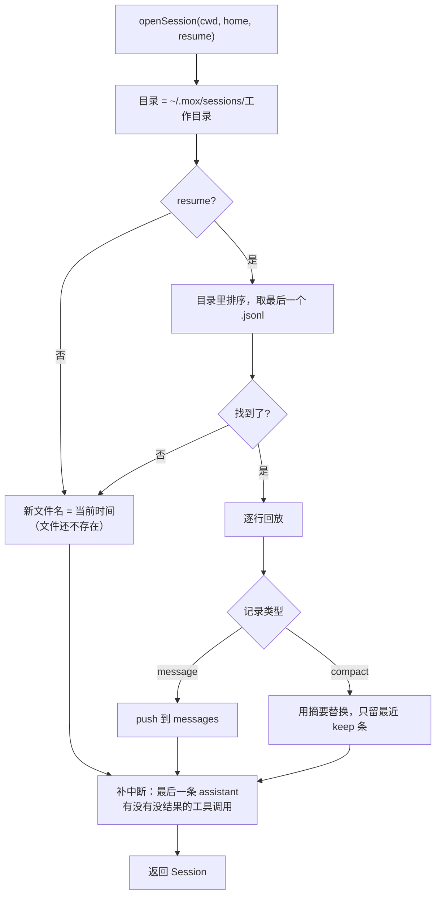
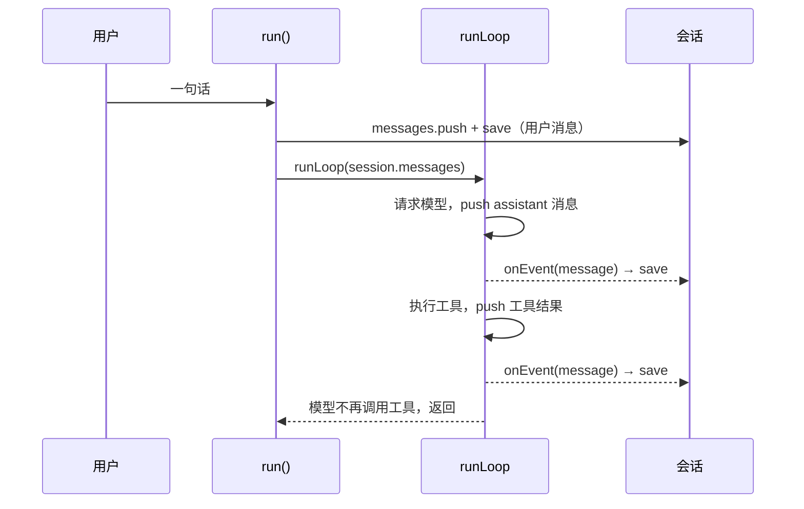

关掉终端，明天接着干。这件事听起来理所当然，对 Agent 却不简单：对话历史是一个会不断变长的数组，里面有模型的回复、工具的调用、工具的结果，进程可能在任何一刻被杀掉——你按了 Ctrl+C，系统内存不够，或者 Agent 自己跑的命令把父进程也带走了。

mox 的答案是 43 行的 `mox/src/session.ts`：每产生一条消息，就往一个文件末尾追加一行。恢复的时候，把这个文件从头读一遍。这一章先看这个文件长什么样，再沿着 `openSession` 读下去，然后真的把 mox 杀掉，看它怎么爬起来；最后对照 Pi 的会话树，讲清楚 mox 的平铺做法省掉了什么、又付出了什么。

## 一次运行之后，磁盘上有什么

让真正的 mox 命令行做一件小事：读 `notes.txt`，告诉你里面有什么。模型是脚本（第 3 章用过的做法，不需要 API Key），其余全是真的。运行结束后直接去读会话文件：

@lab node labs/ch07/jsonl.ts

四行，每行一条消息：用户的问题，模型要求调用 `read`，工具的结果，模型的最后回答。消息的格式就是第 2 章说的 OpenAI 格式——assistant 带着 `tool_calls`，工具结果是 `role: "tool"` 加 `tool_call_id`。**文件里存的就是下一次请求要发给模型的东西**，没有任何转换。

文件放在 `~/.mox/sessions/` 下，目录名是工作目录（把 `/` 换成 `-`），所以每个项目有自己的一堆会话；文件名是创建时的时间，字符串排序就是时间排序。`mox -c` 要找“最近一次”，只需要把文件名排个序，取最后一个。

为什么是 JSONL（每行一条 JSON），而不是一个大 JSON 文件或者数据库？Pi 也是这么存的：

@pi packages/coding-agent/src/core/session-manager.ts#L43-L67

- **追加是最安全的写入。** 往末尾写一行，最坏的情况是这一行有问题，前面的内容不会受影响。重写整个 JSON 文件时进程崩溃，整个会话就没了。
- **存储和第 6 章的原则一致。** 上下文只追加不修改，会话文件也只追加不修改。
- **人能直接读。** `tail -f` 能看着 Agent 工作，`grep` 能搜所有历史会话。

## 读 openSession：回放一个文件

`openSession` 干三件事。第一件，决定用哪个文件，并把它读回来：

@code mox/src/session.ts#L14-L34 hl=15,17,18,19,21,22,23,25,26,31,32

- 第 17 行：`resume` 为真时，在目录里找最近的 `.jsonl`；否则 `latest` 是 `undefined`，走第 18 行的新文件名。**目录是 `mkdirSync` 建的，文件却没有创建**——要等第一次 `appendFileSync` 才会出现。上面实验的最后一行证实了：开一个新会话然后什么都不说，磁盘上不会多出一个空文件。
- 第 19 行的 `write` 是整个文件里唯一写盘的地方，同步追加一行。`save` 和 `compacted` 都是它。
- 第 21–28 行回放：先读整个文件（第 21 行），文件末尾缺换行就补一个（第 22 行，“半行”一节会说为什么）；然后一行一条记录，第 25 行解析失败的行直接跳过；普通消息直接 `push`；`compact` 记录要特殊处理（下一节）。**回放得到的 `messages` 数组，就是 `runLoop` 要原地追加的那个数组**，命令行直接拿它当会话历史。
- 返回的 `Session` 只有四样东西：文件路径、消息数组、`save`、`compacted`。没有 id，没有父节点，没有“当前位置”。

### compact 记录：摘要和 keep

第 26 行是压缩在会话文件里的全部痕迹。压缩（第 8 章）发生时，命令行追加这样一行：

@lab node labs/ch07/jsonl.ts compact

`summary` 是摘要消息本身，`keep` 是“保留最近几条原样的消息”。回放时遇到它，第 26 行做的事是：`messages.splice(0, messages.length - keep, summary)`——从头开始删掉 `length - keep` 条，换成这一条摘要。四条消息、`keep: 1`，就删掉前三条，剩下 `摘要 + 最后一条`。

这里有两个值得想一想的地方。第一，**原来的四行一个字都没改**，压缩只是在末尾多记了一笔；第二，`keep` 是“从尾巴数几条”，不是“从某个 id 开始”。mox 的消息没有 id，计数是它唯一能指认消息的办法。这个办法在一个前提下才对：回放到这一行时，`messages` 里的内容必须和压缩发生时完全一致。会话只增不改，这个前提成立；一旦有人想在文件中间插入或删除一行，后面所有 `compact` 记录都会错位。

::: predict 把 keep 写成 99 会怎样
一个会话里有 3 条消息，手工追加一行 `{"type":"compact","summary":{...},"keep":99}`。恢复之后，`messages` 有几条，摘要在哪里？
???
4 条：摘要插在最前面，原来的 3 条一条没少。`messages.length - keep` 是 `3 - 99 = -96`，`splice(0, -96, summary)` 的删除数量为负数时按 0 处理，只插入、不删除。

这不是 bug，只是 mox 对坏数据不设防：回放代码相信文件里的 `keep` 是它自己写下的合法值。信任的边界就是“只有 mox 自己写这个文件”。
:::

### 补中断：最后一条 assistant 之后

第二件事在回放完成之后。会话可能停在工具执行到一半的时候，这时历史里有一个带 `tool_calls` 的 assistant 消息，却缺少对应的结果。第 2 章说过，服务商要求每个调用都有结果，原样发出去会被拒绝。

@code mox/src/session.ts#L36-L45 hl=37,38,39,40,41,42,43

只检查**最后一条 assistant 消息**（第 37 行）：它之后出现过的 `tool` 消息，把 `tool_call_id` 收进 `answered`（第 38 行）；这条 assistant 的每个调用，不在 `answered` 里的，补一条“中断”结果，**同时追加到内存和文件里**（第 42–43 行）。为什么只看最后一条？更早的 assistant 之后，循环一定是把结果都交回去了才请求的下一轮，缺口只可能出现在末尾。

## 谁在什么时候写文件

`openSession` 只提供 `save`，什么时候调用它是命令行的事：

@code mox/src/cli.ts#L108-L132 hl=113,127,128,129

- 用户消息由 `run` 自己存（第 127–128 行），因为循环只在**自己** `push` 消息时才发 `message` 事件；用户的第一句话是循环开始前就放进数组的。
- 循环产生的每条消息——assistant 回复、每个工具结果、运行中插进来的话——都经过第 113 行的 `onEvent` 存下来。**assistant 消息在工具执行之前就已经落盘**，下一节的崩溃就发生在这个缝隙里。
- 压缩走另一条路：`maybeCompact` 修改完内存里的数组，调用 `session.compacted(...)` 追加一行 `compact`。

所以文件始终跟内存里的数组同步，只差“正在发生”的那一条。

## 崩溃之后

### 把 mox 杀掉

下面这个实验是真的杀进程。第一次运行，模型一次要求两个命令：先 `echo`，再 `sleep 30`。等 mox 打印出 `sleep 30` 开始执行，实验对整个进程组发 `kill -9`——不给 mox 任何收尾的机会。然后用 `mox -c` 恢复同一个会话，看第一次请求发给模型的是什么：

@lab node labs/ch07/kill.ts

磁盘上的会话停在三行：用户的问题，带两个调用的 assistant，**第一个**调用的结果。第二个调用——被杀时正在跑的 `sleep 30`——没有结果。

`-c` 恢复时，`openSession` 的第 37–43 行发现 `sleep 30` 对应的 id 不在 `answered` 里，补了第 4 行：“中断：上次运行在这个工具执行时退出，结果未知，需要的话请检查后重试。”于是模型收到的历史是合法的，而且这句话告诉它真相——**不知道那条命令有没有做完**，让它自己检查，而不是假装成功或失败。

注意第三次运行：再次 `-c`，请求里仍然只有一条“中断”。补上的那一行已经写进了文件，下一次回放时 `answered` 里有它，就不会重复补。

::: steps 一次崩溃和恢复，会话怎样变化
--- 模型回复了两个工具调用。assistant 消息在工具执行之前就落盘了（`onEvent` 的 `save`）。
flowchart LR
  U["user 依次运行"]:::done --> A["assistant echo + sleep"]:::done --> T1["tool echo 的结果"]:::dim --> T2["tool sleep 的结果"]:::dim
--- 工具按顺序执行。`echo` 很快结束，它的结果也落盘了。
flowchart LR
  U["user 依次运行"]:::done --> A["assistant echo + sleep"]:::done --> T1["tool echo 的结果"]:::done --> T2["tool sleep 的结果"]:::dim
--- `sleep 30` 开始执行，进程在这时被 kill -9。磁盘上只有前三条。
flowchart LR
  U["user 依次运行"]:::done --> A["assistant echo + sleep"]:::done --> T1["tool echo 的结果"]:::done --> T2["tool sleep 的结果 （永远不会有）"]:::on
--- `mox -c`：`openSession` 回放出三条，发现最后一条 assistant 有两个调用，只有一个在 `answered` 里。
flowchart LR
  U["user 依次运行"]:::done --> A["assistant echo + sleep"]:::on --> T1["tool echo 的结果"]:::done --> T2["tool sleep 的结果 （永远不会有）"]:::dim
--- 给缺的那个补一条“中断”，写进内存和文件。接下来用户的新消息接在后面，请求合法。
flowchart LR
  U["user 依次运行"]:::done --> A["assistant echo + sleep"]:::done --> T1["tool echo 的结果"]:::done --> T2["tool 中断：结果未知"]:::on --> U2["user 刚才断了，继续"]:::dim
:::

### 补丁写进文件，还是只补在请求里

mox 把“中断”写进了会话文件。Pi 做了不同的选择：它的会话文件不修，在**发送前**对历史做一次投影，缺结果的调用补一条“没有提供结果”的错误结果。同一段历史交给两边：

@lab node labs/ch07/repair.ts

Pi 的实现是 `transformMessages`，它还要处理失败的回复、不同服务商之间的 id 格式差异，所以长很多：

@pi packages/ai/src/api/transform-messages.ts#L179-L257 collapse=true

两种做法的差别在于补丁属于谁。Pi 的原则是**存储的是事实，发送的是投影**：文件只记录实际发生的事，“这里该补一条错误结果”是协议对这一次请求的要求，所以每次请求时重新算，规则改了也不用迁移旧文件。mox 把补丁当作一件新发生的事——“恢复时发现这个调用被中断了”——记在文件里。这也说得通：补上去的确实是事实，而且恢复只发生一次，不会反复补。代价是 mox 的修复规则一旦写进文件就永远在那里；好处是代码只有九行，请求路径上没有任何额外的处理。

### 半行

kill -9 会不会把一行写到一半？先预测，再看实验。

::: predict 会话文件末尾有半行，mox 能恢复吗，恢复之后接着聊会怎样
假设断电让最后一行只写了一半：`{"type":"message","message":{"role":"user","con`，行尾没有换行。`mox -c` 恢复得了吗？恢复之后再说一句话，这句话写到哪里？下一次恢复它还在吗？
???
恢复得了：第 25 行把解析失败的行 `continue` 跳过，前面的消息照常读回。新话也不会丢：第 22 行发现文件不以换行结尾，先补了一个换行，新记录写在自己的一行上，坏行单独留在上一行。如果没有第 22 行，`save` 追加的记录会直接接在半行后面，粘成一行 `{"type":"message","message":{"role":"user","con{"type":"message",…}`，下一次恢复时连同新消息一起被跳过。
:::

@lab node labs/ch07/torn.ts

实验分两部分。第一部分对半行做了一次诚实的尝试：让一个进程不停地追加 2KB 的记录，在随机时刻 `kill -9`，重复 8 次，每次都写下上千行，没有一次留下半行。这是因为一条记录就是一次 `appendFileSync`——一次写系统调用，进程被信号杀死时，内核要么已经把这次写完，要么还没开始。**进程崩溃不会产生半行。**

半行来自进程之外：断电、磁盘写满、写在网络盘上。第二部分手工造了一个，mox 和 Pi 都读回了前两条消息，只丢坏行。mox 为此多出两行代码：第 25 行的 `try` 让解析失败的行不再拖垮整个会话；第 22 行在读之前先补换行，保证后面的追加从新的一行开始。这两行都是实验发现问题之后补上的——早先的版本里，一个坏行会让会话打不开，补了 `try` 之后又出现了“新消息和半行粘在一起、下次恢复时丢失”的数据丢失（实验里的最后三行就是它的检查）。

这个例子说明：**容忍坏数据要在读和写两头都做。** 读的时候跳过很容易；写的时候，你得先确定文件结尾是一个干净的换行。

## 一棵树，而不是一条线

@figure assets/course/ch07-tree.png 会话是一棵只追加的树：回到过去的某个节点，从那里长出新的分支，旧的分支原样保留

mox 的会话是一条线：第 N 条消息接在第 N−1 条后面，没有别的可能。Pi 的会话是一棵树。差别要从一个具体的需求看起：对话进行到一半，你让 Agent “用 Python 重写”，看了一眼觉得不对，想回到之前，改成“给它加上类型”。

Pi 的做法是：**每条记录都有一个 `id` 和一个 `parentId`**。正常对话时，新记录的父节点是上一条，形成一条链。回到过去某一点，只是把“叶子”指针移过去；之后追加的记录以那一点为父节点，自然开出一个新分支。旧分支原封不动地留在文件里。

<figure class="diagram">
<svg viewBox="0 0 720 230" role="img" aria-label="会话树">
<defs><marker id="a7" viewBox="0 0 10 10" refX="9" refY="5" markerWidth="6" markerHeight="6" orient="auto"><path d="M0 0L10 5L0 10z" fill="var(--faint)"/></marker></defs>
<g font-size="12.5" text-anchor="middle">
<rect x="20" y="88" width="92" height="40" rx="8" fill="var(--bg)" stroke="var(--line-2)"/><text x="66" y="113" fill="var(--ink)">U1 列文件</text>
<rect x="142" y="88" width="92" height="40" rx="8" fill="var(--bg)" stroke="var(--line-2)"/><text x="188" y="113" fill="var(--ink)">A1</text>
<rect x="290" y="28" width="150" height="40" rx="8" fill="var(--bg)" stroke="var(--line-2)"/><text x="365" y="53" fill="var(--faint)">U2 用 Python 重写</text>
<rect x="470" y="28" width="92" height="40" rx="8" fill="var(--bg)" stroke="var(--line-2)"/><text x="516" y="53" fill="var(--faint)">A2</text>
<rect x="290" y="148" width="150" height="40" rx="8" fill="var(--accent-soft)" stroke="var(--accent)"/><text x="365" y="173" fill="var(--ink)">U2' 给它加上类型</text>
<rect x="470" y="148" width="92" height="40" rx="8" fill="var(--accent-soft)" stroke="var(--accent)"/><text x="516" y="173" fill="var(--ink)">A2'</text>
</g>
<g stroke="var(--faint)" stroke-width="1.2" fill="none" marker-end="url(#a7)"><path d="M112 108H140"/><path d="M234 102C262 90 266 56 288 50"/><path d="M440 48H468"/><path d="M234 114C262 126 266 160 288 166"/><path d="M440 168H468"/></g>
<g font-size="11.5" fill="var(--muted)"><text x="580" y="53">旧分支：仍在文件里</text><text x="580" y="173" fill="var(--accent-ink)">← 叶子：当前分支</text><text x="140" y="80">分叉点：A1 有两个孩子</text></g>
<text x="20" y="216" font-size="11.5" fill="var(--faint)">发给模型的永远是“从根走到叶子”的那条路径：U1 → A1 → U2' → A2'</text>
</svg>
<figcaption>回退和分叉不删除任何记录，只移动叶子。</figcaption>
</figure>

Pi 里对应的代码非常短。追加一条消息时，父节点就是当前叶子：

@pi packages/coding-agent/src/core/session-manager.ts#appendMessage

“当前分支”就是从叶子沿着 `parentId` 一路走回根，再反转：

@pi packages/coding-agent/src/core/session-manager.ts#buildSessionPath

::: steps 回退一步、开出新分支：Pi 的会话树怎样长出来
--- 会话是一条链：每条记录的 `parentId` 指向上一条，叶子在 A2（橙色）。
flowchart LR
  U1["U1 列文件"]:::done --> A1["A1"]:::done
  A1 --> U2["U2 用 Python 重写"]:::done --> A2["A2"]:::on
  A1 --> U2p["U2' 给它加上类型"]:::dim --> A2p["A2'"]:::dim
--- 用户想回到“重写之前”。这一步**只是移动叶子指针**到 A1（`branch(id)`），没有删除任何记录；U2、A2 变灰，是因为它们不在当前路径上，仍然躺在文件里。
flowchart LR
  U1["U1 列文件"]:::done --> A1["A1"]:::on
  A1 --> U2["U2 用 Python 重写"]:::dim --> A2["A2"]:::dim
  A1 --> U2p["U2' 给它加上类型"]:::dim --> A2p["A2'"]:::dim
--- 用户发新消息：追加 U2'，它的 `parentId` 是**当前叶子** A1。A1 于是有了两个孩子，这里就是分叉点。
flowchart LR
  U1["U1 列文件"]:::done --> A1["A1"]:::done
  A1 --> U2["U2 用 Python 重写"]:::dim --> A2["A2"]:::dim
  A1 --> U2p["U2' 给它加上类型"]:::on --> A2p["A2'"]:::dim
--- 模型的回复 A2' 接在 U2' 后面，叶子移到 A2'。旧分支原样留着，随时可以再回去。
flowchart LR
  U1["U1 列文件"]:::done --> A1["A1"]:::done
  A1 --> U2["U2 用 Python 重写"]:::dim --> A2["A2"]:::dim
  A1 --> U2p["U2' 给它加上类型"]:::done --> A2p["A2'"]:::on
--- 发给模型的是**从叶子沿 `parentId` 走回根、再反转**得到的路径（`buildSessionPath`）：U1、A1、U2'、A2'。旧分支的 U2、A2 不会出现在请求里。
flowchart LR
  U1["U1 列文件"]:::on --> A1["A1"]:::on
  A1 --> U2["U2 用 Python 重写"]:::dim --> A2["A2"]:::dim
  A1 --> U2p["U2' 给它加上类型"]:::on --> A2p["A2'"]:::on
--- 重新打开文件：叶子指针不需要单独存。新分支的记录一定是最后追加的，文件里的**最后一条就是叶子**。
flowchart LR
  U1["U1 列文件"]:::done --> A1["A1"]:::done
  A1 --> U2["U2 用 Python 重写"]:::dim --> A2["A2"]:::dim
  A1 --> U2p["U2' 给它加上类型"]:::done --> A2p["A2'"]:::on
:::

有了树，几个看起来不同的功能变成了同一个操作：

| 功能 | 在树上的操作 |
| --- | --- |
| 继续上次的会话 | 打开文件，叶子是最后一条 |
| 回到之前某一步重来 | 移动叶子，之后的追加自动成为新分支 |
| 编辑之前的某条用户消息 | 移动到它的父节点，再追加修改后的消息 |
| 把某个分支拆成独立会话 | 复制根到叶子的路径到新文件，记下来源（Pi 的 `/fork`、`/clone`） |
| 给某条记录打书签 | 追加一条 `label` 记录 |

### mox 没有树，回退会发生什么

mox 的数组是平的。如果想回到 A1，最直接的办法是把内存里的数组截短：`messages.length = 2`，再往下聊。内存里确实只剩 U1、A1 加上新的 U2'、A2'。问题出在文件上——文件只追加，被截掉的 U2、A2 还在那里：

@lab node labs/ch07/tree.ts

中间一段是关键：内存里是 `U1 → A1 → U2' → A2'`，`mox -c` 恢复出来却是六条，被放弃的 U2、A2 又回来了，夹在 A1 和 U2' 之间。模型会看到一个用户先说“用 Python 重写”、做了一半、又改口说“给它加上类型”的历史——对话变得自相矛盾，而且用户以为已经丢掉的方向仍然在影响模型。

**平铺文件无法表达“回退”。** 要么放弃回退，要么在文件的层面做分叉：这就是最后一段的做法，把前 `n` 条消息复制进一个新文件，在新文件上继续。旧文件原样保留，随时可以回去；`-c` 恢复的是最新的文件，也就是分叉出来的那个。

@code labs/ch07/fork.ts#forkSession

这个实现完全建立在 mox 公开的 `openSession` 之上，不用改 `mox/` 里的任何东西。代价和树的对比：

| | Pi 的树 | mox 的平铺 + 分叉 |
| --- | --- | --- |
| 回退一步重来 | 移动叶子，零复制 | 复制前 n 条到新文件 |
| 旧分支在哪 | 同一个文件里 | 另一个文件里 |
| 两个分支的共同祖先 | 只存一份 | 每个文件各存一份 |
| 在分支之间跳转 | `/tree`，不换文件 | 换文件；`-c` 只认最新的 |
| 实现 | `id` + `parentId` + 叶子指针 + 沿路径构建 | 8 行复制 |
| 能出的错 | 父节点缺失时整棵树断裂（所以 Pi 写盘失败要回滚内存） | 几乎没有 |

树的好处是廉价和连贯：分叉不复制，所有分支在一个地方。平铺的好处是你一眼就能读懂整个文件。mox 选择后者，因为教学和日常使用里，“继续上次的会话”远比“在同一次会话里来回跳分支”常见。

Pi 为了让树不断裂，在写盘上花了更多心思：

@pi packages/coding-agent/src/core/session-manager.ts#L1160-L1207

一条没写进文件的记录，不能成为后续记录的父节点，否则文件里会出现指向不存在的父节点的记录。mox 没有父节点，也就没有这个问题——`save` 同步写，写失败直接抛出，整个运行失败，文件和内存不会出现“内存里有、文件里没有”的情况。

## 小结：两种做法

| | mox | Pi |
| --- | --- | --- |
| 记录 | `message`、`compact` | message、compaction、label、模型切换等 |
| 结构 | 一条线，没有 id | 树：`id` + `parentId` |
| 恢复 | 回放全部行，按 `keep` 处理压缩 | 找到叶子，沿路径构建上下文 |
| 分支 | 没有（用复制出新文件代替） | `branch`、`/tree`、`/fork` |
| 坏行 | 跳过；末尾缺换行时先补一个 | 跳过 |
| 中断的工具调用 | 打开时补一条写进文件 | 发送前投影，文件不动 |
| 文件创建 | 第一次写入时 | 有真正的对话时，`wx` 模式防覆盖 |

## 你来改

::: predict 删掉补换行的那一行
把 `session.ts` 第 22 行（`if (saved && !saved.endsWith('\n')) appendFileSync(file, '\n');`）删掉，再运行 `node labs/ch07/torn.ts`。最后一次“再恢复一次”会读回几条消息？
???
2 条：「再试一次」和半行粘成了一行，两者一起被第 25 行的 `try` 跳过，新消息丢了。实验里最后的断言会失败，这就是它守住的东西。
:::

::: predict 在模型回复的途中被杀
`mox -p "..."` 已经把用户消息写进了文件，模型还在流式回复，这时 kill -9。`mox -c -p "继续"` 之后，发给模型的历史是什么样？`openSession` 要补什么吗？
???
历史是 `user → user`：被杀的那一轮只留下用户消息，第二个 user 是新输入的“继续”。`openSession` 什么都不用补——没有 assistant 消息，也就没有缺结果的工具调用。OpenAI 兼容的接口通常接受连续两条 user 消息（这一点没有在本课程里实测，换服务商前自己试一下），所以不必处理；如果服务要求 user/assistant 严格交替，就需要在发送前合并。这个情形和“工具执行到一半被杀”不同：assistant 消息在流式结束、`push` 之后才落盘，所以不完整的回复根本不会进入文件。
:::

**练习：分叉做成命令。** `forkSession` 已经能把会话复制到新文件，但命令行里没有入口。mox 的 `registerCommand` 只能在命令里做事，不能提交一条用户消息，也拿不到当前的 `session`。想想看：要让 `/fork 2` 这样的命令起作用，命令行需要给扩展多暴露什么？（提示：`ExtensionApi` 里只有 `cwd`、`registerTool`、`registerCommand`、`addSystemPrompt`、`ask`、`on`。）这是 mox 最小接口的一个真实边界——课程里不改它，但你可以在自己的分支上试试。

**练习：只容忍最后一行。** 第 25 行的 `continue` 不管坏行在哪里都跳过。文件中间的某一行被人手工改坏，也会被悄悄跳过——如果它恰好是某条 assistant 的 `tool_calls`，后面的 `tool` 消息就成了没有调用的孤儿，下一次请求会被服务商拒绝（第 2 章）。把第 25 行改成：只有**最后一行**解析失败才跳过，中间的坏行抛出错误。对照 Pi：它跳过坏行之后，在发送前还会再做一次投影（`transformMessages`），所以能承受这类孤儿；mox 没有这一层，应该严格到什么程度？

**练习：id。** 给每条记录加一个 `id`（比如行号），给 `compact` 记录用 `fromId` 代替 `keep`。恢复逻辑要怎么改？这样改之后，“在文件中间插入记录会让压缩错位”的问题还存在吗？

## 面试题

先自己回答，再展开对照要点。

::: interview Agent 的对话历史应该怎样持久化？为什么常用 JSONL？
每条消息一产生就追加写入，用 JSONL（每行一条 JSON 记录）。追加写入最安全：崩溃时前面的内容不受影响；读取时逐行回放即可。它还天然契合“历史只追加不修改”的原则，记录的就是模型真实看到和说过的内容，便于审计和回放，人也可以直接用命令行工具查看。

细节：写入要同步，不要攒在内存里批量写；内存状态和文件必须一致，写盘失败要有明确的行为（mox 抛出，Pi 回滚）；没有实际对话时不创建文件。
:::

::: interview 进程在工具执行到一半时被杀，重新打开会话要处理什么？怎么处理？
assistant 消息在工具执行之前就落盘了，所以历史里有调用没有结果，原样发给服务商会被拒绝。恢复时检查最后一条 assistant 的每个调用，没有对应结果的补一条“中断”结果，内容要告诉模型真相：命令可能已经执行了一部分，结果未知，需要时自己检查。

两种位置：写进文件（mox，恢复时补一次）或者发送前投影（Pi，文件不动）。进程被杀不会产生半行，但已经执行的副作用（改了一半的文件）无法从会话里恢复，需要配合检查点（第 16 章）。
:::

::: interview 会话文件末尾有半行，应该怎么处理？
半行不会来自进程被杀（一次追加就是一次写系统调用），而来自断电、磁盘写满等。要在读和写两头都处理：读取时逐行解析，解析失败的行跳过，只丢那一条消息；写入前先确认文件以换行结尾，没有就补一个，否则下一条记录会粘在半行后面，新消息也跟着丢失（mox 的 `openSession` 两件事都做了）。更严格的做法是只容忍**最后一行**坏，中间的坏行说明文件被改过，应当报错。
:::

::: interview 如何支持“回到之前某一步重来”？平铺文件和树各有什么取舍？
树：每条记录有 `id` 和 `parentId`，维护叶子指针；回退就是移动叶子，新记录自然成为新分支；发给模型的是从根到叶子的路径；重新打开时最后一条就是叶子。分叉零复制，所有分支在一个文件里，编辑历史消息、拆分会话、书签都是同一套操作。

平铺：一条线，简单到一眼能读懂；不能表达回退——内存里截短，文件里被截掉的消息恢复时又回来。要回退只能复制前 n 条到新文件。适合“继续上次会话”远多于“在分支间跳转”的场景。
:::

::: interview 压缩过的会话怎样存储和恢复？
压缩不改原来的记录，只在末尾追加一条 `compact`：摘要消息加上“保留最近多少条”。恢复时回放：普通消息 push，遇到 `compact` 就把前面的消息替换成摘要、只留最近 keep 条。因此原始历史仍然完整，可以审计；代价是 `keep` 依赖“回放到这里时内存和压缩时一致”，文件只能追加，不能在中间插入或删除。Pi 的 compaction 记录用 `firstKeptEntryId` 指向第一条保留的消息，不依赖计数。
:::
