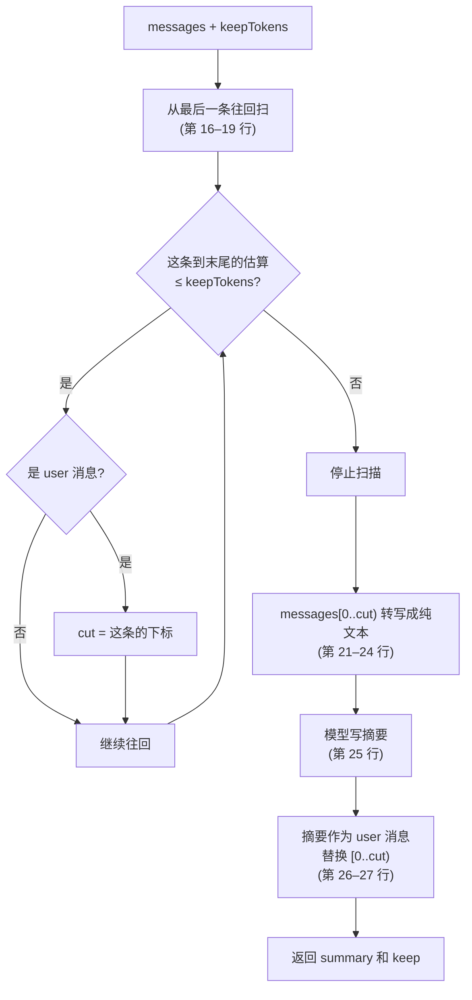

第 1 章算过，每次请求都要重发全部历史。一个持续几十轮的修 bug 任务，读过的文件、跑过的命令输出加起来，很快就会超出模型的上下文窗口。即使没有超出，越来越长的历史也意味着越来越贵、越来越慢，模型的注意力也越来越分散。

**压缩**（compaction）的做法是：把较早的历史交给模型写一份摘要，之后的请求用“摘要 + 最近的消息”代替完整历史。mox 的实现是 `mox/src/compact.ts` 的 29 行，加上 `cli.ts` 里 8 行决定什么时候调用它。这一章把这些代码读透，再对照 Pi 看它们省掉了什么。

## 先看一次压缩

先看结果。下面的实验造一段 4 步的对话（读文件、改文件，每步工具输出 1600 个字符），摘要模型用脚本代替，然后调用 mox 真实的 `compact()`：

@lab node labs/ch08/compact.ts

几件事一目了然：

- 16 条消息变成 5 条：**1 条摘要 + 最近一步的 4 条原文**，估算从约 1900 个 token 降到约 540。
- 保留部分从 `第 4 步：看看 src/file4.ts` 这条**用户消息**开始。
- 发给摘要模型的请求只有一条消息：一段指令，加上被转写成纯文本的旧对话。没有系统提示，没有工具定义。
- 会话文件里，原来的 16 条消息一条没少，只在末尾多了一行 `compact` 记录（第 7 章的 `keep`）。重新打开会话，得到的数组和压缩后的内存完全一样。

## 沿着 compact() 读：切点只有 4 行

@figure assets/course/ch08-compaction.png 压缩：较早的消息折成一份摘要，最近的原样保留；工具调用和它的结果始终夹在一起，不会被切开

整个函数在这里：

@code mox/src/compact.ts#compact hl=16,17,18,19,20,21,22,23,24,25,26,27,28

### 切点：只切在用户消息前

第 16–19 行是切点的全部逻辑。`cut` 起初是 `messages.length`，意思是“全部摘要”。然后从最后一条消息往回扫：只要“这一条到末尾”的估算 token 不超过 `keepTokens`，就继续往回走；每遇到一条用户消息，就把 `cut` 记在它身上。扫描停下来的时候，`cut` 就是**额度之内最靠前的那条用户消息**。

为什么只认用户消息？因为工具调用和它的结果必须成对出现（第 2 章）。如果切点落在一条工具结果上，保留部分就以一条“没有调用的结果”开头，服务商会拒绝这样的请求。用户消息是整个对话里唯一一定安全的边界：一条用户消息之前，上一轮的所有调用都已经有了结果。

::: steps compact 怎样从最新往回找到切点
--- 额度 `keepTokens` 只够保留最后一小段。`cut` 起初是消息总数（11），意思是“全部摘要”。扫描从最后一条 M10 开始。
flowchart TB
  subgraph T1["第 1 轮"]
    direction LR
    M1["user"]:::dim --> M2["call"]:::dim --> M3["result"]:::dim --> M4["asst"]:::dim
  end
  subgraph T2["第 2 轮"]
    direction LR
    M5["user"]:::dim --> M6["call"]:::dim --> M7["result 很大"]:::dim --> M8["asst"]:::dim
  end
  subgraph T3["第 3 轮"]
    direction LR
    M9["user"]:::dim --> M10["asst"]:::on
  end
  T1 --> T2 --> T3
--- M10 到末尾的估算在额度内，它不是用户消息，`cut` 不变，继续往回。
flowchart TB
  subgraph T1["第 1 轮"]
    direction LR
    M1["user"]:::dim --> M2["call"]:::dim --> M3["result"]:::dim --> M4["asst"]:::dim
  end
  subgraph T2["第 2 轮"]
    direction LR
    M5["user"]:::dim --> M6["call"]:::dim --> M7["result 很大"]:::dim --> M8["asst"]:::dim
  end
  subgraph T3["第 3 轮"]
    direction LR
    M9["user"]:::on --> M10["asst"]:::done
  end
  T1 --> T2 --> T3
--- M9 到末尾仍在额度内，而且是用户消息：`cut` 记在 M9 上。绿色是目前确定要保留的部分。
flowchart TB
  subgraph T1["第 1 轮"]
    direction LR
    M1["user"]:::dim --> M2["call"]:::dim --> M3["result"]:::dim --> M4["asst"]:::dim
  end
  subgraph T2["第 2 轮"]
    direction LR
    M5["user"]:::dim --> M6["call"]:::dim --> M7["result 很大"]:::dim --> M8["asst"]:::on
  end
  subgraph T3["第 3 轮"]
    direction LR
    M9["user cut"]:::done --> M10["asst"]:::done
  end
  T1 --> T2 --> T3
--- M8 到末尾还在额度内，但它是 assistant 消息，`cut` 仍然停在 M9。
flowchart TB
  subgraph T1["第 1 轮"]
    direction LR
    M1["user"]:::dim --> M2["call"]:::dim --> M3["result"]:::dim --> M4["asst"]:::dim
  end
  subgraph T2["第 2 轮"]
    direction LR
    M5["user"]:::dim --> M6["call"]:::dim --> M7["result 很大"]:::on --> M8["asst"]:::done
  end
  subgraph T3["第 3 轮"]
    direction LR
    M9["user cut"]:::done --> M10["asst"]:::done
  end
  T1 --> T2 --> T3
--- 加上很大的 M7，累计超过额度，扫描停止。M1～M8 交给模型写摘要；M9、M10 原样保留。第 2 轮被整个摘要掉，没有被切开。
flowchart TB
  subgraph T1["第 1 轮"]
    direction LR
    M1["user"]:::dim --> M2["call"]:::dim --> M3["result"]:::dim --> M4["asst"]:::dim
  end
  subgraph T2["第 2 轮"]
    direction LR
    M5["user"]:::dim --> M6["call"]:::dim --> M7["result 很大"]:::dim --> M8["asst"]:::dim
  end
  subgraph T3["第 3 轮"]
    direction LR
    M9["user cut"]:::done --> M10["asst"]:::done
  end
  T1 --> T2 --> T3
:::

还有两个边界藏在循环条件里，用不着实验也能看出来：

- `i > 0`：扫描**永远不看 `messages[0]`**。所以即使整段对话都在额度之内，`cut` 也只会落在第二条及以后的用户消息上——第一轮总会被摘要。
- 如果连最后一条消息到末尾的估算都超了额度，循环一步也不走，`cut` 保持 `messages.length`——**全部摘要，一条原文都不留**。

### 和 Pi 的切点对照

Pi 同样从最新往回累加，攒够 `keepRecentTokens`（默认 20000）就停。区别是它允许切点落在 assistant 消息上，于是有了 **split turn**：这一轮被切成两半，前半段单独写一份摘要，再和历史的摘要合并。

::: tabs
@@ Pi
@pi packages/coding-agent/src/core/compaction/compaction.ts#findCutPoint collapse=true
可以切在 assistant 上（工具结果不行），切开的那一轮单独写摘要。
@@ mox
@code mox/src/compact.ts#L15-L20 hl=18
只切在 user 前面；不切开任何一轮。
:::

同一段 5 轮对话，三种情形，分别交给 mox 真实的 `compact()` 和 Pi 真实的 `findCutPoint`（两边估算 token 的方式不同，所以同一种情形用的额度数字不一样）：

@lab node labs/ch08/cut-point.ts | md

- **第一行**，额度正好够最近两轮：两边切在同一个位置。
- **第二行**，额度落在一轮的中间：Pi 切开了第 3 轮，保留 9 条；mox 宁可只保留最后一轮的 4 条，把第 3、4 轮都交给摘要。
- **第三行**，最近一轮的工具输出很大，单独就超了额度：Pi 仍然保留最后一条回答（并为那一轮前面的部分单独写摘要）；mox 一条也不保留，**连用户最后那个问题都进了摘要**。

第三行是 mox 最大的取舍。它换来的是简单——不需要 split turn 的第二份摘要，保留部分永远是完整的几轮——代价是在“一个大任务，一条用户消息，几十次工具调用”的典型 Agent 场景里，切点无处可落。后面的“触发”一节会用真实的命令行跑一遍这个情形。

::: predict 放开切点：任何消息都能当切点
把 `compact.ts` 第 18 行的 `if (messages[i].role === 'user')` 去掉条件，每一步都 `cut = i`。对上面那段 5 轮对话，额度设为 500 tokens（这个估算方式下），切点会落在哪里？发给模型的历史有什么问题？
???
切点落在第 15 条消息（下标 14），是一条 **tool 结果**。保留部分以 `{role: "tool", tool_call_id: ...}` 开头，而发出这个调用的 assistant 消息已经被摘要掉了。服务商要求每个 `tool` 消息都对应前面某条 assistant 消息里的 `tool_calls`，这样的请求会被拒绝。

这就是 Pi 为什么要在 `isCutPointMessage` 里单独排除工具结果：只要允许切在 assistant 上，就必须保证它之后紧跟的结果一起被保留。mox 选了更省事的约束——只认 user。
:::

## 摘要是怎么写出来的

### 转写成纯文本，只给一条消息

第 21–25 行把要摘要的消息变成一段文本，放进**一条用户消息**，再发给模型。为什么不把历史消息原样发过去，最后加一句“请总结”？因为模型很可能**接着对话往下说**：回答最后一个问题，甚至试图调用工具。转写成纯文本，历史就成了“被讨论的材料”，而不是需要延续的对话。

转写的格式在实验里看得很清楚：每条消息一行 `[角色] 内容`，assistant 的工具调用写成 `调用 read({"path":...})`，工具结果是 `[tool] ...`。三个细节，每个都有后果：

- **每条消息的内容只取前 2000 个字符**（第 23 行的 `slice(0, 2000)`）。一个 10 万字符的工具输出，摘要模型只看得到开头。写摘要不需要完整的文件内容，这是合理的；但这条规则对所有消息一视同仁，包括下面要说的旧摘要。
- **`[tool]` 行不带工具名。** 摘要模型只能靠上一行的“调用”推断这是哪个工具的结果。
- 没有系统提示，没有“不要继续对话”的硬约束，只有 `PROMPT` 里那句“只输出摘要”。

Pi 在这几处下了更多功夫：

@pi packages/coding-agent/src/core/compaction/utils.ts#serializeConversation

它的注释说明了取舍：工具结果截断到 2000 个字符，思考内容不放进去；系统提示明确禁止继续对话：

@pi packages/coding-agent/src/core/compaction/utils.ts#L161-L163

### 提示词：一句话 vs. 一套格式

mox 的指令是一句话：写一份摘要，让助手只看摘要就能继续工作，包含目标、已做的事、改过的文件、关键结论、没完成的事。Pi 规定了固定的结构：

@pi packages/coding-agent/src/core/compaction/compaction.ts#L507-L538

目标、约束与偏好、进展（已完成/进行中/受阻）、关键决定、下一步、关键上下文，最后还要求**准确保留文件路径、函数名和错误信息**。“修了一个搜索的 bug”对接手者毫无用处，`src/search.ts` 里的 `toLowerCase` 和那条失败测试的原文才有用。

### 真实模型写出的摘要

下面是 MiniMax-M3.1-Flash 对一段修 bug 对话做的真实压缩（录制方法见 `labs/ch08/record.ts`，回放时 mox 的 `compact()` 照常运行，它构造的请求必须和录制时逐字一致）。对话里，用户要求修复搜索的大小写问题、不要引入新依赖；Agent 改了代码，测试还剩一个关于土耳其语字符的失败用例；用户随后选了 `localeCompare` 方案，并要求以后改完都跑 lint：

@lab node labs/ch08/replay.ts | md

对这份摘要，有三点可以说：

- **关键事实都在**：文件路径、改成了什么、失败测试的名字、期望值和实际值。提示词里没有规定格式，模型自己写出了目标、已完成、修改文件、关键结论、未完成这几块。
- **用户最后的两个决定不在摘要里**——选 `localeCompare`、以后要跑 lint。这不是疏漏：它们在被保留的最后两条消息里，原样发给模型。摘要里“可考虑使用 `localeCompare`”，是摘要模型写的时候用户还没有决定。
- **`修改文件` 是模型自己总结出来的**。这一次它对了，但这是一类“能从工具调用里直接得到的事实”，让程序提取比让模型回忆可靠。这就是 Pi 的做法：

@pi packages/coding-agent/src/core/compaction/utils.ts#L30-L72

**能从结构化数据里得到的事实，就不要交给模型去总结。** mox 没有这一步，“你来改”里会补上。

### 压缩两次会怎样

Pi 做第二次压缩时，把上一份摘要放进 `<previous-summary>` 标签，要求模型**合并**：保留已有信息，把完成的事项从“进行中”移到“已完成”。mox 没有这样的特殊处理。上一份摘要只是 `messages[0]`，一条普通的用户消息，和别的消息一起被转写——也就一起被截成前 2000 个字符。

::: predict 第一份摘要有 2500 字，第二次压缩时模型能看到多少
第一次压缩产生了一份约 2500 字的摘要（60 条已完成的事项）。随着任务继续，第二次压缩又触发了。摘要模型的请求里，旧摘要还剩多少？
???
前 2000 个字符。第 23 行对每条消息一视同仁地 `slice(0, 2000)`，旧摘要也不例外。摘要最后的一部分——在“已完成”清单里通常是最近发生的事——不会进入第二份摘要。实验会数出具体丢了几条。
:::

@lab node labs/ch08/repeat.ts

第二份摘要的作者根本没有机会读到第 48 项以后的内容，更谈不上把它们保留下来。压缩是有损的，而重复压缩让损失**叠加**：每一轮都从上一轮的摘要里再丢一点。

## 什么时候压缩

触发的逻辑在 `cli.ts` 里：

@code mox/src/cli.ts#L99-L106 hl=101,102,104

- 第 101 行：**历史、系统提示、工具定义**三样的估算加起来，达到窗口的 80% 就压缩（每次请求都带着系统提示和全部工具定义，它们同样占上下文）；`force` 是手动的 `/compact`。窗口默认 128000，用 `MOX_CONTEXT_WINDOW` 改。
- 第 102 行：`keepTokens` 是窗口的 20%。窗口 128000 时是 25600——比 Pi 的默认 20000 略多。
- 第 104 行：压缩成功后，把摘要和 `keep` 写进会话文件。

交互模式里输入 `/compact`（`cli.ts` 第 154 行）调用的是同一个函数，只是 `force` 为真，不看阈值。

谁来调用它？`runLoop` 的第 28 行，`await options.compact?.(messages)`，在**每次请求模型之前**。所以压缩可以发生在一次运行的中途，而不只是两次用户输入之间。

下面用真正的命令行验证。窗口设成 4000 tokens，阈值是 3200；模型（脚本）一直要求读同一个文件（几百个 token）：

@lab node labs/ch08/trigger.ts | md

第一行就有一千出头：那是系统提示和八个工具定义的开销，历史里只有一句话，请求已经占了阈值的三分之一。之后每读一次，估算涨四百多。摘要请求前面的那次正常请求，估算还在 3200 以下；它的工具结果追加之后越过了阈值，于是下一次请求之前 mox 先发了一次摘要请求，然后继续。压缩之后，发给模型的只剩**一条用户消息**，就是摘要。这个任务只有一条真正的用户消息，所以切点无处可落：这就是前面第三种情形，真实地发生在命令行里。

对模型来说这没问题——摘要里写着目标和进展，它可以继续。但“用户最初的原话”和最近几步的原始输出都没有了，只能靠摘要写得好。长任务里压缩一旦发生，任务的上下文就完全取决于那一份摘要。

### 估算有多准

阈值比较的三样东西都用 `estimateTokens` 估算：

@code mox/src/compact.ts#estimateTokens

先把值序列化成 JSON 文本，数出非 ASCII 字符（中文就是它）的个数 `wide`，其余字符约 4 个一个 token，非 ASCII 每个约 0.7 个 token。最朴素的公式是“字符数 ÷ 4”，对中文是灾难：一个汉字常常占 1 个 token 以上，却被算成 0.25。用真实的 MiniMax 接口量一下同样长度的三段文字，服务商返回的真实 `prompt_tokens`，对比两种公式：

@lab node labs/ch08/replay.ts tokens | md

朴素公式在英文和代码上大致可用（1.06～1.14 倍），在中文上只有真实值的 0.46。mox 现在的公式把中文拉到了 1.29 倍：**宁可估高**。估高的代价是压缩来得早一点，估低的代价是请求在压缩有机会发生之前就被服务商拒绝，两边不对称。这里的 0.7 是一个固定常数，别的模型的分词器会有别的数字（这是推测，没有逐个测过），而且这三段文字都是纯中文、纯英文、纯代码，真实对话是混合的，工具输出的 JSON 转义（`\n`、`\"`）还会让文本显得更长。估算永远是估算。

撑爆之后 mox 怎么办？什么都不办：请求被服务商拒绝，`openai()` 抛出“模型请求失败”，这次运行失败。Pi 有补救：去掉失败的回复，压缩，然后**重试一次**：

@pi packages/coding-agent/src/core/agent-session.ts#L3010-L3056

注释里有几个容易想不到的边界：如果用户刚从小窗口的模型换到大窗口的模型，旧模型的溢出错误不应该触发压缩；压缩之前产生的旧回复，也不应该在压缩之后再触发一次。补救只尝试一次，再失败就把问题报告给用户。

::: tabs
@@ Pi
@pi packages/coding-agent/src/core/compaction/compaction.ts#L267-L270
上下文大于“窗口减预留”（预留默认 16384）。上下文的大小用最近一次回复的真实用量，加上之后新增消息的估算值。
@@ mox
@code mox/src/cli.ts#L101
窗口的 80%，消息、系统提示、工具定义全部用估算值。留的空间随窗口等比例变化。
:::

Pi 用的是服务商**上一次回复里的真实用量**，只对新增的消息做估算，误差被限制在最后一小段里。mox 对每个字符都估算，误差随历史一起增长。这是两边在“触发”上最大的差别。

## 压缩之后，模型看到什么

压缩把 `messages` 就地改成了 `[摘要, ...保留的消息]`，同时在会话文件追加一行 `compact`，里面是摘要和 `keep`。下一次恢复会话时，回放逻辑重现同样的结果：

::: steps compact 记录怎样影响恢复出来的历史
--- 文件里是 M1～M8 八条消息的记录。压缩发生在 M8 之后，这时内存里是完整的八条。
flowchart TB
  subgraph FILE["会话文件（只追加）"]
    direction LR
    F1["M1–M5"]:::done --> F2["M6–M8"]:::done --> FC["compact summary, keep=3"]:::dim --> FN["N1"]:::dim
  end
  subgraph MEM["回放出的 messages"]
    direction LR
    X["M1–M8"]:::on
  end
  FILE --> MEM
--- 压缩成功后追加 `compact` 记录。回放到这一行：`splice(0, 8 - 3, summary)`，M1～M5 被一条摘要代替，留下 M6～M8。
flowchart TB
  subgraph FILE["会话文件（只追加）"]
    direction LR
    F1["M1–M5"]:::done --> F2["M6–M8"]:::done --> FC["compact summary, keep=3"]:::on --> FN["N1"]:::dim
  end
  subgraph MEM["回放出的 messages"]
    direction LR
    S["摘要"]:::on --> X["M6–M8"]:::done
  end
  FILE --> MEM
--- 用户发来 N1，同样追加在 `compact` 之后，回放时 push 到数组末尾。
flowchart TB
  subgraph FILE["会话文件（只追加）"]
    direction LR
    F1["M1–M5"]:::done --> F2["M6–M8"]:::done --> FC["compact summary, keep=3"]:::done --> FN["N1"]:::on
  end
  subgraph MEM["回放出的 messages"]
    direction LR
    S["摘要"]:::done --> X["M6–M8"]:::done --> N["N1"]:::on
  end
  FILE --> MEM
--- 发给模型的是 `system + messages`。前缀和压缩前完全不同，**提示缓存全部失效**，这是压缩不可避免的代价，也是不应该频繁压缩的原因之一。
flowchart TB
  subgraph FILE["会话文件（只追加）"]
    direction LR
    F1["M1–M5"]:::done --> F2["M6–M8"]:::done --> FC["compact summary, keep=3"]:::done --> FN["N1"]:::done
  end
  subgraph MEM["发给模型的请求"]
    direction LR
    SY["system"]:::on --> S["摘要 （user）"]:::on --> X["M6–M8"]:::on --> N["N1"]:::on
  end
  FILE --> MEM
:::

注意摘要是一条 **user 消息**。保留部分又总是从一条 user 消息开始，所以压缩之后的请求里有两条连续的 user 消息：摘要和随后的用户提问。这在 OpenAI 兼容的接口上通常没问题；Pi 把摘要放在开头也是一条带说明的用户消息：

@pi packages/coding-agent/src/core/messages.ts#L11-L17

这和第 7 章说的“只追加”不矛盾：压缩记录本身是追加的，原始历史还在文件里，可以回放、审计。被改变的只是发给模型的那份。Pi 的树还能在 `/tree` 里回到压缩之前的分支；mox 的平铺文件没有这一说，但分叉出的新文件（第 7 章的 `forkSession`）可以从压缩前复制。

::: insight 压缩是有损的
压缩用信息换空间，一定会丢东西，偶尔还会编造。这一章看到了丢东西的三个具体位置：转写时每条消息只取 2000 字符；重复压缩时旧摘要被再截一次；整段历史都进摘要时用户的原话也不例外。缓解的办法：把关键事实放在不依赖摘要的地方（`AGENTS.md` 里的长期约定、第 10 章的长期记忆、程序提取的文件清单）；让用户可以指定压缩的侧重点（Pi 的 `/compact 重点保留 API 的改动`）；不要压缩得太频繁；以及把子任务放进独立的上下文（第 17 章的子 Agent），从根本上减少主对话需要承载的内容。Claude Code 的文档给出了类似的建议：把需要长期遵守的规则写进 `CLAUDE.md`，而不是依赖对话历史。
:::

## 你来改

::: predict 只聊了一轮就 /compact
刚打开 mox，问了一个需要读三个文件的问题，模型回答完。这时输入 `/compact`。`messages` 里还剩什么？
???
只剩一条摘要。整段历史只有一条用户消息，在 `messages[0]`，而扫描的条件是 `i > 0`，永远不会检查它；其余消息都不是用户消息，`cut` 保持 `messages.length`，全部进摘要。如果先聊了两轮再 `/compact`，在额度充足的情况下，只有第一轮被摘要，第二轮原样保留。
:::

**练习一：文件清单。** Pi 在摘要末尾附上读过和改过的文件，程序从工具调用里提取，不依赖模型回忆。mox 不用改，只要包装一下 `compact()`——它就地修改 `messages`，返回的 `summary` 就是 `messages[0]` 同一个对象，所以追加内容会同时作用于内存和写进会话的记录。参考实现：

@code labs/ch08/file-list.ts#compactWithFiles

@lab node labs/ch08/file-list.ts

注意两个细节：只统计**被摘要掉的那一段**（`before.slice(0, before.length - result.keep)`），保留的原文里已经有最新的调用；以及写过的文件从“读过”里去掉，和 Pi 的约定一致。

**练习二：切开一轮。** 第三种情形里，mox 把整个任务摘要掉了，用户最后的提问也在其中。试试在 `compact()` 之外补一个办法：压缩之后，如果保留的部分是空的，把压缩前最后一条用户消息再原样追加到 `messages` 末尾。这样模型至少还能看到用户最后的原话。这个改动要不要写进会话文件？（想想恢复时会发生什么。）

**练习三：增量摘要。** 在 `PROMPT` 后面区分第一次压缩和以后的压缩：如果 `messages[0]` 已经是摘要，把它从转写中拿出来，单独放进 `<previous-summary>` 标签，要求模型合并。运行 `node labs/ch08/repeat.ts`，旧摘要的 60 条事项还能被看到几条？

## 面试题

先自己回答，再展开对照要点。

::: interview 上下文快满了怎么办？说说压缩的完整流程。
1. **触发**：估算的上下文达到窗口的某个比例（mox：80%）或超过“窗口 − 预留”（Pi）时触发；撑爆之后识别溢出错误，压缩并重试一次（Pi 有，mox 没有）。
2. **切点**：从最新往回累加，攒够要保留的额度；mox 只切在用户消息前，Pi 可以切在 assistant 上（切开一轮时单独总结前半段）；都不能切在工具结果上。
3. **摘要**：把要总结的历史转写成纯文本放进一条消息（防止模型继续对话），工具输出截断；用结构化格式；已有摘要时合并；文件清单由程序提取。
4. **落盘**：在会话里追加一条压缩记录（摘要 + 保留多少），原始历史不删除。
5. **投影**：之后的请求用“摘要 + 保留的消息”代替完整历史。
:::

::: interview 压缩时为什么不能把工具调用和工具结果切开？
服务商要求每个工具结果都对应前面某条 assistant 消息里的工具调用（通过 id 关联）。如果切点落在工具结果上，保留部分会以一条“孤立的结果”开头，请求会被拒绝。反过来，切在带工具调用的 assistant 消息上是安全的，因为它的结果紧跟其后，会被一起保留；mox 更保守，只切在 user 消息前，一轮永远不会被切开。
:::

::: interview mox 的切点和 Pi 的 split turn 有什么取舍？
mox 只切在用户消息前：实现简单，保留部分永远是完整的几轮，没有第二份摘要。代价是粒度粗：额度落在一轮中间时少保留；一个大任务只有一条用户消息时，切点无处可落，整段历史（包括用户原话）都进摘要。Pi 允许切在 assistant 上，切开的那一轮前半段另写一份摘要，保留更多近期原文，代价是多一次模型调用、多一套合并逻辑。
:::

::: interview 怎样让模型写出高质量的压缩摘要？
- 先把对话转写成文本，指令明确“只输出摘要，不要继续对话”；
- 规定结构：目标、约束与偏好、进展、关键决定、下一步、关键上下文；要求原样保留路径、函数名、错误信息；
- 增量更新：把上一份摘要作为单独的输入，要求合并而不是重写——否则旧摘要会和普通消息一起被截断，信息逐轮流失；
- 能从结构化数据得到的事实（改过的文件）由程序提取，不依赖模型；
- 允许用户指定侧重点；摘要失败时不写入。
:::

::: interview 估算 token 数用“字符数 ÷ 4”有什么问题？怎么改进？
对英文和代码大致可用，对中文严重偏低：实测同样长度的文本，估算只有真实 token 数的 0.46 倍。后果是触发阈值（比如窗口的 80%）实际上变成了 150% 以上，请求在压缩之前就被服务商拒绝。

改进：非 ASCII 字符单独按更高的权重算（mox 用 0.7，实测中文偏高 29%，落在安全一侧）；阈值要把系统提示和工具定义一起算上，因为每次请求都带着它们；优先使用服务商上一次回复返回的真实用量，只对新增的消息估算（Pi 的做法）；预留足够的余量；撑爆之后能识别溢出错误并补救。
:::

::: interview 压缩有什么风险？如何缓解？
有损：细节会丢失（转写截断、重复压缩叠加损失），模型还可能编造用户没提过的约束；压缩后的第一次请求提示缓存全部失效；整段任务只有一条用户消息时原话也会进摘要。

缓解：长期规则写进项目说明文件或长期记忆；关键事实由程序提取；用户可以指定侧重点；保留足够多的近期消息；减少压缩频率；用子 Agent 隔离探索性工作，减少主上下文的负担。原始历史保留在会话文件里，必要时可以回到压缩之前。
:::
