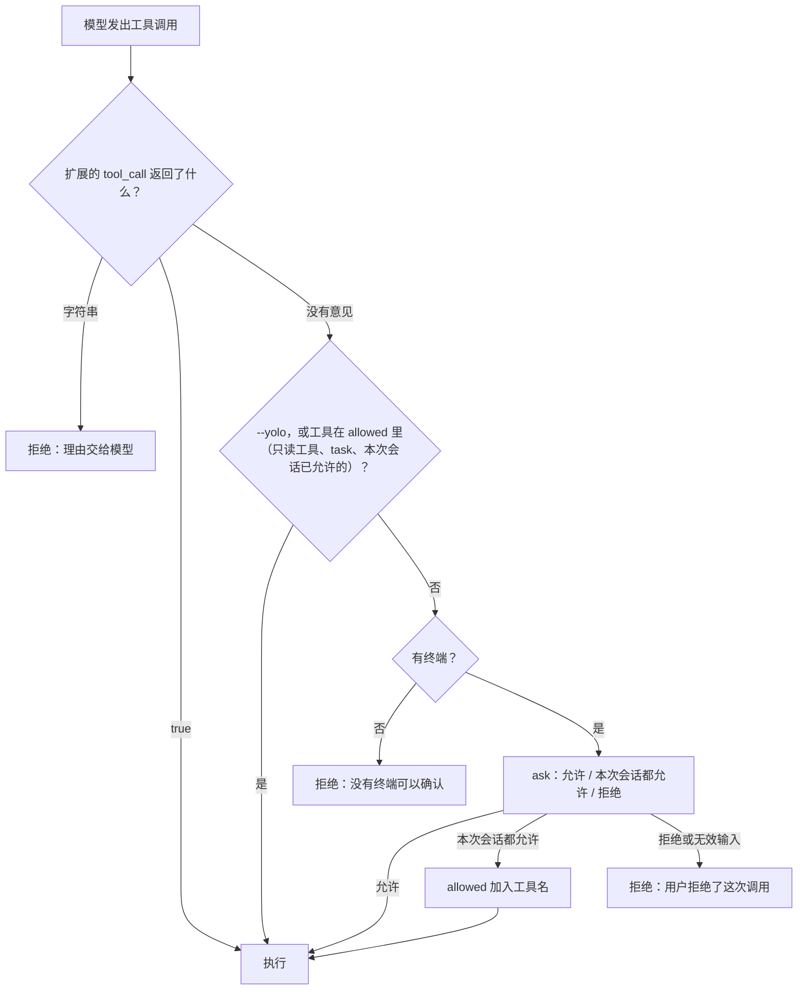

mox 在执行 `write`、`edit`、`bash` 之前会停下来问你一句。守住这道门的代码只有十来行，下面先把它跑一遍：启动真正的 mox 命令行（`mox/src/cli.ts`），让它连到一个脚本化的假模型（所以不需要 Key）。模型依次 `read` 一个文件、`write` 两个文件、`bash ls`，三种运行方式下每一步的下场如下：

@lab node labs/ch14/builtin.ts

三次运行是同一份脚本，差别只在怎么启动：

- **`mox -p`**：没有终端，没法问人。只读的 `read` 放行，其余三个调用（两次 `write` 和 `bash`）全部被拒绝，理由里写着“没有终端可以确认，已拒绝。想自动执行请加 --yolo”。磁盘上什么都没有。
- **`mox -p --yolo`**：不再询问，四个调用全部执行。
- **交互模式**：每个调用前停下来问。第一次 `write` 选了“本次会话都允许”（输入 2），第二次 `write` 就不问了；`bash` 是另一个工具，要重新问，这次选了“拒绝”（输入 3）。

这三种行为够用来防止“模型随手 `rm -rf`”，但也只能防这一种事。这一章的主线是：先读懂这十行，找出它不够用的地方，再用 mox 的扩展接口补上一套规则式的权限（语法和 Claude Code 兼容），最后和 Pi 的立场（不审批，靠隔离）放在一起比较。

## mox 自带的权限：十行代码

提问的函数和决定要不要提问的函数都在 `cli.ts` 里：

@code mox/src/cli.ts#L50-L57 hl=53,56

`ask` 是 mox 给人提问的唯一通道，扩展也能用（`mox.ask`）。第 53 行是关键：**没有终端（stdin 不是 TTY）就不提问，直接返回 `undefined`**。把选项列出来、取回输入的序号，只有第 54 到 56 行。

@code mox/src/cli.ts#L64-L74 hl=65,67,69,70,71,72,73

决定要不要提问的是 `beforeTool`，由 `runLoop` 在每个工具执行前调用。逐行看：

1. **先问扩展**（67 行）。`extensions.verdict(name, args)` 把调用交给**每一个**扩展的 `tool_call` 处理器，汇总成一个结论：只要有一个返回**字符串**就是拒绝，调用到此结束，理由原样交给模型（68 行）；没有人拒绝、有一个返回 **`true`** 就是放行，跳过下面所有的检查（69 行）；都没有意见，就继续往下走。**拒绝优先**，和扩展的加载顺序无关。这一步在 `--yolo` 之前，所以扩展的拒绝对 `--yolo` 也有效。
2. **放行几种情况**（69 行）：扩展说了 `true`，或者 `--yolo`，或者工具在 `allowed` 里——一开始是 `read`、`grep`、`find`、`ls` 这四个只读工具和 `task`（子 Agent 本身没有副作用，它里面的每个工具调用会单独走到这里）——或者用户之前选过“本次会话都允许”，那个工具名也会加进 `allowed`。
3. **没有终端就拒绝**（70 行）。`mox -p` 在 CI 里运行时没人能回答，不能默认放行，所以拒绝，还把解决办法写进了错误信息。拿不准的时候拒绝，是无人值守场景唯一安全的默认值。
4. **问用户**（71 行）。选“本次会话都允许”，把**工具名**加进 `allowed`（72 行）；选“允许”只放过这一次；其他回答（包括输错的序号，`ask` 返回 `undefined`）都按拒绝处理（73 行）。



### 它在哪里不够用

- **粒度是工具名。** “本次会话都允许”记下的是 `bash`，从此 `npm test` 和 `rm -rf ~` 一样不再询问。想放行 `npm test` 而继续盯着其他命令，做不到。
- **不看内容。** 往项目里写一个文件和往 `/etc/hosts` 写一个文件，问的是同一句话；bash 的 `ls` 和 `curl … | sh` 也是。每个调用都问，用户很快就会养成不看就点“允许”的习惯，审批就失去了意义。
- **只有“问”，没有“永远不行”。** 想让 `git push` 永远被拒绝，只能每次点拒绝。
- **没有记忆。** 选择只活到这次会话结束，不能写进项目配置让团队共享。

Claude Code 用一整套规则和模式来补这些，Pi 干脆换了一条路。先看这两种立场。

## 两种安全哲学

Agent 会犯错（在错误的目录里执行 `rm`），也会被利用（第 1、9、10、12 章反复出现的提示注入）。问题是：由谁、在哪一层拦住它？

**Claude Code 的答案是审批。** 工具分成几级：读文件不需要批准；执行命令、修改文件、访问网络需要用户点头。为了不让用户被确认框淹没，又有一整套规则（哪些命令直接放行、哪些一律禁止）和模式（比如“自动接受文件修改”）。mox 的十行代码是这条路线的最小形态。

**Pi 的答案是隔离。** 它的安全文档开门见山：

@pi packages/coding-agent/docs/security.md#L3-L7

Pi 默认不审批任何工具调用。它的立场是：盯着对话记录、审查改动都不构成安全边界；真正的安全来自限制 Agent **能接触到**的文件、凭据、进程和网络——在容器、虚拟机或沙箱里运行。

两种答案并不矛盾，它们防的是不同的东西。审批让人参与关键决定，适合交互式地使用；隔离给出硬性的边界，即使审批被绕过、被用户随手点了“是”，损失也有上限。成熟的方案两者都要：Claude Code 也有沙箱（第 15 章），Pi 也有第 9 章那样的确认扩展。这一章补上审批这一半：一个与 Claude Code 规则语法兼容的权限扩展，先装进 mox，再看 Pi 里的同一份。

## 规则

@figure assets/course/ch14-permissions.png 权限：先查 deny，再查 ask，最后才是 allow；规则拦的是常见的写法，不是边界

### 语法与顺序

规则的形式是 `工具` 或 `工具(说明符)`，分成三组：

```json
{
  "permissions": {
    "deny":  ["Bash(git push *)", "Bash(curl *)", "Read(.env)"],
    "ask":   ["Bash(npm install *)"],
    "allow": ["Bash(npm run *)", "WebFetch(domain:docs.python.org)", "mcp__issues__search_issues"]
  }
}
```

| 规则 | 匹配 |
| --- | --- |
| `Bash` | 所有命令 |
| `Bash(npm run *)` | 以 `npm run` 开头的命令；`*` 匹配任意文本 |
| `Read(.env)`、`Edit(/src/**)` | 路径，gitignore 风格（下文详述） |
| `WebFetch(domain:docs.python.org)` | 访问这个域名 |
| `mcp__github`、`mcp__github__search_code` | 一个 MCP 服务器的全部工具、某一个工具（第 12 章的命名） |

判断顺序是 **deny → ask → allow**，第一个匹配的组决定结果，**和规则写得多具体无关**。`Bash(aws *)` 在 deny 里，`Bash(aws s3 ls)` 写进 allow 也没用——allow 不能在 deny 上开口子。这样设计是为了让 deny 规则可以放心地写：不会被别的什么规则意外覆盖。

一条**不带说明符的 deny**（比如 `"deny": ["WebFetch"]`）有特殊含义：这个工具直接从模型能看到的工具列表里去掉，而不是等模型调用时再拒绝。模型不会白白尝试，也少占上下文。

### 没有规则匹配时：模式

| 模式 | 行为 |
| --- | --- |
| `default` | 工作目录内的读取、只读命令直接执行；修改文件、其他命令、网络访问需要确认 |
| `acceptEdits` | 再加上：工作目录内的文件修改自动接受 |
| `plan` | 只能读，任何修改和非只读命令都拒绝（第 16 章的计划模式建立在它之上） |
| `dontAsk` | 需要确认的一律拒绝，只执行规则明确允许的（适合无人值守） |
| `bypassPermissions` | 不再询问，但 deny 规则仍然有效。只应在容器、虚拟机里使用 |

规则引擎的入口：

@code extensions/permissions/rules.ts#decidePermission collapse=true

## 一行命令，怎么判断

文件路径、域名都比较好判断，难的是 Bash：命令是一段自由文本，模型可以用无数种方式写出同一个效果。

### 复合命令

`npm run build && rm -rf /` 以 `npm run` 开头，但显然不能因为 `Bash(npm run *)` 就放行。规则引擎先把命令按 `&&`、`||`、`;`、`|`、`&`、换行拆成子命令（引号里的不算），**每一个**子命令都被允许，整条命令才放行；**任何一个**子命令匹配 deny 或 ask，整条命令就被拒绝或需要确认。`$(…)`、反引号和括号里的命令同样会执行，也要拿出来检查：

@code extensions/permissions/rules.ts#splitCommand collapse=true

拆不开的命令（引号没闭合、`npm test &&` 后面什么都没有）不能自动放行，只能交给用户。

### 包装命令与环境变量

`timeout 30 npm run test` 实际执行的是 `npm run test`。匹配之前要去掉这类不改变“实际执行什么”的前缀：`timeout`、`time`、`nice`、`nohup`、`stdbuf`、`command`，以及不带参数的 `xargs`。

开头的环境变量赋值要区别对待：匹配 deny 时，去掉所有赋值（`FOO=bar rm -rf tmp` 仍然是 `rm`）；匹配 allow 时，只去掉已知安全的变量。`PATH=/tmp/evil:$PATH npm run build` 看起来是 `npm run build`，实际执行的 `npm` 可能是攻击者放在 `/tmp/evil` 里的程序：

@code extensions/permissions/rules.ts#stripWrappers

::: steps decideBash 判断 npm run build && rm -rf /
--- 模型要执行的是一整条复合命令。`decidePermission` 发现工具是 Bash，转给 `decideBash`。单看开头是 `npm run`，会被 `Bash(npm run *)` 放行；规则引擎不能这样看。
flowchart LR
  C["npm run build && rm -rf /"]:::on --> SP[splitCommand]:::dim
  SP --> S1["npm run build"]:::dim --> M1{"命中 deny？"}:::dim
  SP --> S2["rm -rf /"]:::dim --> M2{"命中 deny？"}:::dim
  M2 -- Bash(rm *) --> OUT["deny"]:::dim
  OUT --> BLK["tool_call 返回理由"]:::dim
--- `splitCommand` 按 `&&` 拆成两个子命令（引号里的不算，`$(…)` 里的也会拿出来）。`ok` 为真，说明这条命令能可靠解析。
flowchart LR
  C["npm run build && rm -rf /"]:::done --> SP[splitCommand]:::on
  SP --> S1["npm run build"]:::dim --> M1{"命中 deny？"}:::dim
  SP --> S2["rm -rf /"]:::dim --> M2{"命中 deny？"}:::dim
  M2 -- Bash(rm *) --> OUT["deny"]:::dim
  OUT --> BLK["tool_call 返回理由"]:::dim
--- 先过 deny：对每个子命令 `stripWrappers(sub, false)` 去掉包装命令和**所有**环境变量赋值，再逐条规则匹配。`npm run build` 没有命中任何 deny 规则。
flowchart LR
  C["npm run build && rm -rf /"]:::done --> SP[splitCommand]:::done
  SP --> S1["npm run build"]:::on --> M1{"命中 deny？"}:::on
  SP --> S2["rm -rf /"]:::dim --> M2{"命中 deny？"}:::dim
  M2 -- Bash(rm *) --> OUT["deny"]:::dim
  OUT --> BLK["tool_call 返回理由"]:::dim
--- 第二个子命令 `rm -rf /` 命中 `Bash(rm *)`。任何一个子命令命中 deny，整条命令就是 deny，函数在这里直接返回，不再看 allow。
flowchart LR
  C["npm run build && rm -rf /"]:::done --> SP[splitCommand]:::done
  SP --> S1["npm run build"]:::done --> M1{"命中 deny？"}:::done
  SP --> S2["rm -rf /"]:::on --> M2{"命中 deny？"}:::on
  M2 -- Bash(rm *) --> OUT["deny"]:::dim
  OUT --> BLK["tool_call 返回理由"]:::dim
--- 返回 `deny`，原因是“被规则 Bash(rm *) 禁止：rm -rf /”。注意 `Bash(npm run *)` 的 allow 规则根本没机会出场：deny → ask → allow，第一个匹配的组说了算。
flowchart LR
  C["npm run build && rm -rf /"]:::done --> SP[splitCommand]:::done
  SP --> S1["npm run build"]:::done --> M1{"命中 deny？"}:::done
  SP --> S2["rm -rf /"]:::done --> M2{"命中 deny？"}:::done
  M2 -- Bash(rm *) --> OUT["deny"]:::on
  OUT --> BLK["tool_call 返回理由"]:::dim
--- 扩展的 `tool_call` 处理函数拿到 `deny`，把原因（带“权限：”前缀）作为字符串返回——mox 里 `tool_call` 返回字符串就是拒绝，字符串是给模型看的理由；整个过程没有询问用户。
flowchart LR
  C["npm run build && rm -rf /"]:::done --> SP[splitCommand]:::done
  SP --> S1["npm run build"]:::done --> M1{"命中 deny？"}:::done
  SP --> S2["rm -rf /"]:::done --> M2{"命中 deny？"}:::done
  M2 -- Bash(rm *) --> OUT["deny"]:::done
  OUT --> BLK["tool_call 返回理由"]:::on
:::

### 只读命令

`ls`、`cat`、`grep`、`git status` 这类命令不改变任何东西，没必要每次都问。但“只读”要小心定义：`find` 带上 `-delete` 或 `-exec` 就不是只读的；`git` 只有 `status`、`log`、`diff` 等几个子命令是；任何带输出重定向的命令（`ls > files.txt`）都在写文件。

只读也不等于什么都能读：`cat .env` 和用 `read` 工具读 `.env` 是一回事，Read 的 deny 规则对 `cat`、`head`、`tail` 这类读文件的命令同样生效。

### 实验

一组规则，二十九种情况，每一行的“期望”都来自 Claude Code 权限文档描述的行为：

@lab node labs/ch14/rules.ts

### 规则看不到的东西

注意实验中期望为 `ask` 而不是 `deny` 的几行：

- `python3 -c "print(open('.env').read())"`：规则只认识 `cat` 这类命令，不知道 Python 脚本里打开了什么文件。
- `git -C . push origin main`：`Bash(git push *)` 匹配不到这种写法。同理，`/usr/bin/curl`、`sh -c 'curl …'` 也绕得过 `Bash(curl *)`。

Claude Code 的文档也明确说了，deny 规则拦的是“模型通常会写出的那种调用”，**不是围绕某个程序的安全边界**。这里有一条一般原则：**黑名单总有漏洞，白名单更可靠。** 没有被明确允许的命令会落到“需要确认”，而不是被放行——这正是 allow 规则的检查比 deny 严格得多（每个子命令都要允许、只去掉安全的环境变量）的原因。要真正挡住 `.env` 被读取，需要在操作系统层面限制进程能访问的文件：这是第 15 章沙箱的工作。

## 路径规则

`Read` 和 `Edit` 的说明符用 gitignore 的语法，有四种锚点：

| 写法 | 基准 | 例子 |
| --- | --- | --- |
| `//path` | 文件系统根目录 | `Read(//etc/**)` |
| `~/path` | 家目录 | `Read(~/.ssh/**)` |
| `/path` | 规则所在配置文件对应的目录（项目配置就是项目根目录） | `Edit(/src/**)` |
| `path`、`./path` | 当前目录 | `Read(.env)` |

规则沿用 `.gitignore` 的习惯：**没有写起点、也不含斜杠**的裸名字（`.env`、`*.pem`）匹配任意深度，所以 `Read(.env)` 也挡住了 `config/.env`；写了起点（`/`、`//`、`~/`、`./`）或者中间带斜杠的，从起点开始匹配，`Read(/.env)` 只管项目根目录下那一个 `.env`。注意 `/path` **不是**绝对路径——这是最常见的配置错误。

@code extensions/permissions/rules.ts#matchPath

还有两条规则：Read 的 deny 也挡住对同一路径的 Edit 和 Write（不能读的文件也不该能改）；路径要解析**符号链接**，否则一个指向 `.env` 的 `notes.txt` 就能绕过 `Read(.env)`。

符号链接还在写这一章时制造了一个真实的 bug：macOS 上临时目录在 `/var` 下，而 `/var` 本身是 `/private/var` 的符号链接。规则引擎一开始只解析了文件的真实路径，没有解析工作目录的，结果工作目录里的文件被判断为“在工作目录之外”，指向 `.env` 的链接反而被放行。实验的第一版有五行不符合期望，修复的办法是两边都解析（`realish`），连还不存在的新文件也要解析它的上级目录。权限代码里，路径比较几乎总是比看起来难。

## 装进 mox：on('tool_call') 加 ask

扩展接口里有两样东西正好对上规则引擎的两端：`on('tool_call', (name, args) => 结论)` 在工具执行前被调用，返回字符串就拒绝，返回 `true` 就放行；`ask(question, choices)` 让用户从几个选项里选一个，没有终端时返回 `undefined`。规则引擎 `decidePermission` 给出 allow、ask、deny 三种结论，接上去就是：

@code extensions/permissions/mox.ts#L16-L46 hl=26,27,29,30,33,36

- 第 26、27 行：**allow 返回 `true`，deny 返回原因**（带“权限：”前缀）。deny 不经过用户，规则不给用户“点错”的机会。
- 第 29 行：**ask 就调用 `mox.ask`**，三个选项：允许一次；本会话都允许；拒绝。选“允许一次”返回 `true`（30 行）。
- 第 31 到 33 行：“本会话都允许”不是放开整个工具，而是 `suggestRules` 为这次调用生成规则，存进 `sessionRules`，然后返回 `true`。Bash 按每个需要确认的子命令各生成一条精确的规则（批准 `git add -A && git commit -m "wip"`，得到的是两条规则，而不是一条拼起来的）；文件修改生成 `Edit(/**)`，只覆盖工作目录内。和 mox 内置的“记工具名”相比，粒度细了一个数量级。
- 第 36 行：`ask` 返回 `undefined`（没有终端，或输入了无效的序号）按拒绝处理，原因里写明“当前没有终端可以确认”。
- `/permissions` 命令：不带参数打印当前模式和规则（包括本会话新增的），带一个模式名（`/permissions plan`）切换模式。

`INTERNAL_TOOLS` 里的三个工具（`task`、`todo_write`、`exit_plan_mode`）只改变 Agent 自己的状态，规则引擎不认识它们，按“未知工具”会要求确认。通过 `readOnlyTools` 告诉引擎它们没有副作用；第 16 章的两个工具会用到这条。子 Agent 发起的每个调用，仍然各自经过这里的检查——检查效果，不检查容器。

### 为什么 tool_call 需要“放行”

这个扩展对每个调用都给出明确的结论：规则允许的返回 `true`，规则禁止的返回理由，要确认的自己问用户。如果 `tool_call` 只能拒绝，会发生什么？下面的实验最后两种情况，用同一份规则、同样的回答（每个问题都选第一项）对比。“旧接口”是把扩展的 `true` 吞掉，等于 `tool_call` 只能拒绝、返回空表示“没有意见”（mox 早先的行为）：

@lab node labs/ch14/mox-session.ts

前三种情况是现在的接口：有终端、没有终端（`-p`）、计划模式。命令和回答与下面 Pi 的实验完全相同，放行和拒绝的结果逐步一致；而且不需要 `--yolo`。

最后的对比是重点。旧接口下，规则明明允许的 `npm run build`，用户还是被内置确认问了一遍，同一组调用一共被问了 9 次，其中 5 次是内置确认。原因在 `beforeTool` 的结构里：扩展说“没有意见”，随后内置的 `allowed` 检查照常进行，规则里写的 `allow` 换不来少问一次。要少问只能加 `--yolo`，把内置确认整个关掉，可那样没有被扩展拒绝的调用，就彻底没人把关了。

放行的结论让两层各司其职：**扩展掌握规则，内置确认是没有规则时的兜底**。扩展说 `true`，内置确认让路；扩展说字符串，调用被拒绝；扩展没有意见（比如 `todo_write` 没装权限扩展），内置确认照旧。现在同一组调用只被问 4 次，全部来自扩展，而且问的都是规则看不懂、必须由人决定的那几个。

这里有一个要小心的性质：**拒绝优先**。`verdict` 会问到每一个扩展，只要有一个说“不行”，别的扩展再多的 `true` 也没用。这是 mox 早先犯过的一个错：当时 `emit` 遇到第一个有结论的就停，一个排在前面的扩展说了 `true`，后面扩展的拒绝就不会被调用，安全取决于加载顺序。现在放行和拒绝不对称：放行要所有人都不反对，拒绝一票就够。第 16 章的计划模式和检查点都用到这个性质，那里有对调顺序的实验。放行的权力也让 `--trust` 加载的项目扩展多了一项能力：它可以替用户跳过内置确认，但它放不开别的扩展的拒绝。所以项目里的扩展仍然默认不加载，要信任才加载。

### 一次完整的过程

::: steps 「本会话都允许」：第二次就不再问了
--- 脚本模型发出 `edit src/app.ts`。`tool_call` 处理函数调用 `decidePermission`：没有 deny/ask/allow 规则命中，工作目录内的修改在 default 模式下是 `ask`。
sequenceDiagram
  participant L as Agent 循环
  participant X as 权限扩展
  participant U as 用户
  L->>X: tool_call（edit src/app.ts）
  Note over X: decidePermission：没有规则命中，default 模式下改文件是 ask
--- 返回的不是 allow 也不是 deny，扩展调用 `mox.ask` 弹出三选一。如果没有终端，`ask` 返回 `undefined`，这里就直接拒绝了。
sequenceDiagram
  participant L as Agent 循环
  participant X as 权限扩展
  participant U as 用户
  L->>X: tool_call（edit src/app.ts）
  Note over X: decidePermission：没有规则命中，default 模式下改文件是 ask
  X->>U: mox.ask：允许一次 本会话都允许 拒绝
--- 用户选“本会话都允许”。
sequenceDiagram
  participant L as Agent 循环
  participant X as 权限扩展
  participant U as 用户
  X->>U: mox.ask：允许一次 本会话都允许 拒绝
  U-->>X: 本会话都允许
--- 扩展不是放开整个 Edit 工具，而是 `suggestRules` 为这次调用生成规则：文件修改是 `Edit(/**)`，基准是工作目录，只覆盖目录内。规则存进 `sessionRules`，处理函数返回 `true`，这次调用放行，内置确认让路。
sequenceDiagram
  participant L as Agent 循环
  participant X as 权限扩展
  participant U as 用户
  U-->>X: 本会话都允许
  Note over X: suggestRules 给出 Edit(/**)，parseRule 后放进 sessionRules
  X-->>L: 返回 true，放行
--- 接着模型调用 `write src/util.ts`。`context()` 每次都重新拼 `[...settings.rules, ...sessionRules]`，会话规则已经在里面了。
sequenceDiagram
  participant L as Agent 循环
  participant X as 权限扩展
  participant U as 用户
  X-->>L: 返回 true，放行
  L->>X: tool_call（write src/util.ts）
--- `decidePermission` 里 `Edit` 的路径规则同样适用于 `Write`，命中 allow，不再弹窗。`cat .env` 则不同：deny 规则命中后直接返回理由，连选择的机会都不给用户。
sequenceDiagram
  participant L as Agent 循环
  participant X as 权限扩展
  participant U as 用户
  L->>X: tool_call（write src/util.ts）
  Note over X: context 合并 rules 与 sessionRules，Edit 规则也管 Write，命中 allow
  X-->>L: 放行，没有弹窗
:::

几个细节：`npm run build` 匹配 allow 规则，没有弹窗；批准第一次 `edit` 时选了“本会话都允许”，紧接着的 `write` 就不再询问；`cat .env` 直接被拒绝，根本没有询问用户；`python3 -c "print(open('.env').read())"` 规则看不懂，落到 ask，用户这次选了拒绝。

### 真正的命令行

`labs/ch14/host.ts` 把 `cli.ts` 里和扩展有关的几十行搬了过来（权限那段一字不改），所以前面的实验是离线、确定的。但它终究是“仿”的。下面的实验启动真正的 `mox/src/cli.ts`，加载这个扩展，规则写在（临时目录里的）`~/.mox/permissions.json`；因为 mox 只在 stdin 是终端时才提问，实验借了一个伪终端（`labs/ch14/pty-driver.py`）像用户那样回答：

@lab node labs/ch14/cli-rules.ts

有终端时，`npm run build` 被 allow 规则直接放行，`cat .env` 被 deny 规则拒绝，两者都没有提问；`write` 要确认，输入 2（本会话都允许）；`python3` 那条要确认，输入 3（拒绝）。`-p` 模式下，需要确认的两个调用因为“当前没有终端可以确认”被拒绝，规则决定的两个照旧。

## 装进 Pi

同一个规则引擎，在 Pi 里是这样接的：

@code extensions/permissions/index.ts#createPermissionsExtension collapse=true

和 mox 版本相比有三处不同，都来自 Pi 的扩展接口更丰富：Pi 有 `session_start` 事件，规则在那里读取，整条 deny 的工具（比如 `"deny": ["WebFetch"]`）还能用 `setActiveTools` 直接从模型的工具列表里去掉，模型不会白白尝试（mox 的扩展拿不到工具列表，只能等调用时拒绝）；Pi 默认不做任何审批，所以没有内置确认可以“让路”，拒绝要返回 `{ block: true, reason }`，放行就是什么都不返回；Pi 的扩展之间有事件总线，第 16 章的计划模式用它通知权限扩展切换模式。

**没有界面时**（`pi -p` 在 CI 里运行、通过 RPC 调用），没有人能回答“允许吗”，扩展按拒绝处理。这和第 9 章 Pi 官方的权限示例，以及 mox 的 `ask` 返回 `undefined` 是同样的选择：拿不准的时候，拒绝。无人值守的场景应该把需要的操作提前写进 allow 规则，或者干脆在沙箱里运行。

同样的三种情况（有界面、没有界面、计划模式）装进一个真实的 Pi 会话，界面是脚本化的：

@lab node labs/ch14/session.ts

对照 mox 的实验：同一组命令、同样的回答，每一步的放行和拒绝完全一致。规则判断共用 `rules.ts`，区别只在“怎么问人”：

::: tabs
@@ mox
@code extensions/permissions/mox.ts#L22-L35
`mox.ask` 在没有终端时返回 `undefined`；deny 和拒绝都是返回一个字符串。规则每次由 `context()` 重新拼出。
@@ Pi
@code extensions/permissions/index.ts#L41-L56
通过 `ctx.hasUI` 判断有没有界面，`ctx.ui.select` 提问；拒绝要返回 `{ block: true, reason }`；规则还带着 `readOnlyTools`（来自工具的 `readOnlyHint` 注解）和 `additionalDirectories`。
:::

三种做法放在一起：

| | mox 内置 | mox + 权限扩展 | Claude Code | Pi |
| --- | --- | --- | --- | --- |
| 默认立场 | 除 read、task 外每次都问 | 按规则；没规则的问 | 读放行，写和命令按规则或问 | 不审批，靠隔离 |
| 粒度 | 工具名 | 工具 + 说明符（命令前缀、路径、域名） | 同左，另有模式 | — |
| 能不能“永远不行” | 不能 | deny 规则 | deny 规则 | 扩展自己写 |
| 没有终端 | 拒绝 | 拒绝 | dontAsk 模式拒绝 | 不适用 |
| 谁能放宽 | 只有用户 | 用户的规则和选择（扩展替用户执行，返回 `true`） | 用户和配置 | 用户 |

### 和钩子的关系

第 13 章的 PreToolUse 钩子也能允许或拒绝工具调用，两者同时存在时听谁的？在 Pi 和 mox 里，它们都是 `tool_call` 上的闸门（第 9 章）：Pi 里任何一个说“拦下”，调用就被拦下。钩子说“允许”在 Pi 里只是“我没有意见”，不能推翻权限规则的拒绝；Claude Code 的规则相同：PreToolUse 钩子返回 `allow` 不能绕过 deny 和 ask 规则，而返回退出码 2 的钩子在规则之前就拦下了调用。mox 的 `verdict` 也是同样的“拒绝优先”：钩子扩展说 `true`，权限扩展的 deny 规则照样生效，反过来也一样；能放行的扩展再多，一票反对就够了。**放宽权限的只有用户自己，收紧权限的可以有很多方。**

::: compare Claude Code 的权限
- **auto 模式**：不再弹确认框，而是由一个后台的分类模型检查每个命令、每次网络请求是否符合用户的意图，不符合的才拦下。这是用模型对付“审批疲劳”的办法。
- **受保护的路径**：`.git`、`.claude` 这样的目录，即使在 acceptEdits 模式下也不会自动接受修改。
- **工作目录**：读取默认只限于工作目录和 `additionalDirectories`；可以配置为完全禁止访问之外的路径。
- **更细的 Bash 分析**：识别更多只读命令和危险参数（比如 `ps` 打印环境变量的写法、Windows 网络路径会泄露凭据），检查重定向和 `tee` 的写入目标。
- 用 SDK 时可以提供自己的审批函数（`canUseTool`），第 19 章会用到。

官方文档：[Configure permissions](https://code.claude.com/docs/en/permissions)
:::

## 你来改

每道题先写下预测，再动手验证。

::: predict 给 allow 加一条 Bash(*)
在 `labs/ch14/rules.ts` 的 `allow` 列表最前面加一条 `'Bash(*)'`，运行实验。表格里哪些行会变？`cat .env`、`rm -rf` 这些 `deny` 的行呢？
???
五行从 `ask` 变成 `allow`，实验结果从 29/29 变成 24/29（末尾的断言会报错）：`npm run lint && npm publish`、`PATH=/tmp/evil:$PATH npm run build`、`ls > files.txt`、`python3 -c "print(open('.env').read())"`、`git -C . push origin main`。所有 `deny` 的行一行都没变，因为判断顺序是 deny → ask → allow，`Bash(*)` 夺不走 deny 的决定权。

被夺走的是**兜底**。“规则看不到的东西”一节说过，Python 读 `.env`、换一种写法的 `git push`，规则拦不住，只能靠没有规则匹配时的“需要确认”把它们交给用户。一条宽泛的 allow 把这层兜底整个关掉，这些调用就悄悄放行了。所以 allow 规则要写窄：`Bash(npm run *)`，而不是 `Bash(*)`。
:::

::: predict 带环境变量的命令
在 `labs/ch14/rules.ts` 的 `cases` 里加三行，期望都写 `allow`：`NODE_ENV=production npm run build`、`FOO=bar npm run build`、`CI=1 FOO=bar npm run test`。哪几行会通过？
???
只有第一行通过，另外两行得到 `ask`。匹配 allow 规则时，只去掉**已知安全**的环境变量（`NODE_ENV`、`CI`、`DEBUG`、`LANG` 等几个）。遇到不认识的变量（`FOO`）就停下来，剩下的 `FOO=bar npm run build` 不再以 `npm run` 开头，不匹配 `Bash(npm run *)`，没有规则命中，落到“需要确认”。第三行里 `CI=1` 虽然是安全变量，但它后面的 `FOO` 挡住了去路。

对 deny 规则正好相反：`FOO=bar rm -rf tmp` 去掉**所有**赋值再匹配，得到 `rm`，被拒绝。放行要严，拦截要宽，这是同一条原则在环境变量上的体现。
:::

::: predict 把 todo_write 从 INTERNAL_TOOLS 里去掉
第 16 章的 `todo_write` 只维护任务清单，不碰文件。把 `extensions/permissions/mox.ts` 里的 `INTERNAL_TOOLS` 改成 `['task', 'exit_plan_mode']`，用 `mox -p -e extensions/todo/mox.ts -e extensions/permissions/mox.ts` 让模型列一份清单。结果是什么？交互模式下呢？
???
`-p` 模式下 `todo_write` 被拒绝：`权限：todo_write 需要确认。当前没有终端可以确认，已拒绝`（`labs/ch14` 的组装里可以用 `assemble` 复现）。规则引擎不认识这个工具，按“未知工具”处理，默认是 `ask`；没有终端就拒绝。交互模式下每个新工具第一次调用都会弹出三选一，选“本会话都允许”后 `suggestRules` 生成一条 `todo_write` 规则，之后不再问。

这是“白名单比黑名单可靠”的另一面：**新增的工具默认要确认**，扩展作者要显式声明哪些工具没有副作用，而不是让引擎去猜。MCP 工具也一样，服务器自称“只读”不可信（第 12 章），所以不在这个名单里。
:::

::: predict 把 allow 的 true 改成不返回
把 `extensions/permissions/mox.ts` 里 `if (decision.behavior === 'allow') return true;` 改成 `return;`，运行 `node labs/ch14/mox-session.ts`，看第一种情况（回答仍然是 `['允许一次', '本会话都允许', '拒绝']`）。会发生什么？
???
回答被打乱了，第一种情况的放行与拒绝和预期对不上，断言会报错。规则允许的 `npm run build` 不再返回 `true`，等于“没有意见”，内置确认接着问了一遍。内置确认的选项是“允许 / 本次会话都允许 / 拒绝”，和扩展的“允许一次 / 本会话都允许 / 拒绝”文字不同，脚本里的“允许一次”不在内置的选项里，`ask` 把它当作无效回答，`beforeTool` 按拒绝处理：`npm run build` 就这样被拒绝了。

真正的 mox 里，用户输入的是序号，不会“答非所问”，但会被同一个调用问两遍。这正是“旧接口”对比里 9 次提问的来源，也是 `tool_call` 需要能放行的原因。
:::

## 面试题

先自己回答，再展开对照要点。

::: interview 如何为 coding agent 设计权限系统？
- **分级**：只读操作默认放行；修改文件、执行命令、访问网络需要确认。
- **规则**：allow / ask / deny，按 deny → ask → allow 判断，deny 不能被更具体的 allow 覆盖；规则可以按工具、命令前缀、路径、域名、MCP 服务器来写。
- **模式**：在“全部询问”和“全部放行”之间提供几档：自动接受编辑、只读的计划模式、无人值守时不询问而拒绝。
- **会话级授权**：“本会话都允许”生成精确的规则，而不是放开整个工具。
- **没有界面时出错拒绝**。
- **与隔离配合**：权限规则管“模型通常怎么做”，沙箱管“最坏能做到什么”。
- 规则要能放进版本库，团队共享；个人规则另放。
:::

::: interview 判断一条 Bash 命令能否执行，有哪些难点？
- 复合命令：要拆开，每个子命令都允许才放行；任何一个子命令命中 deny 就拒绝。
- 命令替换、子 shell 里的命令也会执行。
- 包装命令（`timeout`、`nice`、`xargs`）和环境变量赋值：匹配前要去掉；允许时不能越过可疑的赋值（`PATH=…`）。
- 通配符的位置：`Bash(git * main)` 会放行 `git -c core.fsmonitor=<脚本> diff main`。
- 只读的定义：`find -delete`、输出重定向都在写文件。
- 无法解析的命令要交给人。
- 根本局限：同一个效果有无数种写法（换路径、换解释器、`sh -c`），基于文本的规则不是安全边界。
:::

::: interview 为什么说权限规则不是安全边界？那什么才是？
规则匹配的是命令文本和工具参数，而同一个操作可以有无数种表达方式：`python -c` 读文件、`/usr/bin/curl` 代替 `curl`、写一个脚本再执行。规则能拦住模型“通常会写出”的那种调用，防止善意的模型犯错，但拦不住被注入的模型有意绕过。

安全边界要在操作系统或虚拟化层面：沙箱限制进程能访问的文件和网络、容器或虚拟机隔离主机、使用权限最小且短期有效的凭据。权限规则、钩子、审批在边界之内提供可控性和可见性。
:::

::: interview mox 的 tool_call 事件为什么既要能拒绝，又要能放行？
- 只有拒绝的话，扩展里的 allow 规则没有意义：扩展说“没有意见”，内置确认照常再问一遍，用户为同一个调用被问两次；要少问只能加 `--yolo`，那就把兜底也关了。
- 返回值有三种：字符串是拒绝（理由给模型看），`true` 是放行（内置确认让路），空是没有意见（交给后面的扩展和内置确认）。规则扩展对每个调用给出明确的结论，内置确认只在没人表态时兜底。
- 放行和拒绝是不对称的：mox 的 `verdict` 问遍每一个扩展，**拒绝优先**，一个字符串就拒绝；没人拒绝、有一个 `true` 才放行。所以放行的权力不会盖过别人的拒绝，安全不取决于加载顺序。（早先的实现遇到第一个有结论的就停，一个排在前面的 `true` 会让后面的 deny 失效。）
- 放行的权力来自用户：规则是用户写的，“本会话都允许”是用户点的；项目里的扩展（`--trust`）默认不加载，因为它们现在也能替用户放行。
- 加分点：Claude Code 的 PreToolUse 钩子也不能绕过 deny 和 ask 规则，保证同样是“拒绝优先”。顺序仍有体验上的影响：权限扩展先问了用户、后面的扩展再拒绝，用户就白问了一次。
:::

::: interview 用户被确认框烦得不行，怎么办？
- 读操作和只读命令默认不问。
- 用 allow 规则把常用、安全的命令（`npm run test`）提前放行，规则放进项目配置让团队共享。
- “本会话都允许”：一次确认覆盖同类操作。
- 合适的模式：信任当前任务时用 acceptEdits。
- 用分类模型自动审查（Claude Code 的 auto 模式），只把可疑的操作交给人。
- 在沙箱里运行，边界之内可以放心地少问。
- 注意：确认框太多，用户会养成不看就点“是”的习惯，审批就失去了意义。审批的数量本身就是安全问题。
:::

::: interview Agent 在 CI 里无人值守地运行，遇到需要确认的操作怎么办？
没人能确认，就不能“默认允许”，应该拒绝（dontAsk 模式，或者像本章的扩展那样没有界面时拒绝），并把拒绝原因交给模型，让它换一种做法或者报告失败。需要的操作提前写进 allow 规则；如果任务确实需要很大的权限，就在一次性的容器或虚拟机里用 bypassPermissions 运行，用隔离代替审批。还可以通过 SDK 提供一个审批回调，由程序按策略判断。
:::
