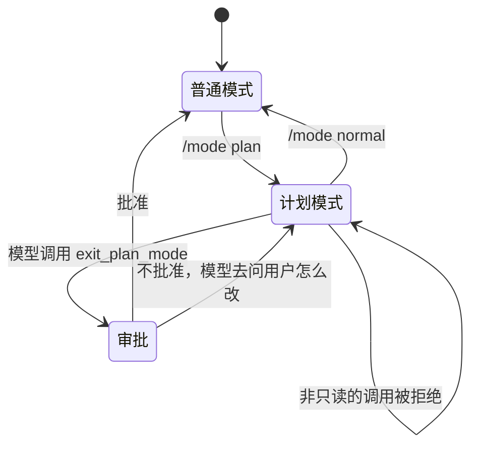
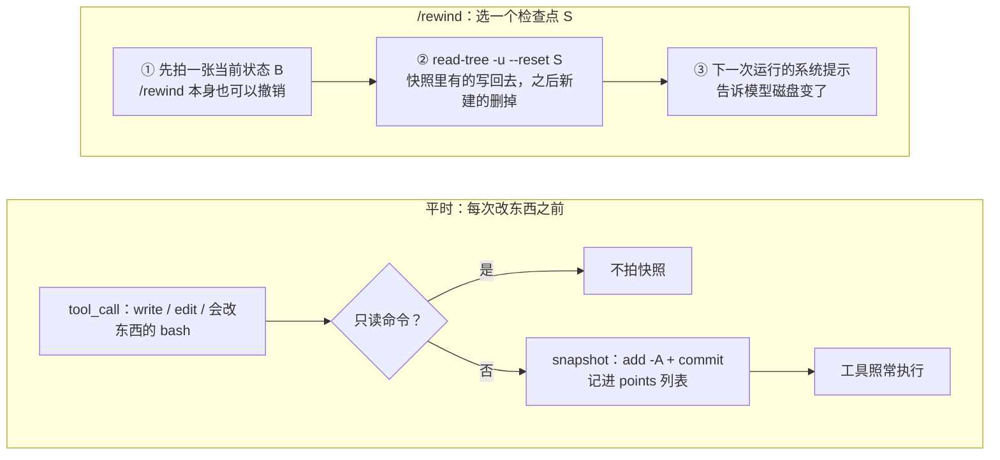

## 三个缺口

前面的章节让 Agent 能做事、能安全地做事。这一章解决的是“做大一点的事”时暴露出来的三个问题：

1. **动手太快。** 一个涉及十几个文件的需求，模型读了两个文件就开始改。方向错了，改得越多，越难收拾。
2. **做着做着就忘了。** 长任务进行到一半，模型忘了还有哪几步没做；用户也看不出它做到哪了。
3. **做错了退不回去。** 对话可以重新开始，文件改动却没法跟着回去。

Claude Code 对应的功能是计划模式、TodoWrite 工具和检查点（`/rewind`）。mox 和 Pi 都没有内置这三样，但 mox 的扩展接口恰好够用：`registerCommand` 切换模式，`on('tool_call')` 拦截调用，`addSystemPrompt` 告诉模型现在的规则，`registerTool` 加新工具。Pi 的示例目录里也有三个相关的扩展：`plan-mode`、`todo.ts`、`git-checkpoint.ts`。这一章先读 Pi 的示例，看它们各自的局限，再给 mox 写我们自己的三个扩展（Pi 版本也在 `extensions/` 里，可以对照着读），看每个设计决定背后的取舍。

## 计划模式

### 先看一次完整的过程

计划模式把一次任务分成两段：**调研和规划**时只能读文件、运行只读命令；用户**批准计划**之后，才能修改文件。下面的实验把三个扩展装进同一个 mox（计划模式、第 14 章的权限扩展、本章的任务清单）：用户先输入 `/mode plan`，模型读文件、试着编辑（被拦下）、运行一条只读命令，然后提交计划，用户批准，模型开始编辑。模型是脚本，`runLoop`、工具和扩展是真的，终端是脚本化的 `ask`：

@lab node labs/ch16/mox-plan.ts

几处值得停下来看：

- 第二行：计划模式里的 `edit` 被拒绝，**没有弹确认框**。用户不需要为一个注定被拒绝的调用点“允许”。
- 弹出的对话框只有两个：批准计划，以及批准之后第一次 `edit` 的权限确认。Pi 版本里只有一个，因为批准计划时可以顺便把权限扩展切到 `acceptEdits`；mox 的扩展之间没有事件总线，计划模式管不到权限扩展的模式。
- 第一张表：`exit_plan_mode` 一直在工具列表里；计划模式的说明在**同一次运行里**一直不变，批准之后的第 5、6 次请求里还是“只能读”。因为系统提示是在运行开始时取一次值（`addSystemPrompt` 每次运行前重新取值，不是每次请求前）。所以提示里专门写了一句“以 `exit_plan_mode` 的结果为准”；下一次提问，说明就没有了。
- 最后：把加载顺序对调，权限扩展排在计划模式前面，用户在计划模式里被问了 `edit`，点了“允许”，计划模式照样拒绝：拒绝优先，安全不取决于顺序，但用户被白问了一次。

::: steps 计划模式：从 /mode plan 到批准后的第一次 edit
--- 用户输入 `/mode plan`。命令处理函数把 `active` 设为真；之后每次运行前，`addSystemPrompt` 的取值函数都会把计划模式的说明放进系统提示。
sequenceDiagram
  participant U as 用户
  participant L as Agent 循环
  participant PM as 计划扩展
  participant PE as 权限扩展
  U->>PM: /mode plan
  Note over PM: active = true
--- 模型试着 `edit`。`tool_call` 事件按加载顺序传给处理函数，计划扩展排在前面：`decidePermission(…, mode: 'plan')` 的结果不是 allow，处理函数返回理由，提醒“请先调用 exit_plan_mode”。事件到此为止，后面的权限扩展根本没被调用，用户什么都没看到。
sequenceDiagram
  participant U as 用户
  participant L as Agent 循环
  participant PM as 计划扩展
  participant PE as 权限扩展
  Note over PM: active = true
  L->>PM: tool_call edit src/cli.ts
  PM-->>L: 返回理由：计划模式只能读
--- 只读调研不受影响：bash 命令同样交给 `decidePermission`，规则引擎认定是只读，计划扩展放行；权限扩展也认为只读，放行。
sequenceDiagram
  participant U as 用户
  participant L as Agent 循环
  participant PM as 计划扩展
  participant PE as 权限扩展
  PM-->>L: 返回理由：计划模式只能读
  L->>PM: tool_call bash（只读）
  PM-->>L: 放行：只读
--- 计划写好了，模型调用 `exit_plan_mode`，参数 `plan` 就是计划。它在 `ALWAYS_ALLOWED` 里不会被拦；权限扩展的 `INTERNAL_TOOLS` 里也有它。审批发生在这次工具调用**之内**：工具的 `run` 调用 `mox.ask`。
sequenceDiagram
  participant U as 用户
  participant L as Agent 循环
  participant PM as 计划扩展
  participant PE as 权限扩展
  PM-->>L: 放行：只读
  L->>PM: exit_plan_mode（计划全文）
  PM->>U: mox.ask：批准这个计划吗？
--- 用户选“批准”。`active` 变回假，工具返回“用户批准了计划，现在可以修改文件了”，模型在同一次运行里接着干。选“不批准”的话，结果是让模型去问用户需要怎么改。
sequenceDiagram
  participant U as 用户
  participant L as Agent 循环
  participant PM as 计划扩展
  participant PE as 权限扩展
  PM->>U: mox.ask：批准这个计划吗？
  U-->>PM: 批准
  Note over PM: active = false
  PM-->>L: 结果：用户批准了计划
--- 同一个 `edit` 现在畅通无阻：计划扩展的处理函数第一行就因为 `active` 为假而返回。但权限扩展照常工作：default 模式下修改文件要确认，于是这里多了一个对话框。
sequenceDiagram
  participant U as 用户
  participant L as Agent 循环
  participant PM as 计划扩展
  participant PE as 权限扩展
  PM-->>L: 结果：用户批准了计划
  L->>PM: tool_call edit src/cli.ts
  PM-->>L: 放行（active 为假）
  L->>PE: tool_call edit src/cli.ts
  PE->>U: mox.ask：允许执行吗？edit
:::

这个过程里有三个设计决定：计划怎么交接，只读怎么保证，扩展之间怎么协作。

### 计划怎么交接：解析文本，还是调用工具

模型怎么告诉 Agent“计划写好了”？Pi 的示例从模型的回答里找一个 `Plan:` 标题，再解析下面的编号列表：

@pi packages/coding-agent/examples/extensions/plan-mode/utils.ts#extractTodoItems

这段代码的每一行都在猜模型的格式：标题可能加粗，编号可能用 `.` 或 `)`，太短的条目被丢掉，以反引号开头的被跳过，超过 50 个字符的被截断。模型换一种写法（比如用“## 计划”），计划就“不存在”了。执行阶段也是同样的做法：示例让模型每做完一步在回答里写一个 `[DONE:n]` 标记，再用正则扫出来打钩：

@pi packages/coding-agent/examples/extensions/plan-mode/utils.ts#extractDoneSteps

而且审批发生在**一次运行结束之后**（示例在 `agent_end` 事件里弹出选择框）：模型已经把话说完，用户的修改意见要作为一条新消息重新开始一轮。

我们的版本用一个工具 `exit_plan_mode`：模型写完计划后调用它，参数就是计划本身。工具调用是**结构化**的，也是模型**明确发出**的信号——不需要猜它写完了没有、格式是什么。审批发生在这次工具调用**之内**：`mox.ask` 弹出选项，用户选择，选择的结果就是工具的返回值，模型在同一次运行里接着干。这也是 Claude Code 的做法（它的工具就叫 ExitPlanMode）。mox 版有两个选项：

- **批准**：退出计划模式，工具结果告诉模型可以改文件了；
- **不批准**：工具结果让模型先别动手，去问用户需要怎么改。`ask` 只能选选项，修改意见走普通对话，不需要另开输入框。

（Pi 版有三个选项：批准并自动接受编辑、批准但逐个确认、不批准并输入意见。批准时它还会通过事件总线把权限扩展切到对应的模式。）

同一个问题——模型怎样把“计划”交出来——两种写法对照：

::: tabs
@@ Pi 官方示例
@pi packages/coding-agent/examples/extensions/plan-mode/utils.ts#extractTodoItems
从回答文本里找 `Plan:` 标题和编号列表，每一行都在猜模型的格式。
@@ mox 扩展
@code extensions/plan-mode/mox.ts#L38-L50
计划是 `exit_plan_mode` 的参数；审批在工具调用之内完成，选择结果就是工具的返回值。
:::

### 只读怎么保证

计划模式的承诺是“调研阶段什么都不会被改”。Pi 的示例分两层兑现。第一层是工具：进入计划模式时，把 `edit` 和 `write`（常量 `PLAN_MODE_DISABLED_TOOLS`）从启用的工具里去掉，模型根本看不到它们：

@pi packages/coding-agent/examples/extensions/plan-mode/index.ts#L86-L109

`bash` 去不掉，因为调研离不开它（`git log`、`grep`）。所以第二层是命令：`tool_call` 钩子在计划模式下检查每一条 bash 命令，不安全就拦下：

@pi packages/coding-agent/examples/extensions/plan-mode/index.ts#L163-L174

判断函数是一份正则白名单（`^ls`、`^cat`、`^git status`……）加一份正则黑名单（`rm`、`mv`、输出重定向、`npm install`……）：命中黑名单一律否决，没命中白名单也否决。

@pi packages/coding-agent/examples/extensions/plan-mode/utils.ts#L80-L101 hl=80,86,89,90,98-100

mox 的扩展拿不到工具列表，没法像第一层那样把 `edit` 和 `write` 藏起来，只剩第二层——不过不是只盯着 bash，而是对**所有**工具调用做同一个检查。我们不另写一份正则，而是直接复用第 14 章的规则引擎：`decidePermission` 的 `plan` 模式只放行它认定为只读的调用（`read`、`grep`、`find`、`ls` 和只读的 bash 命令），`write`、`edit` 和其他会改东西的 bash 一律不放行。第 14 章已经花了大力气处理复合命令、包装命令、重定向，计划模式白拿一份。同一批命令交给两边：

@lab node labs/ch16/readonly.ts | md

正则白名单漏过了五条会修改东西的命令：`find -delete` 和 `sort -o` 只是在白名单命令后面多了一个参数；`git branch new-feature` 在黑名单里只防了 `branch -d` 一种写法；`curl … | sh` 里 `curl` 在白名单上、`sh` 不在黑名单上。这不是示例写得粗心：**一条命令是自由文本，同一个命令加上不同的参数，效果就不同**，枚举“好的”和“坏的”永远有缺口（第 14 章的黑名单与白名单之争）。第 14 章的引擎更保守——它认定的只读命令少，所以误拦了 `sed -n`——但它也不是完备的：`tree -o` 同样被放过了。

所以计划模式是**护栏，不是边界**。它用闸门和一段系统提示，让模型在调研阶段“不想也不能”乱动；要真正保证只读，得在操作系统层面限制进程（第 15 章的沙箱，只读挂载工作目录）。这条原则和第 14、15 章一脉相承。

### 扩展之间的协作

计划模式要和第 14 章的权限扩展配合，这里有两个问题。

**谁来拒绝？** 如果两个扩展各管各的，进入计划模式后模型试图编辑文件，权限扩展（default 模式）会先弹出“允许吗？”，用户点了允许，计划模式再把它拦下——白问了一次。Pi 的做法是让计划模式**通知**权限扩展切换模式：Pi 提供了扩展之间的事件总线 `pi.events`，计划模式发出 `permissions:set-mode`，权限扩展监听它。

mox 的扩展之间没有这样的通道，但 `tool_call` 的判定本身解决了安全的那一半：mox 把每个调用交给**所有**扩展的处理器，**拒绝优先**——只要有一个返回字符串就拒绝，没有人拒绝而有一个返回 `true` 才放行。权限扩展说了“允许”，计划模式照样能拒绝；先后顺序不影响结论。

剩下的只是体验问题。实验最后一段把两个扩展的顺序对调了一次：权限扩展在前时，用户在计划模式里被问了“允许执行吗？edit”，点了允许，计划模式随后还是拒绝，这个提问是白问的。所以建议把只会拒绝的扩展（计划模式）排在会提问的权限扩展前面：计划模式先说“不行”，处理器遇到拒绝就停，后面的权限扩展不会被调用，用户什么都看不到。顺序排错了，最坏是多问一次，不会放过任何一个调用。（早先的 mox 遇到第一个有结论的扩展就停，权限扩展排前面时，它的“允许”会让计划模式失效，那是真正的安全问题，所以现在改成了拒绝优先。）没装权限扩展时，计划模式自己的检查照样生效。

**内部工具要不要审批？** `exit_plan_mode` 和下一节的 `todo_write` 只改变 Agent 自己的状态，不碰文件、不碰网络。权限扩展不认识它们，按“未知工具”处理就会要求确认，在计划模式里甚至会直接拒绝。Pi 版让这类工具声明 `annotations: { readOnlyHint: true }`，权限扩展信任这个声明——但只信任扩展注册的工具，MCP 工具的同名注解来自外部服务器，第 12 章说过不能信。mox 的工具没有注解字段，权限扩展里写了一份名单 `INTERNAL_TOOLS`（`task`、`todo_write`、`exit_plan_mode`）。名单是显式的，少了一个就会出问题，这是本章最后“你来改”的第一题。

### 计划模式扩展（mox）

把上面三件事放在一起，就是这个扩展：

@code extensions/plan-mode/mox.ts#L17-L52 hl=22,24,29,30,31,32,35,38,43,44,47

- 第 22 到 26 行：**`/mode` 命令**切换。`/mode plan` 进入，`/mode normal` 退出，不带参数就切换。状态只是一个闭包里的布尔值。
- 第 29 到 33 行：**`tool_call` 闸门**。计划模式里，除了 `ALWAYS_ALLOWED` 里的三个工具，所有调用都交给 `decidePermission`（`mode: 'plan'`，不带规则），不是 allow 的就返回理由。理由里带着“请先调用 exit_plan_mode”，模型据此知道下一步该做什么。
- 第 35 行：**`addSystemPrompt`** 在计划模式里追加一段说明。这是软约束，让模型少做无谓的尝试；硬约束是上面的闸门。
- 第 38 到 50 行：**`exit_plan_mode`**。不在计划模式时调用只会得到一句提示（mox 的工具列表在注册后就固定了，不能像 Pi 那样只在计划模式里出现）；`mox.ask` 返回 `undefined`（没有终端）时，让模型把计划作为最终回答输出；批准后 `active` 变假。
- 状态**没有跟着会话走**：`mox -c` 恢复会话后，扩展是新的，又回到普通模式。Pi 的版本把开关记成会话里的自定义记录，恢复和切换分支时沿着当前分支找回来；mox 的扩展拿不到会话，也没有分支。

把它接进真正的命令行（借一个伪终端输入 `/mode plan`，再提任务；第一个回答批准计划，第二个回答批准之后第一次 `edit` 的权限确认）：

@lab node labs/ch16/cli-plan.ts

### Pi 里的同一个扩展

Pi 版本多了三样东西，都来自 Pi 更丰富的扩展接口：`setActiveTools` 让 `exit_plan_mode` 只在计划模式里出现在工具列表里；`pi.events` 事件总线让批准时同时切换权限模式；`appendEntry` 把开关记进会话。

@code extensions/plan-mode/index.ts#createPlanModeExtension collapse=true hl=22-26,41-48,58-62,69-75

同样的过程装进 Pi 会话：

@lab node labs/ch16/plan.ts

只有一个对话框（批准计划）：批准时选的是“自动接受编辑”，权限扩展随之切到了 `acceptEdits`，后面的 `edit` 没有再问；`exit_plan_mode` 只在计划模式里出现，批准之后就从工具列表里消失了。这两点是 mox 版做不到的。

## 任务清单

### todo_write

长任务需要一份清单，让模型自己知道做到哪了，也让用户看得到。先看 Pi 示例的设计：工具参数是一个动作（`list`、`add`、`toggle`、`clear`）加上条目 id：

@pi packages/coding-agent/examples/extensions/todo.ts#L31-L35

模型每次只发一个小动作，开销很低，但它必须自己记住每一项的 id；说错了 id，得到的是一条“Todo #7 not found”。我们的工具参照 Claude Code 的 TodoWrite，走另一个方向：

- 每次写入**完整的**清单，而不是增删单项。模型看到的永远是完整的当前状态，也不会出现“删掉了不存在的第 3 项”这类错误；代价是每次都要重复输出整张清单。
- 状态只有三种：`pending`、`in_progress`、`completed`。**同一时间只能有一个 `in_progress`**：逼着模型一件一件地做，做完立即标记。

@code extensions/todo/mox.ts#L12-L53 hl=37,38,40,43,44,50

- 第 16 到 36 行：工具定义。描述里写清楚了什么时候用（三步以上的任务）、什么时候不用（简单的一两步）。这和第 11 章 Skill 的描述一样重要：模型照着描述决定行为。参数是一份 JSON Schema，mox 只用它告诉模型怎么传参。
- 第 37 到 43 行：**mox 不校验参数**（这是它刻意省掉的东西之一），所以工具自己检查：形状不对、`status` 写成了 `doing`、有两个 `in_progress`，都抛出错误。错误会作为工具结果交给模型（`错误：…`），而赋值 `todos = next` 在检查之后，所以**状态保持不变**：清单是模型的工作记忆，不能被一次错误的调用弄乱。
- 第 50 行：每次运行前，`addSystemPrompt` 把还没完成的清单放进系统提示（下面讲为什么）。
- 第 52 行：`/todos` 命令，用户随时看得到进度。

### 状态存在哪里

清单是状态，状态要放在某个地方。几个选择，各自会坏在哪里：

| 存放位置 | 会坏在哪里 |
| --- | --- |
| 扩展的内存 | 会话恢复（`mox -c`）时丢失：扩展是新启动的，内存是空的 |
| 一个文件 | 扩展不知道当前是哪个会话（`ExtensionApi` 里没有会话 id），新开的会话会读到旧会话的清单 |
| 工具结果里（Pi 的 `details`） | 几乎没有；代价是每个结果都带着一份完整清单，多占一点会话文件 |

Pi 官方 todo 示例的做法值得学：**状态存在工具结果的 `details` 里**。每次 `todo` 的结果都带着完整的清单；需要当前状态时，沿着当前分支找到最后一次结果：

@pi packages/coding-agent/examples/extensions/todo.ts#L110-L133

会话本身就是事件日志，状态是从日志推出来的。切换分支（`session_tree` 事件）时重新推一遍，清单就自动回到那个时间点的样子。

这个办法 mox 用不了：mox 的工具结果只是一个字符串，扩展拿不到对话（`registerTool` 的 `run` 只收到参数），也没有会话树。mox 版本退而求其次，用**扩展的内存**，并接受“`-c` 恢复之后要重新写一遍”这个代价——对话里还留着之前所有的 `todo_write` 结果，模型读一遍就能把清单再写出来。

### 让清单留在视线里

清单写在第 5 轮的工具结果里，到第 50 轮时，模型还记得吗？长任务中途压缩（第 8 章）之后，那条结果可能已经不在上下文里了。所以只要还有没完成的项，扩展就把当前清单放进**系统提示**。Pi 版本的做法是每次提问时附一条隐藏消息；mox 里 `addSystemPrompt` 正好做这件事，而且系统提示不会被压缩掉。

@lab node labs/ch16/mox-todo.ts

实验依次展示了：

- 正常的更新，以及两种被拒绝的调用（两个 `in_progress`；`status` 写成 `doing`）——都返回了错误，清单没变，第五次写入的结果显示前面的状态都在。
- 下一次运行时系统提示末尾的清单；全部完成之后就不再提醒（没有未完成的项）。
- **恢复会话**：对话里有之前的 12 条消息，系统提示里却没有清单——这就是“扩展的内存”的代价，也是上面表格的第一行。
- 最后一段：没有权限扩展时，内置确认对 `todo_write` 的态度。它不是 `read`、`grep`、`find`、`ls`、`task` 之一，所以第一次调用要问；选“本次会话都允许”之后不再问。装了第 14 章的权限扩展就不必（它的 `INTERNAL_TOOLS` 里有 `todo_write`）。

Pi 版本把状态存在 `details` 里，所以会话树回到更早的节点时，清单也回到那时的样子：

@lab node labs/ch16/todo.ts

## 检查点

### Pi 的示例：git stash create

Pi 的示例是一个不到 60 行的扩展：

@pi packages/coding-agent/examples/extensions/git-checkpoint.ts#L10-L53 hl=15-18,22-26,29-31,44,51

思路很巧：`git stash create` 生成一个包含当前改动的 stash 提交，却不改变工作区。每一轮开始前（`turn_start`）创建一个，记在内存里的 `Map` 中；用户 fork 的时候（`session_before_fork`），问一句“要不要把代码也恢复到那时”，要就 `git stash apply`。逐段看它的局限：

- **工作区干净时什么都不返回。** 第 22 行拿到空字符串，第 24 行的 `if (ref && …)` 就不记。第一轮往往是最需要回退的那一轮，恰好没有检查点（本节末尾的实验验证）。
- **第一轮还有另一个原因。** `currentEntryId` 只在 `tool_result` 事件里被赋值（第 15-18 行）；在会话里第一次出现工具结果之前，它是 `undefined`，快照即使创建了也不会被记下。
- **只包含 git 已跟踪的文件。** 模型新建的文件不在快照里（本节末尾的实验验证）。
- **检查点只存在内存里。** 一次运行结束（`agent_settled`，第 49-52 行）就清空，会话恢复后也没有了。
- **只能在 fork 的时候恢复**，而且没有界面时（第 33 行）不恢复。

### 影子仓库

我们的做法是一个“影子” git 仓库：它的 `.git` 放在 Agent 的数据目录里（不碰项目自己的 `.git`），工作目录就是项目目录。每次 Agent 要改东西之前，`git add -A` 加 `git commit`，就是一个完整的快照。

快照和恢复都在 `CheckpointStore` 里：

@code extensions/checkpoint/store.ts#CheckpointStore hl=18,20,33,36,51,53

- **`--git-dir` 指向影子仓库，`--work-tree` 指向项目目录**（18 行）：两边分开，项目自己的 `.git` 不受影响；工作目录相同，所以项目的 `.gitignore` 照样生效，再额外排除 `node_modules/` 这类大目录（33 行）。
- **影子仓库禁用钩子**（20 行 `core.hooksPath=/dev/null`）。第 15 章说过，`.git/hooks` 是执行代码的入口。
- **没有变化也生成一个提交**（36 行 `--allow-empty`），这样每个检查点都有自己的 id，不会出现“这次没有快照”。
- **恢复用 `git read-tree -u --reset`**（53 行）：快照里有的文件写回去，之后新建的文件删掉，被忽略的文件不动。
- **恢复之前先拍一张**（51 行）：`/rewind` 本身也可以撤销。

### mox 版本：在每次改动之前拍快照

Pi 的检查点在用户提问时拍快照（`input` 事件），mox 没有这个事件。但 `tool_call` 更精确：真正会改东西的只有 `write`、`edit` 和一部分 `bash`，在它们执行之前拍，粒度从“每次提问”变成“每次改动”。

@code extensions/checkpoint/mox.ts#L15-L52 hl=23,25,28,32,38,39,42,44,45,50

- 第 23、25 行：只给 `write`、`edit` 和**会改东西的** bash 拍快照。只读命令（`ls`、`cat`）的判断复用第 14 章的规则引擎，不然 `/rewind` 的菜单会被无意义的检查点淹没。
- 第 28、32 行：`store.snapshot` 的返回值（提交号）存进 `points`，**不能 `return`**。`tool_call` 处理器返回字符串就是拒绝这次调用，把提交号顺手返回出去，每个写操作都会被拒绝（实验最后一段演示了这个常见的错误）。
- 第 38、39 行：`/rewind` 不带参数时用 `mox.ask` 列出所有检查点（最新的在前），带序号（`/rewind 3`）就直接选。
- 第 42、44 行：恢复之前先拍一张当前状态，也记成一个检查点。
- 第 45、50 行：mox 没有会话树，对话不会跟着回退，所以恢复之后用 `addSystemPrompt` 放一段**一次性**的说明：用户刚刚用 `/rewind` 回到了某次操作之前，之前对话里的修改有些已经不在磁盘上，继续之前先重新读文件。读完这次就清空。
- 检查点列表在内存里，`mox -c` 之后丢失；影子仓库本身还在磁盘上，所以数据没有丢，只是菜单没有了。
- **加载顺序**：放在权限扩展前后都能拍到快照，因为每个扩展的处理器都会被调用，检查点处理器返回空也不影响别人的结论。区别只在被拒绝的调用上：检查点在前，会为一个被权限扩展拒绝的调用留下检查点（恢复它不会改变任何东西）；检查点在后，遇到拒绝就不再被调用，也就没有检查点（本章最后“你来改”的第三题）。

下面的实验里，第一次提问让模型用三种方式改文件（`edit` 工具改的、`bash` 追加的、新建的文件），第二次提问删掉一个文件，然后 `/rewind` 回到第一次改动之前，再撤销这次 `/rewind`：

@lab node labs/ch16/mox-checkpoint.ts

菜单里只有四项：`ls src` 是只读命令，没有检查点；`edit`、两条写文件的 bash、`rm` 各有一个。选第一项之后，三个文件全部回到了原样（包括被删掉的 README 恢复、新建的 `src/list.ts` 被删除），恢复提示是用两个快照的差异算出来的。撤销 `/rewind` 时菜单里多了第 5 项“`/rewind` 之前的状态”，选它，一切又回到了两次提问之后的样子。

::: steps 检查点与 /rewind：拍快照，再原路退回
--- 模型要 `edit` 一个文件。检查点扩展的 `tool_call` 处理器看到是 `edit`，要拍快照。如果是 `ls src` 这样的只读 bash，就直接返回。
sequenceDiagram
  participant U as 用户
  participant L as Agent 循环
  participant X as 检查点扩展
  participant S as 影子仓库
  L->>X: tool_call（edit src/cli.ts）
  Note over X: write / edit / 会改东西的 bash：要拍快照
--- 快照是影子仓库里的一个提交：`--git-dir` 指向数据目录，`--work-tree` 指向项目，`add -A` 加 `commit --allow-empty`。提交号记进 `points`，处理器返回 `undefined`，`edit` 照常执行。
sequenceDiagram
  participant U as 用户
  participant L as Agent 循环
  participant X as 检查点扩展
  participant S as 影子仓库
  Note over X: write / edit / 会改东西的 bash：要拍快照
  X->>S: snapshot：add -A + commit
  S-->>X: commit A
  X-->>L: 返回 undefined，edit 执行
--- 接着模型用 `bash` 追加了 README、新建了 `src/list.ts`，第二次提问又删掉了一个文件：每一次改动之前各拍一张（B、C、D）。
sequenceDiagram
  participant U as 用户
  participant L as Agent 循环
  participant X as 检查点扩展
  participant S as 影子仓库
  X-->>L: 返回 undefined，edit 执行
  Note over X,S: 每次改动之前各拍一张：B、C、D
--- 用户输入 `/rewind`。扩展用 `mox.ask` 列出检查点，用户选「1. edit src/cli.ts」，也就是回到 A 的状态。
sequenceDiagram
  participant U as 用户
  participant L as Agent 循环
  participant X as 检查点扩展
  participant S as 影子仓库
  Note over X,S: 每次改动之前各拍一张：B、C、D
  U->>X: /rewind
  X->>U: mox.ask：回到哪一次操作之前？
  U-->>X: 1. edit src/cli.ts
--- `restore` 的第一件事是**给当前状态再拍一张**（E），然后用 `changes` 算出两张快照的差异，用来生成“恢复 / 还原 / 删除”的提示。
sequenceDiagram
  participant U as 用户
  participant L as Agent 循环
  participant X as 检查点扩展
  participant S as 影子仓库
  U-->>X: 1. edit src/cli.ts
  X->>S: restore(A)：先拍 backup E
  X->>S: changes 算差异
--- `git read-tree -u --reset`：快照里有的文件写回去，之后新建的文件删掉，被忽略的不动。这是实验里 `src/list.ts` 能被删掉的原因。
sequenceDiagram
  participant U as 用户
  participant L as Agent 循环
  participant X as 检查点扩展
  participant S as 影子仓库
  X->>S: restore(A)：先拍 backup E
  X->>S: read-tree -u --reset A
  S-->>X: 工作目录回到 A
--- 备份 E 也记成一个检查点，`/rewind` 本身因此可以撤销。最后 `note` 变量里存了一句话，下一次运行时 `addSystemPrompt` 把它放进系统提示，告诉模型磁盘变了，然后清空。
sequenceDiagram
  participant U as 用户
  participant L as Agent 循环
  participant X as 检查点扩展
  participant S as 影子仓库
  S-->>X: 工作目录回到 A
  Note over X: points 加上 E；note 等待下一次运行
  X-->>U: 代码已恢复：恢复 README.md，还原 cli.ts，删除 list.ts
:::

同一个扩展接进真正的命令行（伪终端里输入任务和 `/rewind`，菜单里最新的在最前面，所以输入 2 选的是第一次写入）：

@lab node labs/ch16/cli-checkpoint.ts

回到第一次写入之前，`src/list.ts` 就不存在了；下一次提问时，系统提示里带着 `/rewind` 的说明。

### Pi 版本，和 stash 的对照

Pi 版本把检查点记成会话里的自定义记录（`pi.appendEntry`），所以恢复会话后检查点还在；`/rewind` 还可以用 `ctx.navigateTree` 把对话一起退回去（第 7 章的会话树）。下面的实验在 Pi 会话里做同一件事，最后跑了一次 Pi 示例用的 `git stash create` 做对照，验证上面读源码得到的两个结论：

@lab node labs/ch16/checkpoint.ts

三种改动和一次删除，全部回到了原样，对话也回到了第一次提问之前（0 条消息）。对照部分验证了：干净的工作区里 `git stash create` 什么都不返回；新建的 `src/list.ts` 不在快照里。

### 取舍

影子仓库给整个工作目录拍快照，所以 bash 造成的改动也能恢复。Claude Code 的检查点只跟踪它的文件编辑工具改过的文件：bash 单独改的文件不能恢复，你自己在编辑器里的改动也不受影响。两种设计各有道理：

| | 整个工作目录（本章） | 只跟踪 Agent 编辑过的文件（Claude Code） |
| --- | --- | --- |
| bash 的改动 | 能恢复 | 不能（除非这个文件也被编辑工具改过） |
| 你同时手动改的文件 | **也会被回退** | 不受影响 |
| 开销 | 每次改动之前扫描一遍工作目录（git 是增量的，通常很快） | 只保存改过的文件 |

如果你习惯在 Agent 工作时自己也改代码，回退整个目录可能把你的改动一起带走。`/rewind` 之前拍的那张快照就是为这种情况准备的。另外，两者都**不能代替 git**：检查点是会话级的后悔药，长期的历史还是要靠提交。

mox 版本和 Pi 版本的差别，来自 mox 的接口更少：没有会话树，所以只恢复代码，对话靠 `addSystemPrompt` 提醒模型；没有 `appendEntry`，检查点列表只在内存里。换来的是一个 50 行就能读完的文件。

::: compare Claude Code
- **计划模式**：是权限模式的一种（Shift+Tab 切换）。模型用 ExitPlanMode 工具提交计划，用户可以选择批准并自动接受编辑、批准但逐个确认、或者继续规划。
- **TodoWrite**：内置工具，界面上实时显示清单。
- **检查点**：每次提问自动创建，保存最近 100 个，随会话保存（会话恢复后仍可 `/rewind`），默认保留约 30 天。`/rewind`（或连按两次 Esc）可以恢复代码和对话、只恢复对话、只恢复代码，还可以“从这里开始压缩”或“压缩到这里”。限制：bash 单独改的文件、子 Agent 的改动、外部改动不跟踪；符号链接和硬链接的文件不恢复。

官方文档：[Checkpointing](https://code.claude.com/docs/en/checkpointing)
:::

## 你来改

每道题先写下预测，再动手验证。

::: predict 把 exit_plan_mode 从 INTERNAL_TOOLS 里去掉
删掉 `extensions/permissions/mox.ts` 里 `INTERNAL_TOOLS` 中的 `'exit_plan_mode'`，运行 `node labs/ch16/mox-plan.ts`。模型提交计划时会发生什么？用户会看到几个对话框？
???
计划本身还是被批准了，文件也改成功了，但用户多看到一个对话框：先是“允许执行吗？exit_plan_mode …”，然后才是“批准这个计划吗？”。实验末尾对对话框数量的断言会报错（期望 2 个，实际 3 个）。

计划扩展自己放行了 `exit_plan_mode`（`ALWAYS_ALLOWED`），但权限扩展是另一道闸门，它不认识这个工具，按“未知工具”处理，默认要确认。任何一道闸门说“要问”，用户就要被问一次。名单（Pi 版是工具注解）正是让权限扩展认出“这个工具只改 Agent 自己的状态”的办法。在 `-p` 这样没有终端的场景里，后果更严重：权限扩展直接拒绝了它，计划永远交不出去。
:::

::: predict 用 checkout 代替 read-tree
把 `extensions/checkpoint/store.ts` 里 `restore` 的 `this.git(['read-tree', '-u', '--reset', commit])` 换成 `this.git(['checkout', commit, '--', '.'])`，运行 `node labs/ch16/mox-checkpoint.ts`。`/rewind` 之后三个文件分别是什么状态？恢复提示里会写什么？
???
`src/cli.ts` 和 `README.md` 回到了原样，但 `src/list.ts` 还留在磁盘上，实验末尾的断言会报错。`checkout <commit> -- .` 只把快照里**有**的文件写回来，不会删除快照里没有、之后才出现的文件。

更糟的是恢复提示仍然写着“删除 src/list.ts”：提示是用两个快照的差异算出来的，并不是实际执行过的操作。提示和现实对不上，比没有提示更危险。`read-tree -u --reset` 让工作目录和索引都变成快照的样子，多出来的文件才会被删掉。
:::

::: predict 检查点扩展和权限扩展，谁排在前面
一个 `write` 调用，权限扩展弹出确认框，用户选了“拒绝”。之后输入 `/rewind`，菜单里有这次 `write` 的检查点吗？把两个扩展的加载顺序对调，结果一样吗？如果用户选的是“允许一次”呢？
???
选“允许一次”：两种顺序下菜单里都有这次写入的检查点。mox 把调用交给每一个扩展，检查点扩展的处理器返回空，不影响权限扩展的 `true`，也不会因为权限扩展排在前面就被跳过。（早先的 mox 遇到第一个有结论的就停，权限扩展在前时检查点一张也拍不到，所以现在改成了问遍所有扩展。）

选“拒绝”：不一样。**检查点扩展排在前面**，它先拍了快照，然后权限扩展才拒绝，菜单里多了一个对应一次没有发生的写入的检查点，恢复它什么也不会改变，但白占一个位置。**权限扩展排在前面**，它的拒绝让判定立刻结束，检查点处理器没被调用，菜单是空的（“还没有检查点”）。

所以安全不取决于顺序，顺序只决定被拒绝的调用留不留痕迹：想少一点噪音，把会拒绝的扩展排前面。
:::

## 面试题

先自己回答，再展开对照要点。

::: interview 什么是计划模式？怎么实现？
把任务分成两段：先只读地调研、写出计划，用户批准后才执行。实现上：

- 只读限制复用权限系统（plan 模式只放行只读操作），并用一段隐藏的提示告诉模型现在的规则；
- 计划用一个专门的工具提交（参数就是计划），而不是从回答里解析文本——工具调用是结构化的、明确的信号；
- 批准时可以顺便调整权限模式（比如自动接受编辑），不批准时把意见作为工具结果交还；
- 开关状态如果放在内存里，恢复会话后会丢；有会话记录的实现（Pi 的 `appendEntry`）把它记在会话里，恢复和切换分支时跟着走。

价值：方向性的错误在动手之前就被发现；用户在最便宜的时候参与决策。
:::

::: interview Agent 的任务清单（todo）工具应该怎么设计？
- 每次写入完整清单，而不是增量修改：模型看到的总是完整状态，避免引用不存在的条目。
- 状态少而明确（待办、进行中、完成），同时只允许一个进行中，促使模型逐项推进、及时标记。
- 工具描述写清楚什么时候该用。
- 状态存在会话里（工具结果的 details），从当前分支推导，保证恢复和分支后正确。
- 让清单留在模型的视线里：压缩后重新提醒，或每次提问时附上未完成的项。
- 校验失败时拒绝并保持原状态。
:::

::: interview 怎样实现“撤销 Agent 的改动”？有哪些方案？
- **影子 git 仓库**：每次提问前给整个工作目录拍快照（遵守 .gitignore），恢复时 read-tree。能恢复 bash 的改动和新建的文件，但会连同用户同时手动做的改动一起回退。
- **只跟踪编辑工具改过的文件**（Claude Code）：在编辑前保存文件原样，精确但不覆盖 bash 的改动。
- **git stash create**（Pi 示例）：轻量，但干净的工作区不产生快照，也不包含未跟踪的文件。
- 共同的要点：恢复前先保存当前状态（撤销可以撤销）；检查点和会话记录关联，对话与代码一起回退；它们都不能代替版本控制。
:::

::: interview 多个扩展（或插件）之间如何协作而不互相依赖？
- **事件总线**：一方发出事件（“切换到 plan 模式”），另一方如果存在就响应，不存在也不影响发出方。
- **声明式的元信息**：工具声明自己的性质（只读、破坏性），由权限等扩展统一解读，而不是互相写死对方的工具名。声明的可信度取决于来源：进程内的扩展可信，外部 MCP 服务器的声明不可信。
- **状态放在共享的会话记录里**，而不是彼此的内存。
- **注意执行顺序**：多个闸门作用于同一个事件时，谁先运行会影响用户体验（比如先弹了确认框，再被另一个扩展拦下）。mox 没有事件总线，但 `tool_call` 是拒绝优先：每个扩展都被问到，有一个拒绝就拒绝，所以安全不取决于顺序，顺序只影响体验——纯拒绝型的扩展（计划模式）排在会提问的扩展（权限）前面，用户就不会被白问。
:::

::: interview 计划模式怎样保证“只读”？一份命令白名单够吗？
分层，而且要诚实地说明每一层能挡住什么：

- **工具层**：计划模式下把写文件的工具从模型的工具列表里去掉，或者让权限引擎拒绝所有非只读的调用；
- **命令层**：bash 去不掉，要逐条判断。复用权限系统的规则引擎，比另写一份正则更可靠：它已经处理了复合命令、包装命令和重定向；
- **提示层**：用一段隐藏的提示告诉模型现在的规则，减少无谓的尝试。

白名单不够：命令是自由文本，`find -delete`、`sort -o`、`curl … | sh`、`git branch <名字>` 这类“白名单命令加一个参数”会漏过去，Pi 的示例就漏了五条，第 14 章的规则引擎也漏了 `tree -o`。真正的边界在操作系统层：沙箱里只读挂载工作目录。计划模式是护栏，让模型“不想也不能”乱动，不是安全边界。
:::
