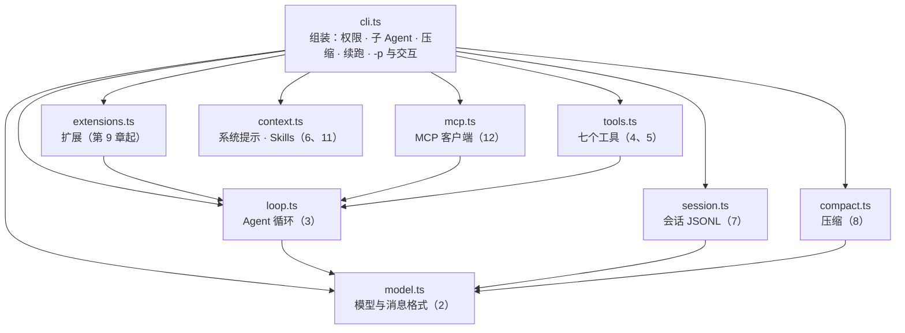

## 回顾：二十章读过的 Pi

第 0 章画过一张地图：Pi 由四层构成，模型层（`packages/ai`）、循环层（`packages/agent`）、产品层（`packages/coding-agent` 的 `core`），和最上面的界面。后面二十章，每一章把其中一块拆开读透。回头把它们摆在一起：

| 章 | 机制 | 在 Pi 里读过的位置 | 章末在 mox 里搭的 |
| --- | --- | --- | --- |
| 2 | 模型协议、流式 | `packages/ai`：各服务商适配、事件流、半截 JSON | `model.ts` |
| 3 | Agent 循环 | `packages/agent/src/agent-loop.ts` | `loop.ts` |
| 4 | 工具流水线 | `agent-loop.ts` 的 `prepareToolCall`、参数校验、钩子 | `Tool`、`beforeTool`/`afterTool` |
| 5 | 编程工具 | `packages/coding-agent/src/core/tools/` | `tools.ts` 的七个工具 |
| 6 | 系统提示与上下文 | `core/resource-loader.ts` 与系统提示的拼装 | `context.ts` |
| 7 | 会话 | `core/session-manager.ts`：JSONL 的树 | `session.ts` |
| 8 | 压缩 | `core/compaction/`：切点、split turn、摘要 | `compact.ts` |
| 9–16 | 扩展、记忆、Skills、MCP、钩子、权限、沙箱、计划模式 | `core/extensions/`、`packages/mcp`、`examples/extensions/` | `extensions.ts` 和各个扩展 |
| 17 | 子 Agent | `examples/extensions/subagent/`：每个子 Agent 一个 pi 进程 | `cli.ts` 里的 `task` |
| 18 | 长任务 | `packages/durable`、示例扩展 | `session.ts` 的补“中断”、goal、background |
| 19 | 嵌入 | `core/sdk.ts`、`src/modes/`（print、json、rpc） | 当库用、`mox-rpc.ts` |
| 20 | 评测 | `packages/evals` | `evals/` |

这张表有一个很明显的特点：Pi 的**内核很小**。循环、工具流水线、会话、压缩，都是产品层里几千行的事；权限、记忆、子 Agent、计划模式、后台命令，Pi 一概没有放进内核，而是留给扩展和示例。这一点在 Claude Code 里是反过来的，后面的对照表会看到。

## 一次回车，经过 Pi 的哪些地方

把二十章的零件按一次请求的顺序串起来：

::: steps 一次回车在 Pi 里的旅程
--- 用户在终端里敲回车。`pi` 命令先决定进哪个模式：交互、打印、JSON、RPC；非交互模式在加载任何扩展之前就接管 stdout（第 19 章）。
flowchart LR
  A["main.ts<br/>选模式"]:::on --> B["AgentSession<br/>prompt()"]:::dim --> C["扩展<br/>输入事件"]:::dim --> D["agent-loop<br/>runLoop"]:::dim --> E["工具<br/>过关与执行"]:::dim --> F["会话<br/>追加 JSONL"]:::dim --> G["压缩 · 结算<br/>settle"]:::dim --> H["事件<br/>TUI · JSON · RPC"]:::dim
  G -- 扩展要求继续 --> D
--- `AgentSession.prompt()` 是所有模式共用的入口：校验模型和凭证，运行中的 prompt 必须声明是插话还是追加任务（第 3、19 章）。
flowchart LR
  A["main.ts<br/>选模式"]:::done --> B["AgentSession<br/>prompt()"]:::on --> C["扩展<br/>输入事件"]:::dim --> D["agent-loop<br/>runLoop"]:::dim --> E["工具<br/>过关与执行"]:::dim --> F["会话<br/>追加 JSONL"]:::dim --> G["压缩 · 结算<br/>settle"]:::dim --> H["事件<br/>TUI · JSON · RPC"]:::dim
  G -- 扩展要求继续 --> D
--- 扩展有机会改写输入、往系统提示里加东西（第 9、10 章）；系统提示由项目说明、Skills 目录、工具说明拼成，稳定的前缀留给提示缓存（第 6 章）。
flowchart LR
  A["main.ts<br/>选模式"]:::done --> B["AgentSession<br/>prompt()"]:::done --> C["扩展<br/>输入事件"]:::on --> D["agent-loop<br/>runLoop"]:::dim --> E["工具<br/>过关与执行"]:::dim --> F["会话<br/>追加 JSONL"]:::dim --> G["压缩 · 结算<br/>settle"]:::dim --> H["事件<br/>TUI · JSON · RPC"]:::dim
  G -- 扩展要求继续 --> D
--- `runLoop`：请求模型、解析流式的工具调用、执行工具、把结果交回去，直到模型不再调用工具。截断的回复不执行工具，取消沿着 `AbortSignal` 传到最底层（第 2、3 章）。
flowchart LR
  A["main.ts<br/>选模式"]:::done --> B["AgentSession<br/>prompt()"]:::done --> C["扩展<br/>输入事件"]:::done --> D["agent-loop<br/>runLoop"]:::on --> E["工具<br/>过关与执行"]:::dim --> F["会话<br/>追加 JSONL"]:::dim --> G["压缩 · 结算<br/>settle"]:::dim --> H["事件<br/>TUI · JSON · RPC"]:::dim
  G -- 扩展要求继续 --> D
--- 每个工具调用要过的关：查找工具、校验参数、扩展的 `tool_call`（钩子、权限、计划模式、沙箱都挂在这里，第 13–16 章）、执行、扩展的 `tool_result`。一个子 Agent 就是这条路径上的一个工具，里面再跑一遍（第 17 章）。
flowchart LR
  A["main.ts<br/>选模式"]:::done --> B["AgentSession<br/>prompt()"]:::done --> C["扩展<br/>输入事件"]:::done --> D["agent-loop<br/>runLoop"]:::done --> E["工具<br/>过关与执行"]:::on --> F["会话<br/>追加 JSONL"]:::dim --> G["压缩 · 结算<br/>settle"]:::dim --> H["事件<br/>TUI · JSON · RPC"]:::dim
  G -- 扩展要求继续 --> D
--- 每条消息一形成就追加进会话 JSONL（第 7 章）：崩溃后从这里恢复，durable 把它推到极致（第 18 章）。
flowchart LR
  A["main.ts<br/>选模式"]:::done --> B["AgentSession<br/>prompt()"]:::done --> C["扩展<br/>输入事件"]:::done --> D["agent-loop<br/>runLoop"]:::done --> E["工具<br/>过关与执行"]:::done --> F["会话<br/>追加 JSONL"]:::on --> G["压缩 · 结算<br/>settle"]:::dim --> H["事件<br/>TUI · JSON · RPC"]:::dim
  G -- 扩展要求继续 --> D
--- 上下文快满就压缩，切点绝不拆开工具调用和结果（第 8 章）。运行真正结束前还有最后一个决策点 `agent_before_settle`：目标循环在这里检查、不满意就让它继续（第 18 章）。
flowchart LR
  A["main.ts<br/>选模式"]:::done --> B["AgentSession<br/>prompt()"]:::done --> C["扩展<br/>输入事件"]:::done --> D["agent-loop<br/>runLoop"]:::done --> E["工具<br/>过关与执行"]:::done --> F["会话<br/>追加 JSONL"]:::done --> G["压缩 · 结算<br/>settle"]:::on --> H["事件<br/>TUI · JSON · RPC"]:::dim
  G -- 扩展要求继续 --> D
--- 整个过程中，每个状态变化都是一个事件，TUI、JSON 模式、RPC 的客户端、评测框架，订阅的是同一个事件流（第 19、20 章）。
flowchart LR
  A["main.ts<br/>选模式"]:::done --> B["AgentSession<br/>prompt()"]:::done --> C["扩展<br/>输入事件"]:::done --> D["agent-loop<br/>runLoop"]:::done --> E["工具<br/>过关与执行"]:::done --> F["会话<br/>追加 JSONL"]:::done --> G["压缩 · 结算<br/>settle"]:::done --> H["事件<br/>TUI · JSON · RPC"]:::on
  G -- 扩展要求继续 --> D
:::

几个站点的源码，是前面读过的：模式的分叉、`prompt()` 的入口、循环本身。

@pi packages/coding-agent/src/main.ts#L112-L127 hl=113-122

@pi packages/coding-agent/src/core/agent-session.ts#L2157-L2195 hl=2158-2170,2193-2195

@pi packages/agent/src/agent-loop.ts#runLoop collapse=true

## 扩展事件怎样汇总：先到先拦，依次接力

扩展是 Pi 把权限、钩子、沙箱、计划模式、后台命令都装进去的地方。装了不止一个扩展的时候，同一个事件有不止一个处理函数，谁说了算？Pi 对不同的事件用不同的汇总方式。

**`tool_call`：任何一个拦下，就拦下。** 处理函数依次调用，返回 `block` 的立即结束，其余的只是被记下；一个“放行”不会盖住后面的“拒绝”：

@pi packages/coding-agent/src/core/extensions/runner.ts#emitToolCall

**`tool_result`：依次接力。** 每个处理函数拿到的是**上一个改过的结果**，各自可以改内容、改是否出错：

@pi packages/coding-agent/src/core/extensions/runner.ts#emitToolResult collapse=true

这两种汇总方式是对“这个事件最怕什么”的回答：拦截怕被盖掉，所以拒绝优先；改写怕丢，所以接力。而像“Agent 准备停下时给出下一句话”这样只能有一个答案的事件，只好先到先得。后面实战里 mox 的三种汇总方式，就是照着这个来的。

## Pi、mox、Claude Code

| 能力 | Pi v1.5 | mox | Claude Code |
| --- | --- | --- | --- |
| 模型协议 | 多服务商适配，统一内部格式 | 只走 OpenAI 兼容的 Chat Completions，消息格式就是它的格式（2） | 原生协议，自家服务 |
| 循环、工具流水线 | 并行工具、参数校验、钩子 | 一个 `for` 加 `await`，工具顺序执行，不校验参数（3、4） | 并行只读工具，完整流水线 |
| 编程工具 | 七个内置 | 七个，名字和参数与 Pi 一致（5） | 更多，含搜索、网页、计划等 |
| 会话 | 树，可分支、可导航 | JSONL，线性，没有分支（7） | 会话恢复、`/branch` |
| 压缩 | 内置，切开的轮次写两份摘要 | 单份摘要，切点只在用户消息前（8） | 内置 |
| 扩展 | 四十多种事件 | 八个接口，扩展就是一个函数（9） | 插件、mods |
| Skills | 内置，含提示模板 | 目录 + 名字描述，模型自己 `read`（11） | 内置 |
| MCP | 内置，四种暴露方式、OAuth | 只有 stdio，工具名 `mcp__服务器__工具`（12） | 内置，默认推迟加载 |
| 权限 | 无，本课写了兼容扩展 | `ask` 三选一，只读工具免确认，`--yolo` 跳过（14） | 规则与模式，还有 auto 模式 |
| 沙箱 | 容器、微型虚拟机方案 | 无（15） | 内置 |
| 子 Agent | 示例扩展，独立进程 | 一个 `task` 工具，七行（17） | 内置，定义文件，可后台 |
| 后台命令、目标循环 | 示例与 durable 包（实验性） | 扩展（18） | 后台命令、`/loop` |
| 崩溃恢复 | durable：意图先于效果、重启计数 | 恢复时补“中断”（18） | 会话恢复 |
| SDK / JSON / RPC | 全部内置 | import 模块；`-p`；没有 RPC（19） | Agent SDK、无界面模式 |
| 评测 | evals 包 | 小框架，评测对象是 `mox -p`（20） | — |

Pi 的取舍很清楚：内核小而完整，很多功能留给扩展和示例。Claude Code 则把这些都做成了产品功能。mox 在 Pi 的另一头：它小到整个读完只要一个下午，是你亲手搭出来的最小版本。读 Pi，知道一个机制做到生产级是什么样；搭 mox，知道它最少需要多少行，多出来的行数花在了哪里。

## 实战：组装——把全课搭出来的 mox 跑一遍

**目标。** 前面每一章，你给 mox 加了一样东西：循环、工具、会话、压缩、扩展、权限、子 Agent、后台命令、RPC、评测。这一章不加新东西，只做一件事：**从头读一遍 `cli.ts`**——它是唯一知道全部零件的文件——然后把它们同时装上，跑一次完整的修 bug。

### 第 1 步：mox 的地图

第 1 章的 Agent 只有一个文件、不到一百行：一个循环、两个工具。二十章之后，你搭出来的 mox 长这样：

@lab node labs/ch21/map.ts

九个文件，六百多行。表是从源码里量出来的，每次构建都会重新量一遍，所以数字不会过时。几个值得停下来看的地方：

- **`tools.ts` 最长，其次是 `cli.ts`。** 七个工具（第 5 章）的参数、截断、进程组清理占了四分之一的代码。真实的 Agent 里，“细节多”的地方永远是工具。
- **依赖只有两种。** 除了 `cli.ts`，每个文件最多依赖 `model.ts`（消息和模型的类型）和 `loop.ts`（工具和事件的类型）。`session.ts`、`compact.ts` 只认识消息，`mcp.ts`、`extensions.ts`、`tools.ts` 只认识 `Tool`。没有两个功能模块互相知道对方。
- **`cli.ts` 依赖其余全部八个文件，是唯一的“组装车间”。** 每个机制自己是自己的文件，怎么拼在一起，权限怎么问、子 Agent 怎么派、什么时候压缩、停下之后要不要续跑，全是 `cli.ts` 的决定。读懂 mox，就是读懂这 167 行。




越往下越接近“和模型说话”，越往上越接近“和人、和别的程序说话”。这和 Pi 的分包是同一个原则，只是 Pi 分成了几个包、几万行，mox 分成了几个文件、六百多行。

### 第 2 步：从头读 cli.ts

`cli.ts` 是一个脚本，从上到下执行，没有导出。它做的事，按顺序，每一步都对应前面写过的一章：

::: steps 从敲下 mox 到回答结束，cli.ts 做了什么
--- **启动。** 读环境变量（`MOX_MODEL` 必须有，第 2 章的 `openai()` 在第 39 行创建），确定 `cwd` 和 `home`。配置目录有两个：`~/.mox` 总是加载；项目里的 `.mox` 可能是别人写的代码，加了 `--trust` 才加载（第 38 行）。
flowchart LR
  A["启动<br/>环境变量 · 配置目录"]:::on --> B["MCP 与 Skills<br/>第 12、11 章"]:::dim --> C["会话<br/>第 7 章"]:::dim --> D["扩展<br/>第 9 章"]:::dim --> E["系统提示<br/>第 6 章"]:::dim --> F["提问<br/>run()"]:::dim --> G["循环<br/>第 3 章"]:::dim --> H["停下<br/>agent_end"]:::dim
  H -- 扩展给了下一句话 --> F
--- **外部能力。** `connectMcp` 启动 `mcp.json` 里的服务器，把它们的工具并进工具列表（第 43–44 行）；`loadSkills` 扫描 Skills 目录，只收名字和描述（第 46 行）。
flowchart LR
  A["启动<br/>环境变量 · 配置目录"]:::done --> B["MCP 与 Skills<br/>第 12、11 章"]:::on --> C["会话<br/>第 7 章"]:::dim --> D["扩展<br/>第 9 章"]:::dim --> E["系统提示<br/>第 6 章"]:::dim --> F["提问<br/>run()"]:::dim --> G["循环<br/>第 3 章"]:::dim --> H["停下<br/>agent_end"]:::dim
  H -- 扩展给了下一句话 --> F
--- **会话。** `openSession` 新建一个 JSONL 文件，加了 `-c` 就打开最近的一个，并给没有结果的工具调用补“中断”（第 47 行；第 18 章）。
flowchart LR
  A["启动<br/>环境变量 · 配置目录"]:::done --> B["MCP 与 Skills<br/>第 12、11 章"]:::done --> C["会话<br/>第 7 章"]:::on --> D["扩展<br/>第 9 章"]:::dim --> E["系统提示<br/>第 6 章"]:::dim --> F["提问<br/>run()"]:::dim --> G["循环<br/>第 3 章"]:::dim --> H["停下<br/>agent_end"]:::dim
  H -- 扩展给了下一句话 --> F
--- **扩展。** `~/.mox/extensions/*.ts`（按文件名排序）、`--trust` 时的项目扩展、`-e` 指定的文件，依次加载（第 59–60 行）。扩展拿到 `host`：`tools` 数组（可以注册和替换工具）、`ask`（向用户提问）。
flowchart LR
  A["启动<br/>环境变量 · 配置目录"]:::done --> B["MCP 与 Skills<br/>第 12、11 章"]:::done --> C["会话<br/>第 7 章"]:::done --> D["扩展<br/>第 9 章"]:::on --> E["系统提示<br/>第 6 章"]:::dim --> F["提问<br/>run()"]:::dim --> G["循环<br/>第 3 章"]:::dim --> H["停下<br/>agent_end"]:::dim
  H -- 扩展给了下一句话 --> F
--- **系统提示。** `system()` 是一个函数，不是字符串：基本规则、AGENTS.md、Skills 目录，再加每个扩展 `addSystemPrompt` 的返回值（第 61–62 行）。每次运行前重新取值，所以扩展的状态变化（比如后台命令列表）下一次提问就能看到。
flowchart LR
  A["启动<br/>环境变量 · 配置目录"]:::done --> B["MCP 与 Skills<br/>第 12、11 章"]:::done --> C["会话<br/>第 7 章"]:::done --> D["扩展<br/>第 9 章"]:::done --> E["系统提示<br/>第 6 章"]:::on --> F["提问<br/>run()"]:::dim --> G["循环<br/>第 3 章"]:::dim --> H["停下<br/>agent_end"]:::dim
  H -- 扩展给了下一句话 --> F
--- **提问。** `-p` 直接调用 `run(once)`；交互模式每读到一行就 `run(text)`。`run` 先看是不是 `/skill名`，是就把 SKILL.md 的全文拼在前面（第 11 章），然后创建 `AbortController`。
flowchart LR
  A["启动<br/>环境变量 · 配置目录"]:::done --> B["MCP 与 Skills<br/>第 12、11 章"]:::done --> C["会话<br/>第 7 章"]:::done --> D["扩展<br/>第 9 章"]:::done --> E["系统提示<br/>第 6 章"]:::done --> F["提问<br/>run()"]:::on --> G["循环<br/>第 3 章"]:::dim --> H["停下<br/>agent_end"]:::dim
  H -- 扩展给了下一句话 --> F
--- **循环。** `runLoop` 每一轮：先 `compact`（必要时压缩，第 8 章），请求模型，执行工具（每个调用先过 `beforeTool`，第 14 章），取走插话（第 3 章）。`task` 工具在这里再调用一次 `runLoop`（第 17 章）。每条消息产生就 `session.save`。
flowchart LR
  A["启动<br/>环境变量 · 配置目录"]:::done --> B["MCP 与 Skills<br/>第 12、11 章"]:::done --> C["会话<br/>第 7 章"]:::done --> D["扩展<br/>第 9 章"]:::done --> E["系统提示<br/>第 6 章"]:::done --> F["提问<br/>run()"]:::done --> G["循环<br/>第 3 章"]:::on --> H["停下<br/>agent_end"]:::dim
  H -- 扩展给了下一句话 --> F
--- **停下。** 模型不再调用工具，`runLoop` 返回，`run` 里的 while 循环把最后的回答交给 `agent_end` 事件。扩展给了下一句话（目标没达成、后台命令结束了），就当作新的用户消息回到“提问”；没有，这一次提问结束（第 18 章）。
flowchart LR
  A["启动<br/>环境变量 · 配置目录"]:::done --> B["MCP 与 Skills<br/>第 12、11 章"]:::done --> C["会话<br/>第 7 章"]:::done --> D["扩展<br/>第 9 章"]:::done --> E["系统提示<br/>第 6 章"]:::done --> F["提问<br/>run()"]:::done --> G["循环<br/>第 3 章"]:::done --> H["停下<br/>agent_end"]:::on
  H -- 扩展给了下一句话 --> F
:::


整个组装，在 `cli.ts` 的前三分之一：

@code mox/src/cli.ts#L36-L62 hl=38,39,40,43,44,46,47,60,62

读的时候注意两个“顺序”：扩展在 MCP 和 Skills **之后**加载（第 60 行），所以扩展能看到并替换 MCP 工具；`system()` 在扩展**之后**才定义（第 62 行），所以它能收集到每个扩展的 `addSystemPrompt`。

把前面各章的零件同时装上，跑一次真实的修 bug。真正的 `mox -p`，带着项目说明（AGENTS.md）、一个 Skill、一个团队规矩扩展（拦 `rm`，加一句系统提示）和第 18 章的目标循环；模型是本机起的假服务器，按剧本说话：先派子 Agent 调研，想 `rm -rf build`，改错了就说“修好了”，目标循环发现检查没过，再来一轮：

@lab node labs/ch21/journey.ts

按顺序看一遍，就是整门课的缩影：

- **①系统提示**由四部分拼成：基本规则（第 6 章）、`AGENTS.md`（第 6 章）、Skills 目录（第 11 章）、扩展用 `addSystemPrompt` 加的一句（第 9 章）。工具一共八个：七个编程工具（第 5 章）加 `task`。
- **请求 2、3 是子 Agent**（第 17 章）：消息数从 1 开始，是空白上下文；它的工具列表里没有 `task`。请求 4 回到主 Agent，上下文里只多了子 Agent 的结论一条。
- **请求 5**：主 Agent 想 `rm -rf build`，扩展的 `tool_call` 处理函数返回字符串，`beforeTool` 把它当作拒绝理由，模型收到“错误：不允许删除文件”（第 3、9、14 章）。
- **请求 6–7**：改了一处，没有验证就说“修好了”。`runLoop` 返回，`agent_end` 触发，目标扩展跑 `node test.js`，失败，返回下一句话；终端上出现“扩展让 Agent 继续”，请求 7 的最后一条消息就是那句话（第 18 章）。
- **请求 8–9**：改对，`node test.js` 通过。再次 `agent_end`，检查通过，扩展不返回字符串，循环结束，打印“目标达成”。
- **会话文件**里只有主 Agent 的十四条消息：子 Agent 的请求一条都不在里面（第 7、17 章）。


一个工具调用要过的关，在 `cli.ts` 的 `beforeTool` 和 `afterTool` 里：

@code mox/src/cli.ts#L64-L75 hl=67,68,69,70,75

::: steps 一个工具调用要过的关
--- 模型想执行 `bash`。`runLoop` 的 `execute` 先查找工具、解析参数（第 3 章），然后调用 `beforeTool`。
flowchart LR
  CALL["bash：rm -rf build"]:::on --> EXT{"扩展的<br/>tool_call"}:::dim --> YOLO{"--yolo 或<br/>只读工具？"}:::dim --> TTY{"有终端？"}:::dim --> ASK{"用户确认"}:::dim --> RUN["执行工具"]:::dim --> AFTER["扩展的<br/>tool_result"]:::dim
  EXT -- 返回字符串 --> DENY["拒绝：理由交给模型"]:::dim
  TTY -- 没有 --> DENY
  ASK -- 拒绝 --> DENY
--- 第一关：`extensions.verdict` 把调用交给**每一个**扩展的 `tool_call` 处理函数。返回字符串 = 拒绝，字符串是给模型的理由；返回 `true` = 放行，不再问用户；什么都不返回 = 没有意见。**拒绝优先**：只要有一个扩展拒绝就拒绝，否则有一个放行才放行，安全不取决于加载顺序。
flowchart LR
  CALL["bash：rm -rf build"]:::done --> EXT{"扩展的<br/>tool_call"}:::on --> YOLO{"--yolo 或<br/>只读工具？"}:::dim --> TTY{"有终端？"}:::dim --> ASK{"用户确认"}:::dim --> RUN["执行工具"]:::dim --> AFTER["扩展的<br/>tool_result"]:::dim
  EXT -- 返回字符串 --> DENY["拒绝：理由交给模型"]:::on
  TTY -- 没有 --> DENY
  ASK -- 拒绝 --> DENY
--- 第二关：`--yolo`，或者工具在 `allowed` 里（`read`、`grep`、`find`、`ls`、`task`），直接放行。其余的工具要问用户。
flowchart LR
  CALL["bash：node test.js"]:::done --> EXT{"扩展的<br/>tool_call"}:::done --> YOLO{"--yolo 或<br/>只读工具？"}:::on --> TTY{"有终端？"}:::dim --> ASK{"用户确认"}:::dim --> RUN["执行工具"]:::dim --> AFTER["扩展的<br/>tool_result"]:::dim
  EXT -- 返回字符串 --> DENY["拒绝：理由交给模型"]:::dim
  TTY -- 没有 --> DENY
  ASK -- 拒绝 --> DENY
--- 第三关：要问用户，但标准输入不是终端（CI、管道、`mox -p`），一律拒绝，并告诉模型“想自动执行请加 --yolo”。有终端就列出三个选项，“本次会话都允许”会把这个工具名加进 `allowed`。
flowchart LR
  CALL["bash：node test.js"]:::done --> EXT{"扩展的<br/>tool_call"}:::done --> YOLO{"--yolo 或<br/>只读工具？"}:::done --> TTY{"有终端？"}:::on --> ASK{"用户确认"}:::on --> RUN["执行工具"]:::dim --> AFTER["扩展的<br/>tool_result"]:::dim
  EXT -- 返回字符串 --> DENY["拒绝：理由交给模型"]:::dim
  TTY -- 没有 --> DENY
  ASK -- 拒绝 --> DENY
--- 全部通过，工具执行；结果再依次经过每个扩展的 `tool_result` 处理函数（`transform`），返回字符串就替换结果（比如脱敏），后一个扩展拿到的是前一个改过的。无论哪一关拒绝，都变成一条 `错误：…` 的工具结果交给模型，因为每个调用都必须有结果（第 3 章）。
flowchart LR
  CALL["bash：node test.js"]:::done --> EXT{"扩展的<br/>tool_call"}:::done --> YOLO{"--yolo 或<br/>只读工具？"}:::done --> TTY{"有终端？"}:::done --> ASK{"用户确认"}:::done --> RUN["执行工具"]:::on --> AFTER["扩展的<br/>tool_result"]:::on
  EXT -- 返回字符串 --> DENY["拒绝：理由交给模型"]:::dim
  TTY -- 没有 --> DENY
  ASK -- 拒绝 --> DENY
:::

子 Agent 里的每一个工具调用，走的是同一组关；这是 `task` 只有七行的原因，也是第 17 章里扩展版子 Agent 比内置版麻烦的原因：扩展拿不到这个 `beforeTool`。


### 第 3 步：组合起来会出什么问题

每个部件单独测试都没问题，装在一起时却会冲突。这门课的实验里实际遇到过的：

1. **同一个事件，怎么汇总，决定了加载顺序重不重要。** 一个扩展放行已知安全的命令（`echo`、`ls`），另一个扩展拦 `rm`，各自都对。`echo hi && rm -rf build` 以 `echo` 开头，如果谁先加载谁说了算，拦截的那个根本没有机会看到它。所以 mox 的 `tool_call` 走 `verdict`：每个扩展都被问到，拒绝优先，安全不取决于加载顺序。`tool_result` 走 `transform`：依次接力，后一个拿到前一个改过的结果，所以一个遮密钥、一个遮邮箱，两道都生效。只有 `agent_end` 仍然是“第一个给出结论的说了算”：目标循环和后台命令都想让 Agent 接着干时，后面那个这一轮连处理函数都不会被调用；排在前面的那个如果要 `await` 很久，后面的检查就一直等着：

   @lab node labs/ch21/order.ts

   扩展按文件名顺序加载（`~/.mox/extensions/*.ts`），再加 `-e` 指定的。这是第 14 章里“规则的先后顺序”的翻版，只是发生在两个互相不认识的扩展之间；三个事件三种汇总方式，每一种都是对“这个事件最怕什么”的回答：拒绝怕被盖掉，所以拒绝优先；改写怕丢，所以接力；“接着干”只能有一句话，所以先到先得。
2. **职责重叠。** 记忆扩展有自己的审核（第 10 章），权限扩展又把没见过的工具当作未知而要求确认，两个扩展都在管“这次写入该不该发生”。没有终端时，确认等于拒绝，正常的功能被挡住。解决办法是明确由谁负责。
3. **容器不该被审批，里面的调用才要。** `cli.ts` 的 `allowed` 里有 `task`：它本身没有外部效果，它发起的每个调用都会单独过关（第 17 章）。扩展实现的子 Agent 没有这个待遇，只能自己重做一遍审批。
4. **环境泄漏。** `~/.mox/AGENTS.md`、`~/.mox/extensions/`、`~/.mox/skills/`、`~/.agents/skills` 对所有项目生效，项目里的 `.mox` 则要 `--trust`。测试和评测必须在隔离的 HOME 里跑，否则你电脑上的个人配置会混进结果；第 20 章的评测反过来利用了它：变体的系统提示就写在临时 HOME 的 `AGENTS.md` 里。
5. **路径。** macOS 的 `/var` 是 `/private/var` 的符号链接：会话目录按 `process.cwd()` 的真实路径命名，评测框架在创建临时目录之后要 `realpath`，否则找不到会话文件（第 20 章）。权限规则（第 14 章）和沙箱策略（第 15 章）也在这里出过错。
6. **生命周期。** MCP 服务器、后台命令都是子进程，不在退出时清理，`mox -p` 就留下一堆孤儿（第 12、18 章）；而清理用的计时器如果不 `unref`，又会挡住进程退出（第 18 章）。`cli.ts` 的 `exit` 不用 `process.exit`，就是为了让还没写完的输出先写完。
7. **状态放在哪里。** 目标循环的目标只在扩展的内存里，`mox -c` 恢复会话时不会恢复它；任务清单、计划模式、检查点（第 16 章）的状态要放进会话记录，恢复时才不会错乱。
8. **默认值的叠加。** “需要确认的工具默认拒绝没有终端的情况”“`-p` 没有终端”，单独看都对，叠在一起就是 CI 里不加 `--yolo` 时 `bash` 永远被拒绝，而退出码是 0（第 19 章）。
9. **失败的形状。** `mox -p` 的错误写在 stdout 上，和工具调用的输出混在一起，靠退出码区分成败；评测里还要把“运行出错”（429、断网）和“任务失败”分开（第 19、20 章）。

这些问题都很难从任何一个部件的文档里读出来，面试里却经常被问到：“你在做 Agent 的时候遇到过什么坑？”


### 验证

```bash
node labs/ch21/practice.ts                      # 检验参考实现
MOX_DIR=~/my-mox node labs/ch21/practice.ts     # 检验你自己的 mox
```

依次运行 `map.ts`（九个文件的分层要对）、`journey.ts`（真正的 `mox -p` 完整旅程）、`order.ts`（三个事件的三种汇总方式）。你自己的 mox 把这三关都过了，课程的实战就全部搭完了。

### 和 Pi 比，mox 省掉了什么

回头一句话总结：Pi 做到生产级的，mox 都做了最小版本，省掉的是**为失败准备的那部分**：

- 模型：只有 OpenAI 兼容协议，没有重试和退避，没有多服务商。
- 循环与工具：顺序执行，没有并行、参数校验、工具进度。
- 会话：线性的 JSONL，没有分支；崩溃后一律补“中断”，没有 durable 的意图和重启计数。
- 扩展：八个接口，没有 UI、没有四十多种事件；子 Agent、后台命令、目标循环都只能在 `agent_end` 这一个口子上接话。
- 安全：一个确认加一个扩展点，没有规则语言、没有沙箱。
- 嵌入：`-p` 和库，RPC 只有四条命令，没有背压。

这些省略都有对应的练习（下面），也都有对应的章节讲 Pi 是怎么做的。

### 你来改

每道题先写下预测，再动手验证。

::: predict 对调两个扩展的加载顺序
`labs/ch21/journey.ts` 加载了两个扩展：团队规矩（拦 `rm`，加一句系统提示）和目标循环。把命令行里 `-e` 的顺序对调，整个旅程的输出会变吗？
???
一个字都不会变。顺序只在“同一个事件、而且汇总方式取决于顺序”的时候才有关系。两个扩展监听的事件不重叠：团队规矩监听 `tool_call`（走 `verdict`，拒绝优先，本来就与顺序无关）并追加系统提示，目标循环监听 `agent_end`。只有当两个扩展监听同一个事件，而这个事件走的是 `emit`（第一个非空结论说了算）时，顺序才会改变结果，像 `labs/ch21/order.ts` 的第三张表那样。
:::

::: predict 去掉 --yolo
在 `journey.ts` 里把命令行里的 `--yolo` 去掉。终端上会看到什么？`add.js` 最后是什么？
???
`add.js` 不会被改。`task` 在 `allowed` 里，子 Agent 的 `read` 也在，调研照常完成；但主 Agent 的 `edit` 和 `bash` 都需要确认，而 `mox -p` 没有终端，每一次都得到“没有终端可以确认，已拒绝。想自动执行请加 --yolo”（`rm -rf build` 还是先被扩展拦下，理由是“不允许删除文件”）。模型脚本不管这些，照样说“修好了”；目标循环运行 `node test.js`，仍然失败，把失败信息交回去；第二轮又被拒绝，文件一个字节都没变，指纹相同，目标循环以“上一轮没有修改任何文件……原地打转”停下。退出码是 0。几个默认值叠加的结果：权限、`-p`、目标循环各自都对，合起来是一个安静地失败的运行。
:::

### 练习

每道题都能在 mox 上动手完成，括号里是相关的章节：

1. **会话分支**（7）。给 `session.ts` 的每条记录加一个 `parent` 指针，实现 `/fork`：从历史中的某条消息开出一条新分支，恢复时能选择走哪条。对照 Pi 的会话树。
2. **MCP 的 Streamable HTTP 传输**（12）。读 Pi 的 `packages/mcp/src/transports/streamable-http.ts`，处理会话 ID 和重连。
3. **让子 Agent 继承权限**（14、17）。参考实现 `labs/ch17/agents.ts` 要自己重做审批，因为扩展拿不到 `beforeTool`。设计一个最小的接口改动让它不用重做，再回答：这个改动会不会破坏“扩展接口只有八个”这件事？
4. **`agent_end` 的取消**（18）。后台命令的 `await` 叫不停，Ctrl+C 无效。让 `emit` 把 `signal` 传给处理函数，并修改后台扩展使取消时放弃等待。
5. **重试与退避**（2）。mox 请求失败就抛出，评测里一次 429 就是一次无效观测。在 `model.ts` 外面包一层：遇到 429 和网络断开时退避重试，遵守 `Retry-After`。
6. **压缩写两份摘要**（8）：切开的那一轮单独总结，和 Pi 对齐。
7. **RPC 的确认子协议**（14、19）：给 `labs/ch19/mox-rpc.ts` 加上审批，权限需要确认时通过 RPC 把问题发给客户端，等它回答。
8. **“意图先写”**（18）：执行工具之前先在会话里记下意图，恢复时据此区分“没开始”和“做了一半”，让 `session.ts` 的补“中断”少补一些。
9. **LLM 评分器**（20）：给“解释代码”这类开放任务写一个评分提示，用十几条人工标注校准它。
10. **为你自己的工作流写一个 Skill 和一个子 Agent，然后用评测证明它们有用**（11、17、20）。


## 面试

所有章节的面试题汇总在[面试题库](../interview.html)。最后几道，是把整门课串起来的。

::: interview 请你设计一个 coding agent。
按层次讲，每一层说清楚“做什么”和“难在哪”：

1. **模型适配**：统一的消息格式，适配不同服务商的流式协议；工具参数的增量只用于预览；停止原因归一化，未知的按失败处理（第 2 章）。
2. **循环**：模型回复 → 执行工具 → 结果交回，直到没有工具调用；处理截断、出错、取消；每个调用都必须有一条结果；插话和追加任务两个队列（第 3 章）。
3. **工具流水线**：查找、修正、校验、执行前钩子、执行、执行后钩子；并行执行、按顺序返回；同一文件的修改串行（第 4 章）。核心工具：读（带截断）、精确替换的编辑、带进程树清理的 bash、搜索（第 5 章）。
4. **上下文**：分节的系统提示和项目约定文件；稳定前缀保护提示缓存（第 6 章）。会话持久化为只追加的记录，支持恢复（第 7 章）。快满时压缩，绝不切开工具调用与结果（第 8 章）。
5. **扩展能力**：插件系统（第 9 章）；按需加载的 Skills（第 11 章）；MCP 接入外部工具，工具多时推迟加载（第 12 章）；子 Agent 隔离上下文（第 17 章）；长期记忆（第 10 章）。
6. **安全**：权限规则与模式（第 14 章）；沙箱作为硬边界（第 15 章）；钩子作为团队规矩（第 13 章）；对注入保持警惕：网页、工具结果、记忆、MCP 描述都是不可信的数据。
7. **长任务与可靠性**：计划模式、任务清单、检查点（第 16 章）；后台命令、目标循环、崩溃恢复（第 18 章）。
8. **集成与评测**：打印、SDK、RPC 三种嵌入方式（第 19 章）；用评测而不是感觉来判断改动的好坏（第 20 章）。

最后补一句取舍：哪些功能放进内核、哪些做成扩展，决定了这个 Agent 是“小而可改”（mox、Pi）还是“大而全”（Claude Code）。
:::

::: interview 从零写一个最小的 Agent，需要哪些部分？
一个调用模型的函数（支持工具定义）、一个循环（有工具调用就执行，把结果加进历史，再请求；没有就结束）、几个工具（至少能读文件、执行命令），再加一个轮数上限。第 1 章的版本不到 100 行；mox 的核心（`model.ts` 加 `loop.ts` 加 `tools.ts`）也只有两百多行。接下来每加一个能力（流式、并行、权限、压缩……），代码量和复杂度都在“正确处理边界情况”上，而不是主干上。
:::

::: interview 你的 Agent 出了问题（越改越乱、成本暴涨、卡住不动），怎么排查？
- 先看轨迹：会话记录里每一轮模型说了什么、调用了什么、得到了什么（第 7、20 章；mox 的会话文件就是 JSONL，一行一条消息）。
- 越改越乱：是不是在原地打转（重复的调用）、有没有验证、上下文是不是被压缩丢了关键信息（第 8 章）、指令是不是互相矛盾。
- 成本暴涨：看每次请求的输入 token 和缓存命中率——系统提示或工具列表是不是在变（第 6、12 章）；是不是读进了大文件或大量工具结果（第 5、12、17 章）。
- 卡住不动：在等什么——一个不会结束的命令（第 18 章）、一个没回答的权限确认（第 14 章）、一个没响应的 MCP 服务器（第 12 章）、子进程没清理。
- 找到原因后，把这个场景变成一个评测任务，防止它再次发生（第 20 章）。
:::

::: interview 如果让你改进 Pi、Claude Code 或 mox 的某个设计，你会改什么？
这是一道开放题，用这门课里亲手验证过的事实来回答最有说服力。比如：

- Pi 的 RPC 代码注释说 Node 的 readline 会在 U+2028 处断行，在 Node 22 上实测并不会（第 19 章）——注释需要更新，但“只按 \n 切分”的规则是对的。
- Pi 的 git-checkpoint 示例用 `git stash create`，干净的工作区不产生快照，也不包含新建的文件（第 16 章），可以换成影子仓库。
- Claude Code 的检查点不跟踪 bash 的改动，代价是更安全地对待用户自己的修改（第 16 章）——这是一个取舍，可以提供第二种模式。
- 权限系统里，容器类工具（子 Agent、codemode）应该默认免审，只审它们发起的调用（第 15、17、21 章）；mox 的 `task` 做到了，扩展实现的子 Agent 做不到。
- mox 的 `agent_end` 是“第一个扩展说了算”：目标循环和后台命令同时想让 Agent 接着干，后面的这一轮不会被调用（第 21 章）。可以改成把所有扩展的话收集起来，合成一条消息发给模型。代价是消息变长，而且处理函数之间的副作用（比如目标循环的轮数计数）会在不需要的时候发生。

重点不在于提出了什么，而在于能说清楚现在的设计为什么这样做、改了之后会失去什么。
:::
