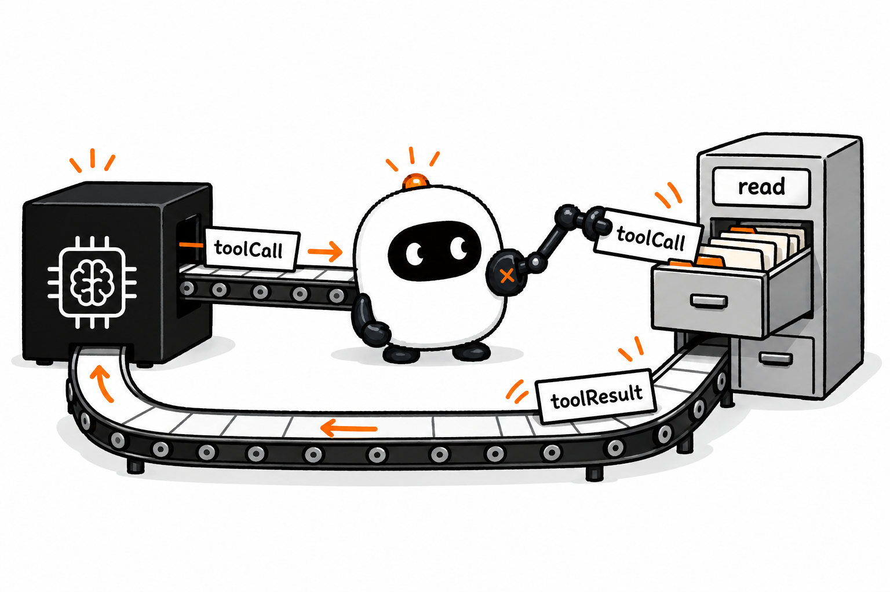

# 从一次模型调用到 Agent：跟踪一次文件读取

想象你刚打开一个陌生的仓库，输入「读一下 README，告诉我这个项目是做什么的」。文件在你的电脑上，模型只能接收请求里的消息。从这句话到最后的回答，中间需要有一个程序真正打开文件，还需要有一次新的模型请求，让模型读到文件内容。我们从这两次请求的差别进入 Pi。

## 1. 两次请求之间发生了什么

示例项目叫「木星笔记」。它的 README 有一个标题和一句用途说明。下面的实验可以改动这句话，观察它怎样从文件进入工具结果，再出现在最后一条消息里。图中的模型使用 Pi 的 Faux Provider，按预设规则产生回复。循环、参数校验、事件分发和结果回填由 Pi 执行。浏览器的 `read` 读取示例文本框，本地程序则调用 Pi 内置的文件工具。

[运行 README 实验](../examples/read-loop/README.md)

从成功情况开始。第一次请求里有用户的问题和工具声明，文件正文还没有进入消息。模型返回一个 `toolCall`，意思是「请调用这个工具」。此时能确定的是工具名、调用编号和参数。只有当运行时收到工具结果，文件正文才成为下一次模型请求的一部分。



读图时沿着箭头走一圈。上半圈的载荷是动作请求，下半圈的载荷是执行结果。同一工具可以被请求两次，甚至同时被请求两次。Pi 用调用编号把每份结果关联回发起它的那一次调用。

## 2. 先认识负责这件事的对象

日常通过终端使用 Pi 时，输入控件把一行字交给 `AgentSession.prompt()`。Session 处理命令、资源、会话和运行中的输入，普通消息随后进入 `Agent.prompt()`。Agent 持有运行状态，并把本轮的消息、工具和配置交给循环。SDK 也能创建同一种 Session。这是两种使用入口共享核心行为的原因。[交互入口](https://github.com/earendil-works/pi/blob/main/packages/coding-agent/src/modes/interactive/interactive-mode.ts) · [SDK 装配](https://github.com/earendil-works/pi/blob/main/packages/coding-agent/src/core/sdk.ts) · [Agent 入口](https://github.com/earendil-works/pi/blob/main/packages/agent/src/agent.ts)

| 对象或函数 | 在读取 README 时做什么 | 这里保存的东西会保留多久 |
| --- | --- | --- |
| `AgentSession` | 组装工具，转交输入，订阅底层事件，协调会话记录 | 一次活动会话，可以接收多次用户输入 |
| `Agent` | 保存消息、模型、可执行工具和运行状态 | 当前 Agent 实例的生命周期 |
| `runAgentLoop` | 为这次运行准备上下文，推进模型和工具轮次，返回新增消息 | 一次运行，可以包含多轮模型请求 |
| `ModelRuntime` | 在正常 SDK 路径中调用所选模型的 Provider，处理认证和请求选项 | 可以被多个会话共享 |
| `SessionManager` | 把消息追加为带父记录标识的条目，恢复时选择活动分支 | 内存模式随实例结束，文件模式可跨进程恢复 |

装配顺序很有用。`createAgentSession()` 先取得模型运行时、资源加载器和 SessionManager，调用 `buildSessionContext()` 恢复已有消息，然后构造 Agent，最后把它们一起交给 AgentSession。于是“恢复昨天的对话”可以从会话记录重新生成消息数组，而“继续当前对话”通常已经有一个活着的 Agent。第十三章会实际创建这一整套对象。[完整 SDK 示例](../examples/read-loop/session.mjs)

网页实验把范围缩小到 `runAgentLoop`，直接传入一个工具和一个模型流函数。因此能独立看到循环的输入输出。页面没有创建磁盘会话。后面每次谈“状态”，都需要指出是哪一个对象的状态。

## 3. 把一句话送进循环

普通字符串可以由 Agent 包装成用户消息。我们的演示直接交给低层入口一条 `role: "user"` 的消息。此处选择文本形式的 `content`，时间固定为零，让两次实验易于对照。调用位置如下，摘自课程程序。[run.mjs](../examples/read-loop/run.mjs)

```js
const messages = await runAgentLoop(
  [{ role: 'user', content: question, timestamp: 0 }],
  { messages: [], tools: [tool] },
  { model: model.getModel(), convertToLlm: messages => messages },
  event => events.push(event.type),
  undefined,
  (modelInfo, context, options) => {
    requests.push(context.messages.map(messageView));
    return model.streamSimple(modelInfo, context, options);
  },
);
```

第二个参数的 `messages` 为空表示没有旧对话。`tools` 里是带可执行函数的对象。第三个参数中的转换函数在这个极小例子中直接返回消息，因为示例只产生模型层认识的角色。完整 Coding Agent 还要处理自己的消息类型。第四个参数记录事件，第五个位置可以传入取消信号，最后一个函数是观察请求边界的窗口。每调用它一次，示例就保存一份请求快照。

进入 `runAgentLoop()` 后，`declareToolChanges(context, prompts)` 会比较当前工具声明与已有声明，把必要的声明变化放入系统消息。正因为我们从空历史提供了 `read`，第一次请求出现的是 `system → user`。系统消息中可以包含工具声明，即便它的文本内容为空。读取对象时只看 `content` 会遗漏这份能力声明。[循环初始化与工具声明](https://github.com/earendil-works/pi/blob/main/packages/agent/src/agent-loop.ts)

循环还区分两个数组。`currentContext.messages` 包括旧消息与本次新增消息，用于准备请求。`newMessages` 收集这次运行新产生的记录，用于返回给调用者。若此前已有十条历史，下一次请求可能用到那十条历史，调用结束时返回的新增列表却不会因此多十条。

## 4. 第一轮回复只包含动作请求

下面保留成功实验中第一条 assistant 消息的关键字段。

```json
{
  "role": "assistant",
  "stopReason": "toolUse",
  "content": [
    {
      "type": "toolCall",
      "id": "read-1",
      "name": "read",
      "arguments": { "path": "README.md" }
    }
  ]
}
```

`content` 是数组，因为模型回复可以同时带文本与多个工具请求。`runLoop()` 从中选出 `type === "toolCall"` 的块。它先看流结束的原因，再决定是否执行这些请求。即便参数看起来是完好的 JSON，当整条回复因输出长度上限而结束时，Pi 也会把这一批请求记为失败，避免执行可能不完整的动作。[工具分派分支](https://github.com/earendil-works/pi/blob/main/packages/agent/src/agent-loop.ts)

成功路径接着按 `name` 在当前可执行工具中查找 `read`，准备和校验参数，经过已配置的调用前钩子，然后执行工具。网页工具到内存里找文件，本地 `createReadTool(directory)` 则把相对路径解析到目录，检查可读性，读取字节，把文本解码为 UTF-8，再按行数和字节数限制选择可返回的内容。运行时给模型的工具声明只包含描述和参数等数据，真正能够接触文件系统的是上述执行代码。[内置 read](https://github.com/earendil-works/pi/blob/main/packages/coding-agent/src/core/tools/read.ts)

## 5. 工具结果怎样成为第二轮输入

工具返回面向模型的 `content`，运行时把它包装成有角色的消息。下面是本地成功路径选取的字段。

```json
{
  "role": "toolResult",
  "toolCallId": "read-1",
  "toolName": "read",
  "isError": false,
  "content": [
    { "type": "text", "text": "# 木星笔记\n\n一个将 Markdown 笔记整理成索引的命令行工具。\n" }
  ]
}
```

`toolCallId` 与上一轮的 `id` 相等。循环把结果依次加入当前上下文和本次新增消息，再开始下一轮。此时模型收到的角色是 `system → user → assistant → toolResult`。其中的 assistant 消息保留了当初的请求，最后一条消息提供请求所得到的结果。

演示模型在第二次调用时取最后一条工具结果，从正文中找第一条非空、非标题的段落，形成回复。这个选择规则是课程编写的脚本，便于验证数据究竟有没有传过去。真实模型会根据提示和内容生成回答。循环接下来检查这条回复是否又请求工具，检查回合决策和待处理输入，在本例中发出 `turn_end` 与 `agent_end`。至此一次用户输入产生了两轮模型回复。[模型脚本](../examples/read-loop/run.mjs) · [继续与停止](03-agent-loop-state-machine-and-stopping.md)

## 6. 同样是读取失败，应该去哪里查

| 受控情形 | 首轮结束原因 | 进入工具函数 | 第二轮看到的结果 |
| --- | --- | --- | --- |
| 正常读取 | `toolUse` | 1 次 | `isError=false`，附带 README 正文 |
| 请求不存在的文件 | `toolUse` | 1 次 | `isError=true`，附带工具错误 |
| 模型输出被截断 | `length` | 0 次 | `isError=true`，附带运行时构造的失败说明 |

第二、三行最后都可能显示「读取未完成」，排查入口却不同。第二行要检查工作目录、路径和工具执行异常。第三行应查看第一轮 assistant 的结束原因，磁盘上的文件即使完全正常也不会被读到。仅统计 `tool_execution_start` 也不足以证明工具函数被执行。演示把计数放在实际的 `execute()` 入口，才能分辨这两条路径。

## 7. 在本机运行相同的循环

在课程仓库中使用 Node.js 22.19 或更新版本运行以下命令。示例项目目录包含它自己的 README，第一次运行后能直接看到两次请求的差别。[示例目录](../examples/read-loop/README.md)

```bash
cd examples/read-loop
npm ci
npm start -- success
```

```text
请求 1  system → user
请求 2  system → user → assistant → toolResult
read.execute 进入次数  1
工具结果  read-1  isError=false
项目说明：一个将 Markdown 笔记整理成索引的命令行工具。
```

`npm start -- missing` 把路径换成不存在的文件，`npm start -- length` 改变第一轮结束原因。要读实际消息可运行 `node cli.mjs success --json`。接下来的三章依次拆开这次运行的三条边界，先看模型协议，再看循环决定，最后进到工具实现。

[继续阅读：消息怎样穿过 Provider](02-model-api-and-message-protocols.md) · [源码地图](../references/source-map.md)
