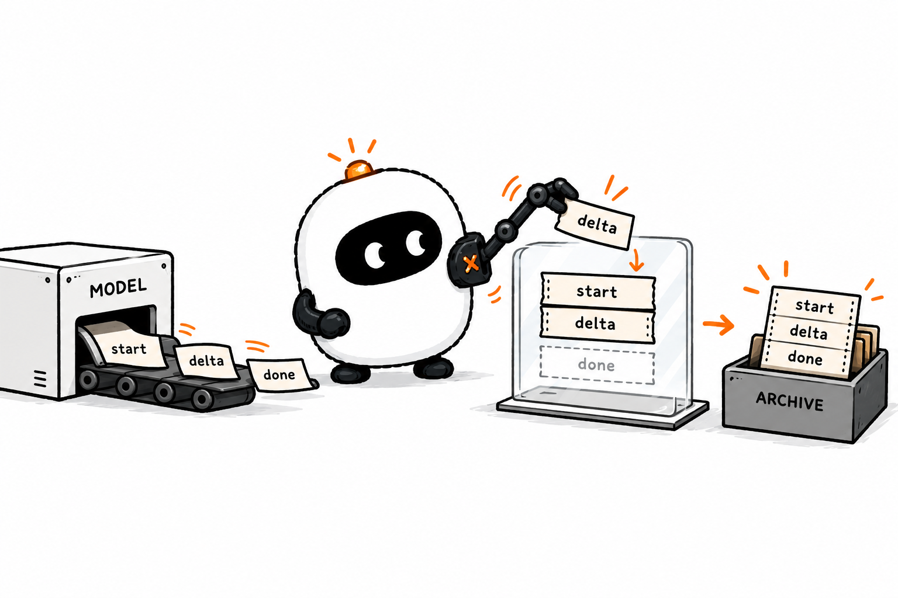

# 模型 API 与消息协议：一条消息怎样穿过 Provider

本章追踪第一章的 `read` 请求在模型边界上的表达：Pi 内部使用什么数据，供应商协议如何转换，以及流式内容怎样成为一条完整消息。理解这一层后，看到模型回复异常时，就可以区分上游响应、适配器与 Agent Loop 各自的责任。



## 1. 三层接口分别负责什么

`pi-ai` 处理模型访问；`pi-agent-core` 用它推进循环；`pi-coding-agent` 再装配认证、会话与工具。模型 API 接收工具声明、返回调用请求，执行本地操作的代码仍在宿主程序里。

[`types.ts`](https://github.com/earendil-works/pi/blob/main/packages/ai/src/types.ts) 中的 `Message` 是系统、用户、assistant 和工具结果消息的联合类型。程序先按 `role` 判断角色，再读取对应字段。

源码摘录：[packages/ai/src/types.ts](https://github.com/earendil-works/pi/blob/main/packages/ai/src/types.ts#L561)

```ts
export interface SystemMessage {
	role: "system";
	/** Instruction text. On the leading message this is the base prompt; later, additional instructions. */
	content: string | TextContent[];
	/**
	 * Named, ordered prompt sections rendered verbatim after `content`. The leading message
	 * declares them; later messages replace sections by name, and `null` removes one. Keep
	 * each section self-delimiting (a tag, a heading) so the model can relate an update to
	 * the original. Avoid integer-like names; JSON objects reorder those.
	 */
	sections?: Record<string, string | null>;
	/** Complete definitions of tools that become available at this point. */
	toolsAdded?: Tool[];
	/** Tools that stop being available at this point. */
	toolsRemoved?: ToolReference[];
	timestamp: number; // Unix timestamp in milliseconds
}
```

系统消息还携带命名提示章节和工具增删声明。重放这些消息可以得到某一时点有效的指令和工具集，使变化过程进入消息历史。

## 2. Context 的标准化

公开接口接受 `Context`，允许调用者用 `systemPrompt` 和 `tools` 快捷字段；Provider 接收的 `TranscriptContext` 已把这些信息折入系统消息。

源码摘录：[packages/ai/src/types.ts](https://github.com/earendil-works/pi/blob/main/packages/ai/src/types.ts#L786)

```ts
export interface Context {
	systemPrompt?: string;
	messages: Message[];
	tools?: Tool[];
}
```

源码摘录：[packages/agent/src/agent-loop.ts](https://github.com/earendil-works/pi/blob/main/packages/agent/src/agent-loop.ts#L404)

```ts
const llmMessages = await config.convertToLlm(messages);

const llmContext = normalizeContext({ messages: llmMessages });

// Resolve API key (important for expiring tokens)
const resolvedApiKey =
	(config.getApiKey ? await config.getApiKey(config.model.provider) : undefined) || config.apiKey;

const response = await streamFunction(config.model, llmContext, {
	...config,
	apiKey: resolvedApiKey,
	identity: mergeClientIdentity(DEFAULT_AGENT_IDENTITY, config.identity),
	signal,
});
```

先转换消息，再标准化 Context，最后调用模型流函数。快捷输入和 Provider 实际收到的记录是两个处理阶段，不能混作同一个结构。

## 3. 工具请求和结果怎样配对

模型的统一请求内容块是 `ToolCall`：`id` 标识调用，`name` 指明工具，`arguments` 保存 JSON 参数。结果的 `toolCallId` 对应这个 ID，多个工具并行完成时也不依赖数组位置猜对应关系。

源码摘录：[packages/ai/src/types.ts](https://github.com/earendil-works/pi/blob/main/packages/ai/src/types.ts#L444)

```ts
export interface ToolCall {
	type: "toolCall";
	id: string;
	name: string;
	arguments: JsonObject;
	thoughtSignature?: string; // Google-specific: opaque signature for reusing thought context
	/** OpenAI Responses namespace for calls to dynamically loaded or namespaced tools. */
	namespace?: string;
	/**
	 * Set when the model's complete arguments text was not a valid JSON object. `arguments` is then `{}`.
	 * Describes the problem and includes the text the model sent; tool argument validation fails with it.
	 */
	argumentsError?: string;
```

`argumentsError` 保留参数文本解析失败的诊断；后续校验会失败。收到流式参数片段，不意味着已经拥有合法的完整参数。

## 4. 以 Anthropic 适配器为例

阅读 [`api/anthropic-messages.ts`](https://github.com/earendil-works/pi/blob/main/packages/ai/src/api/anthropic-messages.ts) 的 `buildParams`、`convertMessages` 和 `mapStopReason`：工具请求变成 `tool_use`，结果用 `tool_use_id` 关联请求；响应内容与停止原因再映射回统一类型。

适配器还处理系统消息的位置、工具结果顺序、图片、缓存和供应商约束。它承担的是语义适配，而不只是字段改名。例如工具请求和结果之间存在系统更新时，仍要维持供应商要求的合法消息顺序。

[`providers/anthropic.ts`](https://github.com/earendil-works/pi/blob/main/packages/ai/src/providers/anthropic.ts) 注册模型、认证与 API；真正序列化请求和解析流的是 API 实现。排查问题时应找到后者。

## 5. Streaming 的事件边界

成功响应通常经历 `start`、内容增量和 `done`；准备请求失败也可能直接产生错误。`text_delta` 适合即时显示，完整消息才适合后续控制与存档。

| 数据 | 适合做什么 | 不能推断什么 |
| --- | --- | --- |
| 文本增量 | 更新显示 | 回答已经完整 |
| 工具参数增量 | 组装请求 | 参数合法、工具已执行 |
| 完整 assistant 消息 | 判断请求和停止原因 | Agent 必然已空闲 |
| 工具结果 | 为下一轮提供观测 | 任务业务目标已完成 |

Agent Loop 根据事件更新部分消息和最终消息，界面再订阅其变化。流式显示、模型响应完成、整段运行结束是不同时间点。

## 6. 用测试核对转换顺序

[`agent-loop.test.ts`](https://github.com/earendil-works/pi/blob/main/packages/agent/test/agent-loop.test.ts) 的 `should build provider context exclusively from transcript messages` 检查 Provider 上下文来源；`should apply transformContext before convertToLlm` 检查转换顺序。一个 Provider 的案例只能证明其覆盖的协议行为，不能推广为全部服务的保证。

下一章回到循环本身，观察统一消息怎样形成后续行动。

## 7. 一条结果的协议转换实例

假设统一工具结果包含 `toolCallId: "read-1"`、文本内容和 `isError: false`。Anthropic 适配器用下面的函数生成对应内容块：

源码摘录：[packages/ai/src/api/anthropic-messages.ts](https://github.com/earendil-works/pi/blob/main/packages/ai/src/api/anthropic-messages.ts#L1334)

```ts
function convertToolResult(msg: ToolResultMessage, content = msg.content): ContentBlockParam {
	return {
		type: "tool_result",
		tool_use_id: msg.toolCallId,
		content: convertContentBlocks(content),
		is_error: msg.isError,
	};
}
```

可以逐项对应：关联 ID 进入 `tool_use_id`；内容经过 `convertContentBlocks()`；错误标记进入 `is_error`。这保留了调用关联、观测内容和失败语义。完整消息的角色和相邻顺序则由外层 `convertMessages()` 处理。

若 UI 能显示读取结果，模型却没有据此回答，应继续检查结果是否进入转换前的消息、是否被 Context 钩子筛掉、转换后的角色是否正确，以及供应商是否拒绝了消息序列。这比只检查接口是否返回 200 更接近实际故障链。


[继续阅读：Agent Loop：状态、事件、队列与停止条件](03-agent-loop-state-machine-and-stopping.md)

[返回课程路线](00-source-learning-path.md) · [查看源码地图](../references/source-map.md)
