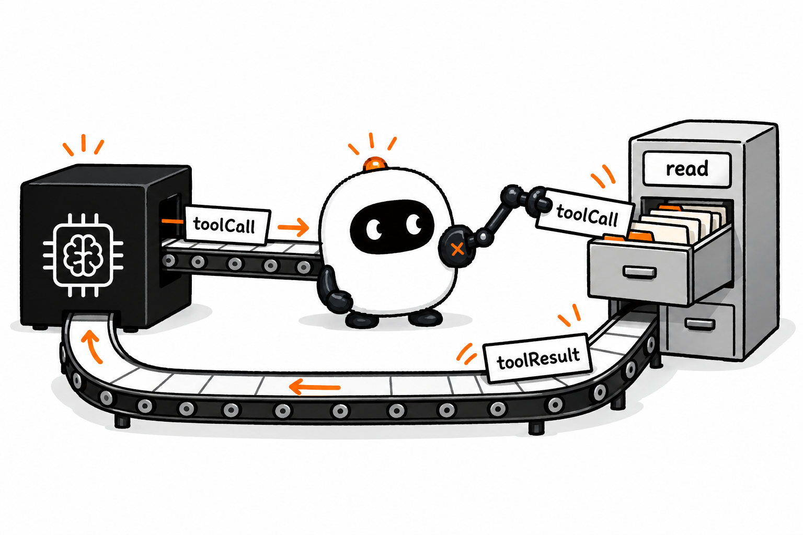

# Agent Loop：一次运行为什么有两轮模型调用

按一次回车，模型却收到了两次请求。第一次返回 `read("README.md")`，第二次根据读到的内容回答。用户发起的一次请求在 Pi 里叫一次运行（run）。其中每次模型响应及其引出的整批工具处理，是一轮（turn）。要解释第二轮从哪里来，可以从 `runLoop` 中几个变量的值入手。



## 谁保管这次运行

`Agent.prompt()` 首先检查 `activeRun`。已有运行时，再次直接调用 `prompt` 会抛错。正常情况下，`runWithLifecycle` 创建一个 `AbortController`，把取消信号交给执行函数，并设置 `state.isStreaming`。这里的标记覆盖一次运行的生命期，也包含等待工具的时间。新输入可以通过下文的队列进入。[运行入口](https://github.com/earendil-works/pi/blob/3e0eec29f50e7861e9db91f2d12723267411b4f3/packages/agent/src/agent.ts#L380) · [生命期与清理](https://github.com/earendil-works/pi/blob/3e0eec29f50e7861e9db91f2d12723267411b4f3/packages/agent/src/agent.ts#L518)

进入 `runAgentLoop`，先准备两组消息。

源码摘录：[packages/agent/src/agent-loop.ts](https://github.com/earendil-works/pi/blob/3e0eec29f50e7861e9db91f2d12723267411b4f3/packages/agent/src/agent-loop.ts#L119)

```ts
const initialMessages = declareToolChanges(context, prompts);
const newMessages: AgentMessage[] = [...initialMessages];
const currentContext: AgentContext = {
	...context,
	messages: [...context.messages, ...initialMessages],
};
```

`...context.messages` 在新数组中展开已有元素。假设旧上下文已有系统消息 S，已经声明 `read`，本次普通输入是 U，工具集合未变。这时 `declareToolChanges` 返回包含 U 的输入。`currentContext.messages` 从 `[S, U]` 起步，`newMessages` 从 `[U]` 起步。前者提供下一次请求所需的历史，后者用于汇总这一次 run 的新增内容。若需要插入工具声明，中间还会新增系统消息。

Pi 随后发出 `agent_start` 和第一轮的 `turn_start`，为初始消息发出消息事件。`runLoop` 接收当前上下文和新增列表，开始驱动模型与工具。以下推演沿用这个已有 S 的场景。[初始事件及返回值](https://github.com/earendil-works/pi/blob/3e0eec29f50e7861e9db91f2d12723267411b4f3/packages/agent/src/agent-loop.ts#L126)

## 在纸上走完一次成功的运行

记 A₁ 为模型的工具请求，R 为文件结果，A₂ 为模型的最终文字。假定工具正常返回、没有新输入、没有改变停止决策的钩子。下表是控制流推演，省略流式增量和系统提示的具体文字。

| 运行走到哪一步 | 当前上下文 `messages` | 此时为什么向前走 |
| --- | --- | --- |
| 用户提交 U | S，U | 外层循环开始时将 `hasMoreToolCalls` 设为 `true`，由此进入第一次请求 |
| 模型完成第一轮响应 | S，U，A₁ | A₁ 的内容有 `toolCall`，其 ID 是 `read-1`。按此块查找和执行工具 |
| `read` 返回 R | S，U，A₁，R | 普通读取没有要求批次终止，`hasMoreToolCalls = true`，内层循环再次成立 |
| 第二轮模型给出 A₂ | S，U，A₁，R，A₂ | A₂ 只含文字。本轮把 `hasMoreToolCalls` 置回 `false` |
| 检查队列与结束决策 | 同上 | 没有 steering、follow-up 或额外继续请求，跳出外层循环，发出 `agent_end` |

运行返回的新增消息是 `[U, A₁, R, A₂]`。当第一轮把 `hasMoreToolCalls` 设为 `true` 时，当前批次的 `read` **已经执行完**。这个值表示还要带着结果向模型再请求一次。决定下一轮的赋值正是下面几行。

源码摘录：[packages/agent/src/agent-loop.ts](https://github.com/earendil-works/pi/blob/3e0eec29f50e7861e9db91f2d12723267411b4f3/packages/agent/src/agent-loop.ts#L276)

```ts
const executedToolBatch =
	message.stopReason === "length"
		? await failToolCallsFromTruncatedMessage(toolCalls, emit)
		: await executeToolCalls(currentContext, message, config, signal, emit);
toolResults.push(...executedToolBatch.messages);
hasMoreToolCalls = !executedToolBatch.terminate;

for (const result of toolResults) {
	currentContext.messages.push(result);
	newMessages.push(result);
}
```

`!` 取反。批次返回 `terminate: false`，取反得到 `true`。R 同时进入 `currentContext.messages` 与 `newMessages`，所以下次请求能看见它，运行结束时调用者也能拿到它。模型至此才首次得到文件原文。[工具批次与状态更新](https://github.com/earendil-works/pi/blob/3e0eec29f50e7861e9db91f2d12723267411b4f3/packages/agent/src/agent-loop.ts#L267)

## 一批两个工具，听谁的停止信号

一个模型响应可以提出两个调用。工具或钩子可以在各自的最终结果中设置 `terminate`。批次怎样合并这两个意见，取决于一个很小的函数。

源码摘录：[packages/agent/src/agent-loop.ts](https://github.com/earendil-works/pi/blob/3e0eec29f50e7861e9db91f2d12723267411b4f3/packages/agent/src/agent-loop.ts#L700)

```ts
function shouldTerminateToolBatch(finalizedCalls: FinalizedToolCallOutcome[]): boolean {
	return finalizedCalls.length > 0 && finalizedCalls.every((finalized) => finalized.result.terminate === true);
}
```

`every` 检查集合中每一项。额外检查 `length > 0` 是因为 JavaScript 对空数组调用 `every` 会返回 `true`。被检查的是每个已经完成准备、执行或拦截处理的最终结果，后置钩子也可能更改它。下表只看“工具结果本身是否自然触发下一轮”，其余决策暂时固定为空。

| 最终结果 A | 最终结果 B | 批次 `terminate` | 因这批结果再次请求模型 |
| --- | --- | --- | --- |
| `true` | `true` | `true` | 否 |
| `true` | `false` | `false` | 是 |
| `true` | 未提供该字段 | `false` | 是 |

上游的混合批次测试用同一个 `echo` 工具执行两次。参数 `value` 第一次为 `"first"`，第二次为 `"second"`，工具返回 `terminate: params.value === "first"`。模拟模型第一次发出两个调用，下一次只回答 `"done"`。实际断言是模型流函数被调用两次，消息角色依次为 `system → user → assistant → toolResult → toolResult → assistant`。这里的系统消息来自测试中首次声明工具，与上一节已有 S 的起点不同。[混合批次测试](https://github.com/earendil-works/pi/blob/3e0eec29f50e7861e9db91f2d12723267411b4f3/packages/agent/test/agent-loop.test.ts#L1899)

[运行批次停止实验](../examples/read-loop/batch.mjs)

## 决策次序：工具、钩子和来自用户的新输入

同样是“还有一件事要做”，有三个不同来源。`hasMoreToolCalls` 表示工具结果自然引出的下一轮。`pendingMessages` 保存准备注入的消息。`explicitContinuation` 表示 `finishTurn` 明确要求再跑一轮。理解优先级要看检查位置。

1. **先结束异常响应。** 若 assistant 消息的 `stopReason` 是 `error` 或 `aborted`，Pi 仍调用 `finishTurn` 通知上层，发出 `turn_end`、`agent_end` 并返回。该分支不执行工具，也不采用该钩子的返回决策。
2. **正常分支先处理完整批次。** 然后把消息、工具结果和当前上下文传给 `finishTurn`，发出 `turn_end`。钩子若返回 `{ action: "end" }`，立即结束，后续队列检查也被跳过。
3. **先满足自然发生的继续。** 否则记录是否明确要求 `continue`，并读取 steering 队列。工具结果或 steering 已足以开始下一轮时，清除额外继续标记。
4. **内层工作耗尽，再取 follow-up。** 有消息就带着它回到外层顶部。若仍无消息，但 `explicitContinuation` 为真，则消耗这个标记，以原有上下文再请求一次。三种来源均为空才结束。[完整分支顺序](https://github.com/earendil-works/pi/blob/3e0eec29f50e7861e9db91f2d12723267411b4f3/packages/agent/src/agent-loop.ts#L249)

源码摘录：[packages/agent/src/agent-loop.ts](https://github.com/earendil-works/pi/blob/3e0eec29f50e7861e9db91f2d12723267411b4f3/packages/agent/src/agent-loop.ts#L295)

```ts
const decision = await config.finishTurn?.(lastCompletedTurn, signal);
await emit({ type: "turn_end", message, toolResults });

if (decision?.action === "end") {
	await emit({ type: "agent_end", messages: newMessages });
	return;
}

explicitContinuation = decision?.action === "continue";
pendingMessages = (await config.getSteeringMessages?.()) || [];
if (hasMoreToolCalls || pendingMessages.length > 0) {
	explicitContinuation = false;
}
```

这段代码也解释了两个具体行为。一种是第一次工具调用后，同时有工具结果和 `continue`。它们会合为同一个下一轮。另一种是第一次回答只含文字，`finishTurn` 第一次返回 `continue`、第二次返回 `undefined`。此时会额外进行恰好一次请求。上游测试让模型按调用次数生成 `response 1`、`response 2`，最后分别检查模型、钩子的调用次数均为 2。[仅使用上下文的额外轮次](https://github.com/earendil-works/pi/blob/3e0eec29f50e7861e9db91f2d12723267411b4f3/packages/agent/test/agent-loop.test.ts#L1273)

### steering 与 follow-up 分别何时进入

假设用户在文件读取过程中补充“只说明用途”，这条 steering（运行中追加的引导消息）先入队。低层循环在整批工具处理和 `finishTurn` 之后读取队列。接下来模型看到 R 和新的用户消息，能够据此调整回答。已经启动的文件读取按自身的取消规则工作。如果使用 follow-up（当前工作告一段落后的追加任务）提交“再写一段安装说明”，内层先带 R 请求原任务的回答。待内层准备退出时，外层才取出这条消息组织下一轮。[两类队列的取出位置](https://github.com/earendil-works/pi/blob/3e0eec29f50e7861e9db91f2d12723267411b4f3/packages/agent/src/agent-loop.ts#L303)

还有一个时机差异。后续轮开始前，`prepareNextTurn` 可能进行耗时的上下文准备。若之前没有取到 steering，准备结束后会再取一次，以便这期间输入的消息赶上当前轮。若之前已取到，就不多取一次，保留“一次取一条”的语义。`prepareRequest` 则在待加入消息已写入之后、流请求之前调整 context 或模型，完成它不会再次轮询 steering。[下一轮准备](https://github.com/earendil-works/pi/blob/3e0eec29f50e7861e9db91f2d12723267411b4f3/packages/agent/src/agent-loop.ts#L192) · [时序测试](https://github.com/earendil-works/pi/blob/3e0eec29f50e7861e9db91f2d12723267411b4f3/packages/agent/test/agent-loop.test.ts#L1458)

## 出错时要看哪一个信号

| 已知信号 | 执行器走的分支 | 对后续模型请求的影响 |
| --- | --- | --- |
| 整个 assistant 响应 `error` 或 `aborted` | 结束通知与硬退出 | 当前 run 到此为止 |
| `length` 且响应里带工具块 | 给这条消息的所有调用生成错误结果，跳过执行 | 默认继续，让模型有机会重发完整调用 |
| 工具运行失败，如文件不存在 | 将异常转成与原调用 ID 对应的错误工具结果 | 普通批次仍可继续，模型能解释出错原因 |
| 正常文本响应，没有工具 | 无工具批次可执行 | 仍检查钩子、steering 和 follow-up |

上游测试让 `echo` 收到 `{ value: "hel" }`，它在类型上完全符合“字符串”的要求，但模型停止原因为 `length`。真实工具的调用记录仍是空数组，`tool_execution_end.isError` 为真。模拟模型被请求了两次。只校验参数类型会漏掉这种内容被截短却仍合法的情况。[截断响应测试](https://github.com/earendil-works/pi/blob/3e0eec29f50e7861e9db91f2d12723267411b4f3/packages/agent/test/agent-loop.test.ts#L456)

## 消息结束、轮次结束、运行空闲

对于同一个 `read-1`，界面会看到多种“结束”。`tool_execution_end` 指一个工具调用得到最终结果，`message_end` 指一条完整消息已形成，`turn_end` 指这一轮模型响应及其工具处理已完成，`agent_end` 指本次循环不会再发事件。`processEvents` 根据事件更新对外可读的 `Agent.state`。

| 事件 | Agent 对自己状态所做的更新 |
| --- | --- |
| `message_start`、`message_update` | 替换 `streamingMessage`，界面可显示正在生成的内容 |
| `message_end` | 清空 `streamingMessage`，把完整消息追加到 `state.messages` |
| `tool_execution_start`、`tool_execution_end` | 为 `pendingToolCalls` 增加、移除对应 ID |
| `turn_end` | 若当前轮的 assistant 携带错误说明，记录 `errorMessage` |
| `agent_end` 之后 | 等待订阅者完成，`finishRun` 释放当前运行句柄，清理暂存状态并使 `waitForIdle()` 的等待者继续 |

为何 `finishTurn` 可以检查文件结果，而 UI 又还没收到 `turn_end`？一个测试订阅事件，同时让钩子记录自己的执行位置。钩子内确认最后一条上下文消息是 `toolResult`，最后三个记录恰好是 `message_end:toolResult → finishTurn → turn_end`。另一个测试让异步监听器阻塞在 `agent_end`，等它释放后，等待空闲的代码才继续。需要切换会话或发起下一次普通 `prompt` 时，这两个结束时刻有实际区别。[事件与钩子顺序](https://github.com/earendil-works/pi/blob/3e0eec29f50e7861e9db91f2d12723267411b4f3/packages/agent/test/agent-loop.test.ts#L1108) · [状态与订阅者](https://github.com/earendil-works/pi/blob/3e0eec29f50e7861e9db91f2d12723267411b4f3/packages/agent/src/agent.ts#L575) · [空闲等待测试](https://github.com/earendil-works/pi/blob/3e0eec29f50e7861e9db91f2d12723267411b4f3/packages/agent/test/agent.test.ts#L374)

配套示例使用空历史与一个可执行的 `read` 启动，工具声明使第一次请求从 `system → user` 开始。在示例目录运行 `node cli.mjs success`，实测第二次请求的角色顺序为 `system → user → assistant → toolResult`，进入 `read.execute` 一次。改用 `node cli.mjs length` 仍有两次模型请求，实际进入工具的次数变为 0。[运行与输出](../examples/read-loop/README.md)

[继续阅读：从工具声明追到文件读取](04-tools-and-function-calling.md) · [课程路线](00-source-learning-path.md)
