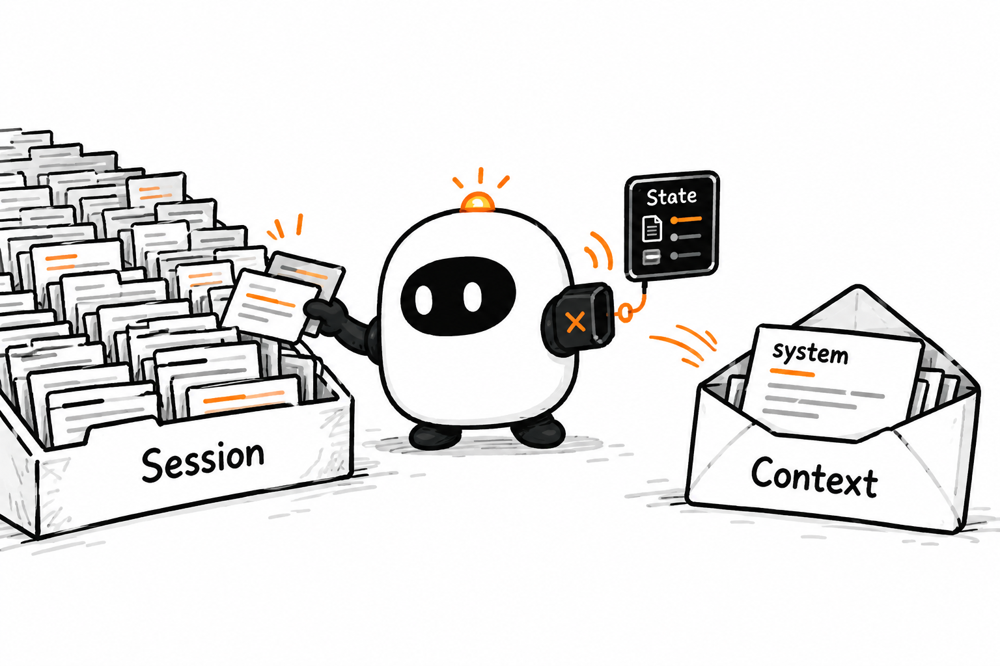

# Context Engineering：每次请求到底给模型什么

会话保存了许多信息，模型本轮收到的请求仍是一份经过组织的输入。本章解释系统消息、项目文件、工具声明与历史的装配，以及输出格式约束的边界。



## 1. 从运行状态到请求输入

`AgentState` 保存模型、消息、工具和流式状态；`AgentContext` 是循环使用的消息与工具快照；Provider 使用标准化消息上下文。认证信息、取消控制器、工具执行函数与 UI 状态不会因为存在于内存就自然进入模型请求。

Context Engineering 是选择、组织和更新模型输入的过程。它必须考虑来源、预算、时机和后续程序的消费方式。

## 2. 系统提示的命名章节

Pi 把项目材料、工具说明和 Skill 索引组织为系统提示章节，并能表达章节变化：

源码摘录：[packages/coding-agent/src/core/system-prompt.ts](https://github.com/earendil-works/pi/blob/main/packages/coding-agent/src/core/system-prompt.ts#L216)

```ts
export function diffSystemPromptSections(
	previous: Record<string, string | null>,
	current: SystemPromptSections,
): Record<string, string | null> | undefined {
	const patch: Record<string, string | null> = {};
	for (const [name, text] of Object.entries(current)) {
		if (previous[name] !== text) patch[name] = text;
	}
	for (const name of Object.keys(previous)) {
		if (current[name] === undefined) patch[name] = null;
	}
	return Object.keys(patch).length > 0 ? patch : undefined;
}
```

命名章节让变化可以明确表达；供应商对中途系统更新的支持差异则交给 Provider 适配。运行时消息结构与服务实际接受的载荷需要分别观察。

## 3. 项目指令的加载路径

源码摘录：[packages/coding-agent/src/core/resource-loader.ts](https://github.com/earendil-works/pi/blob/main/packages/coding-agent/src/core/resource-loader.ts#L260)

```ts
export function loadProjectContextFiles(options: {
	cwd: string;
	agentDir: string;
}): Array<{ path: string; content: string }> {
	const resolvedCwd = resolvePath(options.cwd);
	const resolvedAgentDir = resolvePath(options.agentDir);

	const contextFiles: Array<{ path: string; content: string }> = [];
	const seenPaths = new Set<string>();

	const globalContext = loadContextFileFromDir(resolvedAgentDir);
	if (globalContext) {
		contextFiles.push(globalContext);
		seenPaths.add(globalContext.path);
	}

	const ancestorContextFiles: Array<{ path: string; content: string }> = [];
```

加载器处理全局目录、当前目录及祖先目录，还要处理路径去重与 worktree 情况。Context 文件是指令材料，而不是强制限制系统调用的权限配置。

加载阶段决定可用资源，模型调用阶段决定实际请求；资源存在并不等于正文已全部发给模型。Skill 的索引和正文尤其需要区分。

## 4. 消息转换的顺序

```text
Agent 消息 → transformContext → convertToLlm → normalizeContext → Provider
```

SDK 把 Extension 的 Context 处理接到转换链：

源码摘录：[packages/coding-agent/src/core/sdk.ts](https://github.com/earendil-works/pi/blob/main/packages/coding-agent/src/core/sdk.ts#L428)

```ts
transformContext: async (messages) => {
	const runner = extensionRunnerRef.current;
	if (!runner) return messages;
	return runner.emitContext(messages);
},
```

循环还允许 `prepareRequest` 在请求前更新上下文与模型，更靠后的 Provider 扩展点可处理具体载荷。修改边界不同，会影响会话记录、界面和请求是否一致。

## 5. Token 预算

预算需要同时容纳系统指令、工具声明、历史、检索内容和预留输出。消息数或文件字节数不能直接代表实际输入 token。长会话需要估计和压缩，相关实现见下一章。

压缩应保留行动所需的证据，例如测试名、报错、文件和已验证结论。只保留“已经检查”会让后续无法判断检查了什么。必要时仍要重新读取原材料。

## 6. Structured Output

结构化输出约束回答的数据形状，Tool Calling 请求外部能力。两者都可能使用 Schema，但一个合法 JSON 对象不代表工具已执行，也不代表事实正确。

具体采样或 Schema 支持要沿所选 API 的构造代码核对。应用消费结果时还要校验业务条件、缺失值和事实来源，而不能把供应商接受了某字段当成所有语义都已保证。

## 7. 内容来源与信任

文件、网页和工具结果中的文字可以影响模型，却不能因此获得用户授权。来源标签帮助模型理解材料；真正限制外部操作还要依靠执行策略和系统环境。下一章区分持久化 Session、活动分支与模型 Context。

## 8. 系统章节变化的具体例子

下面是教学数据，说明 `diffSystemPromptSections()` 的输入输出关系：先前有 `project` 和 `skills` 两节，新状态修改 `project` 并移除 `skills`。补丁会为变化的节提供新文字，并用 `null` 表达删除。

```json
{
  "project": "更新后的项目规则",
  "skills": null
}
```

有了明确的差异表达，运行历史可以反映指令变化，而不是每次静默替换一个字符串。Provider 再依据其协议将这种变化送达模型。

调试上下文问题时，最好分层观察：资源加载得到什么、系统章节构建得到什么、转换钩子输出什么、最终 Provider 载荷是什么。只查看磁盘上的 `AGENTS.md`，无法判断模型那一轮实际看到了哪些内容。


[继续阅读：Session 与 Compaction：会话树怎样变成模型输入](06-session-memory-retrieval-and-compaction.md)

[返回课程路线](00-source-learning-path.md) · [查看源码地图](../references/source-map.md)
