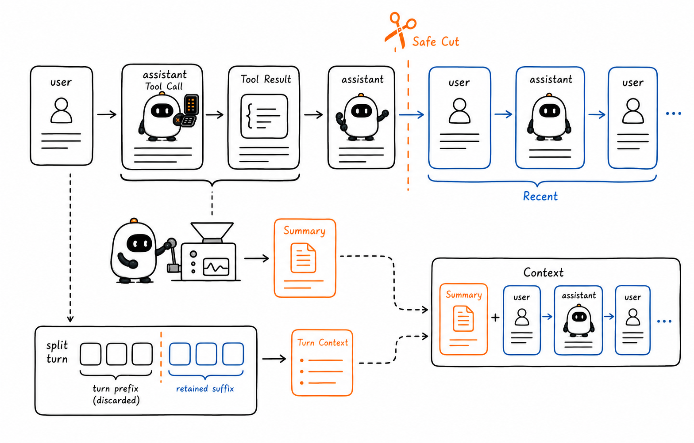

# Session 与 Compaction：亲手推演一次会话压缩

Pi 读出一个很大的文件，文件内容刚进入工具结果，窗口已经快满了。如果按长度截掉前面几条消息，保留下来的第一条可能是「这里是结果」，却找不到「谁请求了它」。Pi 怎样选切点，又怎样让下一轮模型接着工作？我们用上游回归测试中的五条消息推演。测试的输入、预期切点和摘要材料都可在源码中核对。为便于跟踪，下文为记录另取短 ID，摘要文字采用教学示例。[大工具结果的回归测试](https://github.com/earendil-works/pi/blob/3e0eec29f50e7861e9db91f2d12723267411b4f3/packages/coding-agent/test/compaction.test.ts#L378)



## 1. 文件里有整棵树，运行时先选一条路

磁盘会话使用 JSONL，一行记录一个 JSON 对象。文件有会话头，后续 Entry 包含自己的 `id`、`parentId`、时间、类型和相应的数据。下面是两条教学记录的**字段投影**，仅展示解释分支需要的字段。真实消息还会记录时间等元数据。

```json
{"type":"message","id":"a","parentId":null,"message":{"role":"user","content":"old history"}}
{"type":"message","id":"b","parentId":"a","message":{"role":"assistant","content":[{"type":"text","text":"old answer"}]}}
```

追加消息时，新 Entry 的父节点就是当前叶子。`_appendEntry` 把它添加到列表和 `byId` 索引，把叶子改成它的 ID，然后根据持久化配置写入文件。写入抛错时，函数撤销刚才的内存修改，让后续记录不会指向一个写入失败的父节点。开启文件持久化时，首次遇到用户或 assistant 对话会把此前积累的记录一并写出，后续通常逐行追加。[追加与落盘](https://github.com/earendil-works/pi/blob/3e0eec29f50e7861e9db91f2d12723267411b4f3/packages/coding-agent/src/core/session-manager.ts#L1167)

如果 `b` 之后有两次尝试，记录可能是这样。

```text
a ─ b ─ c ─ d ─ e       读取 big.txt 的路径
      └ f                从 b 改为询问另一个文件
```

选叶子 `e` 时，`buildSessionPath` 从 `e` 逐次查 `parentId`，依次得到 `e,d,c,b,a`，再反转得到 `a,b,c,d,e`。选 `f` 时结果是 `a,b,f`。即使 `f` 是磁盘中最后追加的一行，它也不会进入以 `e` 为叶子的投影。若只看文件最后几行，可能刚好看错了分支。[路径选择与模型设置](https://github.com/earendil-works/pi/blob/3e0eec29f50e7861e9db91f2d12723267411b4f3/packages/coding-agent/src/core/session-manager.ts#L390)

## 2. 压缩有两个独立的决定

第一个决定是**什么时候压**。`shouldCompact` 用上下文估算量和模型窗口做比较。依照下面的源码，若窗口为 100,000、预留 10,000，90,000 还没过线，90,001 才过线。显式手动压缩可以直接进入准备流程。

源码摘录：[packages/coding-agent/src/core/compaction/compaction.ts](https://github.com/earendil-works/pi/blob/3e0eec29f50e7861e9db91f2d12723267411b4f3/packages/coding-agent/src/core/compaction/compaction.ts#L267)

```ts
export function shouldCompact(contextTokens: number, contextWindow: number, settings: CompactionSettings): boolean {
	if (!settings.enabled) return false;
	return contextTokens > contextWindow - settings.reserveTokens;
}
```

第二个决定是**压缩后保留哪段原文**。`prepareCompaction` 先按活动路径生成投影，把记录同模型可见消息关联起来，再让 `findProjectedCutPoint` 按 `keepRecentTokens` 寻找边界。因此改变预留量会影响触发时机；改变保留目标会影响切分位置。下面只推演第二个决定，沿用测试给定的 1,000 tokens。

## 3. 五条记录，边界在哪里

| ID | 父节点 | 消息与核心字段 | 可能作为保留区开头 |
| --- | --- | --- | --- |
| a | 无 | user，`old history` | 可以 |
| b | a | assistant，`old answer` | 可以 |
| c | b | user，`read the large file` | 可以，也是新 turn 的开始 |
| d | c | assistant，`read({path:"big.txt"})`，调用 ID 是 `call-1` | 可以 |
| e | d | toolResult，`toolCallId:"call-1"`，正文是 8,000 个 `x` | 不可以 |

一个 **turn** 在这个切分算法里可以包含「用户输入 → assistant 请求工具 → 工具结果 → assistant 回应」。Entry ID `d` 用来沿会话树走，`call-1` 用来配对调用和结果，两个标识解决不同问题。

1. 扫描候选。`isCutPointMessage` 接受 user、assistant 等角色，排除 toolResult。因此候选位置是 `[a, b, c, d]`。
2. 从尾部往前累加估算。`e` 的文本粗估 `ceil(8000 / 4) = 2000` tokens，单独这一条就已达到 1,000 的目标。
3. 在 `e` 或之后寻找合法切点，找不到时取候选表最后一个，也就是 `d`。因此保留 `d,e`。尾部会超过 1,000，但调用和结果能一起重放。
4. 检查 `d` 的角色。assistant 可以作为切点，却不能独立算一个用户 turn 的开始。算法向前追到 `c`，因此 `isSplitTurn = true`，`turnStartIndex = 2`。

这解释了为何「保留最近 1,000」不能翻译成「恰好留下最后 1,000 个 token」。选择单位是消息及其关系，切点本身是会话 Entry 的位置。实际实现还处理不可见编辑、元数据和以前的压缩记录，本例恰好没有这些分支。[候选规则](https://github.com/earendil-works/pi/blob/3e0eec29f50e7861e9db91f2d12723267411b4f3/packages/coding-agent/src/core/compaction/compaction.ts#L351) · [投影上的切点算法](https://github.com/earendil-works/pi/blob/3e0eec29f50e7861e9db91f2d12723267411b4f3/packages/coding-agent/src/core/compaction/compaction.ts#L789)

## 4. 一个切点分出三份材料

确定 `d` 后，函数先把它的源记录 ID 放进 `firstKeptEntryId`。注意 `slice(start, end)` **含起点、不含终点**，所以同一个下标可以同时充当前一段的终点和后一段的起点。

源码摘录：[packages/coding-agent/src/core/compaction/compaction.ts](https://github.com/earendil-works/pi/blob/3e0eec29f50e7861e9db91f2d12723267411b4f3/packages/coding-agent/src/core/compaction/compaction.ts#L887)

```ts
const firstKeptEntry = projectedEntries[cutPoint.firstKeptEntryIndex]?.sourceEntry;
if (!firstKeptEntry?.id) return undefined;
const firstKeptEntryId = firstKeptEntry.id;
const historyEnd = cutPoint.isSplitTurn ? cutPoint.turnStartIndex : cutPoint.firstKeptEntryIndex;

const messagesToSummarize = projectedEntries
	.slice(boundaryStart, historyEnd)
	.flatMap(getMessagesFromProjectedEntryForCompaction);
const turnPrefixMessages = cutPoint.isSplitTurn
	? projectedEntries
			.slice(cutPoint.turnStartIndex, cutPoint.firstKeptEntryIndex)
			.flatMap(getMessagesFromProjectedEntryForCompaction)
	: [];

if (messagesToSummarize.length === 0 && turnPrefixMessages.length === 0) return undefined;
```

在本例中，`boundaryStart=0`，`historyEnd=turnStartIndex=2`，`firstKeptEntryIndex=3`。于是结果如下。

| 范围 | 记录 | 如何使用 |
| --- | --- | --- |
| `[0, 2)` | a、b | `messagesToSummarize`，总结已完成的历史 |
| `[2, 3)` | c | `turnPrefixMessages`，交代这个尚在进行的 turn 的原始请求 |
| `[3, 5)` | d、e | 保留原始调用和工具结果，以后仍可按 `call-1` 配对 |

上游回归测试同时调用切点函数和 `prepareCompaction`。第一组断言检查索引和分轮状态；第二组直接检查三项数据。即使一个实现碰巧返回 `d`，若把 `c` 混入历史摘要，第二组断言仍会失败。

源码摘录：[packages/coding-agent/test/compaction.test.ts](https://github.com/earendil-works/pi/blob/3e0eec29f50e7861e9db91f2d12723267411b4f3/packages/coding-agent/test/compaction.test.ts#L404)

```ts
const preparation = prepareCompaction(entries, {
	...DEFAULT_COMPACTION_SETTINGS,
	keepRecentTokens: 1000,
});
expect(preparation?.firstKeptEntryId).toBe(toolCall.id);
expect(preparation?.messagesToSummarize).toEqual([oldUser.message, oldAssistant.message]);
expect(preparation?.turnPrefixMessages).toEqual([currentUser.message]);
```

在默认 `compact` 路径中，普通整轮切分只需要历史摘要；这个分轮案例有两个部分。`generateSummaryWithUsage` 总结已完成的历史，`generateTurnPrefixSummary` 专门总结当前 turn 较早的部分，最后合并成一个 `summary`。若已存在上一轮摘要，准备阶段还会取出 `previousSummary`；系统提示有专门的检查点，生成对话摘要时会滤掉系统消息。实现还从被选材料中提取读写过的文件并整理进结果。[摘要合并与文件记录](https://github.com/earendil-works/pi/blob/3e0eec29f50e7861e9db91f2d12723267411b4f3/packages/coding-agent/src/core/compaction/compaction.ts#L952)

## 5. 写入后，下次恢复实际会读到什么

[逐步查看会话投影](../examples/read-loop/projection.mjs)

假设两段摘要合起来表达「此前完成了旧任务；本轮用户要求读取大文件」。实际文字由摘要模型生成。`appendCompaction` 在 `e` 后面追加一条记录，我们称为 `x`。

```json
{
  "type": "compaction",
  "id": "x",
  "parentId": "e",
  "firstKeptEntryId": "d",
  "summary": "此前完成了旧任务；本轮用户要求读取大文件。"
}
```

这份教学投影省略时间、`tokensBefore`、usage、文件详情等字段。如果活动投影中有系统消息，`appendCompaction` 还会把当时的有效系统状态一同保存为 `systemMessage`。这样即使旧系统消息落入摘要范围，也能恢复指令与工具声明。[压缩 Entry 的构造](https://github.com/earendil-works/pi/blob/3e0eec29f50e7861e9db91f2d12723267411b4f3/packages/coding-agent/src/core/session-manager.ts#L1271)

现在重新打开并选择 `x`。原始路径仍是 `[a,b,c,d,e,x]`。`buildContextEntries` 找到路径上最新的压缩记录，先放 `x`，再从 `firstKeptEntryId` 起收集压缩前的保留记录，最后接上压缩后新增的记录。在这个例子里得到 `[x,d,e]`。如果又追加一条 `y`，则变成 `[x,d,e,y]`。保留范围中的旧系统消息由检查点代表，避免重复重放。[保留区重建](https://github.com/earendil-works/pi/blob/3e0eec29f50e7861e9db91f2d12723267411b4f3/packages/coding-agent/src/core/session-manager.ts#L468)

`buildSessionProjection` 再把 Entry 投影为消息。`x` 贡献系统检查点（如有）和一条 `compactionSummary`；`d` 贡献 assistant 工具请求；`e` 贡献工具结果。上一章的 `convertToLlm` 会把 `compactionSummary` 转成带 `<summary>` 标记的用户角色文本。所以下一次送去适配的顺序是：

```text
系统检查点（若保存）
    ↓
user       <summary>合并后的摘要</summary>，前面带有压缩说明
    ↓
assistant  toolCall id=call-1，read({path:"big.txt"})
    ↓
toolResult toolCallId=call-1，正文仍是原文
```

压缩把旧材料从活动请求中折叠起来，原始 JSONL 里仍然能找到 `a,b,c`。另一个机制 `context_edit` 则能对特定 `targetId` 替换或省略内容。投影先收集当前范围里对同一 ID 的最后一次编辑，再应用到该条记录；`replacement: null` 使这条记录贡献零条消息。这就是磁盘占用、界面历史和模型输入会有不同长度的具体原因。[投影与编辑](https://github.com/earendil-works/pi/blob/3e0eec29f50e7861e9db91f2d12723267411b4f3/packages/coding-agent/src/core/session-manager.ts#L520)

## 6. 摘要生成到一半就截断了

设摘要模型已经返回 `partial summar`，同时 `stopReason` 为 `length`。若把这段文本当成完整检查点，下一次恢复会静默丢失摘要的后半段。Pi 的回归测试令模拟模型返回这个组合，断言 `session.compact()` 抛出含有 `generation hit the token cap` 的错误，并且存储中的 `compaction` Entry 数量依然是零。[截断摘要的回归测试](https://github.com/earendil-works/pi/blob/main/packages/coding-agent/test/suite/regressions/7048-compaction-truncated-summary.test.ts)

成功的手动路径先得到完整结果，再检查取消信号，然后才调用 `appendCompaction`、刷新活动上下文。因而排查某次恢复时，可以看见两类不同证据。已有 `x` 时，检查它指向的保留 ID 和当前叶子；没有 `x` 时，追查生成、取消或写入错误。会话恢复重建的是已有消息及模型设置。一个中断的外部命令是否已经改变文件，还需查该命令自身的状态。[手动压缩的提交顺序](https://github.com/earendil-works/pi/blob/3e0eec29f50e7861e9db91f2d12723267411b4f3/packages/coding-agent/src/core/agent-session.ts#L2913)

[继续阅读：MCP 的远程工具如何接回循环](07-mcp-protocol-and-pi-integration.md) · [返回课程路线](00-source-learning-path.md)
