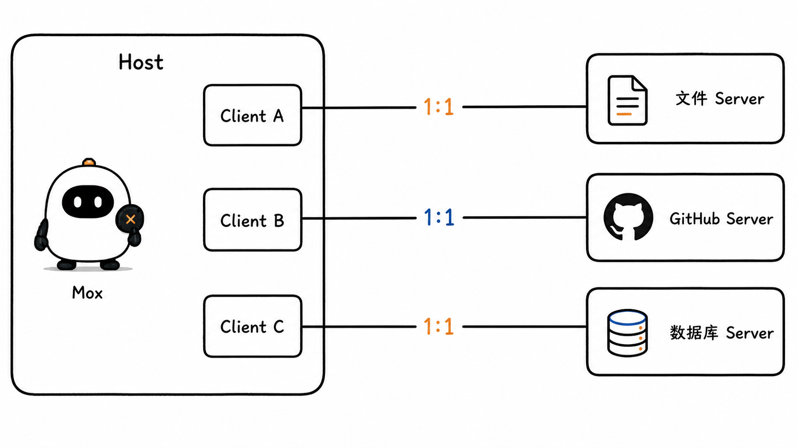

# MCP：外部服务怎样进入 Pi 的工具链

假设模型需要查询另一个进程管理的资料库。Pi 必须发现它提供哪些能力，把 Schema 暴露给模型，再把调用结果接回 Agent。MCP（Model Context Protocol）提供这条进程或服务边界上的协议；本章重点研究 Pi 已有的客户端和内置扩展。



## 1. 客户端、传输和宿主

`packages/mcp` 是独立客户端包，包含传输无关的核心、stdio、Streamable HTTP 与内存测试传输。Coding Agent 的内置 MCP Extension 负责把它装配进产品生命周期。

源码摘录：[packages/mcp/src/client.ts](https://github.com/earendil-works/pi/blob/main/packages/mcp/src/client.ts#L204)

```ts
async connect(transport: McpTransport): Promise<InitializeResult> {
	if (this.state !== "idle") throw new Error(`Cannot connect MCP client in ${this.state} state`);
	this.state = "connecting";
	this.transport = transport;
	this.disposers = [
		transport.onMessage((message) => this.handleMessage(message)),
		// Transport errors are reported only. Pending requests fail when the transport closes.
		transport.onError((error) => this.emitError(error)),
		transport.onClose(() => this.handleTransportClose()),
	];

	try {
		await transport.start();
		const capabilities: ClientCapabilities = { ...this.options.capabilities };
```

`connect()` 建立协议连接，不等于某个业务工具已成功。`listTools()` 获取声明，`callTool()` 执行具体远端请求；宿主仍负责选择服务器、认证、超时、界面和清理。

## 2. 工具发现到注册

入口是 [`extensions/mcp/index.ts`](https://github.com/earendil-works/pi/blob/main/packages/coding-agent/src/extensions/mcp/index.ts) 的 `registerTools`。它为服务器建立命名空间、处理名称清洗和冲突，然后创建工具定义并交给 `pi.registerTool()`。

源码摘录：[packages/coding-agent/src/extensions/mcp/index.ts](https://github.com/earendil-works/pi/blob/main/packages/coding-agent/src/extensions/mcp/index.ts#L419)

```ts
const definition = createMcpToolDefinition({
	server,
	tool,
	name: assignName(tool.name, `${server}\0${tool.name}`),
	exposure: getMcpToolExposure(entry.config, tool.name),
	namespace,
	timeoutMs: connection.timeoutMs,
	getClient: async () => {
		// A prepared call can outlive this definition's connection while the readiness
		// hook waits for a disable/re-enable. Resolve the replacement at execution time.
		const current = findServer(server);
		if (!current || !isEnabled(current)) throw new Error(`MCP server "${server}" is disabled.`);
		const client = current.connection;
		if (!client) throw new Error(`MCP server "${server}" is still starting.`);
```

名字不能简单拼接后就假定唯一。供应商工具名有字符和长度限制；清洗后的名称可能冲突，Pi 使用相应的分配与哈希处理，执行时仍需找回正确的服务器和原始工具名。

## 3. 调用时重新检查可用性

工具定义中包含的 `getClient` 会在实际执行时检查服务器是否仍启用、连接是否已就绪、工具是否仍存在。发现与执行之间可能经历重连或禁用，因此不能永远相信注册时保存的连接对象。

工具不再提供时，内置扩展会按其注册机制把旧定义隐藏；这与直接删除某一条模型历史是不同操作。模型输入里的工具声明变化需要与运行时可执行能力共同维护。

## 4. MCP 结果如何变成 Pi 结果

[`tools.ts`](https://github.com/earendil-works/pi/blob/main/packages/coding-agent/src/extensions/mcp/tools.ts) 是内容转换入口。文本与图片可以进入模型内容；较大文本会截断并把完整输出存到临时文件；资源链接和二进制材料也需要明确的转换策略。

源码摘录：[packages/coding-agent/src/extensions/mcp/tools.ts](https://github.com/earendil-works/pi/blob/main/packages/coding-agent/src/extensions/mcp/tools.ts#L51)

```ts
export const MCP_OUTPUT_MAX_BYTES = 20 * 1024;
/** Visual (wrapped) result lines shown before the output is expanded. */
const OUTPUT_PREVIEW_LINES = 5;
/** Tool that reads the resources named by resource links. */
export { READ_MCP_RESOURCE_TOOL };
```

给模型的内容与 Code Mode 获取的程序化结果并不完全相同。后者可以保留完整的 `CallToolResult` 结构供脚本处理，而显示或模型输入需要满足各自的长度与类型要求。

MCP 结果中的 `isError` 是工具业务执行失败；传输断开或协议错误则是另一种故障。把两者都转成“空字符串”会让模型误以为查询成功但没有结果。

## 5. Resources 与 Prompts

MCP 不只定义 Tools，还包含资源和提示相关能力。资源描述“可读取什么”，工具描述“可执行什么”；宿主怎样暴露给模型或用户由集成实现决定。Pi 的资源适配代码在同一扩展目录，不能仅因服务宣称支持某能力就假定它已全部进入模型输入。

## 6. 认证与生命周期

独立包的 OAuth 子入口提供授权状态和回调相关组件，但不会替应用选择所有凭据存储和浏览器流程。内置扩展还负责连接与界面管理。服务器启动命令本身会在本地运行，远端响应也属于外部输入。

stdio 适合由宿主启动子进程；HTTP 适合远端地址和请求生命周期。使用哪种传输都需要取消、超时、权限和连接清理，而不只是一段成功的调用示例。

## 7. 验证这条链

`packages/mcp/test` 用内存传输检查协议行为；Coding Agent 的 MCP 测试检查命名、配置、工具适配和运行状态。调试时按连接、发现、注册、模型声明、执行、结果转换的顺序定位，避免把所有故障归因于模型。

下一章区分 Skill 和工具：前者告诉模型怎么工作，后者提供可执行能力。

## 8. 从外部名字到可执行工具

服务器名和工具名组成 `mcp__<server>__<tool>` 一类名字，字符清洗、长度限制和冲突处理发生在本地适配层。模型看见的是适配后的标识，执行时需要还原成对应连接和原始名字。

这解释了为什么重连后不能只保留一份工具列表：同名工具可能消失、暴露方式改变或尚未就绪。`getClient` 的执行时检查使准备中的调用也能观察到禁用和重建。

检查 MCP 集成时，可以沿一条记录查：配置项 → 连接状态 → 服务工具声明 → Pi 工具定义 → 模型请求名字 → 实际 `callTool` 参数 → Pi 工具结果。每层都能正常工作，才算接通端到端能力。


[继续阅读：Skills 与 Prompt Templates：工作方法怎样进入请求](08-skills-and-prompt-templates.md)

[返回课程路线](00-source-learning-path.md) · [查看源码地图](../references/source-map.md)
