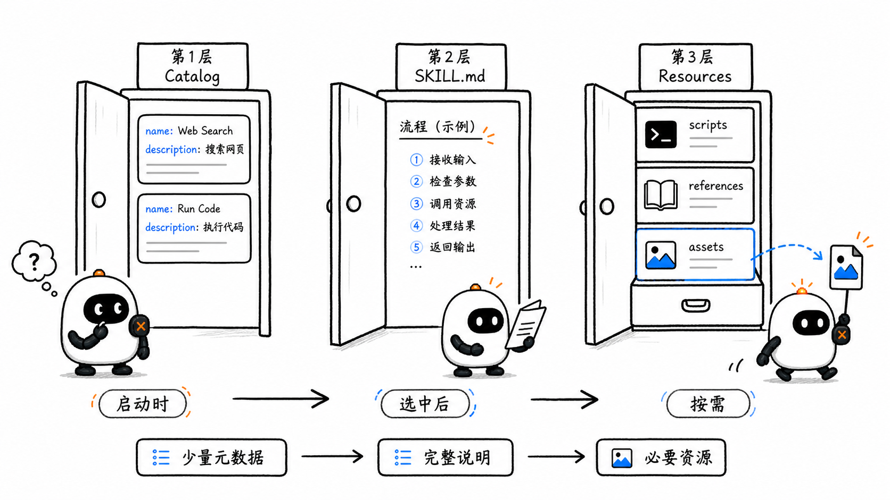

# Skills 与 Prompt Templates：一份 Markdown 在哪一轮被读到

项目有一份审阅指南。用户说「帮我审阅新模块」时，模型可能先调用 `read` 读取指南。用户改用 `/skill:review 新模块`，同一份指南却能直接出现在用户消息中。还有一种写法 `/review 新模块`，由提示模板展开。三种输入看起来都在「调用一个方法」，实际上有三条数据路径。



## 1. 从两个文件开始

下面的教学目录放在已启用项目资源的示例项目中。`SKILL.md` 描述如何工作，`criteria.md` 存放可选的详细标准；另一个目录里的 `review.md` 是用户可以点名的模板。

```text
/work/demo/.pi/
  skills/
    review/
      SKILL.md
      criteria.md
  prompts/
    review.md
```

`SKILL.md` 内容如下。顶部两个 `---` 之间的 YAML 称为 frontmatter，它供加载器读取元数据。空行以下是正文。

```markdown
---
name: review
description: 根据变更文件检查输入校验与失败处理。
---

先读取变更文件，列出公开输入和可能失败的外部调用。
遇到重试逻辑时，阅读同目录的 criteria.md。
```

发现时，`loadSkillFromFile` 读取文件、解析 frontmatter，构造的 `Skill` 对象含 `name`、`description`、`filePath`、`baseDir`、`sourceInfo` 和 `disableModelInvocation`。这里容易混淆「Pi 进程已经读过文件」与「模型已经收到正文」。加载器为了提取元数据读入了文件，传给索引格式化函数的对象里却没有正文属性。[源文件解析](https://github.com/earendil-works/pi/blob/3e0eec29f50e7861e9db91f2d12723267411b4f3/packages/coding-agent/src/core/skills.ts#L275)

如果 `name` 没有填写，加载器可以使用父目录名。`description` 缺失或全是空白时，这份 Skill 会被跳过。命名规则告警可以和加载成功同时出现。两条路径若经符号链接解析到同一已注册文件会去重；不同文件声明同名时，`loadSkills` 保留先遇到的记录，把胜者和落选路径写进碰撞诊断。实际次序取决于加载器给出的路径顺序，因此定位选错的指南要看获选 `filePath`。[发现、去重与诊断](https://github.com/earendil-works/pi/blob/3e0eec29f50e7861e9db91f2d12723267411b4f3/packages/coding-agent/src/core/skills.ts#L414)

## 2. 模型自行选用时，第一次请求只有索引

`buildSystemPromptSections` 检查选中的工具和可见声明，决定是否加入技能索引，并给出合适的读文件提示。声明中若有 `read`，提示使用 `read`；需要通过间接机制读取时，提示避免硬编码一个未声明的工具名。然后 `formatSkillsForPrompt` 过滤 `disableModelInvocation`，逐个输出下面三个字段。[提示构建中的条件](https://github.com/earendil-works/pi/blob/3e0eec29f50e7861e9db91f2d12723267411b4f3/packages/coding-agent/src/core/system-prompt.ts#L171)

源码摘录：[packages/coding-agent/src/core/skills.ts](https://github.com/earendil-works/pi/blob/3e0eec29f50e7861e9db91f2d12723267411b4f3/packages/coding-agent/src/core/skills.ts#L377)

```ts
for (const skill of visibleSkills) {
	lines.push("  <skill>");
	lines.push(`    <name>${escapeXml(skill.name)}</name>`);
	lines.push(`    <description>${escapeXml(skill.description)}</description>`);
	lines.push(`    <location>${escapeXml(skill.filePath)}</location>`);
	lines.push("  </skill>");
}
```

因此一次正常的教学输入会得到如下系统章节片段。正文中的「遇到重试逻辑」尚未出现，`criteria.md` 也还没读。

```xml
<available_skills>
  <skill>
    <name>review</name>
    <description>根据变更文件检查输入校验与失败处理。</description>
    <location>/work/demo/.pi/skills/review/SKILL.md</location>
  </skill>
</available_skills>
```

此时只有**模型选择**能触发下一步。设模型认为用户的任务匹配，它可以提出 `read({path:"/work/demo/.pi/skills/review/SKILL.md"})`。工具真正读取成功后，下一轮收到的 `toolResult` 里才出现文件内容。若模型随后需要详细标准，还需针对 `/work/demo/.pi/skills/review/criteria.md` 再次读取。相对引用的起点是 Skill 目录，即 `baseDir`。如果文件在发现后被移动，名称可能仍在这次索引快照中，真正的 `read` 却会失败。

```text
请求 1  系统消息含 description + location；用户消息含审阅要求
响应 1  assistant 发出 read(SKILL.md) 调用
宿主    read 返回文件内容，形成 toolResult
请求 2  原有消息 + assistant 调用 + toolResult；模型此时能读到方法正文
```

这种拆分把每轮常驻的信息限制在简短的描述和位置。代价是描述必须足以帮助模型做决定，选用后还需一次实际读取。

## 3. 用户显式写出 /skill:review 时

`AgentSession.prompt` 在输入处理路径调用 `_expandSkillCommand`。该函数从 `/skill:` 后取第一个空格前的名字，从 `resourceLoader.getSkills().skills` 找到它，然后在宿主进程直接读取 `skill.filePath`，去掉 frontmatter 并把正文包起来。[命令解析与失败分支](https://github.com/earendil-works/pi/blob/3e0eec29f50e7861e9db91f2d12723267411b4f3/packages/coding-agent/src/core/agent-session.ts#L2232)

源码摘录：[packages/coding-agent/src/core/agent-session.ts](https://github.com/earendil-works/pi/blob/3e0eec29f50e7861e9db91f2d12723267411b4f3/packages/coding-agent/src/core/agent-session.ts#L2243)

```ts
const content = readFileSync(skill.filePath, "utf-8");
const body = stripFrontmatter(content).trim();
const skillBlock = `<skill name="${skill.name}" location="${skill.filePath}">\nReferences are relative to ${skill.baseDir}.\n\n${body}\n</skill>`;
return args ? `${skillBlock}\n\n${args}` : skillBlock;
```

输入 `/skill:review 新模块` 变成的**用户消息文本**如下。模板字符串中的 `\n` 在运行时是换行。

```text
<skill name="review" location="/work/demo/.pi/skills/review/SKILL.md">
References are relative to /work/demo/.pi/skills/review.

先读取变更文件，列出公开输入和可能失败的外部调用。
遇到重试逻辑时，阅读同目录的 criteria.md。
</skill>

新模块
```

这条路径中读取正文不需要模型先选择或发出工具调用。若名称未找到，函数返回原文；若读取文件抛错，Session 会发出 `skill_expansion` 错误并返回原文。`disable-model-invocation: true` 只影响自动索引过滤，显式路径仍从已发现的技能集合按名字寻找。上游有一个测试把可见和禁用自动选择的 Skill 一同交给格式化器，断言结果只含前者，另一个测试检查全部禁用时最终结果是空字符串。[索引过滤测试](https://github.com/earendil-works/pi/blob/3e0eec29f50e7861e9db91f2d12723267411b4f3/packages/coding-agent/test/skills.test.ts#L308)

## 4. /review 模板在发送前做字符串替换

同一项目的 `prompts/review.md` 可以只有一行正文：

```text
请审阅 $1；优先检查 ${@:2}。
```

用户输入 `/review "src/payment service.ts" 超时 重试`，`expandPromptTemplate` 先按命令名找到 `review` 模板，再把参数文本交给 `parseCommandArgs`。解析器在引号内部保留空格，在引号外遇到空白才结束当前参数。这是本地字符串解析，没有启动 shell。[参数解析与替换](https://github.com/earendil-works/pi/blob/3e0eec29f50e7861e9db91f2d12723267411b4f3/packages/coding-agent/src/core/prompt-templates.ts#L25)

| 阶段 | 手上的数据 |
| --- | --- |
| 命令名 | `review` |
| 参数数组 | `["src/payment service.ts", "超时", "重试"]` |
| `$1` | `src/payment service.ts` |
| `${@:2}` | 从第 2 个参数起，用空格连接，得到 `超时 重试` |
| 展开后的输入 | `请审阅 src/payment service.ts；优先检查 超时 重试。` |

`$@` 或 `$ARGUMENTS` 表示全部参数，`${2:-失败处理}` 表示第二个参数缺失或为空时使用给定值。替换只扫描原始模板一遍。如果用户的一项参数恰好是字面量 `$1`，插入它后不会拿它再替换一次。上游用参数本身含 `${@:2}` 的情况断言了这一点。这使模板接收包含 shell 写法的文本时仍能保留原意。[模板展开入口](https://github.com/earendil-works/pi/blob/3e0eec29f50e7861e9db91f2d12723267411b4f3/packages/coding-agent/src/core/prompt-templates.ts#L309) · [单次替换测试](https://github.com/earendil-works/pi/blob/3e0eec29f50e7861e9db91f2d12723267411b4f3/packages/coding-agent/test/prompt-templates.test.ts#L287)

## 5. 从消息轨迹判断发生了哪件事

假设已经进入普通 prompt 路径，且扩展没有提前消费输入。

| 入口 | 谁做选择 | 模型最早在哪儿看到方法或文本 | 运行时可观察的证据 |
| --- | --- | --- | --- |
| 用户说「帮我审阅」 | 模型根据技能描述判断 | 索引先出现；完整文件在读取后的工具结果里 | 有 assistant 的 `read` 请求及配对的 toolResult |
| 用户输入 `/skill:review 文件` | Session 按已发现的名字展开 | 首次用户消息就含 `<skill ...>` 正文 | 展开本身没有额外的工具调用 |
| 用户输入 `/review 文件` | Session 按模板名匹配 | 首次用户消息含替换后的提示 | 参数值成为文本，没有额外读取 Skill 的步骤 |

这三个入口可以共存。一份 Skill 中要求「运行测试」，只是正文的一句话；要让测试实际运行，还要由模型提出 `bash` 等动作并经过工具执行路径。下一章的 Extension 则能直接在宿主注册函数，改变工具执行或消息转换的行为。

[继续阅读：扩展的注册、执行与拦截](09-extensions-plugins-and-packages.md) · [返回课程路线](00-source-learning-path.md)
