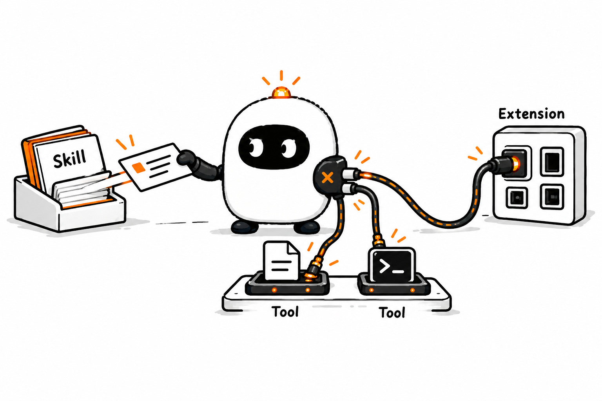

# Extensions 与 Packages：能力怎样注册并参与运行

本章以“增加工具、拦截调用、在界面显示进度”为线索，解释扩展的加载和事件串联。Skill 的文字方法到这里进一步变成宿主中的代码接入点。



## 1. 加载与注册的生命周期

资源加载器找到扩展来源；`extensions/loader.ts` 建立运行时并加载 factory；factory 使用 Extension API 注册工具、命令和事件处理器；`ExtensionRunner` 再把处理器接到 Session 运行。

源码摘录：[packages/coding-agent/src/core/extensions/loader.ts](https://github.com/earendil-works/pi/blob/main/packages/coding-agent/src/core/extensions/loader.ts#L292)

```ts
registerTool(tool: ToolDefinition): void {
	assertActive();
	if (typeof tool.parameters !== "object" || tool.parameters === null || Array.isArray(tool.parameters)) {
		throw new Error(
			`Tool "${tool.name}" registered by extension "${extension.path}" must define an object parameter schema.`,
		);
	}
	extension.tools.set(tool.name, {
		definition: tool,
		sourceInfo: extension.sourceInfo,
	});
	runtime.refreshTools();
```

注册工具并不等于马上调用它，也不等于一定把全部工具声明放进每一轮请求。工具暴露、活动工具集和工具搜索等机制还会决定模型如何发现能力。

## 2. 普通工具与注册工具的包装

源码摘录：[packages/coding-agent/src/core/extensions/wrapper.ts](https://github.com/earendil-works/pi/blob/main/packages/coding-agent/src/core/extensions/wrapper.ts#L17)

```ts
export function wrapRegisteredTool(registeredTool: RegisteredTool, runner: ExtensionRunner): AgentTool {
	return wrapToolDefinition(registeredTool.definition, (toolCallId, signal) =>
		runner.createToolContext(toolCallId, signal),
	);
}

/**
 * Wrap all registered tools into AgentTools.
 * Uses the runner's createToolContext() for consistent context across tools and event handlers.
 */
export function wrapRegisteredTools(registeredTools: RegisteredTool[], runner: ExtensionRunner): AgentTool[] {
	return registeredTools.map((tool) => wrapRegisteredTool(tool, runner));
}
```

包装层在实际执行时创建扩展工具 Context，使工具能访问允许的 Session 和环境信息。直接复制一个函数引用与通过运行时包装调用，在生命周期和可用 Context 上不同。

## 3. 输入、上下文与 Provider 边界

输入处理发生在用户消息正式进入运行之前；`before_agent_start` 参与运行准备；`context` 改变模型前的消息；Provider 请求处理则针对更靠后的供应商数据。

源码摘录：[packages/coding-agent/src/core/extensions/runner.ts](https://github.com/earendil-works/pi/blob/main/packages/coding-agent/src/core/extensions/runner.ts#L1305)

```ts
async emitContext(messages: AgentMessage[]): Promise<AgentMessage[]> {
	const ctx = this.createContext();
	let currentMessages = structuredClone(messages);

	for (const { ext, handlers } of snapshotEventHandlers(this.extensions, "context")) {
		for (const handler of handlers) {
			try {
				const visibleMessages = currentMessages.filter((message) => message.role !== "system");
				const visibleSnapshot = visibleMessages.slice();
				const event: ContextEvent = { type: "context", messages: visibleMessages };
				const handlerResult = (await handler(event, ctx)) as ContextEventResult | undefined;

				// Handlers may return a new list or edit event.messages in place.
				const returned =
					handlerResult?.messages ??
					(sameMessages(visibleMessages, visibleSnapshot) ? undefined : visibleMessages);
```

更早的修改通常能以统一消息表达，更晚的修改更贴近供应商。选择错误边界会让会话、UI 与实际请求不一致；扩展应清楚自己改变的是哪一份数据。

## 4. 工具中间件

AgentSession 把 Extension 的 `tool_call` 与 `tool_result` 接到 Agent 的前后钩子。前者可以阻止动作，后者在动作之后处理结果。多个处理器的串联顺序及结果合并由 Runner 定义。

执行前修改参数后不会再自动校验，因此这不是随意修改任何形状数据的自由入口。执行后把结果改成失败，也不能撤销实际写文件或发请求。

## 5. 状态与 reload

扩展内存状态随实例生命周期变化；希望恢复的状态应使用明确的 Session 记录或其他存储，并在重建时恢复。reload 也需要解除旧订阅、清理进程或连接，避免一个输入被两个旧新处理器同时响应。

`session_shutdown` 和 Runner 的活动性检查帮助维护边界，但不能替每个扩展清理任意外部资源。扩展作者仍需理解自己创建的对象归谁所有。

## 6. Package 是分发单位

`package-manager.ts` 负责 npm、Git 和本地来源及资源配置；Package 可以分发 Extension、Skill、Prompt Template 和 Theme。运行接入点由 Extension 提供，安装来源与内容组织由 Package 管理。

不同产品的 Plugin 术语不能仅凭名称做等价映射。研究 DSH 等项目时，应比较加载、依赖、状态、权限和事件的实际边界。

## 7. 扩展测试如何写出行为证据

`extensions-runner.test.ts` 检查事件串联，发现相关测试检查路径与来源。最小测试应验证扩展实际改变的输出、状态或工具行为；只检查“注册函数被调用过”无法证明完整集成有效。

## 8. 工具阻止处理怎样短路

Runner 对 `tool_call` 处理器逐个调用，遇到阻止结果会提前返回：

源码摘录：[packages/coding-agent/src/core/extensions/runner.ts](https://github.com/earendil-works/pi/blob/main/packages/coding-agent/src/core/extensions/runner.ts#L1253)

```ts
for (const { handlers } of snapshotEventHandlers(this.extensions, "tool_call")) {
	for (const handler of handlers) {
		const handlerResult = await handler(event, ctx);

		if (handlerResult) {
			result = handlerResult as ToolCallEventResult;
			if (result.block) {
				return result;
			}
		}
	}
}

```

这说明中间件不是任意并行的事件广播。后续处理器是否运行，取决于前面的返回值；扩展顺序因而会影响可见行为。对照 `tool_result` 和 `context` 的实现时，也要分别检查它们怎样合并或替换数据，不能套用同一规则。

如果要记录所有被阻止的动作，应确认日志处理器处于什么位置以及哪些边界总会触发。把一个可能被短路的普通处理器当作完整审计入口，会遗漏部分调用。


[继续阅读：Workflow 与 Agent：下一步由谁决定](10-workflow-vs-agent.md)

[返回课程路线](00-source-learning-path.md) · [查看源码地图](../references/source-map.md)
