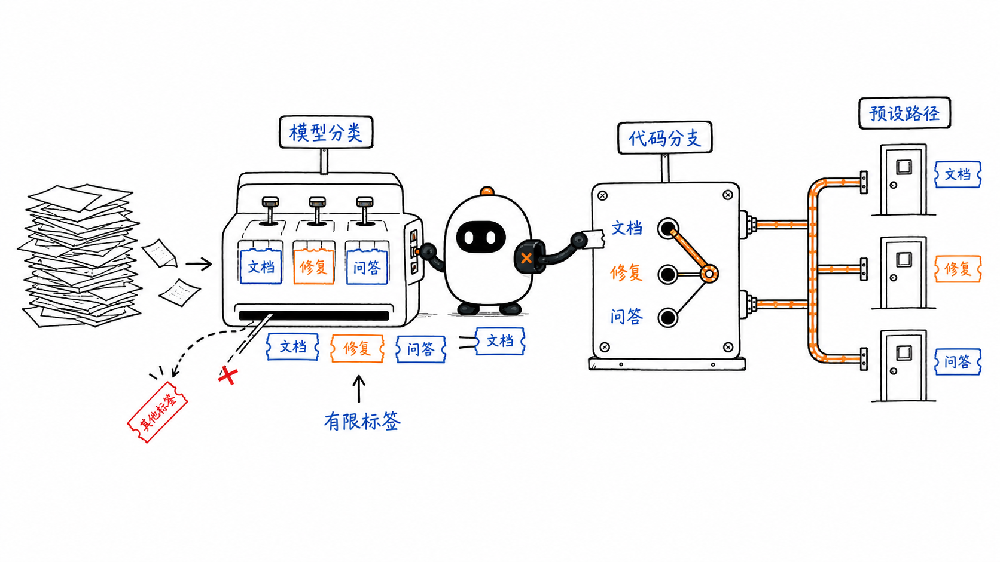

# Workflow 与 Agent：下一步由谁决定

在“读取 README 并解释项目”的例子里，模型决定是否要读文件。换一个任务：让 Pi 创建模板、重新加载项目、再实际调用模板。如果把这三步都写在一句提示里，模型可以自选路径。如果程序必须保证创建后真的重新加载，就要把其中一部分次序写进宿主代码。Pi 自己的文档评测正好这样做。



## 1. 把两层循环画在一起

```text
调用方的三步流程                每次 prompt 内部
① prompt「创建模板」 ─────→   请求模型 → 工具调用 → 工具结果 → 请求模型
② reload             ─────→   宿主重新加载资源
③ prompt「/current-time」 →   展开模板 → 请求模型 → 得到回答
```

图中左侧的步骤次序来自评测用例。右侧第一个 `prompt` 的具体轨迹由模型响应、活动工具和运行时规则共同决定。这里画出了一条可能的工具调用路径，真实模型执行时可以调用多次工具。第二步则由程序直接调用 `session.reload()`，无须等待模型提出 reload 请求。[三步流程的定义](https://github.com/earendil-works/pi/blob/main/packages/evals/evals/prompt-templates.docs.eval.ts) · [流程执行器](https://github.com/earendil-works/pi/blob/3e0eec29f50e7861e9db91f2d12723267411b4f3/packages/evals/src/harness.ts#L370)

在这个设计里，“工作流”是应用对节点和顺序的选择，“Agent”负责节点内部需要观察环境和决定下一次动作的部分。决定由谁做，可以从代码中的循环、条件分支以及各次调用的参数直接看出来。

## 2. 一次 await 的两侧

评测宿主用 `promptAgent` 把 Session 包装成一个可嵌入工作流的步骤。先看完整的小函数，再推演其中两个例子。

源码摘录：[packages/evals/src/harness.ts](https://github.com/earendil-works/pi/blob/3e0eec29f50e7861e9db91f2d12723267411b4f3/packages/evals/src/harness.ts#L238)

```ts
async function promptAgent(session: AgentSession, input: string, signal: AbortSignal | undefined): Promise<string> {
	signal?.throwIfAborted();
	const previousMessageCount = session.messages.length;
	await session.prompt(input);
	const assistant = session.messages
		.slice(previousMessageCount)
		.reverse()
		.find((message) => message.role === "assistant");
	if (!assistant) throw new Error("Agent run completed without an assistant message.");
	if (assistant.stopReason !== "stop" && assistant.stopReason !== "toolUse") {
		throw new Error(
			assistant.errorMessage ?? `Agent run ended with unexpected stop reason: ${assistant.stopReason}.`,
		);
	}
	const output = session.getLastAssistantText();
	if (!output && assistant.stopReason === "stop") throw new Error("Agent run produced no assistant text.");
	return output ?? "";
}
```

假设进入函数时 `session.messages.length` 为 5。调用期间新增了一条用户消息、一个请求工具的助手消息、一条工具结果和最后的助手答复。`slice(5)` 把这一段新产生的消息取出来，`reverse().find(...)` 从末尾找到最后一条助手消息。如果这一轮没有助手消息，函数会报错，避免将上一个节点的旧答复误认为本轮产物。

接下来是**该评测宿主自己的接纳规则**。`stop` 与 `toolUse` 在允许集合中，`error`、`aborted` 或其他原因会抛错。最后通过 `getLastAssistantText()` 提取文本。自然结束却没有文本会被拒绝，合法的 `toolUse` 则允许返回空字符串。这个函数没有验证模板文件位置。是否完成业务动作，还要交由用例读取产物。[提取助手文本的实际实现](https://github.com/earendil-works/pi/blob/3e0eec29f50e7861e9db91f2d12723267411b4f3/packages/coding-agent/src/core/agent-session.ts#L4428)

| 教学输入状态 | 包装函数看到的值 | 调用方接下来会怎样 |
| --- | --- | --- |
| 本次没有产生助手消息，历史里有旧答复 | 本轮切片找不到 `assistant` | 抛出缺少助手消息错误 |
| 模型因长度上限结束，已有一段可读文本 | `stopReason = "length"` | 拒绝这次结果 |
| 自然结束且含有文本 | `stopReason = "stop"`、文本非空 | 将文本交还流程，业务判断另行进行 |

由此可以理解为什么 `await session.prompt(...)` 能作为“这一步完成等待”的边界。它返回 `Promise<void>`，程序要从事件、消息、工具记录或文件中取得自己需要的产物。

## 3. 为什么三步复用一份 Session

后两步必须能找到第一步创建的项目模板。评测为一次运行创建工作区、资源加载器和 SessionManager，并保存运行标识。后续循环在同一个 Session 上执行步骤。reload 后可以重新发现落盘资源，第三步的会话消息也留在同一份历史里。[会话装配和运行标识](https://github.com/earendil-works/pi/blob/3e0eec29f50e7861e9db91f2d12723267411b4f3/packages/evals/src/harness.ts#L337)

如果把这个流程拆成三个独立 Session，要额外传递工作目录、模板作用域与希望保留的上下文。反过来，即使每个节点都创建了新 Session，只要它们仍共享工作目录，第一步写的文件就可能被第二步看到。消息历史和文件系统是两条独立的数据通道。这个观察在下一章并行调度时还会用到。

## 4. 业务流程如何处理失败、取消和发布

用发布说明作为第二个例子。下面是应用设计示例，控制流以可信产物作为判断依据。

| 阶段 | 宿主提供的输入 | 产物或进入下一步的依据 |
| --- | --- | --- |
| 收集改动 | 两个提交标识 | Git 返回的变更集合和退出状态 |
| 调用 Pi 起草 | 已确认的变更集合 | 当前运行结束、生成了候选说明 |
| 核对说明 | 候选内容、原始变更 | 引用的提交存在、没有遗漏要求中的变更 |
| 发布 | 已经批准的明确产物 | 发布服务返回的发布标识 |

如果调用者取消，评测宿主会把信号连到 `session.abort()`，在离开步骤循环时解除监听并等待已发起的取消完成。如果只是把调用方 Promise 丢弃，内层模型请求仍可能在继续。类似地，重新起草说明通常只产生一个新候选，再调用发布动作却可能新增一次发布，二者应使用不同的重试条件。[宿主的取消生命周期](https://github.com/earendil-works/pi/blob/3e0eec29f50e7861e9db91f2d12723267411b4f3/packages/evals/src/harness.ts#L360)

第 18 章会回到同一个模板流程，打开评分函数，观察它如何把“完成了三步”进一步检验为“在正确的位置创建并成功调用了模板”。

[继续阅读：Workflow Patterns：把多个 Agent 节点连接起来](11-workflow-patterns.md)

[返回课程路线](00-source-learning-path.md) · [查看源码地图](../references/source-map.md)
