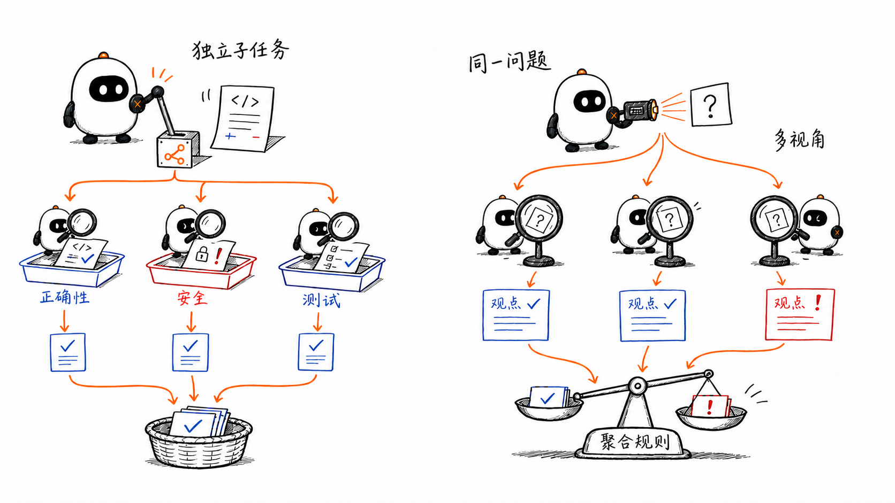

# Workflow Patterns：把多个 Agent 节点连接起来

本章以代码修复流程为例，说明串行、路由、并行和评审循环如何建立在明确契约上。这里的模式是应用设计方法；Pi SDK 提供节点内部的 Agent 能力，应用决定节点如何组合。



## 1. 节点首先要有契约

一个节点至少需要说明输入、产物、失败与取消的表达方式。对于代码修改，产物可以是 diff、测试记录和总结；对于检索，产物可以是来源和证据。让下游从一大段聊天文字猜测状态会变得脆弱。

Pi 的事件可用于显示进度，而持久的输出需要由应用明确选取。Session 的历史不是天然稳定的业务结果 Schema。

## 2. 串行与路由

串行节点依赖前一步的结果，例如先找到故障再修复。每个边界应验证前一步确实给出了下游需要的材料。路由可以是代码规则，也可以调用模型分类；模型参与分类不改变外层流程仍由代码选择分支这一事实。

教学伪代码如下：

```text
diagnosis = 调查节点(仓库、问题)
校验 diagnosis 的文件、症状与证据
选择修复路径(diagnosis)
修改节点(diagnosis)
验证节点(实际修改与测试命令)
```

校验应检查内容而不只是字段是否存在，特别是命令输出和模型总结可能不一致。

## 3. 并行的前提是没有写入冲突

独立调查可以并行，依赖对方产物的任务不能简单同时开始。多个节点写同一文件时，需要独立 checkout、工作区或显式合并策略；独立 Agent 对象不能替代这些边界。

并行还要处理部分失败、超时、取消、结果回收和成本。最慢的关键依赖决定总时间；启动更多节点不保证更快。

## 4. Orchestrator–Workers

管理者负责拆任务和聚合结果，Worker 负责局部目标。Pi 的 Subagent Extension 示例提供 single、parallel 和 chain 等执行组织，可以作为一个具体实现观察：

源码摘录：[packages/coding-agent/examples/extensions/subagent/index.ts](https://github.com/earendil-works/pi/blob/main/packages/coding-agent/examples/extensions/subagent/index.ts#L270)

```ts
async function runSingleAgent(
	defaultCwd: string,
	dispatchDefaults: DispatchDefaults,
	agents: AgentConfig[],
	agentName: string,
	task: string,
	cwd: string | undefined,
	step: number | undefined,
	signal: AbortSignal | undefined,
	onUpdate: OnUpdateCallback | undefined,
	makeDetails: (results: SingleResult[]) => SubagentDetails,
): Promise<SingleResult> {
	const agent = agents.find((a) => a.name === agentName);

	if (!agent) {
```

此处展示的是仓库中的扩展示例，不代表每次 `createAgentSession()` 都自动启动这些子进程。核心、内置资源和可选示例需要分开定位。

## 5. Evaluator–Optimizer

评审循环需要明确的评价标准、最大迭代次数和最好候选保存策略。否则“再改好一点”可能让结果越改越差。评审也可以出错，不能把另一个模型的肯定直接当成测试通过。

需要评估代码时，先依据实际执行结果检查行为，再结合可读性和设计评论。外部副作用应放在可靠的批准和执行边界之后。

## 6. 运行证据

应用记录节点 ID、输入来源、Session、产物、错误、取消和花费，有助于判断问题在哪个节点。重试时要辨别计算可重复与副作用可重复：重新分析通常不同于重复发送一封邮件。

下一章研究规划和推理强度：模型产生计划，与系统按照计划可靠行动，依然是不同职责。

## 7. 并行工作者为何仍需要外层约束

Subagent 示例用 `spawn` 启动进程并解析逐行 JSON 输出：

源码摘录：[packages/coding-agent/examples/extensions/subagent/index.ts](https://github.com/earendil-works/pi/blob/main/packages/coding-agent/examples/extensions/subagent/index.ts#L344)

```ts
const proc = spawn(invocation.command, invocation.args, {
	cwd: cwd ?? defaultCwd,
	shell: false,
	stdio: ["ignore", "pipe", "pipe"],
});
let buffer = "";

const processLine = (line: string) => {
	if (!line.trim()) return;
	let event: any;
	try {
		event = JSON.parse(line);
	} catch {
		return;
	}

```

每个子进程的消息和用量要归属到正确结果对象；父进程还要在返回前汇总状态。stdout 中出现不合法的一行，不应被当成一条正确的运行事件。

并行修复两个模块时，即使模型上下文彼此独立，两个进程仍可能竞争共享文件和依赖安装目录。先设计哪些资源独占、哪些结果合并，再决定并发数，才能避免速度增加却更难复现。


[继续阅读：Planning 与 Reasoning：从推理配置到可执行计划](12-planning-and-reasoning-patterns.md)

[返回课程路线](00-source-learning-path.md) · [查看源码地图](../references/source-map.md)
