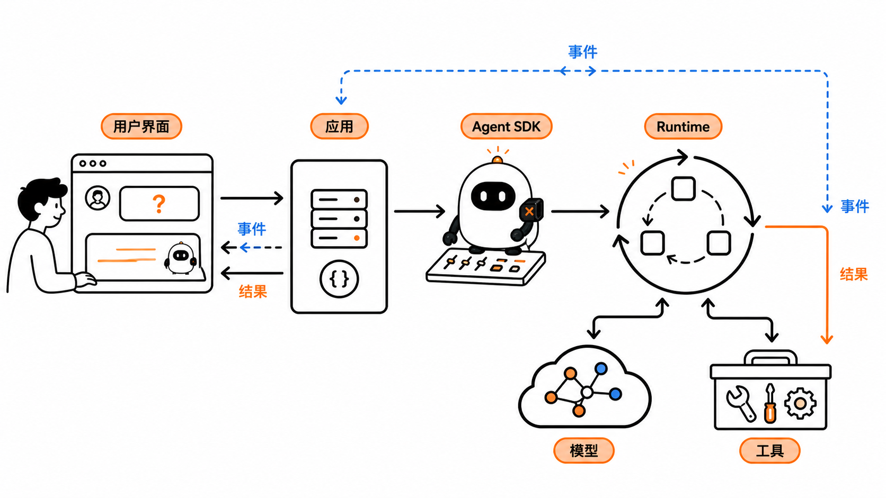

# SDK 与应用集成：从启动装配到资源释放

本章把前面读过的机制装配起来：一个应用怎样创建 Pi、提交输入、显示响应、恢复会话和取消运行。重点入口是 `createAgentSession()`，不是让应用自己复制一套 Agent Loop。



## 1. 从 CLI 到 SDK 的装配

`cli.ts` 调用 `main()`。`main.ts` 解析模式和参数、准备服务，并通过 `createAgentSessionFromServices()` 创建会话；交互、print、JSON 与 RPC 模式随后使用相应界面。

SDK 可以直接调用 `createAgentSession()`，复用模型运行时、资源加载、Settings、Session 和工具，而不必经过终端输入控件。

源码摘录：[packages/coding-agent/src/core/sdk.ts](https://github.com/earendil-works/pi/blob/main/packages/coding-agent/src/core/sdk.ts#L191)

```ts
export async function createAgentSession(options: CreateAgentSessionOptions = {}): Promise<CreateAgentSessionResult> {
	const cwd = resolvePath(options.cwd ?? options.sessionManager?.getCwd() ?? process.cwd());
	const agentDir = options.agentDir ? resolvePath(options.agentDir) : getDefaultAgentDir();
	let resourceLoader = options.resourceLoader;

	const authPath = options.agentDir ? join(agentDir, "auth.json") : undefined;
	const modelsPath = options.agentDir ? join(agentDir, "models.json") : undefined;
	const modelRuntime = options.modelRuntime ?? (await ModelRuntime.create({ authPath, modelsPath }));

	const settingsManager = options.settingsManager ?? SettingsManager.create(cwd, agentDir);
	const sessionManager = options.sessionManager ?? SessionManager.create(cwd, getDefaultSessionDir(cwd, agentDir));

	if (!resourceLoader) {
		resourceLoader = new DefaultResourceLoader({ cwd, agentDir, settingsManager });
		await resourceLoader.reload();
		time("resourceLoader.reload");
	}
```

这里先确定目录和运行服务，再恢复会话上下文。应用显式传入对象时，会改变默认所有权和资源来源；创建前应知道哪些对象由调用者共享。

## 2. 模型访问在什么位置

SDK 创建低层 Agent，并把模型调用接入 `ModelRuntime.streamSimple()`。运行时承担 Provider 和认证等模型访问职责，Agent 则负责消息、工具和控制流。

源码摘录：[packages/coding-agent/src/core/sdk.ts](https://github.com/earendil-works/pi/blob/main/packages/coding-agent/src/core/sdk.ts#L403)

```ts
const agent = new Agent({
	initialState: {
		systemPrompt: "",
		model,
		thinkingLevel,
		tools: [],
		messages: existingSession.messages,
	},
	convertToLlm: convertToLlmWithBlockImages,
	streamFn: async (model, context, options) => {
		const requestOptions = buildRequestOptions(options);
		// Compaction and summaries use their own routing ids; only session requests
		// replace the cache entry, so warming restarts from them. Keep warming while
		// the current transcript still extends the request's prefix. Agent state may
```

恢复的消息成为初始状态的一部分；工具和系统提示等还会在后续装配中建立。不能仅看到构造函数里暂时为空，就断言运行时没有这些能力。

## 3. 事件到界面

应用通过 Session 的 `subscribe()` 获取流式与生命周期事件；返回的函数解除这一个订阅。

源码摘录：[packages/coding-agent/src/core/agent-session.ts](https://github.com/earendil-works/pi/blob/main/packages/coding-agent/src/core/agent-session.ts#L1404)

```ts
subscribe(listener: AgentSessionEventListener): () => void {
	this._eventListeners.push(listener);

	// Return unsubscribe function for this specific listener
	return () => {
		const index = this._eventListeners.indexOf(listener);
		if (index !== -1) {
			this._eventListeners.splice(index, 1);
		}
	};
}

```

在交互模式里，`interactive-mode.ts` 的订阅与 `handleEvent()` 把 Session 事件映射到文本、工具和状态组件。TUI 处理终端渲染，不能把模型文本直接理解为终端控制命令。

Web 应用也应维护自己的 View State：部分文本、最终消息、工具进度和错误需要分别表达。网络断开后能否恢复，是应用的传输和持久化设计，不能只靠重新订阅内存对象。

## 4. 取消与释放

源码摘录：[packages/coding-agent/src/core/agent-session.ts](https://github.com/earendil-works/pi/blob/main/packages/coding-agent/src/core/agent-session.ts#L2519)

```ts
async abort(): Promise<void> {
	if (this._isAgentRunActive) {
		this._agentRunAbortRequested = true;
	}
	this.abortRetry();
	this.abortCompaction();
	this.abortBranchSummary();
	if (this._isBeforeSettle) this._abortDuringBeforeSettle = true;
	this.agent.abort();
	await this.waitForIdle();
}

```

`abort()` 请求取消并等待 Session 空闲；`dispose()` 清理监听、失效扩展 Context、取消相关工作并断开资源连接。调用 dispose 后再使用捕获的扩展 Context 会越过生命周期边界。

取消不能保证已经完成的文件或网络副作用自动撤销。对用户显示状态时，要区分请求已取消、子进程已停止、会话已空闲和动作是否已经发生。

## 5. Session 替换

新建、切换、分叉或 reload 后，活动 Session 和相关服务可能变化。`agent-session-runtime.ts` 管理运行对象替换，官方 `examples/sdk/13-session-runtime.ts` 展示应用侧用法。长期持有旧句柄时，应确认它是否仍属于当前活动运行。

多用户服务还需要隔离会话目录、凭据、工作区和并发修改。仅给每个用户创建一个 JavaScript 对象，不会自动隔离磁盘和系统权限。

## 6. 可运行示例从哪里看

`examples/sdk` 依次包含最小调用、自定义模型、工具、扩展、资源、认证和会话等示例。它们是真实 API 的入口。运行涉及真实模型时需要配置相应服务；单元测试中模拟的流不产生这种外部调用。

下一章把一个 Session 扩展到多个 Agent，重点看任务契约和进程边界。

## 7. 一次 SDK 运行的对象所有权

`createAgentSession()` 返回 `session`，Session 内持有低层 Agent、SessionManager、资源加载器与扩展相关状态。模型运行时可能由默认创建，也可能由调用者显式共享。共享实例可以减少重复装配，但也要求清楚谁负责关闭和替换。

UI 订阅返回的取消函数只解除这一个监听；`abort()` 等待当前工作停止；`dispose()` 使这份 Session 的运行连接失效。这三种操作不能互相替代。

服务端如果为一个请求临时创建 Session，可用 `try/finally` 保证退出清理；长期交互则需要明确会话寿命。每次页面刷新都直接新建所有对象，可能产生重复运行和遗留连接；永不清理又可能保留过期 Context。


[继续阅读：Multi-Agent：多个独立循环怎样协作](14-multi-agent-and-a2a.md)

[返回课程路线](00-source-learning-path.md) · [查看源码地图](../references/source-map.md)
