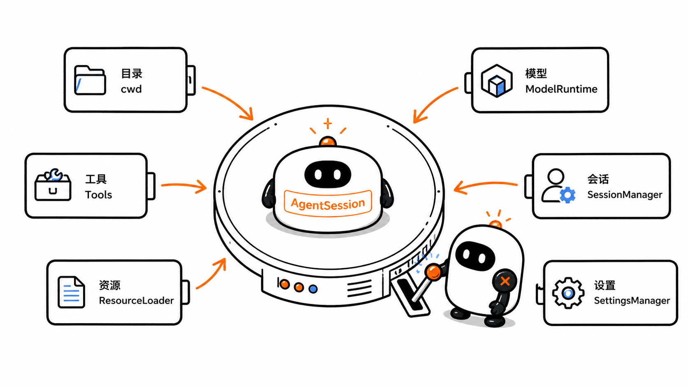

# SDK 与应用集成：从启动装配到资源释放

第一章直接调用 `runAgentLoop()`，输入、可用工具和事件记录器都在一处。现在把同一份 README 放进一个完整的 Coding Agent 会话。它会创建模型运行时，挑选活动工具，把消息记入会话树，同时把实时事件送给调用方。



## 1. 创建一份可重复的 SDK 会话

课程程序使用 Pi 的 Faux Provider 演示两轮消息，在临时配置目录中运行，只开放 `read` 工具。上层应用走正式 SDK 入口，读取的是磁盘上的示例文件。仓库根目录下运行下列命令。[完整程序](../examples/read-loop/session.mjs)

```bash
cd examples/read-loop
npm ci
npm run session
```

```text
消息完成  system
消息完成  user
消息完成  assistant
消息完成  toolResult
消息完成  assistant
会话记录  system → user → assistant → toolResult → assistant
最终回答  项目说明：一个将 Markdown 笔记整理成索引的命令行工具。
```

前五行来自运行期间的 `message_end` 事件。倒数第二行是在 `await session.prompt(question)` 返回后，沿 SessionManager 的活动分支读取消息条目所得。这里同一条 assistant 回复可以在时间上被观察为事件，也可以在运行结束后作为一条会话消息被读取。两种接口承担不同职责。

## 2. 一个工厂装配哪些对象

SDK 的入口先确定 cwd，随后选择模型运行时、设置、会话管理器和资源加载器。如果没有传入 loader，工厂会创建默认 loader 并等待 `reload()`。这种等待有可见后果，注册到会话中的工具、技能和扩展要在资源发现后才能确定。[createAgentSession](https://github.com/earendil-works/pi/blob/main/packages/coding-agent/src/core/sdk.ts)

本例的装配部分如下。模型脚本已经注册到 `modelRuntime`，`cwd` 指向仓库中的 fixtures，`agentDir` 指向新建的临时目录。

```js
const sessionManager = SessionManager.inMemory(cwd);
const { session } = await createAgentSession({
  cwd, agentDir, modelRuntime, model: info, sessionManager, tools: ['read'],
});
```

这里的 `tools: ['read']` 是给产品层的工具选择配置。它接收工具名称。第一章传给底层循环的 `tools: [tool]` 则已经是带 `execute()` 的对象。比较这两个参数能看出 SDK 完成了一段装配工作。CLI 经过自己的参数解析和服务准备，也会进入会话装配，然后才由交互、JSON 或 RPC 界面消费事件。[SDK](https://github.com/earendil-works/pi/blob/main/packages/coding-agent/src/core/sdk.ts) · [CLI](https://github.com/earendil-works/pi/blob/main/packages/coding-agent/src/main.ts)

| 装配步骤 | 读到什么 | 交给下一步什么 |
| --- | --- | --- |
| 会话恢复 | SessionManager 的活动分支 | `existingSession.messages`、已有模型及思考配置 |
| 创建 Agent | 消息、所选模型、消息转换函数、模型流函数 | 可以接收 prompt 的运行对象 |
| 创建 AgentSession | Agent、工具选择、Settings、资源、会话管理器 | 一个产品会话，能处理输入、工具钩子、事件与会话写入 |
| 应用订阅 | Session 产生的事件 | 可以独立维护的输出界面 |

SDK 构造 Agent 时传入 `tools: []` 和恢复好的消息。后续产品会话根据配置建立可用工具。因此在构造函数内部打断点看到空工具列表，和在 `prompt` 时看到 `read`，是同一装配过程的两个时刻。

### 三个目录，三个不同的问题

第一次接 SDK，最容易传错的往往是路径。把本章的应用想成一个桌面编辑器：人打开 `project/`，把个人配置放在 `config/`，希望聊天记录保存在单独的 `sessions/`。谁应该读取哪个目录？`cwd` 是当前工作区，内置 read 要把相对的 `README.md` 解析到这里；`agentDir` 是应用给 Pi 的配置/资源位置，会影响用户级设置等；传给 `SessionManager.create(cwd, sessions)` 的第二个参数决定新会话文件存在哪里。三者在日常 CLI 中经常由默认值代填，在自己的产品里却未必应该指向同一棵目录。

拿具体故障来区分。如果 read 打开了另一个项目的 README，应先查工具绑定的工作目录；如果重新打开后找不到昨天的对话，应先确认打开的会话标识或文件路径；如果无端出现另一个配置里的模板，应查加载器收到的配置和项目来源。三种症状都可能被笼统地说成“上下文不对”，但改提示词并不能修复其中任何一条路径。后面实验故意使用三个不同的临时子目录，让每项依赖都能单独辨认。

再看工厂里的选项：传入 `SessionManager.inMemory` 并不妨碍工具读真正的磁盘；改为文件型 SessionManager 也不会帮工具记一份工作区快照。前者只选择了会话记录的保存策略。工具该如何访问文件和模型如何产生回复是另外两条可以单独替换的依赖。因此一个不调用网络的测试仍然能够检验项目里的真实文件；如果想完全隔离文件系统，还要另外选择临时目录或替代工具操作。

## 3. 为什么替换模型还能测到真实的 Session

`ModelRuntime` 根据模型标识组织 Provider 调用。在正常模型路径里，Agent 配置的流函数整理请求选项，并返回 `modelRuntime.streamSimple(model, context, requestOptions)`。这次实验给 ModelRuntime 注册了一个本地 Provider；它接收同样的 Context 并产生同样类型的流事件。工具依然从 AgentSession 的工具集合中查找。[模型运行时](https://github.com/earendil-works/pi/blob/main/packages/coding-agent/src/core/model-runtime.ts) · [课程模型脚本](../examples/read-loop/run.mjs)

第一次回复明确要求调用 `read`，第二次回复读取上一条工具结果。如果工具没进到循环或结果没有写回，脚本会发现第二次请求里缺少 `toolResult`。这样既能稳定重现 SDK 链路，又能指出这个实验的证据范围。换成真实 Provider 后的选工具能力、网络和费用，需要用相应服务另行观察。

## 4. 事件、状态和磁盘记录各自回答什么

```js
const unsubscribe = session.subscribe(event => {
  if (event.type === 'message_end') console.log('消息完成  ' + event.message.role);
});
try {
  await session.prompt(question);
  const branch = sessionManager.getBranch().filter(entry => entry.type === 'message');
  console.log(branch.map(entry => entry.message.role));
} finally {
  unsubscribe();
}
```

`subscribe()` 将回调加入监听列表，并返回一个专门移除该回调的函数。流式界面通常从 `message_update` 中选取 `text_delta` 渲染局部文本，`message_end` 再确认完整消息。若把每个 delta 都追加成历史消息，恢复时就会把一条回复重复许多次。[订阅实现](https://github.com/earendil-works/pi/blob/main/packages/coding-agent/src/core/agent-session.ts) · [上游最小 SDK 程序](https://github.com/earendil-works/pi/blob/main/packages/coding-agent/examples/sdk/01-minimal.ts)

`session.state.messages` 是活动 Agent 当前持有的消息。SessionManager 的记录则带有条目种类、父节点和标识，里面还可以有模型切换或压缩记录。示例用 `filter` 只留下 message 类型，恰好得到与这一轮消息一致的角色顺序。改用文件型 SessionManager 时，条目可写入会话文件。恢复时沿选中分支进行投影，详见[第六章](06-session-memory-retrieval-and-compaction.md)。

### 一条消息在屏幕上结束时，磁盘已经写了吗

先做个预测：如果在 `message_end` 的订阅回调里立刻查询会话树，会不会已经找到这条消息？沿两个不同层级的函数读，就能给出比“通常会”更准确的答案。底层 `Agent.processEvents` 收到 `message_end` 首先清除正在流式生成的消息，并往自己的 `state.messages` 追加正式消息；完成状态更新后才依次通知 Agent 的订阅者。产品层的 AgentSession 正是其中一个订阅者。[Agent 的处理顺序](https://github.com/earendil-works/pi/blob/main/packages/agent/src/agent.ts#L575)

到了产品层，`_handleAgentEvent` 先把事件送给扩展，再通知公开的 Session 监听器，随后才进入当前消息的持久化分支。普通系统、用户、助手、工具结果会走 `sessionManager.appendMessage`；扩展自定义消息有自己的记录类型。两个层级都在处理同一个事件，但“已经产生这条消息”和“已把它追加到日志”中间仍有一个能被程序观察到的间隙。[公开监听与会话写入的先后](https://github.com/earendil-works/pi/blob/main/packages/coding-agent/src/core/agent-session.ts#L1159)

下一个实验专门在**第一条用户消息**的公开回调里查两份数据：底层 Agent 的数组已经含有这条消息，SessionManager 的活动分支还没有用户条目。等整次 `await session.prompt(...)` 返回，再读取会话文件，就能数出完整的五条消息。这个时序给 UI 设计一个直接结论：要立刻显示这一条，使用事件携带的 `event.message`；要为完成的一次运行导出持久记录，在相应流程结束后读取 SessionManager。不要因为在回调里少查到一行就再手动追加一份，否则框架随后还会按正常路径记录它。

### 真正关闭，再打开：为什么两个不同的 README 都是对的

下面不是在一个活着的实例里接着输入。程序创建磁盘会话，完成第一轮后调用 `dispose()`，修改 README，然后用已知路径 `SessionManager.open(log)` 打开同一份日志，装配一个全新的 Session。两个模型都是本地脚本，读文件仍用内置工具。实验结束会清理临时项目。[可运行的重开实验](../examples/read-loop/resume.mjs) · [会话文件的创建与追加](https://github.com/earendil-works/pi/blob/main/packages/coding-agent/src/core/session-manager.ts#L1157)

```bash
cd examples/read-loop
npm ci
node resume.mjs
```

```text
仅装配，文件已存在：false
第一次 user 结束事件内：Agent 已有=true；会话树已有=false
首次读取：用途：整理旧笔记。
文件中的消息：system → user → assistant → toolResult → assistant
刚恢复，历史结果：用途：整理旧笔记。
再次调用后，两个结果：用途：整理旧笔记。 / 用途：生成新索引。
```

第一行很反直觉。SessionManager 可以已经有会话 ID、目标文件路径，甚至有内存中的配置条目，却还没创建文件。看 `_hasConversation()` 的条件，它检查有没有用户或助手消息；只有配置、系统提示等初始化条目时，新的会话文件不急着落盘。首次满足条件时，把累积条目写进新文件；后续记录才逐条追加。这避免了用户仅打开再退出编辑器就在磁盘上留下一份空对话，也避免了非得等第一次助手完整回答才开始保存用户的问题。这里可区分三件事：取得目标路径、路径上已有文件、文件里已有本次回复。

直接读这个布尔表达式。外层的 `some` 只需要找到一条匹配记录，内层既要求条目种类是 message，又要求消息作者是 user 或 assistant。因此系统消息虽然也是 message，却不能单独触发第一次落盘。若本次用户输入已经被记成一条 user，即使网络随后断开，条件也已经成立。这和“模型回了才算开始聊天”有一个对故障恢复很重要的区别。

源码摘录：[packages/coding-agent/src/core/session-manager.ts](https://github.com/earendil-works/pi/blob/9823079ad98d39f3587286c8d9f29556dfb3687b/packages/coding-agent/src/core/session-manager.ts#L1167)

```ts
private _hasConversation(): boolean {
	return this.fileEntries.some(
		(e) => e.type === "message" && (e.message.role === "user" || e.message.role === "assistant"),
	);
}
```

接着顺源码往下读 `_persist`。如果该管理器是内存模式或者没有会话文件路径，函数直接返回；如果选的是文件模式，第一次刷新会遍历此前所有条目，后面的追加则只把这一个新条目写成一行。两种写法让新日志既能从头恢复启动信息，正常运行时又不必为了多一条消息重写整段历史。反过来读取文件时，应当按行解析各自的对象，不能把整个文件当作一个 JSON 数组。实验里打印的角色顺序就是从这些独立记录过滤出来的，而非在程序里预先列好的答案。

如果你正在实现桌面端的「保存聊天」按钮，这里还有个可检验的边界。用户刚创建空标签，你已经能拿到会话 ID 和预定路径，但调用读取文件可能返回不存在；那是此实现的正常生命周期，不代表目录权限坏了。用户已经提交第一条问题并等到追加完成，再按同一条路径读，才应该见到持久化内容。把「未开始交谈」「正在接收回复」「已可从文件导出」当成三个不同的界面状态，会比用一个“已保存”布尔值更符合这个接口。

倒数第二行是分辨“记忆”最直接的证据。我们在重开前已经把磁盘文字改成「用途：生成新索引。」。然而还没调用工具，新的 Agent 就能拿到「整理旧笔记」。这段文字来自日志里先前的 `toolResult`；恢复沿会话分支把消息装回状态，并没有为了重放历史偷偷执行一次 read。最后一行则是一次**新调用**，它读取当前工作区，看见新文字，结果作为新消息追加，并没有覆盖上次的观察。后来的模型请求可以同时看见两者，正如一个人能同时记得昨天的文件和今天的文件。

如果把恢复那一行换成新建 `SessionManager.inMemory(cwd)`，仍把 cwd 指向同一项目，文件工具依然读得到新版 README，但旧对话不会自动出现在这个新会话里。反过来，只有一份保存完好的聊天文件也不能还原整个工作区。这是为什么需要可复现开发环境的应用，还要另行记录提交、工作区或产物标识。会话负责保留当时观察到了什么，项目管理负责保留当时世界是什么样子。

## 5. 在正确的时刻释放什么

界面临时折叠只需要解除自己的订阅。用户点击“停止”时应调用 `await session.abort()`。它向低层 Agent 发出中断请求，处理重试、压缩等相关工作，并等待会话空闲。已经由工具完成的写文件操作仍然存在。关闭整个会话时调用 `session.dispose()`，释放会话所管理的连接和监听。示例将它放在外层 `finally`，初始化和关闭临时目录再放到更外层。[AgentSession 生命周期](https://github.com/earendil-works/pi/blob/main/packages/coding-agent/src/core/agent-session.ts)

再看一个容易在应用中出现的错误。前端点击“新会话”后，运行时将活动 Session 从 A 替换成 B，原来的回调仍然订阅着 A。即使 B 正在流式输出，它也收不到。上游的 Session Runtime 示例在替换后用新的 Session 重新绑定订阅，并清理旧回调。这样 UI 显示的对象与应用提交输入的对象重新一致。[会话替换示例](https://github.com/earendil-works/pi/blob/main/packages/coding-agent/examples/sdk/13-session-runtime.ts)

### 把 SDK 接到编辑器时，选择正确的完成边界

设想编辑器里有「停止生成」「关闭标签」「稍后再打开」三个动作。停止生成时要终止当前会话正在推进的工作，所以这条按钮路径应调用并等待取消；如果只移除订阅，屏幕虽然安静了，模型或工具仍可能继续。关闭一个只读观察面板时情况相反，窗口只应清理自己的监听，不应替共享同一 Session 的其他界面结束运行。稍后再打开需要的是会话标识和可恢复的记录，并在新实例上重新订阅，旧实例的 JavaScript 回调没有被序列化到文件。

遇到“关掉再开后输出重复两遍”也可这样拆解：先看持久分支里究竟有一条还是两条助手消息。若日志只有一条，检查新界面是否重复订阅，或者渲染时将同一回复的全文与增量都追加到了显示缓冲；若日志本身已有两次用户输入，再往提交输入的事件处理器查。源码给出的顺序和上面的重开输出，让你能在界面、会话与模型之间找到第一个不符合预期的边界，而不必从头猜一遍。

> **先预测**　关闭会话，修改 README，再重新打开同一份会话文件。还没调用 read 时，能看到哪一份内容？
>
> **核对推导**　历史工具结果里是旧内容。恢复重建消息，不重演工具。再次对磁盘执行 read 才会产生新结果；新旧观察可以同时存在，分别对应两次不同的实际读取。

[继续阅读：多个独立循环怎样协作](14-multi-agent-and-a2a.md) · [源码地图](../references/source-map.md)
