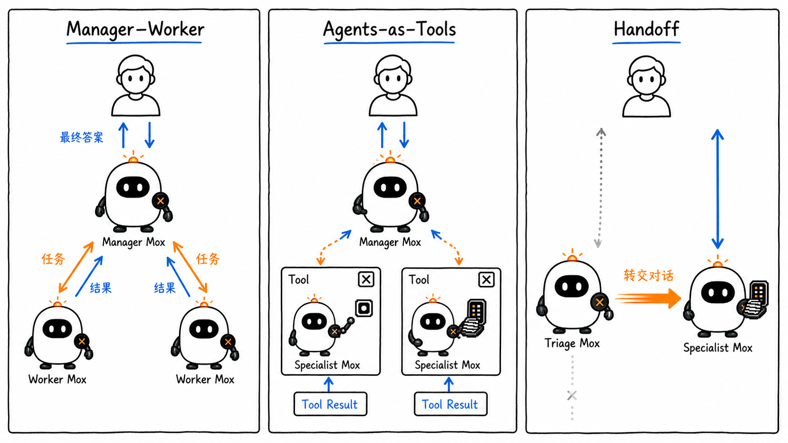

# Multi-Agent：多个独立循环怎样协作

在第 11 章，scout 先调查，planner 再根据调查结果制订计划。现在把其中一次委托放大。父 Agent 调用了一次工具，子 Agent 却可能经历好几轮工具调用。两个循环之间究竟共享了哪些数据？Pi 的 Subagent 扩展示例给出了从工具参数一直到操作系统进程的实现。



## 1. 一个名字怎样选中执行配置

假设父模型发出以下调用。这里的参数是教学示例。默认的 `agentScope` 为 `user`，所以例子假定用户已经装好了 `scout` 定义以及该扩展。[扩展示例与安装方式](https://github.com/earendil-works/pi/blob/main/packages/coding-agent/examples/extensions/subagent/README.md)

```json
{"agent":"scout","task":"定位处理空文件名的 CLI 代码，返回文件和函数名"}
```

扩展首先统计 single、parallel、chain 有几种模式被选中，只接受一种。然后根据作用域发现 Agent 定义。Markdown 文件的头部给出名字、描述、允许工具及可选模型，正文成为系统提示补充。找不到名字时会产生失败结果，附上可选的名字，不会启动子进程。[配置发现与结构](https://github.com/earendil-works/pi/blob/main/packages/coding-agent/examples/extensions/subagent/agents.ts) · [参数判定](https://github.com/earendil-works/pi/blob/3e0eec29f50e7861e9db91f2d12723267411b4f3/packages/coding-agent/examples/extensions/subagent/index.ts#L481)

模型回退有一个小细节。定义里显式配置了模型，就用它。没有配置则继承父会话的模型，只有这种继承情形才会一并传父级 thinking 设置。这样子角色选择了不同模型时，不会自动收到另一个模型的推理设置。[启动参数构造](https://github.com/earendil-works/pi/blob/3e0eec29f50e7861e9db91f2d12723267411b4f3/packages/coding-agent/examples/extensions/subagent/index.ts#L298)

## 2. 跨进程的输入是什么

`runSingleAgent` 使用 `--mode json -p --no-session` 作为基本参数，按需追加模型、推理级别及工具名称。如果角色有系统提示正文，父侧把它写入临时文件，以 `--append-system-prompt` 指向该文件。最后一个参数是以 `Task: ` 开头的任务字符串。下面是简化后的参数形状，省略了模型和工具的具体值。

```text
参数数组
  --mode  json  -p  --no-session
  --tools  <角色允许的工具列表>
  --append-system-prompt  <临时文件路径>
  Task: 定位处理空文件名的 CLI 代码，返回文件和函数名
```

`spawn` 以 `shell: false` 启动 Pi，将任务作为一个参数传递。标准输入设为忽略，stdout、stderr 各接一条管道。工作目录默认使用父侧目录，也可以单独传入。子进程没有继承父 Session 的消息数组，但它仍可能读到同一目录里的文件和在该进程环境下可用的资源。`--no-session` 控制此次会话的持久化，也是另一个独立维度。[进程启动与输入通道](https://github.com/earendil-works/pi/blob/3e0eec29f50e7861e9db91f2d12723267411b4f3/packages/coding-agent/examples/extensions/subagent/index.ts#L330)

## 3. 为什么要留一个未处理的缓冲区

JSON 模式的输出以换行分隔记录。操作系统交来的一个数据块可能只含半行，也可能有多行。父侧用这个处理器把数据块拼回记录。

源码摘录：[packages/coding-agent/examples/extensions/subagent/index.ts](https://github.com/earendil-works/pi/blob/3e0eec29f50e7861e9db91f2d12723267411b4f3/packages/coding-agent/examples/extensions/subagent/index.ts#L388)

```ts
proc.stdout.on("data", (data) => {
	buffer += data.toString();
	const lines = buffer.split("\n");
	buffer = lines.pop() || "";
	for (const line of lines) processLine(line);
});
```

以只含 ASCII 字符的两个**示意字节块**推演算法，A 为 `{"type":"message_`，B 为 `end"}\n{"type":"other"}\n`，其中 `\n` 表示一个实际换行。收到 A，分割后没有完整行，所有字符留在 `buffer`。收到 B，连接后有两条完整记录，依次调用 `processLine`，尾部留下空串。遇到不合法 JSON 时，解析函数捕获错误并跳过该行。进程关闭时还会尝试解析最后一段非空缓冲，即使它没有末尾换行。[逐行解析与退出收尾](https://github.com/earendil-works/pi/blob/3e0eec29f50e7861e9db91f2d12723267411b4f3/packages/coding-agent/examples/extensions/subagent/index.ts#L350)

这是这个扩展示例的解码实现。它对每个 Buffer 单独调用 `toString()`；如果一个 UTF-8 多字节字符恰好跨过字节块，单纯拼字符串可能损坏字符。若用相同协议实现自己的接收器，应在字节层保留未完成的字符或使用流式解码器。换行分帧解决的是“记录不完整”，字符解码另有边界。

## 4. 子结果怎样变回父工具结果

收到 `message_end` 时，处理器把消息放入 `currentResult.messages`。如果是助手消息，还会累计轮数、输入输出 Token、缓存和费用，并记录最近的停止原因、错误文字。stderr 单独累积。父侧 `onUpdate` 可以展示进展，而提交给父模型的文本则要等这项工作结束后从消息里选取。[子消息与用量累积](https://github.com/earendil-works/pi/blob/3e0eec29f50e7861e9db91f2d12723267411b4f3/packages/coding-agent/examples/extensions/subagent/index.ts#L360)

源码摘录：[packages/coding-agent/examples/extensions/subagent/index.ts](https://github.com/earendil-works/pi/blob/3e0eec29f50e7861e9db91f2d12723267411b4f3/packages/coding-agent/examples/extensions/subagent/index.ts#L180)

```ts
function isFailedResult(result: SingleResult): boolean {
	return result.exitCode !== 0 || result.stopReason === "error" || result.stopReason === "aborted";
}

function getResultOutput(result: SingleResult): string {
	if (isFailedResult(result)) {
		return result.errorMessage || result.stderr || getFinalOutput(result.messages) || "(no output)";
	}
	return getFinalOutput(result.messages) || "(no output)";
}
```

| 执行情况 | 单子任务的判定 | 父侧会取什么文字 |
| --- | --- | --- |
| 退出码 0，最后助手完成并有文本 | 成功 | 最近含文本的助手消息中的第一个文本块 |
| 进程正常退出，但助手 `stopReason = "error"` | 失败 | 优先取 `errorMessage`，然后是 stderr，再回退到助手文本 |
| 子程序未能正常启动 | `error` 事件将退出码设为 1 | 错误信息或备用文本 |
| 父运行取消，处理器已发停止信号 | 记录 `wasAborted`，等待结束后抛出中止异常 | 进入调用者的取消或错误路径 |

模型看到的 `content` 和界面可使用的 `details.results` 目的不同。单任务成功只送出选中的最终文本。并行模式还会对每个任务的可见输出分别限长，完整结果仍保留于详情。链式模式选择最后一个成功步骤的文本向父侧返回，早期步骤留在详情里。[三种结果的返回分支](https://github.com/earendil-works/pi/blob/3e0eec29f50e7861e9db91f2d12723267411b4f3/packages/coding-agent/examples/extensions/subagent/index.ts#L581)

## 5. 取消和信任有什么进程级含义

父运行的 `AbortSignal` 会触发 `proc.kill("SIGTERM")`，代码在 5 秒后根据 `proc.killed` 决定是否再发 `SIGKILL`。这个标志代表发过终止信号，不能单独证明整个子进程树已退出。示例在 `finally` 中清理角色提示的临时文件。需要可靠中止进程树的服务，还应核对进程和后代的实际生命周期。第 15 章内置 Shell 使用了自己的进程树处理。[子进程取消与清理](https://github.com/earendil-works/pi/blob/3e0eec29f50e7861e9db91f2d12723267411b4f3/packages/coding-agent/examples/extensions/subagent/index.ts#L399)

项目里的角色定义可以改变模型要执行的任务。示例默认只发现用户侧角色。如果允许项目角色、启用运行前确认、有 UI 且项目未受信任，扩展将检查被请求的角色是否真的来自项目，再决定是否弹出确认。回归测试让同一个虚拟模型请求项目角色，对已信任项目断言确认次数是 0，对未信任的交互项目则断言会询问，拒绝时工具文字包含取消原因。[确认条件](https://github.com/earendil-works/pi/blob/3e0eec29f50e7861e9db91f2d12723267411b4f3/packages/coding-agent/examples/extensions/subagent/index.ts#L519) · [两种信任情形的测试](https://github.com/earendil-works/pi/blob/3e0eec29f50e7861e9db91f2d12723267411b4f3/packages/coding-agent/test/suite/regressions/8261-subagent-project-trust.test.ts#L69)

## 6. 把本地委托放回系统地图

本例属于“Agent 作为工具”。父模型生成动作，扩展负责运行独立的子循环，再把结果交回原父模型。传给下一步的材料来自显式任务字符串、角色配置和共享文件。跨服务的 A2A 协作还需另外定义任务标识、身份、状态、产物和取消如何跨网络传递。Pi 的 Durable 子任务又有自己的存储与恢复语义。它们可以解决相似业务问题，生命周期则分别由子进程、网络协议和持久任务系统承担。

[继续阅读：执行环境：工具的动作到底在哪里发生](15-sandbox-code-agent-and-computer-use.md)

[返回课程路线](00-source-learning-path.md) · [查看源码地图](../references/source-map.md)
