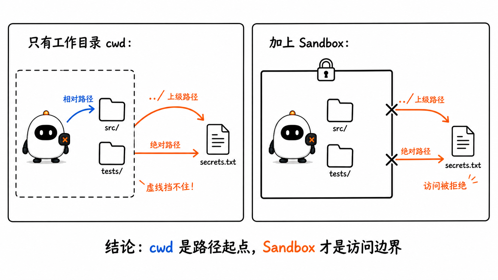

# 执行环境：工具的动作到底在哪里发生

假设一次测试输出了“开始检查”，然后以状态码 7 退出。界面可能已经显示了这行文字，模型又该从哪里知道命令失败了？顺着内置 `bash` 工具往下走，可以看到三种各自有寿命的数据：模型写出的参数、操作系统交还的字节流、Pi 最终提交的工具结果。



## 1. 从参数对象到子进程

下面是一份教学输入，命令仅打印文字并返回非零状态。

```json
{"command":"printf 'checking'; exit 7","timeout":10}
```

模型提供的是字符串和秒数。`createBashTool(cwd)` 创建定义并用 `wrapToolDefinition` 把它接进 Agent。收到调用后，`execute` 选取会话的工作目录，准备命令和环境，如果设置了 `commandPrefix` 或 `spawnHook`，实际执行的值还会变。最终执行位置由 `operations` 决定。默认实现先检查工作目录存在、取消信号尚未触发，再启动所配置的 Shell。[工具装配和执行入口](https://github.com/earendil-works/pi/blob/9823079ad98d39f3587286c8d9f29556dfb3687b/packages/coding-agent/src/core/tools/bash.ts#L242)

源码摘录：[packages/coding-agent/src/core/tools/bash.ts](https://github.com/earendil-works/pi/blob/9823079ad98d39f3587286c8d9f29556dfb3687b/packages/coding-agent/src/core/tools/bash.ts#L110)

```ts
const commandFromStdin = shellConfig.commandTransport === "stdin";
const child = spawn(shellConfig.shell, commandFromStdin ? shellConfig.args : [...shellConfig.args, command], {
	cwd,
	detached: process.platform !== "win32",
	env: env ?? getShellEnv(),
	stdio: [commandFromStdin ? "pipe" : "ignore", "pipe", "pipe"],
	windowsHide: true,
});
if (commandFromStdin) {
	child.stdin?.on("error", () => {});
	child.stdin?.end(command);
}
if (child.pid) trackDetachedChildPid(child.pid);
```

这里的 `stdio` 指定三个通道。标准输入有两种用法，取决于 Shell 接收命令的方式。标准输出与标准错误分别接入管道，然后都把数据块交给同一个 `onData`。默认呈现会将两种输出汇集在一起，单看一行字符已经不能判断它最初走的是哪个通道。Shell 按自身语法解释 `;` 和 `exit`，所以这一条工具调用可以包含多个动作。[流接入和取消处理](https://github.com/earendil-works/pi/blob/9823079ad98d39f3587286c8d9f29556dfb3687b/packages/coding-agent/src/core/tools/bash.ts#L125)

### 工具定义与执行后端怎样分工

从 JS 调用者的角度看，工具本身更像一个适配器。外侧协议要求它为这次调用返回可展示文本、供程序读取的结果和错误标记。内侧协议只要求后端执行命令、不断回调字节，最后交出退出码。沿变量看，命令刚进入工具时只有 `command` 和可选 `timeout`。工具挑选工作目录、合并前缀和环境，得到 `spawnContext`，然后调用 `ops.exec`。从这一行起，后端管理进程生命周期，上层仍持有输出累积器以及渲染进展的回调。[上下文的构造](https://github.com/earendil-works/pi/blob/9823079ad98d39f3587286c8d9f29556dfb3687b/packages/coding-agent/src/core/tools/bash.ts#L185) · [后端调用](https://github.com/earendil-works/pi/blob/9823079ad98d39f3587286c8d9f29556dfb3687b/packages/coding-agent/src/core/tools/bash.ts#L360)

上游测试中有一种不用 Shell 就能推导工具返回值的方法。替身后端忽略命令字符串，直接把预备好的字节传给 `onData`，并返回 `{exitCode: 0}`。上层照常拼装工具结果。这种替换可以精确控制哪些字符在哪个字节处断开，绕过真正子进程管道不稳定的切块时机。反过来，如果想验证取消能否停止后代，或改了工作目录是否影响相对路径，则要观察实际后端。一次调用里出现两个接口，恰好把两类问题分开。[测试中替换 operations](https://github.com/earendil-works/pi/blob/9823079ad98d39f3587286c8d9f29556dfb3687b/packages/coding-agent/test/tools.test.ts#L794)

环境也在交接点发生变化。`resolveSpawnContext` 先取 Shell 环境的副本，清除若干旧会话字段，再按设置和当前扩展上下文补入本轮的会话、模型等信息。如果启用 `spawnHook`，钩子的返回值才是后端收到的上下文。因此排查“终端里能跑，在 Agent 里却找不到配置”，应比较最终命令、工作目录和传给后端的环境。只看模型最初生成的 JSON，观察不到这一段变化。

## 2. 输出逐渐到达，结果在退出后形成

| 时刻 | 新获得的信息 | 由谁保存或消费 |
| --- | --- | --- |
| 开始执行 | 调用已开始，还没有输出 | 若提供 `onUpdate`，先发送空内容 |
| 收到字节 | 此例得到 `checking` | `OutputAccumulator.append` 累积输出，按节流规则向界面发快照 |
| Shell 结束 | 退出码为 7，管道可能还有数据 | `waitForChildProcess` 处理进程与管道的收尾 |
| 生成结果 | 文本、结构化输出、错误标记 | `finishOutput` 完成快照，工具据退出码构造返回值 |

更新是当前快照。将每个快照直接拼接成最终文本会重复之前收到的字符。实际的完成操作先关闭数据入口 `acceptingOutput`，停止计时器，发出待刷新的更新，再取最终快照并关闭临时文件。这个顺序给“最后一批数据”和“结算”画出明确边界。[累积、节流与完成快照](https://github.com/earendil-works/pi/blob/9823079ad98d39f3587286c8d9f29556dfb3687b/packages/coding-agent/src/core/tools/bash.ts#L281)

源码摘录：[packages/coding-agent/src/core/tools/bash.ts](https://github.com/earendil-works/pi/blob/9823079ad98d39f3587286c8d9f29556dfb3687b/packages/coding-agent/src/core/tools/bash.ts#L399)

```ts
if (exitCode !== 0) {
	return {
		content: [{ type: "text", text: appendStatus(outputText, `Command exited with code ${exitCode}`) }],
		details,
		structuredContent,
		isError: true,
	};
}
return { content: [{ type: "text", text: outputText }], details, structuredContent };
```

沿上例推演，模型可见的 `content` 包含 `checking` 和 `Command exited with code 7`。调用方可以直接从 `structuredContent.exit_code` 读取 7，`isError` 为真。用时取决于实际运行。退出码 0 走代码块的最后一行。超时、取消则从异常分支带着已有输出离开，分别追加超时原因或 `Command aborted`。这解释了为什么业务层要检查状态字段，而不能只搜索输出中有没有“error”。[异常和结构化结果](https://github.com/earendil-works/pi/blob/9823079ad98d39f3587286c8d9f29556dfb3687b/packages/coding-agent/src/core/tools/bash.ts#L360)

### 管道递进来的首先是字节

操作系统没有承诺一次 data 事件刚好等于一行文字，甚至没有承诺它包含一个完整字符。欧元符号 `€` 的 UTF-8 编码是三个字节 `E2 82 AC`。假如第一个块只有 `E2`，第二个块才送来 `82 AC 0A`，独立解码第一个块就会把它当成坏字符。在末尾补上第二段字符串也无法找回原字符。这正是实现里同时记录原始字节数和已解码字节数的原因。[累积器的字段和解码器](https://github.com/earendil-works/pi/blob/9823079ad98d39f3587286c8d9f29556dfb3687b/packages/coding-agent/src/core/tools/output-accumulator.ts#L35)

源码摘录：[packages/coding-agent/src/core/tools/output-accumulator.ts](https://github.com/earendil-works/pi/blob/9823079ad98d39f3587286c8d9f29556dfb3687b/packages/coding-agent/src/core/tools/output-accumulator.ts#L64)

```ts
append(data: Buffer): void {
	if (this.finished) {
		throw new Error("Cannot append to a finished output accumulator");
	}

	this.totalRawBytes += data.length;
	this.appendDecodedText(this.decoder.decode(data, { stream: true }));

	if (this.tempFileStream || this.shouldUseTempFile()) {
		this.ensureTempFile();
		this.tempFileStream?.write(data);
	} else if (data.length > 0) {
		this.rawChunks.push(data);
	}
}
```

每次 `append` 先将收到的块长度加进 `totalRawBytes`，再用同一个解码器以流式模式处理。尚不足以形成字符的末尾字节会暂存在解码器内部，这时原始计数增加，屏幕内容还没有变化。调用 `finish` 时再做一次无参数解码，取出最后可解释的内容。已经完成的累积器会拒绝再追加，避免最终结果与随后送到界面的更新矛盾。收到一个空文本快照，也不能据此推出 Shell 没有产生任何字节。

### 为什么保留两种缓冲

完整输出较小时，累积器保留原始块，同时在内存中维护用于界面的文本尾部。达到临时文件条件后，它先创建一个新的独占文件，把此前缓存的所有原始块原样写入，清空这些块，再把当前及后续块写入文件。因此第一次越界之前的数据也会进入完整日志。原始数据流负责完整保存，解码后的文本尾部负责频繁渲染。界面每次更新只需对尾部生成快照，无须反复从磁盘读取整份日志。[临时文件切换条件](https://github.com/earendil-works/pi/blob/9823079ad98d39f3587286c8d9f29556dfb3687b/packages/coding-agent/src/core/tools/output-accumulator.ts#L239) · [输出文件的创建方式](https://github.com/earendil-works/pi/blob/9823079ad98d39f3587286c8d9f29556dfb3687b/packages/coding-agent/src/utils/output-files.ts)

这个尾部也有窗口。积累的尾部字节数超过内部阈值后，程序一次裁回较短的范围，再继续追加，避免每个小数据块都触发复制。裁切位置落在多字节字符中时，会向后移动到有效边界。如果留下的开头只是某一行的后半段，而且后面还有完整的行，快照从最近的完整行开始。与此同时，全局字节数、换行数和最后一行大小一直累计。正因为局部尾部和全局计数各自保留，界面才能只显示一段，却准确标出它在原日志中的行号。[尾部裁切与行边界](https://github.com/earendil-works/pi/blob/9823079ad98d39f3587286c8d9f29556dfb3687b/packages/coding-agent/src/core/tools/output-accumulator.ts#L182)

## 3. 为什么同一条命令会有三种长度

测试日志可能有几万行。Pi 会为模型展示末尾最多 2,000 行、50 KiB，先达到的限制生效。日志尾部通常包含报错位置和最终的测试统计。截断时文本还会写明保留了哪一部分以及完整输出的临时文件路径。程序化调用读取的 `structuredContent.output` 有自己独立的 1 MiB 上限。完整文件、程序化输出与模型摘要的体积因此可以不同。[截断常量](https://github.com/earendil-works/pi/blob/9823079ad98d39f3587286c8d9f29556dfb3687b/packages/coding-agent/src/core/tools/truncate.ts#L11) · [结构化输出上限](https://github.com/earendil-works/pi/blob/9823079ad98d39f3587286c8d9f29556dfb3687b/packages/coding-agent/src/core/tools/bash.ts#L22)

例如运行产生 2,500 行很短的 ASCII 日志，且按字节未达到 50 KiB。模型看到的只是尾部和截断提示，程序化输出仍可能容纳全部字节。反过来，若只有一行极长的输出，限制先由字节数触发，提示可以描述最后一行保留了多少字节。行数本身无法预测结果。[截断说明的三个分支](https://github.com/earendil-works/pi/blob/9823079ad98d39f3587286c8d9f29556dfb3687b/packages/coding-agent/src/core/tools/bash.ts#L337)

### 用十四字节观察三个结果

课程附了一份只运行 Pi 输出累积器的程序。它把展示额度缩到两行、十二字节，将 `HEAD\n€\nTAIL\n` 切成四块喂给真正的 `OutputAccumulator`。在课程仓库根目录执行下面两条命令，最后的参数是旁边的 Pi 源码目录。这个实验使用 Node 22.19 或更高版本，直接加载上游的 TypeScript 文件。[实验程序](../examples/shell-output/observe.mjs)

```bash
git clone https://github.com/earendil-works/pi.git ../pi
node examples/shell-output/observe.mjs ../pi
```

| 刚收到的块 | 总原始字节 | 已解码总字节 | 已知行数 | 输出到哪儿 |
| --- | ---: | ---: | ---: | --- |
| `HEAD` 加换行 | 5 | 5 | 1 | 暂存在内存 |
| `€` 的第一个字节 | 6 | 5 | 1 | 解码器保留半个字符 |
| 剩余两个字节和换行 | 9 | 9 | 2 | 界面看到两行 |
| `TAIL` 加换行 | 14 | 14 | 3 | 完整字节转入临时文件，界面保留尾部 |

第四次更新的快照文本是 `€\nTAIL`，磁盘读回的文本是 `HEAD\n€\nTAIL\n`。前者从尾部挑了两行再用换行连接，后者保留原始换行。算一遍模型侧的预算，尾行需要四个 ASCII 字节，再往前放一个换行和占三个字节的欧元符号，总共八字节。字节额度尚有空间，但两行的限额已经用完，开头的 HEAD 无法再放入。

同一程序随后用十字节限额向累积器请求程序化结果。磁盘文件共有十四字节，算法从头读取五字节、从尾部读取五字节，中间四字节用遗漏标记表示。这个结果能同时呈现头和尾，与展示快照只保留尾部有不同用途。如果切口落在字符中间，代码会处理头部未完成的序列，并跳过尾部开头的 UTF-8 续字节。实验末尾还真实读取了文件，断言完整内容并清理临时文件。[程序化读取的头尾策略](https://github.com/earendil-works/pi/blob/9823079ad98d39f3587286c8d9f29556dfb3687b/packages/coding-agent/src/core/tools/output-accumulator.ts#L144)

从十四字节放大到实际默认设置，容易犯的错误是把最后一个换行读成多出一行。累积器把已遇到换行的行数，与仍有内容但还没有换行的末行分别计数。测试向后端连续写入四千条以换行结尾的输出，断言总行数为四千，保留的是第二千零一行至第四千行。末尾换行之后的空字符串不会被算作第四千零一行。[四千行用例](https://github.com/earendil-works/pi/blob/9823079ad98d39f3587286c8d9f29556dfb3687b/packages/coding-agent/test/tools.test.ts#L772)

## 4. 一个曾经丢日志的时序

Shell 退出与最后一个写入者关闭管道可能相隔一段时间。举例说，一个命令派生了继承 stdout 的进程，父进程先退出，后者仍能写日志。一直等管道关闭可能卡住，在父进程退出时马上停止读取又可能丢数据。Pi 的等待逻辑在退出后观察管道活动，每次再收到数据就重置空闲计时器。[进程等待实现](https://github.com/earendil-works/pi/blob/9823079ad98d39f3587286c8d9f29556dfb3687b/packages/coding-agent/src/utils/child-process.ts#L41)

回归测试使用虚拟时钟精确构造了这条时间线：

| 虚拟时刻 | 测试动作 | 可推断的状态 |
| --- | --- | --- |
| 0 ms | 写 `HEAD`，发出 `exit(0)` | 已知道退出码，等待仍在进行 |
| 50 至 300 ms | 每隔 50 ms 再写一个 `TICK` | 连续六次延长空闲等待 |
| 399 ms | 最后一次写入后 99 ms | 断言等待尚未结束 |
| 400 ms | 再推进 1 ms | 返回 0，输出同时包含 `HEAD` 和 `TICK6` |

“100 ms”在这里表示最近一次活动后的空闲窗口。如果从退出起固定等待 100 ms，第六个数据块会消失。这种测试同时检查返回时机和保留内容，能捕捉只比对退出码会遗漏的错误。[回归用例与断言](https://github.com/earendil-works/pi/blob/9823079ad98d39f3587286c8d9f29556dfb3687b/packages/coding-agent/test/suite/regressions/5303-bash-output-truncation.test.ts#L39)

## 5. 工作目录、取消与执行环境

`cwd` 为相对路径提供起点。默认执行器以当前操作系统用户的权限运行，能够访问哪些绝对路径、网络和凭据由进程环境决定。`timeout` 会触发杀进程树，调用者发出取消信号也会走杀进程树的路径。已经写入的文件会保留，事务回滚需要应用自己实现。[默认执行器](https://github.com/earendil-works/pi/blob/9823079ad98d39f3587286c8d9f29556dfb3687b/packages/coding-agent/src/core/tools/bash.ts#L96)

要把命令放到远端或容器里，应沿 `BashOperations.exec(command, cwd, { onData, signal, timeout, env })` 这个接口替换执行后端。适配器需要把远端输出送回 `onData`，将远端状态变成本地退出码，并把取消传到真正运行命令的一端。只替换 Bash 只会改变走该接口的动作，文件工具和扩展的执行位置还要分别检查。屏幕点击等 Computer Use 工具同样需要自己的执行器与权限边界。[可替换的操作接口](https://github.com/earendil-works/pi/blob/9823079ad98d39f3587286c8d9f29556dfb3687b/packages/coding-agent/src/core/tools/bash.ts#L70) · [Pi 的隔离部署说明](https://github.com/earendil-works/pi/blob/9823079ad98d39f3587286c8d9f29556dfb3687b/packages/coding-agent/docs/security.md)

### 谁决定最终的取消原因

计时器和外部取消信号都可能在等待中触发，它们的共同职责是尽快停止执行。计时器还会设置 `timedOut`，取消监听从 `AbortSignal` 读状态。等待子进程返回以后，代码先检查 `signal.aborted`，然后才检查 `timedOut`。若两者都已经为真，异常走取消分支。一个仅拿到“子进程被终止”结果的调用者无法区分这两种原因，所以工具在等待之前保存触发原因，最后把它和已收集的输出一起返回。无论在哪条路径退出，都会清理计时器、子进程跟踪项和取消监听。[触发、等待与收尾](https://github.com/earendil-works/pi/blob/9823079ad98d39f3587286c8d9f29556dfb3687b/packages/coding-agent/src/core/tools/bash.ts#L123)

Unix 上的进程组和单个 PID 也有区别。只杀 Shell，命令派生的子进程可能继续运行。默认后端会尝试终止整个进程组，失败时再尝试单进程。在 macOS 上还先尝试暂停组，缩小先杀死正在执行的命令、却让等待它的 Shell 有机会启动下一条指令的时间窗。Windows 路径则将子树交给系统的 taskkill 处理。这是对剩余进程的清理，之前已经写入的文件仍须按业务状态处理。[按操作系统处理进程树](https://github.com/earendil-works/pi/blob/9823079ad98d39f3587286c8d9f29556dfb3687b/packages/coding-agent/src/utils/shell.ts#L220)

在已安装依赖的 Pi 仓库中运行下面的定向测试。第一条用虚拟时间检查一百毫秒的空闲规则，第二条令后端按字节分割欧元符号，并断言最终显示的仍是单个字符。和十四字节实验一起看，前者验证字节何时收齐，后者验证收齐后怎样恢复文本。

```bash
cd packages/coding-agent
node ../../node_modules/vitest/dist/cli.js run test/suite/regressions/5303-bash-output-truncation.test.ts
node ../../node_modules/vitest/dist/cli.js run test/tools.test.ts -t 'should decode UTF-8 characters split across output chunks'
```

> **先预测**　一个 UTF-8 字符的三个字节被分在两次输出里。能把每块独立转成字符串再拼接吗？
>
> **核对推导**　这样可能丢掉字符并产生替换符。流式解码器留住上块末尾未完成的字节，等下块补齐后才输出字符。输出块是传输单位，字符和整行并不受这个边界约束。

[继续阅读：Durable：提交、任务状态与崩溃后的继续执行](16-durable-execution-and-human-in-the-loop.md)

[返回课程路线](00-source-learning-path.md) · [查看源码地图](../references/source-map.md)
