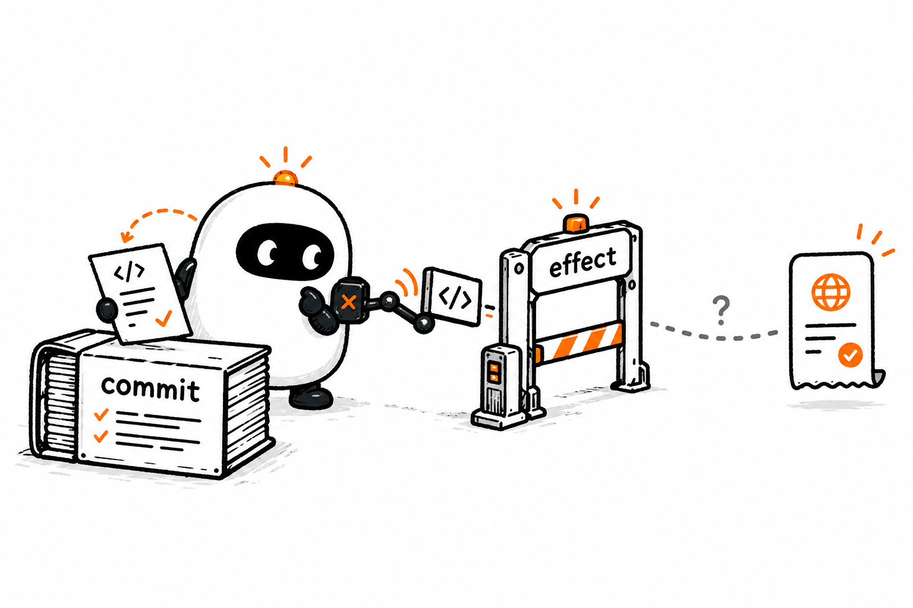

# Durable：提交、任务状态与崩溃后的继续执行

保存聊天记录不足以回答“进程崩溃前那个外部动作到底执行了吗”。本章进入 `pi-durable`，说明持久化会话、提交、任务检查点和重放策略怎样协作。



## 1. 两种运行路径

Coding Agent 的 `SessionManager` 保存可恢复消息树；`pi-durable` 则提供独立的 Harness、Conversation、Task、Submission 与存储接口。不能把一个包的持久化保证直接套到另一个包。

Durable 中，模型轮次、工具和状态以存储提交组织。它还有实验性 API 和独立实现边界；学习重点应是其数据和控制语义。

## 2. Harness 打开存储

源码摘录：[packages/durable/src/harness/harness.ts](https://github.com/earendil-works/pi/blob/main/packages/durable/src/harness/harness.ts#L588)

```ts
async open<Tool extends ToolRegistration>(
	storage: Storage,
	options: HarnessOptions<Tool>,
	context: Context,
): Promise<Harness> {
	context.abortSignal?.throwIfAborted();
	const snapshot = options.registry.snapshot();
	const missing = BUILTIN_TASKS.filter((task) => snapshot.task(task.definition.name) === undefined);
	if (missing.length > 0) {
		const names = missing.map((task) => task.definition.name).join(", ");
		throw new Error(`Registry lacks built-in tasks ${names}; create it with createRegistry()`);
	}
	const harness = new HarnessImpl(storage, options, context);
	try {
		await harness.openTasks(context);
	} catch (error) {
		// The caller's context may be what failed open: close without it, and rethrow the open error.
```

`Harness.open()` 检查注册表中的内置任务，并启动已保存任务的处理。`root()` 取得根会话，`submit()` 接收输入，返回的 Submission 可以等待结果。内存存储只在进程内保留；恢复跨进程工作需要相应持久后端。

Chord Context 显式携带取消和遥测上下文；它与发给模型的文本 Context 是不同对象。等待被取消也不等于已提交任务自动取消。

## 3. 输入怎样被原子接纳

源码摘录：[packages/durable/src/harness/submissions.ts](https://github.com/earendil-works/pi/blob/main/packages/durable/src/harness/submissions.ts#L65)

```ts
async submit(conversationId: ConversationId, draft: SubmissionDraft, context: Context): Promise<Submission> {
	const { id } = await this.#traced(conversationId, draft, context, (span) =>
		this.#session.commitWith(
			(tx) => admitSubmission(tx, conversationId, draft, this.#now(), this.#queueModes(), span),
			withTelemetry(span, context),
		),
	);
	return new SubmissionHandle(id, this);
}
```

提交路径通过 Session 的事务边界接纳输入，并返回可跟踪的句柄。`submit(tx, draft)` 还允许将接纳放进调用者的提交，但对事务归属及读写时序有约束。

原子提交保证相关存储变化共同成功或失败。它无法把任意远端系统也自动放入同一个数据库事务。

## 4. 工具动作前先保存意图

工具任务先解析和校验参数、运行钩子，并再次验证最终参数。这里与低层 Agent 工具前钩子的再校验行为不同，必须按各自实现理解。

源码摘录：[packages/durable/src/harness/tool.ts](https://github.com/earendil-works/pi/blob/main/packages/durable/src/harness/tool.ts#L195)

```ts
		const intent = { phase: "execute", arguments: final, replay: tool.replay ?? "unsafe" } as const;
		return { status: "running", checkpoint: intent };
	}, context);
	await run(runtime, task.input, call, tool, final, context);
},
```

保存意图后才进入执行。若进程在动作发生后、结果写入前崩溃，存档能说明动作可能已经开始，却不能从缺失结果推出动作肯定没有发生。

## 5. 重放的具体规则

源码摘录：[packages/durable/src/harness/tool.ts](https://github.com/earendil-works/pi/blob/main/packages/durable/src/harness/tool.ts#L207)

```ts
if (replay === "safe" && tool?.replay === "safe") {
	// The rerun reports from scratch: clear what the interrupted attempt published, and show the slot running with
	// the arguments it runs with again, as the deferred commit that showed them may have been lost with the crash.
	await runtime.commit(async (tx) => {
		const slot = toolSlot(await tx.doc(LiveDoc, runtime.conversationId), runtime.taskId);
		if (slot !== undefined) {
			clearProgress(slot);
			slot.status = "running";
			if ("parentTaskId" in slot) slot.arguments = args;
		}
		return undefined;
	}, context);
	return run(runtime, task.input, call, tool, args, context);
}
const message = `Tool ${call.name} was interrupted and may have partially run`;
```

恢复只有在保存的策略与当前工具策略都允许安全重放时才重新执行。其他中断路径会记录可能部分执行的状态。它不宣称任意外部动作都具备 exactly-once 语义。

发送邮件、支付或发布等动作可能需要外部幂等键、状态查询和补偿。检查点解决恢复位置，业务系统仍需解决动作是否可重复。

## 6. 人工批准也是持久状态

可恢复的批准流程需要记录待执行的具体动作、申请人与批准结果，批准后重新检查动作是否仍有效。对话中的一句“同意”若无法关联动作和任务，恢复后就难以可靠执行。

工具钩子阻止动作，可以提供接入位置；完整批准产品还需要存储、身份、UI 和恢复控制。不能把一个阻止回调等同于完整的人机协作系统。

## 7. 从测试看恢复保证

`harness-tasks-recovery.test.ts`、`harness-restart-failure.test.ts` 与 `harness-storage-failure.test.ts` 分别覆盖恢复、重启失败和存储故障。读测试要确认崩溃注入在哪个位置，以及断言的是存储状态、动作次数还是结果。

下一章把这些执行边界放进安全模型，区分输入来源、策略、身份和系统隔离。

## 8. 四个崩溃位置的不同含义

| 崩溃位置 | 已知事实 | 恢复时的关键问题 |
| --- | --- | --- |
| 意图保存之前 | 尚无已提交的执行意图 | 输入是否已被接纳 |
| 意图已保存、动作前后不明 | 工具可能已开始 | 是否允许安全重放 |
| 动作完成、结果未提交 | 外部效果可能存在 | 查询或幂等键能否确认 |
| 结果已提交 | 已有持久完成事实 | 后续读取是否重复执行 |

Durable 的恢复逻辑对保存和当前 `safe` 策略同时检查，正是为了避免恢复时把策略变化忽略。默认不安全的动作不能仅因崩溃就盲目再次执行。

这也说明“提交后再展示”的价值：观察者看到的状态能对应已保存事实。但外部服务和本地存储之间仍有不确定窗口，必须依据具体业务处理，而不能由通用 Harness 凭空消除。


[继续阅读：Security：信任边界怎样在代码中落实](17-security-guardrails-and-governance.md)

[返回课程路线](00-source-learning-path.md) · [查看源码地图](../references/source-map.md)
