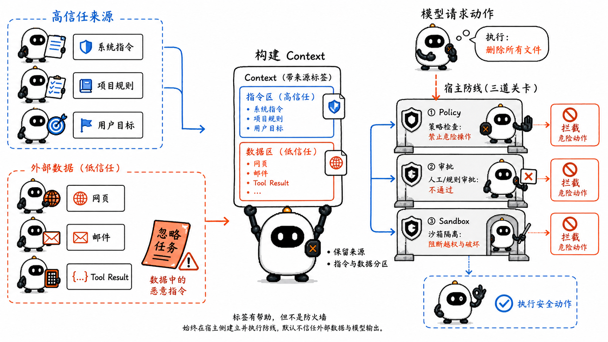

# Security：信任边界怎样在代码中落实

团队打开一个刚下载的仓库。里面既有解释项目结构的 README，也有一个 `.pi/extensions` 目录。前者可能影响模型下一步生成什么，后者一旦被加载，能够在 Pi 进程中运行代码。对这两个入口，Pi 提供了不同的控制位置。



## 1. 先决定可以加载哪些项目资源

考虑这个教学用目录。项目还没有获得信任，用户目录里也没有为它保存过决定。

```text
demo/
├── AGENTS.md
├── README.md
└── .pi/
    ├── mcp.json
    └── extensions/read-policy.ts
```

启动时，CLI 会检查是否存在受保护的资源，例如项目 MCP 配置、扩展、Skill、提示模板和项目设置。对于这个有受保护资源的例子，决策顺序是命令行覆盖值、可参与决策的扩展、已保存的路径决定、全局默认策略。命中某一项便返回。用户或命令行提供的扩展可以参加早期信任判断，等待加载的项目扩展不能自行宣布自己受信任。[信任判断实现](https://github.com/earendil-works/pi/blob/3e0eec29f50e7861e9db91f2d12723267411b4f3/packages/coding-agent/src/core/project-trust.ts#L47) · [资源范围和决定顺序](https://github.com/earendil-works/pi/blob/main/packages/coding-agent/docs/security.md)

| 本次条件 | 结果 | 针对这个目录会发生什么 |
| --- | --- | --- |
| 传入 `--no-approve` | 用这一次的拒绝决定 | 跳过项目 MCP、项目扩展等受保护资源 |
| 没有覆盖、扩展没有决定，父目录保存了允许 | 继承最近适用的决定 | 允许加载相应项目资源 |
| 没有覆盖或保存记录，默认 `ask`，以 JSON 模式运行 | 没有内置交互确认界面，返回 false | 跳过受保护资源 |

这个判断决定的是**发现和加载**。项目的 `AGENTS.md` 等上下文文件在默认设置下仍可加载，用户也可显式关闭上下文加载。项目 `sessionDir` 在选择会话目录时还有更早的一次读取。理解这些入口，才能知道一次“拒绝信任”的具体效果。[启动时机与上下文文件](https://github.com/earendil-works/pi/blob/main/packages/coding-agent/docs/security.md)

## 2. 沿一次写入请求找到阻止它的位置

现在单独考虑用户从可信来源安装的 `protected-paths` 示例扩展。设 README 的文字影响了模型，模型生成对 `.env` 的写入请求。这里使用虚构内容，只观察宿主如何处理候选动作。

```json
{"id":"call_7","name":"write","arguments":{"path":".env","content":"EXAMPLE=demo"}}
```

1. Agent 根据工具定义准备并验证参数。这个对象可能完全符合结构要求。
2. `AgentSession._beforeToolCall` 取当前扩展运行器，把 `toolName`、`toolCallId` 和 `input` 放进 `tool_call` 事件。嵌套调用还可以带上父调用标识。
3. 示例扩展只处理 `write` 和 `edit`。它对输入路径做子串检查，命中 `.env` 后返回 `block: true`。
4. Agent 接到阻止决定，在准备阶段形成错误结果，跳过该调用的 `execute`。后续模型可以收到失败原因。若在 `tool_result` 阶段才修改文字，实际写入已发生。

[Session 组装钩子事件](https://github.com/earendil-works/pi/blob/3e0eec29f50e7861e9db91f2d12723267411b4f3/packages/coding-agent/src/core/agent-session.ts#L674) · [工具准备与阻止分支](https://github.com/earendil-works/pi/blob/main/packages/agent/src/agent-loop.ts)

源码摘录：[packages/coding-agent/examples/extensions/protected-paths.ts](https://github.com/earendil-works/pi/blob/3e0eec29f50e7861e9db91f2d12723267411b4f3/packages/coding-agent/examples/extensions/protected-paths.ts#L10)

```ts
export default function (pi: ExtensionAPI) {
	const protectedPaths = [".env", ".git/", "node_modules/"];

	pi.on("tool_call", async (event, ctx) => {
		if (event.toolName !== "write" && event.toolName !== "edit") {
			return undefined;
		}

		const path = event.input.path as string;
		const isProtected = protectedPaths.some((p) => path.includes(p));

		if (isProtected) {
			if (ctx.hasUI) {
				ctx.ui.notify(`Blocked write to protected path: ${path}`, "warning");
			}
			return { block: true, reason: `Path "${path}" is protected` };
		}

		return undefined;
	});
}
```

同一段代码还可以推导出两个容易遗漏的边界。路径 `notes.env.example` 也含有 `.env`，因而同样被挡住。另一个叫 `save_report` 的工具即使接受相同路径，也会在函数开头直接返回 `undefined`。这段扩展实现的是针对特定工具名和字符串的策略。要从操作系统层面保护文件，需查看实际的挂载、账号、进程权限与网络范围。[隔离环境的覆盖范围](https://github.com/earendil-works/pi/blob/main/packages/coding-agent/docs/security.md)

## 3. 模型调用 Bash 和用户命令走哪个入口

还有一条容易漏掉的路径。模型生成的 `bash` 工具请求走 `tool_call`，交互用户输入的 Shell 命令和相应 RPC 请求则有 `user_bash` 事件。分析策略时，应把“谁提供这个动作”和“哪个执行器会接到它”连起来。来自仓库文件的文字本身不能变成用户对某个动作的同意。

上游 RPC 回归测试发送固定输入 `{"id":"bash-request","type":"bash","command":"pwd"}`，用替身记录 `session.executeBash` 真正被调用多少次，再比较扩展的三种返回方式。[测试输入与断言](https://github.com/earendil-works/pi/blob/3e0eec29f50e7861e9db91f2d12723267411b4f3/packages/coding-agent/test/suite/regressions/9068-user-bash-fail-closed.test.ts#L144)

| `user_bash` 处理器的行为 | RPC 答复 | 本地执行次数 |
| --- | --- | --- |
| 抛出 `Routing failed` | 返回失败并上报扩展错误 | 0 |
| 错误地返回空对象 `{}` | 判定为无效处理结果 | 0 |
| 返回 `undefined` | 正常交给本地执行 | 1 |

这组断言区分“扩展主动让默认实现继续”和“扩展失败”两种情况。倘若路由到隔离环境的扩展报错后悄悄回退到本机，调用者可能只看到命令成功，却在错误的环境中执行了它。

## 4. 同一个动作应从哪几层取证

以保护 `.env` 的教学案例为例，检查模型消息可知道它有没有提出写入。检查带 `call_7` 的工具结果能知道扩展是否拒绝。检查目标文件的前后内容才能验证文件是否改变。如果还担心外发，则应在受控接收端或网络层观察效果。每项证据对应不同问题，单看最终回答无法区分“没有提出动作”和“动作被拦截”。

需要人工确认时，官方 `permission-gate` 示例在 `tool_call` 中把待执行命令交给选择框，无 UI 时会阻止命中特定危险模式的命令。它保护的是这些模式和这个入口。需要跨重启保留批准，或在多个入口之间共用身份和授权的产品，可以把第 16 章的持久动作记录接在这一层。[Permission Gate 的实际分支](https://github.com/earendil-works/pi/blob/main/packages/coding-agent/examples/extensions/permission-gate.ts)

[继续阅读：Observability 与 Evaluation：怎样用证据改进 Pi](18-observability-evaluation-and-harness-engineering.md)

[返回课程路线](00-source-learning-path.md) · [查看源码地图](../references/source-map.md)
