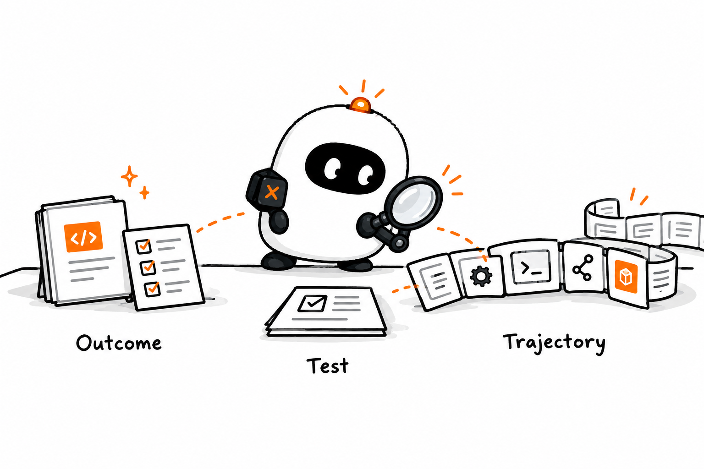

# Observability 与 Evaluation：怎样用证据改进 Pi

课程最后回到完整任务：模型看了什么、做了哪些动作、最终产物是否正确，以及改动是否带来改善。本章区分事件、Trace、Session 和 Eval，并进入 Pi 自己的评测实现。



## 1. 不同证据回答不同问题

| 证据 | 主要回答什么 |
| --- | --- |
| Event / Log | 某件事何时发生、带什么状态 |
| Metric | 延迟、错误率、Token 等聚合变化 |
| Trace / Span | 一次请求跨组件的因果与耗时 |
| Session / Trajectory | 模型消息、工具与后续行为 |
| Eval | 任务结果是否满足评价标准 |

UI 收到完整事件不保证任务正确；任务偶然成功也不能证明每一步可靠。评价需要把最终结果与执行轨迹分开检查。

## 2. Agent 与 Session 事件

低层 Agent 发出模型和工具事件；AgentSession 增加产品级的压缩、重试等状态；Extension Hook 还可能改变行为。观察回调与修改控制流的钩子不能当成同一种纯日志机制。

`packages/telemetry` 提供供应商中立的遥测契约和 Schema；Durable 有自己的类型化遥测。不能仅因代码存在 Span 接口，就假设本地 CLI 每条路径都自动生成完整 Trace 树。

## 3. 从任务到 Grader

一个评测需要任务输入、环境、运行次数、产物和 Grader（评分器）。确定性检查适合文件、测试与结构；人工或模型评审可判断开放式质量，但要注意偏差和标定。

代码修复可以检查测试和产物，再检查是否引入额外变化。模型最后一句“全部通过”本身不是测试结果。

## 4. Pi 的文档效果比较

`packages/evals` 包含两种文档环境 `without_docs` 与 `with_docs`，并用案例、模型与重复编号构造对照任务：

源码摘录：[packages/evals/src/plan.ts](https://github.com/earendil-works/pi/blob/main/packages/evals/src/plan.ts#L39)

```ts
export function createTaskPlan(
	cases: readonly DiscoveredEvalCase[],
	model: string,
	runsPerVariant: number,
): EvalTask[] {
	if (!model.includes("/") || model.startsWith("/") || model.endsWith("/")) {
		throw new TypeError("Model identity must contain a provider and model.");
	}
	if (!Number.isSafeInteger(runsPerVariant) || runsPerVariant < 1) {
		throw new TypeError("Runs per variant must be a positive integer.");
	}
	const tasks: EvalTask[] = [];
	for (const evalCase of cases) {
		for (let runNumber = 1; runNumber <= runsPerVariant; runNumber += 1) {
			const variants: DocumentationVariant[] =
				runNumber % 2 === 1 ? ["without_docs", "with_docs"] : ["with_docs", "without_docs"];
			for (const variant of variants) tasks.push({ ...evalCase, variant, model, runNumber });
		}
	}
	return tasks;
}
```

每个重复轮次改变两种环境的运行顺序以减少顺序偏差。报告需要正确配对相同任务、模型和重复编号；缺失或受阻的配对不能悄悄从总体中删除后继续报一个漂亮的提升值。

## 5. 隔离和信息泄漏

评测 Docker 路径为每个运行建立独立目录和环境，并限制被评 Agent 可读的评测材料。比较文档效果时，还要避免另一处依赖文档泄漏答案，破坏对照。

模型服务网络仍可能需要开放，因此仅有 Docker 不等于所有信息流都被证明隔离。可复现的环境、准确的任务队列和明确的边界比一个总分更能解释结果。

## 6. 单元测试与真实模型评测

单元测试可以用模拟流精确验证事件、停止、工具和恢复控制；真实模型评测检查任务效果、成本和随机性。两者互补。本课程中引用测试时，会区分阅读到的测试、实际执行通过的测试和需要真实服务的评测。

修改 Harness 后先运行相关控制流测试，再对同一任务集合比较结果、错误、延迟和花费。一个案例好转不能证明全局提升；预算或重试增加也可能掩盖基础问题。

## 7. 把整套 Pi 放回一张图

```text
CLI / SDK / 交互界面
   → 模型与认证、资源、设置、Session 的装配
   → Agent 的状态与运行生命周期
   → 消息转换和 Provider 请求
   → Agent Loop 选择工具、继续或结束
   → 工具准备、策略、执行与结果
   → 事件、会话保存和界面展示
   → 测试与评测提供反馈
```

MCP、Skill 和 Extension 从不同位置进入这张图；Durable 提供另一条以存储提交和任务恢复为中心的运行路径。能指出每个概念的代码位置和边界，才形成了既有全景又能进入实现的理解。

## 8. 一项 Harness 修改怎样进入比较

例如修改 Skill 描述后，希望模型更容易选择正确资源。先用单元测试确认加载与格式化没有破坏，再在相同任务集合中比较选择、产物、失败、延迟和费用。评测中的模型、环境和重复编号要能配对，才能区分内容变化和运行噪声。

如果提高成功率的同时增加了大量重试，需要把这项成本同时报告。若某组任务没有运行成功，不应从样本中消失。若 Grader 本身是模型，也要检查它是否偏好更长的回答或被输出内容诱导。

从这个角度，Harness Engineering 不是堆更多功能，而是根据可定位的失败改变上下文、工具、调度或验证，再用相同证据链判断改动是否有效。


[返回课程路线](00-source-learning-path.md) · [查看源码地图](../references/source-map.md)
