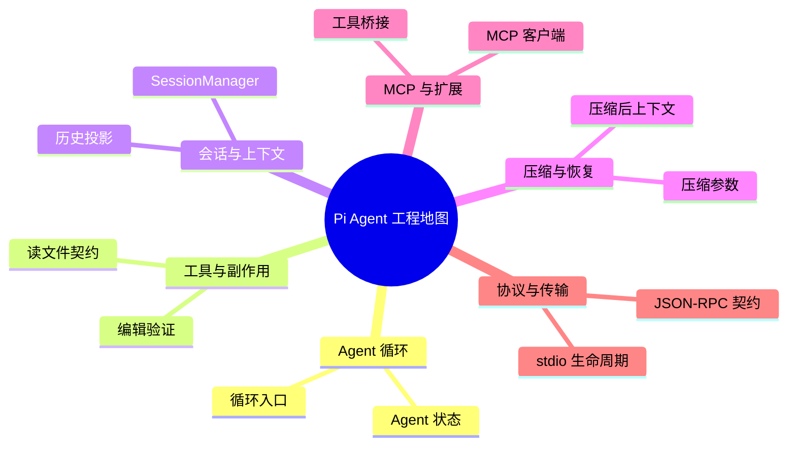

# Pi Agent 工程地图

版本：v1.5.0 · 固定提交：[f9a2636](https://github.com/earendil-works/pi/tree/f9a26365568127461c47a07a37dcb42c140a3ac5)。

主题分类与实现入口；不是完整调用图。每个实现入口都在构建时核对文件与行号。

## 源码入口

### Agent 循环

- [循环入口 · packages/agent/src/agent-loop.ts:47–79](https://github.com/earendil-works/pi/blob/f9a26365568127461c47a07a37dcb42c140a3ac5/packages/agent/src/agent-loop.ts#L47-L79)
- [Agent 状态 · packages/agent/src/agent.ts:194–230](https://github.com/earendil-works/pi/blob/f9a26365568127461c47a07a37dcb42c140a3ac5/packages/agent/src/agent.ts#L194-L230)

### 工具与副作用

- [读文件契约 · packages/coding-agent/src/core/tools/read.ts:85–98](https://github.com/earendil-works/pi/blob/f9a26365568127461c47a07a37dcb42c140a3ac5/packages/coding-agent/src/core/tools/read.ts#L85-L98)
- [编辑验证 · packages/coding-agent/src/core/tools/edit.ts:156–170](https://github.com/earendil-works/pi/blob/f9a26365568127461c47a07a37dcb42c140a3ac5/packages/coding-agent/src/core/tools/edit.ts#L156-L170)

### 会话与上下文

- [SessionManager · packages/coding-agent/src/core/session-manager.ts:988–1025](https://github.com/earendil-works/pi/blob/f9a26365568127461c47a07a37dcb42c140a3ac5/packages/coding-agent/src/core/session-manager.ts#L988-L1025)
- [历史投影 · packages/coding-agent/src/core/session-manager.ts:476–519](https://github.com/earendil-works/pi/blob/f9a26365568127461c47a07a37dcb42c140a3ac5/packages/coding-agent/src/core/session-manager.ts#L476-L519)

### 压缩与恢复

- [压缩参数 · packages/coding-agent/src/core/compaction/compaction.ts:267–270](https://github.com/earendil-works/pi/blob/f9a26365568127461c47a07a37dcb42c140a3ac5/packages/coding-agent/src/core/compaction/compaction.ts#L267-L270)
- [压缩后上下文 · packages/coding-agent/src/core/agent-session.ts:3010–3056](https://github.com/earendil-works/pi/blob/f9a26365568127461c47a07a37dcb42c140a3ac5/packages/coding-agent/src/core/agent-session.ts#L3010-L3056)

### MCP 与扩展

- [MCP 客户端 · packages/mcp/src/client.ts:536–575](https://github.com/earendil-works/pi/blob/f9a26365568127461c47a07a37dcb42c140a3ac5/packages/mcp/src/client.ts#L536-L575)
- [工具桥接 · packages/coding-agent/src/extensions/mcp/tools.ts:312–351](https://github.com/earendil-works/pi/blob/f9a26365568127461c47a07a37dcb42c140a3ac5/packages/coding-agent/src/extensions/mcp/tools.ts#L312-L351)

### 协议与传输

- [JSON-RPC 契约 · packages/mcp/src/protocol/jsonrpc.ts:1–35](https://github.com/earendil-works/pi/blob/f9a26365568127461c47a07a37dcb42c140a3ac5/packages/mcp/src/protocol/jsonrpc.ts#L1-L35)
- [stdio 生命周期 · packages/mcp/src/transports/stdio.ts:152–179](https://github.com/earendil-works/pi/blob/f9a26365568127461c47a07a37dcb42c140a3ac5/packages/mcp/src/transports/stdio.ts#L152-L179)
